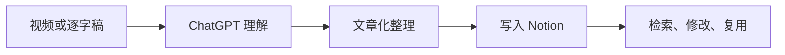
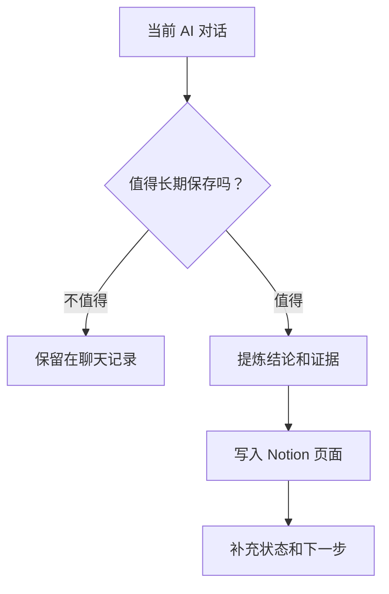

我最近试用了 ChatGPT 网页端的 Notion 连接器，发现它解决的不是“如何让 AI 写得更快”，而是一个更实际的问题：**怎样把一段有价值的 AI 工作，保存成以后还能找到、还能继续使用的成果。**

这次试用有两个入口。第一种是把外部材料交给 ChatGPT，让它整理成 Notion 文章；第二种是让 ChatGPT 把当前对话总结后写入 Notion。前者适合处理视频、网页和逐字稿，后者适合保存一次研究、一次方案讨论，或者一轮已经完成的工作。

我的感受是，Notion 的优势不只是它能保存页面，而是它已经和 ChatGPT 网页端的对话连接起来。AI 负责理解和整理，Notion 负责接住结果。两者之间少了一次复制、粘贴和重新排版，知识沉淀也更容易变成工作流的一部分。

## 一次真实试用：把 YouTube 逐字稿变成一篇文章

这次试用的材料来自 YouTube 视频[《Jev 让你的 Claude Code 强 10 倍？》](https://www.youtube.com/watch?v=_yFen1B8hdU)。视频讨论了 Jev 如何和 Claude Code 配合，内容包括模型选择、Skill 路由、数据分类，以及代码完成后的验证。视频页面右侧的工具可以显示逐字稿，我把它作为本次整理的原始材料。


**图 1：** 先保留视频和逐字稿，后面的笔记才有可回看的来源。

我在 ChatGPT 网页端提出的请求很直接：把这份逐字稿改写成一篇中文技术博客，并写入指定的 Notion 页面。提问里同时提供了 Notion 页面链接、YouTube 链接和逐字稿。这样做的重点，不是让 ChatGPT 自己猜视频内容，而是明确告诉它要处理什么材料、输出到哪里。


**图 2：** 一个合格的请求至少要说清楚原始材料、输出形式和目标页面。

这个细节很重要。只说“帮我总结这个视频”，得到的通常是一份摘要；加上“整理成文章并写入某个页面”，任务就变成了一个有交付位置的内容工作流。

## 关键变化：AI 不只给答案，也可以把结果放回知识库

在等待整理完成后，ChatGPT 会给出执行结果和内容范围说明。它告诉我，逐字稿已经被整理成一篇文章，并写入原来的 Notion 页面，同时列出了文章覆盖的几个主题。


**图 3：** 这里的价值不在于“写入成功”这四个字，而在于对话给出了一个可检查的交付摘要。

真正的结果要回到 Notion 页面里看。页面保留了文章标题、核心观点、来源说明、阅读提示和完整的章节结构。原始逐字稿里的口语表达被重新组织，重复内容被合并，读者可以按照主题阅读，而不必重新听完一遍视频。


**图 4：** Notion 页面把一次临时对话变成了一个可以继续阅读、修改和链接的内容对象。

这一步也暴露了一个边界：整理得像文章，不等于文章里的每个结论都已经被我验证。视频中的案例、效率数字和社区测试结果仍然应该标记来源。AI 可以帮我完成结构化表达，却不能替我把经验性说法变成独立验证过的事实。

## 这条工作流的价值，在于它有一个明确的出口

以前我把 ChatGPT 当成一个很强的临时工作台。问题、资料、推理和结果都集中在一条对话里。对话结束以后，真正有价值的部分却常常留在滚动记录中，之后很难再找到。

ChatGPT 和 Notion 连接之后，工作流多了一个明确出口：先在对话中完成理解和加工，再把经过整理的成果保存到知识库。它不是把所有聊天自动存档，而是让“值得保存的结果”更容易离开聊天窗口。



**图注：** 这条链路的重点不是“自动化”三个字，而是把一次性输入变成了可持续使用的页面。

同样的机制也适用于当前对话。比如，我和 ChatGPT 讨论完一个项目方案，可以要求它提炼出背景、决策、待办、风险和下一步，并写入 Notion 的项目页面。这样保存的不是整段聊天，而是这段聊天最终产生的工作成果。



**图注：** 保存的判断应该发生在对话结束时；知识库需要成果，不需要无差别收集所有过程噪音。

## 一个好 Prompt，不需要很长，但必须有交付标准

这次请求可以抽象成一个可复用的模板：

```text
请把下面的材料整理成一篇中文文章，并写入指定的 Notion 页面。

原始材料：视频链接、逐字稿或当前对话
文章用途：个人技术笔记，方便以后检索和复用
输出要求：
- 先给出文章标题和摘要
- 合并重复观点，按读者理解顺序重排内容
- 区分来源中的事实、作者观点和仍待验证的说法
- 保留原始视频或网页链接
- 在结尾列出可以继续行动的事项
目标位置：指定的 Notion 页面
```

这里有三个容易被忽略的约束。

第一，要告诉 AI 这不是一份即时摘要，而是一篇以后还要读的笔记。第二，要要求保留来源和验证边界，否则文章越流畅，读者越容易忘记哪些内容只是视频作者的经验。第三，要指定写入位置，否则“完成”可能只意味着在聊天里输出了一段文字。

## Notion 和 Obsidian 的差别，不是二选一

我仍然喜欢 Obsidian 的本地文件、Markdown 和可控性。它适合长期维护个人知识库，也适合把内容放进 Git，和代码、脚本及其他文本工具一起管理。它的优势是数据掌握在自己手里，结构可以由自己决定。

Notion 的优势则出现在另一端：它更像一个可视化的内容工作台，而且现在能和 ChatGPT 网页端直接衔接。对我来说，这意味着外部资料和 AI 对话有了一个更顺手的落点。尤其是研究、会议、项目讨论和网页阅读，整理完就能进入页面，而不是停留在一段聊天记录里。

| 场景 | 更适合的工具 | 原因 |
| --- | --- | --- |
| AI 整理网页、视频和对话 | Notion | 连接器让“理解—写入”更连贯 |
| 长期维护纯文本知识库 | Obsidian | 本地 Markdown，结构和数据更可控 |
| 项目协作、数据库和状态管理 | Notion | 页面、数据库和协作界面更集中 |
| 和代码仓库一起版本管理 | Obsidian | 文件可以直接进入 Git 工作流 |

所以，我不会把 Notion 看成 Obsidian 的替代品。更实际的做法是按成果类型分工：需要快速整理、协作和状态管理的内容先进入 Notion；需要长期维护、版本追踪和深度链接的内容，再沉淀到 Obsidian 或项目文件中。

## 让 AI 写入 Notion 之后，还要保留人的判断

这条工作流最容易制造一种错觉：页面已经生成，事情就已经完成。实际上，写入只是保存动作，不是验收动作。

我会在每篇由 AI 整理的笔记里保留三类信息：来源链接、整理日期和待验证内容。来源链接让未来的自己可以回到原文；整理日期帮助判断页面是否已经过时；待验证内容则提醒我，不要把视频中的实验结果直接当成普遍规律。

如果这篇笔记以后要变成博客、课程材料或工作规范，还需要再经过一次人工编辑。AI 适合完成转写、归纳、重排和初步结构化；作者仍然要决定标题是否准确、观点是否成立，以及哪些内容值得进入自己的长期知识体系。

## 结语：AI 的成果，应该有一个能被再次找到的地方

这次 ChatGPT + Notion 的试用让我看到，一个好用的连接器并不只是少做几次复制、粘贴。它改变的是成果的去向：AI 不再只负责生成一段当下有用的答案，也可以帮助我把答案放进一个以后能够检索、编辑和继续工作的地方。

对我来说，最值得保留的不是某一篇由逐字稿生成的文章，而是这条简单的判断：**当一段对话产生了可复用的结论，就应该让它离开聊天窗口，进入一个明确的知识位置。**

Notion 目前提供了一个很顺手的入口。Obsidian 仍然保留着本地化和可控性的优势。真正重要的不是选择哪一个工具，而是不要让 AI 的成果只存在于“当时聊过”的记忆里。
