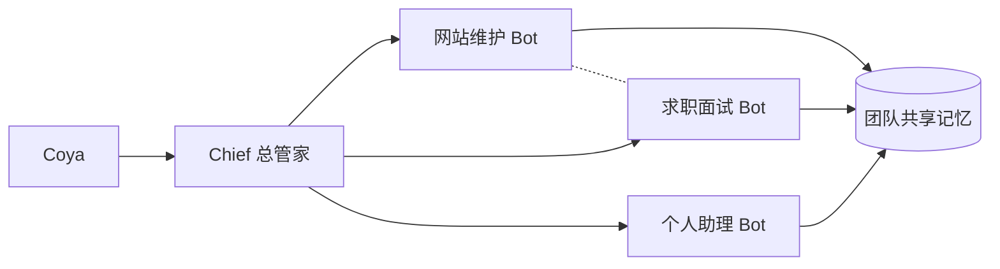

我最近同时推进五件事：维护个人网站、准备求职材料、维护自己的知识库、学英语，还有一堆临时冒出来的日常事务。

真正的成本不是事情多，而是切换。

早上在改网站的部署脚本，下午要换成简历口径写项目经历，晚上又回到英语语料。每一件事单独看都不难，难的是每次切回来，都要把背景重新讲一遍。

## 之前不是工具不够，是没有负责人

切换之前，我用的是多个 Hermes 模块，加 Alma、CodeX 混着用。

这些工具的能力是够的。Hermes 负责本地网关和飞书连接，Alma 负责知识榨取和批改，CodeX 负责代码任务。真要说缺什么，缺的不是功能。

缺的是**某件事的负责人**。

我每次开一个对话，都要重新说明这个项目用什么技术栈、这篇内容要按什么规范写、这份材料的口径是什么。工具越通用，我要复述的背景就越多。

后来我想明白一件事：我要的不是更强的助手，是**不用每次重新介绍自己的助手**。

## 专职 Bot 长什么样

这里的关键差别，不是「一个 AI 分成几个角色」。

而是**每一个都是独立的长期对话**。它们各有一份自己的记忆，各自在一个固定目录里工作，互不干扰。网站 Bot 记得部署流程和那几处仓库脏点，求职 Bot 记得项目经历的简历口径，两边不会串。

同一套结构，放在个人身上和放在一个门店身上，形状是一样的。

<Tabs label="两套分工对照">
  <Tab label="个人：四个专职 Bot">

| Bot | 负责什么 | 绑在哪 |
|---|---|---|
| Chief | 总管家，接我的请求并决定派给谁 | 团队层 |
| PersonalWebsite 维护 Bot | 个人网站的改内容、调样式、部署 | 网站仓库目录 |
| 求职面试 Bot | 走完求职全流程 | 求职材料目录 |
| Lucas 的个人助理 | 日常事务与长期陪伴 | 个人目录 |

这四个已经跑起来了。我这个网站 Bot 上挂着 68 个共享技能，从内容写作规范到浏览器验收都有。

  </Tab>
  <Tab label="门店：五个专职 Bot（推演）">

| Bot | 负责什么 | 产出 |
|---|---|---|
| 小红书运营 Bot | 图文工作流与生图提示词 | 图文笔记 |
| 抖音文案 Bot | 短视频口播文案 | 视频脚本 |
| 软文铺设 Bot | 渠道分发与软文改写 | 投放稿件 |
| 网站维护 Bot | 官网软文编写并上线部署 | 站点内容 |
| 门店销售数据 Bot | 回收各渠道到店数据 | 数据回流 |

这份配置是我推演出来的方案，**尚未搭建**。它的价值在于说明：同一套分工方式，个人和公司都用得上。

  </Tab>
</Tabs>

技能是团队共享的，记忆是各自的。这一点决定了 Bot 之间既要能协作，又不能互相污染。

**图 1：** 每个 Bot 是独立对话，各有自己的记忆与工作目录；共享记忆与互派任务是它们之间仅有的两条连线。

Bot 之间可以直接互派任务，也可以在同一个群里协作。共享记忆是分层级的：各人记各人的，只有确定要让全队知道的事，才写进团队记忆。

<Callout type="warning" title="显式交接也有代价">

Bot 之间不会自动同步。一个 Bot 不知道另一个刚做完什么，除非我明确派一句话过去，或者让它们互相发消息。

多 Bot 换来的清晰，代价就是**交接变成了必须我自己做的动作**。省掉的复述，变成了明确的分派。

</Callout>

## 真正换来的两件事

第一件是记忆不串味。

以前一个对话里什么都能聊，代价是什么都记不牢。现在网站 Bot 打开就知道自己在哪个分支、哪个文件有未提交的改动、部署要跑哪几步。这些不用我再说一遍。

第二件是**可以被同一个模板调度**。

一个 Bot 有了稳定职责之后，它就不再只是「聊天的对象」，而是「可以被派活的岗位」。这一点我有真实经验。

之前做车膜内容时，我配过 5 个平台写手 agent，分别对应小红书、公众号、知乎、什么值得买和汽车之家。每个 agent 内置一套平台调性和红线，做的是同一件事：把一份母版，改写成符合各自平台的稿子。

我把每套改写逻辑都显性化成一个「改写指南」：标题多长、要不要数字、对比表能不能动、常见问题写几条、合规怎么自查。每篇改写稿登记一个 CT 编号，再回写母版库的状态列。

谁的活干没干、卡在哪个环节，一眼看得见。

那次之后我确认了一件事：**只要职责是稳定的，分发就是可行的**。换到 Bot 上，逻辑完全一样。

## 从个人到公司：一个选题怎么分发

上面是个人场景。把同样的结构推演到一个门店的内容团队，会长这样。

假设一家汽车后市场门店要配五个专职 Bot，选题是「车膜为什么要贴车衣」。

<Timeline items={[
  { label: "第 1 步", title: "选题确定", description: "车膜为什么要贴车衣", tags: ["人工决策"] },
  { label: "第 2 步", title: "抖音 Bot 出视频文案", description: "按口播节奏改写，控制时长与钩子", tags: ["抖音文案 Bot"] },
  { label: "第 3 步", title: "小红书 Bot 出图文工作流", description: "配图提示词与图文排版一并产出", tags: ["小红书运营 Bot"] },
  { label: "第 4 步", title: "网站 Bot 写软文并上线", description: "成稿、检查、部署到官网", tags: ["网站维护 Bot"] },
  { label: "第 5 步", title: "软文 Bot 分发到各渠道", description: "按渠道调性改写后投放", tags: ["软文铺设 Bot"] },
  { label: "第 6 步", title: "数据 Bot 回收效果", description: "看哪个渠道真的带来到店", tags: ["销售数据 Bot"] },
  { label: "第 7 步", title: "决定下一轮选题", description: "数据回写，重新排序选题库", tags: ["人工决策"] }
]} />

同一个选题，抖音 Bot 出视频文案，小红书 Bot 出图文工作流和生图提示词，网站 Bot 写软文并上线部署，软文 Bot 分发到各个渠道。最后全部回流到数据 Bot，看哪个渠道真的带来了到店。

<Callout type="warning" title="这是推演，不是已上线的系统">

这五个 Bot 的配置方案和上面的七步分发流程，是我基于已有经验推演出来的蓝图，**尚未搭建、未经实测**。

已实测过的部分，是上文的四个个人 Bot，以及车膜内容线里「一份母版分发给 5 个平台写手」这类分发机制。两者不要混为一谈。

</Callout>

## 底座不是重点，重点是谁负责

这套结构的底座可以很朴素。

五个 Bot 完全可以共用飞书 CLI 作数据中台，也可以往上接本地的 Hermes，或者直接连门店的 CRM 系统。底座换成什么都行，因为它只解决「数据放在一起」。

真正难的是另两件事：**每个岗位的职责边界划不划得清，以及岗位之间怎么交接**。

这两件事划不清，底座再先进也只是一条更快的混乱流水线。我在车膜那条内容线上已经验证过一次：真正搬得走的不是 GEOFlow 或飞书，而是选题系统化、管线自动化、证据纪律这三样。工具会迭代，这三样换个工具还能重建。

## 这套方式适合谁，不适合谁

它适合任务多、且每条线都要长期积累上下文的人。

比如一个人同时经营几条业务线的创业者，或者一个需要同时交付内容、数据和客户沟通的小团队。共同点是：**事情会重复发生，每次重新讲一遍背景是不划算的**。

它不适合一次性任务。为了一个只做一次的需求去配一个 Bot，配置成本高于收益，直接开一个对话更合适。

也不适合边界模糊的探索期。一件事你还没想清楚该怎么做，就没法给它定义职责，硬拆只会拆出几个都不完整的 Bot。

## 我的判断

多 Bot 带来的最大变化，不是效率，而是**把交接变成了显式动作**。

以前所有上下文都堆在一个对话里，切换靠我脑子里记。现在切一次线，就意味着一次明确的分派：这件事交给谁，他需要知道什么，做完要交回什么。

这件事之所以重要，是因为它可检查、可复盘、可交接给别人。

一个岗位一旦有了名字、职责和记忆，它就不再只是我在跟 AI 聊天，而是我搭的一个组织。这个组织今天只有四个 Bot，明天可以加第五个；今天是我在调度，明天可以是另一个人在调度。

<Callout type="info" title="本文的证据边界">

四个个人 Bot 的结构、68 个共享技能、车膜内容线的 5 个平台写手与 CT 编号机制，均为实测。门店五 Bot 配置与七步分发流程为推演方案，已在正文标注。车膜知识库的量化结果（38 页 wiki、27 篇深度文章、304 条结构化记录）来自我此前的项目档案，此处只作背景，不重新主张新的成效数据。

</Callout>
