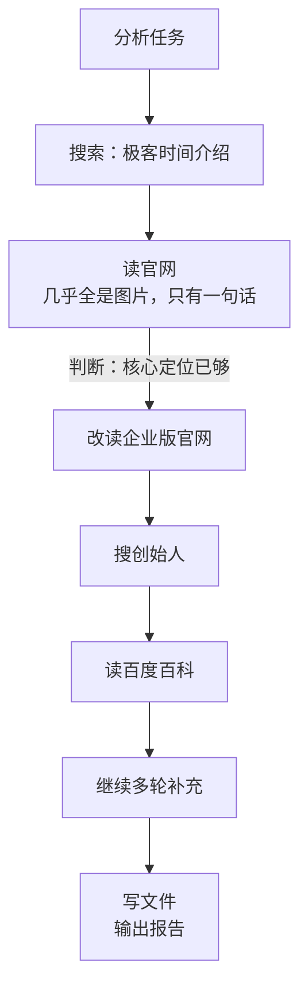
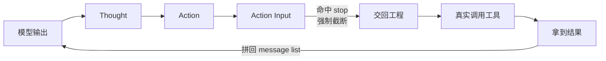
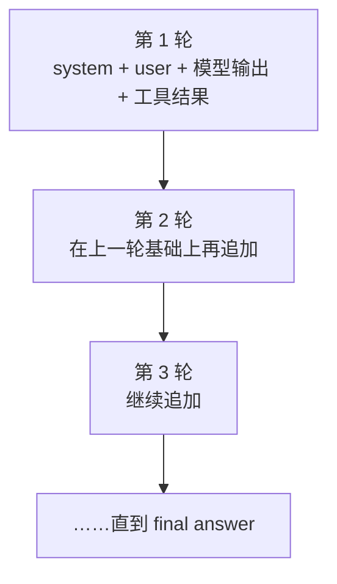
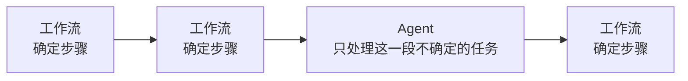

> 本文整理自课程文稿《02｜解构智能体：Agent 的解剖学与 ReAct 范式》。文稿末尾自注「内容由 AI 生成」，属整理稿而非逐字记录。
>
> 文中关于代码行数与运行步骤的计数沿用文稿原述，未做外部核验。

上一篇把 Agent 归进了四种架构范式里。这一篇把它拆开。

作者的说法是先撕外袍：**你会看到它没有那么神秘。但它确实有一个容易被忽略的关键细节。**

## 先给一个直觉：魔法师有三个部件

他先描述了一种常见的想象。

Agent 像一个魔法师。**大脑**负责决策下一步干嘛；**魔法书**是不停翻阅的上下文和记忆；**魔杖**是工具，能取信息也能施加操作。最后它沿着自己规划的路径，抵达目标。

这个想象很好，但有个问题——它让人以为 Agent 内部有什么复杂的调度机制。

事实会简单得多。

## 先用框架做一个：几乎全是提示词

第一个动手环节用了一个 agent 框架，搭一个「网络调研专家」。

拆开看，一个 Agent 的定义只有三段，而**这三段全是提示词**。

| 段 | 是什么 | 他往里写什么 |
|---|---|---|
| role | 身份 | 网络调研专家 |
| goal | 目标 | 接到任务时的总目标 |
| backstory | 背景与规则 | 思维链、步骤、限制条件 |

backstory 这一段是重点。他把「按什么步骤做」全写在这儿：分析任务、搜索、收集信息、深挖网页、撰写报告、自我审核、输出 PDF。

然后是工具。三个：网页抓取（框架自带，本地可跑）、百度搜索（自己封装）、文件写入（因为要出 PDF）。

再往下是参数：打开 memory、调大最大迭代次数、指定模型。

**你会发现做单个 Agent 就是把这些配置填完。**但他说了句关键的话：只有魔法师不行，还得给它任务。

### task 里最重要的不是描述，是验收标准

任务定义有两部分：任务本身的描述，以及**什么状态算预期输出**。

他强调后者极其重要，理由很硬：

> Agent 工作时都是目标导向的。**没给它一个算完成的目标，它就停不下来。**

所以他在任务里把要求写死：生成 Markdown、大纲要有哪几块、质量要求是什么、最终文件名是什么。

这套东西跑起来是什么效果，下面看日志。

## 第一次跑：一个能自我应变的现场

任务是对极客时间这家公司做调研。

日志里能看到它的走法，而且每一步都是它自己决定的。

1. 先分析要干什么，决定抓百度搜索。
2. 调用搜索工具，参数是「极客时间介绍官方网站」，它自己只取前 5 条结果。
3. 从结果里认出官网和企业版官网，决定读官网内容。
4. 读完发现官网大部分是图片，工具只返回一句话：「极客时间，学 AI 用极客时间」。
5. **它判断核心定位已经拿到了，于是转头去抓企业版官网。**
6. 这次拿到了大量信息。
7. 觉得还不够写报告，决定再去找创始人。
8. 调搜索，找到百度百科。
9. 读百科页面，继续挖。

整轮下来：**3 次搜索、6 个网页**，最后用文件写入工具把报告落成 Markdown。验收时看产出，报告里有公司概况、创始人、核心团队、产品服务、企业客户服务、发展里程碑，**而且每个结论后面都带着来源链接**——可以逐条核对到原页面。

上图是这条真实路径。**注意第三个框**：官网返回几乎没信息，这个在工作流里要写一堆 if else 的场景，Agent 自己绕过去了。

## 撕开外袍：日志里的真相

他说自己封装了模型 SDK，所以在打日志时偷偷把**每一次模型调用都存了下来**。

他还顺手给了一个学习方法：你在用任何 agent 工具时，都可以把它的包抓下来看看提示词怎么写的。

### 第一次调用的 message list

打开第一次交互，看到的是一份 message list。

- **system prompt**：开头是「你是一个……」加上 role，接着是 backstory，再拼上 goal。
- 然后是「你只能访问以下工具」，后面接三个工具的 schema——每个工具干什么、每个入参怎么描述，全部结构化的定义好了。

**这就是全部。** 前面这一大段，本质是把他填的配置堆在一起。

### 真正核心的那一段

system prompt 的最后一部分，是整套算法的源代码。它要求模型每次回复都按固定格式：

| 字段 | 模型要输出什么 |
|---|---|
| Thought | 现在应该做什么 |
| Action | 从提供的工具里挑一个 |
| Action Input | 这个工具的入参，JSON 形式 |
| Observation | 工具返回的结果 |

前两个字段是决策，第三是调用参数，第四留给工具结果。

而**终止条件**另有一套格式：当模型认为信息已经够、可以给出结论时，它不再输出 observation，而是输出「我知道最终答案了」加 final answer。

### 那个很少被提到的 stop 参数

这一段是全篇最有价值的技术细节，作者特意说「很多人之前都没有关注到过」。

调用模型时，除了 message list，还有一个参数：**stop**。

它的作用机制是这样的：框架在不停接收模型输出的 token，一旦收到指定的字符串（这里是换行加 observation），**立刻终止当前输出并返回上游。**

**为什么必须有它？**

因为如果没有，模型在输出完 Action Input 之后会继续往下写。它会写出 Observation 这一行，然后**自己编一个工具返回结果**。

它没拿到工具结果，但它会脑补一个看起来合理的结果。这就是最难发现的一类错误：格式完全正确、内容凭空捏造。

加了 stop 之后，模型老老实实停在 Action Input 末尾。

上图是这一圈的完整形态。**stop 是这个循环成立的前提**：它把「模型该说的」和「工具该给的」切开了。

## 工程接管之后：message list 怎么长起来

工具调用完，工程把这轮的结果拼回上下文，再调一次模型。

他讲得很细，值得跟着走一遍。

**第一轮**，message list 有三条：system、user（装着任务描述和验收标准）、然后是模型这轮的输出。

**但模型的输出只到 Action Input 就停了。** 工程把「observation:」加上工具返回的字符串，手工拼成一条 assistant 消息，追加到 list 后面。

然后带着这个更长的 list，再调一次模型。

**第二轮**，模型基于上一轮的节点继续输出新的 Thought、Action。工具再调一次，结果再拼一次。

**如此循环，直到某一条它输出 final answer。** 工程一看到 final answer，把结果取出来，整个流程结束。

上图是这份 list 的增长方式：**每轮都把完整的历史重发一遍，工具返回的网页正文原样拼进去，一字不差。**这也解释了后面要讲的多智能体为什么会成为必需。

## ReAct 不止一种实现

他补了一句很实在的话：ReAct 只是这个死循环的算法，具体实现有好几种。

| 实现方式 | 怎么终止 |
|---|---|
| stop 参数截断 | 命中 observation 字符串就断流 |
| 提供一个 stop 工具 | 模型主动调用这个工具，工程据此停止 |
| JSON 输出 | 按结构解析，缺字段就停 |
| function call | 走模型原生工具调用协议 |

形式不同，骨架一样。

## 40 行手写版

讲完原理，他给了一个不依赖任何框架的实现。

结构很简单：一个类，装 role、goal、backstory、tools；运行时先拼 system prompt 和 user prompt（字符串替换），然后进循环。

循环里做四件事：调模型（带 stop）、解析 action 和 action input、执行工具、把结果拼回 message list。

**核心代码 40 多行。** 他承认这只是极简实现，真正的工程要考虑的还有很多：工具调用失败怎么办、迭代次数超了怎么办、上下文装不下怎么办。

但原理层面，这就够了。

对他来说这一篇的目的是去魅：

> 不要总觉得 Agent 只有大厂能玩，或者内部只有特别厉害的人才能构建。**它的核心代码就是 40 行。**

## 最后一个建议：混合架构

把 Agent 讲明白之后，他立刻踩了一脚刹车。

他的观察是：工作流和 Agent 各有擅长的位置。

- **工作流非常稳定。** 真实业务里一定有大量工作是固化的，哪怕是不确定性很重的场景，执行步骤里也一定有确定的部分。
- **Agent 能自主决策，但可控性差、成本高。** 调模型的次数多，时间成本和钱都上去了。

所以他的建议是：**把确定的部分用工作流实现；一旦碰到不确定的子任务，就把 Agent 插进来。**

这样能同时拿到相对稳定、成本较低、又能应付不确定性三个好处。

上图是这种嵌法的形状。**Agent 不是主角，是工作流里的一个可插拔零件。**

他的落地建议也很克制：先在工作流里用一个 Agent，而不是一上来就做纯 Agent 系统。

## 我的三点补充

以下是评注，不是原片内容；取舍由我负责。

**第一，那个 stop 参数是这一篇真正的分水岭。** 大多数人理解 ReAct 时，以为关键是「让模型按格式输出」。其实格式只是必要条件，**充分条件是必须有个机制在模型开始编造工具结果之前把它掐断**。没有 stop，模型会输出格式完全正确、内容凭空捏造的 observation——这种错误最难查，因为它看起来一切正常。**这也是为什么很多手搓 Agent 的人会在这一步踩坑却查不出原因。**

**第二，那个「官网只有一句话」的现场，比任何理论都能说明 Agent 和工作流的差别。** 工作流遇到这种情况要写分支；而 Agent 判断「核心定位已经拿到，那我去抓企业版」——它没有处理异常，它**重新定义了当前这一步的价值**。这也顺手解释了为什么 Agent 的过程不确定性高：每一步的结果都可能推翻上一步的计划。

**第三，那个课后的思考题值得抄下来自己回答。** 他问：ReAct 只按这个实现，会有什么坑。我能想到几条：上下文只增不减（每一轮重发完整历史）、没有错误恢复（工具失败也会被当成 observation 喂回去）、没有预算控制（只靠最大迭代次数兜底）、单线程串行（每一步都要等工具返回）。这些坑恰好是后面几讲要解的东西——**多智能体的上下文隔离、任务验收标准、迭代上限，全都能从这套极简实现里推出来。**

---

一句话总结：**Agent 不是一个更聪明的程序，是一个被 stop 参数切成两半的循环。**模型负责想，工程负责做，中间那条缝就是全部设计。
