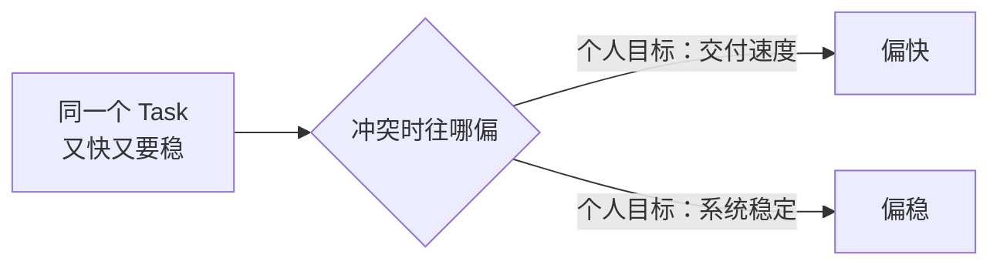
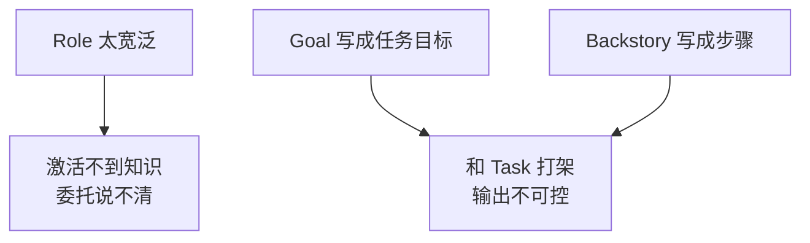
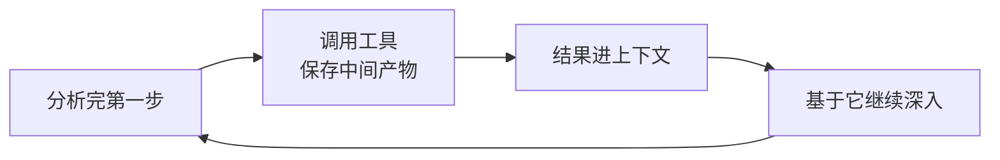

> 本文整理自课程文稿《07｜定义 Agent：从「提示词工程」到「人设工程」》。文稿末尾自注「内容由 AI 生成」，属整理稿而非逐字记录。
>
> 文中的示例文案与专有名词沿用文稿原述，未做外部核验。

进入工程篇第一个模块了。作者先给了整章的骨架：**做 Multi-Agent 就像从程序员变成经理，要做三件事。**

**定人**（Agent）、**定事**（Task）、**定流程**（Process）。

而这一讲只做第一件：定人。

## 招聘的类比

他说理解 Agent 定义最直接的方式，是想清楚你怎么招人。

**先写 JD。** 一份完整的 JD 通常有三块：

| JD 字段 | 写什么 |
|---|---|
| 职位名称 | 资深 Python 工程师、前端工程师、质量部经理 |
| 岗位目标 | 招你进来干嘛，怎么考核，什么算做好 |
| 任职要求 | 需要什么知识、经验、做事方法和能力 |

**然后对着候选人判断。** 而 Agent 的定义恰好也是三个字段，缩写正好是 RGB——他顺口提了一句这个巧合。

| 字段 | 对应 JD 的哪部分 |
|---|---|
| Role | 职位名称 |
| Goal | 岗位目标 |
| Backstory | 任职要求 |

## Role：一句话，但有两重价值

### 概念本身很简单

角色就是**一句话**：你是一个 Python 工程师，你是一位资深架构师。

框架会显式要求一个 role 字段。而很多人会觉得这不就是提示词吗，而且还挺玄学的。

**他不这么看。他给了一个机制解释。**

### 第一重价值：激活

大模型是神经网络，输出时看的是网络里哪些知识被激活了。**而模型对输入的第一句话注意力非常高。**

所以 role 写在第一句，做的其实是一次**定向激活**。

他给了一个对照：

- 只说「你是一个人」——太泛，激活不了什么。
- 说「你是一个 Python 架构师」——**「Python」激活编程语言相关知识，「架构师」激活代码设计与设计模式**。这些被激活的东西，会在后续输出里被调用。

这就是所谓「给 Agent 一个身份，它会按身份的口吻说话」的底层原因。

### 第二重价值：委托

这一条更实际，也更少人想到。

他说在 agent 之间互相委托任务时，真正被用到的**只有 role 这一个字段**。

具体机制是：你在提示词里告诉这个 agent「你可以委托的同事有 A、B、C」，然后就没了——**除了名字，没有任何关于他们能力的描述**。

所以 role 写得含糊，委托就会乱：

> 如果 role 只写「一个员工」，那它在委托时会懵——什么东西该给这个员工。

而如果写的是「AI 是一个 Python 高级工程师」，那代码类的任务就能顺畅地交出去。

### 一条隐含推论

从这里可以推出一个很实用的判断：**如果你打算让某个 agent 被别的 agent 调用，那它的 role 必须自带「我能干什么」的信息。**名字不是标识符，是接口说明。

## Goal：最容易写错的那一个

他把这个字段单独拎出来强调，因为**它极容易和 Task 的目标混淆**。

### 先分清两个「目标」

回到那个调研报告的案例：

- **任务目标**：根据大纲撰写出报告。
- **个人目标**：这个撰写专员的岗位目标是什么。

**这两个不是一回事。**

而真正的个人目标，**不应该是某个具体任务的完成标准，而应该是他的工作取向。**

### 一个很妙的对照实验

他设计了一个思想实验：同样是「把项目从 Python 2 迁到 Python 3」这个任务，交给两个不同的工程师。

| 工程师 | 考核与立场 | 决策倾向 |
|---|---|---|
| 业务团队的人 | 业务满意度、上线效率 | 一切决策偏向**快速上线** |
| 只对技术稳定负责的人 | 出一个 P0 事故绩效全扣 | 一切决策偏向**稳妥、技术合理性优先** |

**任务完全一样，决策完全不同。**

因为任务本身写的是「要快、要稳、要完成这些事」，而这两条要求会打架。**打架时往哪边偏，由个人目标决定。**

上图是这两个字段的分工。**Task 定义要做什么，Goal 定义做选择时的偏好。**

### 所以 goal 该怎么写

他的建议很明确：**写决策偏好，不写具体动作。**

拿那个小红书内容策略专家举例，他的 goal 是这样写的：

> 基于算法制定一套穿透冷启动池、并具有长尾搜索价值的策略。

为什么这么写？他解释得很清楚：

> 我要的**不是这篇笔记多文艺、知识性多强**，我要的是**它能不能火**。这才是这个专家所有决策的偏好。

于是这个 agent 拿到任何任务时，都会用「怎么让它火」这把尺子去衡量。

## Backstory：两个字，补充

他对 Backstory 的定义非常精简：**补充。**

因为一个 agent 有了角色和目标，但在**能力**上一定是空的——需要你去赋能。赋能的东西就是补充。

它分四层。

### 一、人设补充

role 说你是 Python 工程师，那**是什么 level 的？常用什么框架？做过什么项目？是偏高并发还是偏算法？**

这些会进一步激活对应领域的知识。

### 二、知识补充

企业里大量的知识，正规做法是走知识库、知识工程。

但他指出一类例外：**一些简单、容易理解的知识，可以直接以背景故事的方式写进去**，它就会主动拿来用。

### 三、方法补充（也就是思维链）

这里他做了一个重要区分：

**Backstory 里的方法，不是流程。**

因为流程应该写在 Task 里。这里应该写的是**心法**：

> 当我遇到什么场景需要做决策的时候，我的决策逻辑是什么。

他举的例子都很像「内功」：不要泛泛而谈、先找痛点的细分场景、在策略里设计钩子和价值锚点。

### 四、行为边界（他标为最重要）

这一段他直接引用了前面那个翻车的案例。

让一个只写大纲的 agent 不加限制，它会把正文也写出来。而它没有搜索工具，正文里全是幻觉。**这些幻觉进了上下文，后面真正写正文的 agent 会照着它写。**

> 这就是典型的行为边界没设好的例子。

**而边界就设在 Backstory 里**：你是写大纲的，就不要写具体正文。

## 三条反模式

讲完理论，他给了三个很直接的警告，而三条指向同一个原理。

### 一、role 不要太宽泛

太宽泛就激活不了知识，也支撑不了委托。

### 二、goal 不要写成任务目标

这一条的后果他讲得很重：

> 一旦它跟 Task 的目标冲突，**prompt 是最讨厌冲突的**。你上面说生成大纲，下面说生成具体文案——整个模型的输出就完全不可控了。

### 三、backstory 不要写成死流程

理由同上：第一步干嘛、第二步干嘛写进 backstory，**同样会和 Task 冲突**。

上图是这三条反模式。**注意后两条落在同一个坑**：职责重叠。**同一个指令在两处出现，模型就得自己选一个服从。**

## 一个很巧的工具：中间产物保存

这一节是我读完最想立刻用起来的。

他说 agent 以 ReAct 为主，每轮输出 Thought、Action、Action Input，然后观察结果。

**但如果某一步只有思考、没有 action 可做呢？**

比如让 agent 分三步分析：先分析用户诉求，再分析用户群体，再基于群体分析细分场景。**这三步全是模型自己动脑，没有工具可调。**

> 没有 action，它往往一步就完成。而一步完成，思考也很难深入。

**他的解法**：给 agent 一个专门用来保存中间产物的工具。

实现极其简单：

| 项 | 内容 |
|---|---|
| 入参 | 一个字符串，就是中间产物 |
| 返回 | 固定一句话：中间产物结果已保存，可以进行下一步思考 |

**效果**是：它分析完一步，会调用这个工具存一次。存完之后，**中间产物和结论都进了上下文**，于是下一轮它基于这些内容往更深里想。

上图是这个小技巧的机制。**它没有增加任何能力，只是给模型一个「停下来记账」的动作，就把一步变成了多步。**

他说这是自己唯一给这个 agent 的工具——因为它只需要思考。

运行日志印证了这个对比。**加了工具**：agent 先做核心人群与场景定义，调工具存一次；再做漏斗与反漏斗定位，再存；再设计互动钩子与价值锚点，一路走完才给最终答案。**不加工具**：按他的说法，第一步就直接 final answer。

这组对照可以自己复现——把工具摘掉重跑一遍，看日志里还剩几次工具调用。

## 最后：让模型来写提示词

讲完反模式，他给了最佳实践，而这条有点调皮。

**提示词本身可以交给模型生成。**

他说现在有很多「提示词已死」的说法，最大的理由就在这里：刚才讲的所有东西都可以用大模型优化。甚至你把这门课的材料喂进去让它总结，它就得到一套提示词方法论。

**然后你做任何 agent 时，只需要说：基于这套结构帮我生成。**

他还坦白了：**「我又不是小红书的营销专家，里面那些知识、专业名词，全都是大模型帮我生成的。」**

具体做法他也给了：

- Backstory 里的知识和 SOP，让模型做一轮深度研究。
- 拿报告，提取你觉得有价值的点写进去。
- prompt 效果不好，就把 **prompt 加执行日志**一起扔回去让它改。

> **写提示词已经越来越不是我们要重点关注的事。**

那要关注什么？

> 关注的是结构化思维，就像 RGB 一样：**我需要的人是什么职位、他的偏好是什么、他的补充知识是什么、他的边界是什么。**
>
> **这个思维是构造提示词的架子。具体文字交给模型。**

## 我的三点补充

以下是评注，不是原片内容；取舍由我负责。

**第一，「goal 写决策偏好，不写任务目标」这一条，解释了为什么很多 agent 行为不稳定。** 因为大部分人写 goal 时写的是「完成 X 任务」。而这恰好和 task 重复。**重复不是冗余，是冲突**：两句话措辞略有差异时，模型就得自己判断该听谁。而写得好的 goal 根本不该出现任务名，它应该只描述偏好：快还是稳、覆盖还是精准、成本还是质量。

**第二，那个中间产物工具在原理上很像「让人打草稿」。** 它没有扩展模型能力，只是硬造了一个动作，把一次思考切成几段。而切成几段之后，每段的产出都留在上下文里，下一次思考就有了落脚点。**这跟前面讲思维链是同一件事：不是让它更聪明，是让它别一口气想完。**

**第三，他最后那段坦白其实最值钱。** 一个不是小红书专家的人，靠模型生成了整套专业知识和术语——这说明**人设工程的真正门槛不在知识，在结构**。你知道要找什么样的人、他的偏好是什么、边界在哪，剩下的内容可以让模型填。而反过来，如果你连「这个岗位该考核什么」都想不清楚，那喂多少专业知识都堆不出一个稳定的 agent。

---

一句话总结：**写 Agent 不是写提示词，是写一份 JD。**而 JD 里最难的不是职位名，是那句「我按什么标准判断你干得好」。
