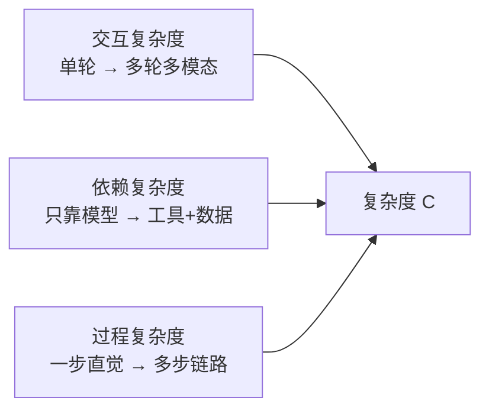
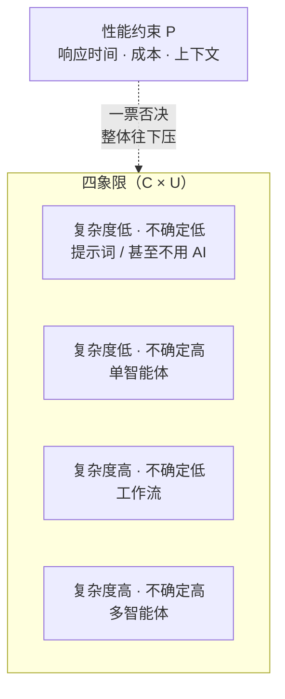
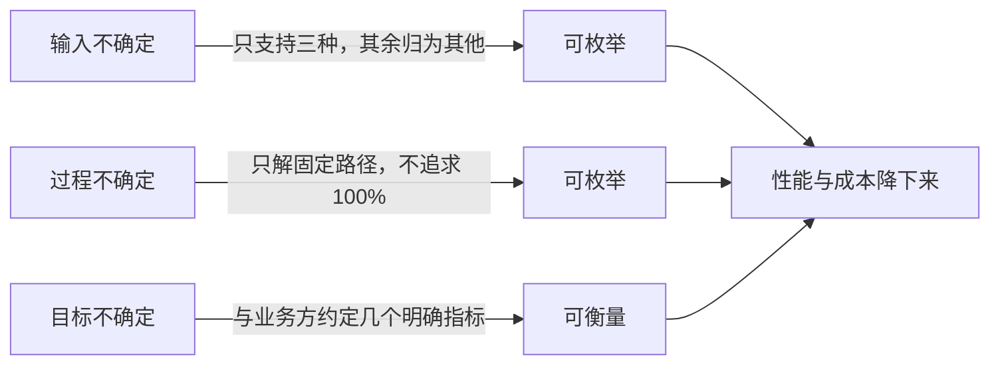

> 本文整理自课程文稿《04｜架构师的决断：AI 应用开发选型工具》。文稿末尾自注「内容由 AI 生成」，属整理稿而非逐字记录。
>
> 文中的时效要求（5 到 10 分钟止损）沿用文稿原述，未做外部核验。

前三篇讲了四种范式、Agent 内部结构、多智能体协作。这一篇回到最开始那个没答完的问题：

> **真遇到一个场景，我该用哪个范式。**

他先描述了一种很具体的困惑状态：一开始落地 AI 应用，是凭一个想法，不知道怎么做好。现在反过来了——**这也能用，那也能用，于是「选哪个」变成了难题。**

他用了一个比喻：是用一把精美的美工刀精准解决，还是上一个专业施工队互相配合？

答案不能凭感觉。所以他给了一个工具。

## 三维评估：CUP

| 维度 | 是什么 | 作用 |
|---|---|---|
| C | 复杂度 | 场景本身有多重 |
| U | 不确定性 | 第一课那个核心维度 |
| P | 性能约束 | **一票否决** |

前两个决定「理想答案」，第三个决定「你能不能拿这个答案」。

## 第一维：复杂度看三个方向

他说很多时候我们只是定性地说「复杂」，没有方法论。所以他拆成三条可评估的线。

### 一、交互复杂度

看用户给 AI 的任务，从简单到难。

- **简单**：单轮、纯文字。比如把一句话翻译成英文。
- **复杂**：多轮往返，还夹带大量文件、图片等多模态输入。

他举了一个跨度很大的例子：让它看一份 Excel，看完不能直接下结论——还得写代码、还得优化——最后才给你结果。中间可能还有人在环。

**这是很复杂的交互过程。**

### 二、依赖复杂度

这一条从「只靠模型自己」到「要靠一堆东西」。

- **低**：最早的问答机器人。知识都在模型里，或者由人带过去。写作、总结、生成日报，都属于这一类。
- **高**：各种工具加数据。

他给的典型例子是 ChatBI：要查表查库、要计算、计算要写代码分析、还要生成图表、图表出来还得发邮件。

**一个场景串起四五种依赖，复杂度就上去了。**

### 三、过程复杂度

这一条他用了一个很好记的判据：**如果是一个人来做这件事，他要走多少步。**

- **低**：一步、靠直觉。查星座、做情感分析，或者「给我画一张图」——单步完成。
- **高**：深度调研那种。爬取、清洗、分析、生成报告，每步都不能省。

上图是这三个方向。它们可以各自独立地高或低，所以要分别看。

## 第二维：不确定性，和复杂度不是一回事

这一段他讲了一个很关键的区分，我觉得是全篇最容易混淆、也最需要说清的地方。

> **复杂度是「样式复杂」，不确定性是「边界模糊」。**

他每讲一种不确定性，都配了一句「它跟那个复杂度不一样」。

### 一、输入不确定性

做数据抽取时，输入是结构化数据，内容明确——**边界清晰，这叫确定。**

而客服、开放助手这类场景，用户会怎么问，你事先预测不了，任务范围可能非常广——**边界模糊，这叫不确定。**

**注意差别**：一个复杂的输入可以完全确定（比如一份格式固定但字段极多的报表）；一个简单的输入也可以完全不确定（比如一句「帮我看看这个」）。

### 二、过程不确定性

他先把「过程复杂」和「过程不确定」分开。

**过程复杂但确定**：调研那条链路，爬取、清洗、分析，步骤多但固定。

**过程不确定**：线上问题定位、网页爬取这类。**第一步做完，你得到的反馈是多样的；根据这个反馈决定下一步的策略，也是多样的。**

所以整条路径无法事先枚举和预测。**这才叫不确定。**

### 三、目标不确定性

- **确定**：金融风控。过程复杂、非常重要，但结果是「能不能放款」，一个是否结论。
- **不确定**：模糊到连用户自己看到结果都判断不了好坏。

他给了一个亲历的例子：让 AI 生成一份调研问卷。只看一版，觉得「好像学到了点东西」，但好不好说不清。**直到他拿多智能体版、单智能体版对比着看，才发现深度、结论确定性、语言说服力都有差别。**

**没有对比就没有判断标准——这就是目标不确定性。**换句话说，验证这类产出的唯一办法，就是把两个版本的输出摆在一起看。

## 第三维：性能约束，一票否决

这一维是这篇相对前几篇新增的东西，也是最有价值的一处。

他先说明白：前两个维度本来就能组成象限。但实际业务里有个关键变量会推翻结论。

**性能约束的三个方面：**

| 约束 | 表现 |
|---|---|
| 响应时间 | 用户界面上一个动作，要求 1 秒内返回 |
| 成本 | 本质是 token 用量，对应 ROI |
| 上下文 | 需要的上下文极大，又要求效果好 |

**响应时间那个例子最能说明「一票否决」：**一个场景再复杂、不确定性再高，如果它要求实时返回，那也没法上 Agent——因为**响应时间一下就飙上去了**。

**成本约束他举了一个特别实在的对照：**

同样是调研报告这个场景。

- **给老板用**：可以上多智能体。老板能等，一份好报告价值很高。
- **给业务员日常用**：多智能体的分析收益，完全抵不上 token 消耗。**ROI 根本不够。**

同样的技术方案，用户不同，选型结论就不同。

> 他的总结：性能约束会起到一票否决的作用。**它天然地把你的选型往下压。**

## 四象限：理想答案

把复杂度和不确定性画成横纵坐标，就得到一个很简明的矩阵。

| 复杂度 | 不确定性 | 结论 |
|---|---|---|
| 低 | 低 | 提示词就够；低到一定程度，**根本不该用 AI** |
| 低 | 高 | 单智能体 |
| 高 | 低 | 工作流 |
| 高 | 高 | 多智能体 |

上图是这套模型的全貌。**注意那条虚线**：P 不是第五个维度，它是一个作用于整个象限的边界。

他有一个判断我觉得很干脆：**如果是确定的东西，有时候压根用不上 AI。**而不确定性特别强时，才需要 Agent 或多智能体。中间地带，工作流就够了。

## 最实用的一节：收缩能力边界

讲完模型，他说到了一个我没想到的点。

因为现实中经常出现这种情况：**场景明明需要多智能体，但性能不允许。**

那怎么办？

> 主要思路叫做**收缩能力边界**。

三种不确定性，对应三种收缩手法。

### 一、收缩输入边界

用户可能有无限种问法，**那我只支持其中三种，剩下的归为一个「其他」，暂不支持。**

这样输入不确定性就被压下来了。

### 二、收缩过程边界

过程可能真的要探索，但成本和时间不允许。

**那就先把固定路径能解决的问题解决掉。枚举不到的，先不解决。**

他还补了一句很重要的话：**解决率不必追求全覆盖。**

### 三、收缩目标边界

如果一份分析报告到底好不好，实在没法客观衡量——**那就先跟业务方建立一个共识，用几个明确指标来衡量。**

他承认这会失真：「也许这个衡量指标会有一定程度失真，但没关系，**它可以让我们往前走。**」

上图是三种收缩。它们的共同点是：**把无法穷举的东西换成一个愿意接受的有限集合。**

而代价他也说清楚了：**代价是应用效果本身。**这是一次明确的交换，不是白得的。

## 完整推演：线上问题定位

概念讲完，他用一个工程师日常最痛的问题做推演。

### 判复杂度

- **交互**：来源相对单一，但报警项多样。**中等偏上。**
- **依赖**：日志、metrics、各模块看板、tracing。**非常高。**
- **过程**：一步就能定位就不叫复杂定位了。**很高。**

**结论：复杂度高。**

### 判不确定性

- **输入**：线上表现有多少种？指标异常有多少种组合？**几乎不可能枚举。非常高。**
- **过程**：看到某个模块时，可能它有问题，也可能是它的依赖方有问题。**每步决策都高度不确定。**
- **目标**：有没有找到根因、能不能止损。**相对确定。**

**结论：不确定性高。**

### 落在哪

**复杂度高 + 不确定性高 → 多智能体。**「在没有任何现实问题的情况下，它一定是用多智能体解决的。」

### 但性能一票否决

**时效性**：从止损角度，至少 5 到 10 分钟内要做出动作。**留给 AI 加人反应的时间，也就是两三分钟。**

**两三分钟做不了多智能体那套编排。**

所以答案是：**落在多智能体象限，但必须收缩能力边界，或用技术手段解决时效问题。**

### 现实中的做法

他给了一个很清醒的补充：**理想态是一回事，实际业务里以混合架构为主。**

他的实践是：**用一个工作流作为整体框架，在其中的叶子环节用单智能体。**组合起来当然也可以叫多智能体，但实质是分工——**框架保证可控和时效，叶子环节保留一点自主性。**

## 第一章的收口

这一讲结束了整个第一章。他做了一个回顾，而我觉得那段回顾本身就是这个系列最好的提纲。

| 课 | 目标 |
|---|---|
| 一 | 建立整体认知：四种范式加混合架构，能覆盖现在的 AI 应用 |
| 二 | 给 Agent 祛魅：三四十行就能实现一个基础 Agent |
| 三 | 初识多智能体：从「面向过程」转向「面向组织」 |
| 四 | 决策选型：所有范式没有好坏，只有适用与否 |

他还说了一句我觉得很实在的话：现在很火的那些东西，**不管是 skill 还是什么，其实都逃不过这四种范式。**

而第二章开始，他会手把手带人搭 AI 应用，以多智能体框架为主。

## 我的三点补充

以下是评注，不是原片内容；取舍由我负责。

**第一，把性能约束单独拎出来当「一票否决」，是这套模型真正成熟的地方。** 大多数选型讨论停在「复杂度 × 不确定性」二维，然后给出一个技术上正确的答案。而实际项目里，**杀死方案的多半不是难，是慢或者贵**。加上这一维之后，这个模型从「技术选型」变成了「业务选型」——它承认现实会压着你降级。

**第二，「收缩能力边界」这三个字值得抄下来当方法论。** 它的价值在于给了一条正当的退路：**不是硬上更强的架构，也不是放弃需求，而是主动把问题范围缩小到一个你能负责的尺寸。** 只支持三种问法、只解固定路径、只认几个指标——每一条都是「我不做全部，我做好这一块」。这在工程上极其常见，但很少有人把它写成一条正当的设计策略。

**第三，线上问题定位那个推演最有说服力，因为它诚实地承认了矛盾。** 复杂度高、不确定性高，按表格该上多智能体；但时效要求两三分钟，多智能体上不去。**最好的答案不是选一个范式，是承认两边都不满足，然后用混合架构去缝。** 这种「不完美的正解」，比任何干净的四象限都更接近真实工程。

---

一句话总结：**选型不是挑最强的范式，是找那个「能力刚好够、代价刚好扛得住」的位置。**而现实总会把你往下压一格——所以留好退路比选对更重要。
