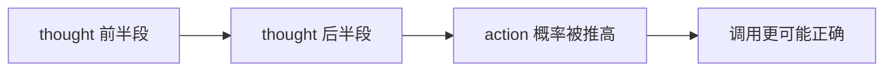
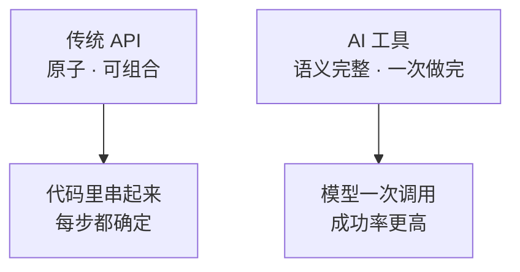
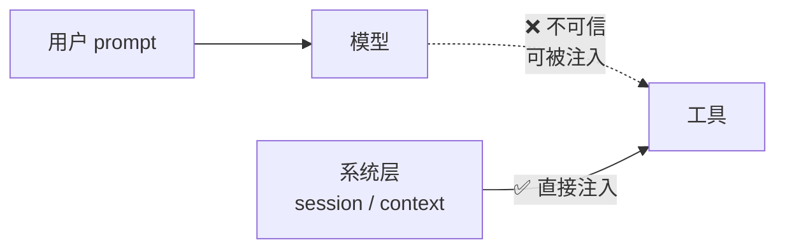
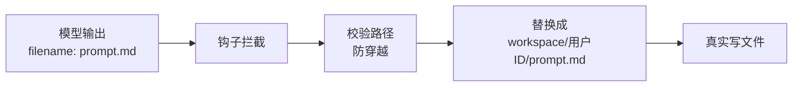
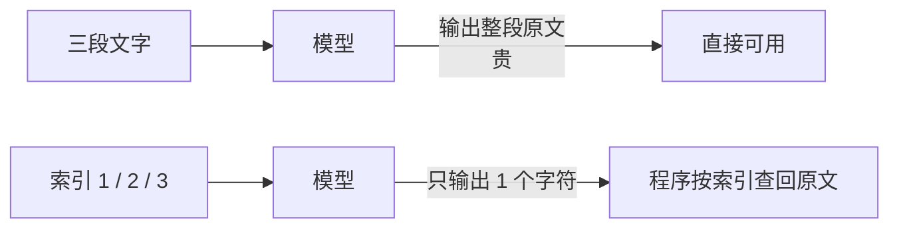

> 本文整理自课程文稿《12｜工具设计哲学：从 API 到 Agent-Native 的范式跃迁》。文稿末尾自注「内容由 AI 生成」，属整理稿而非逐字记录。
>
> 文中的框架行为与技术名词沿用文稿原述，未做外部核验。

模块一的项目只能生成一份报告——**因为它还没有手。**

这一讲开始装手。而它先问了一个更基础的问题：**给 agent 用的工具，和我们平时写的 API，到底有什么不同。**

## 先看两种调用方式

### 方式一：原生函数调用

这是最早由 GPT 提供的能力，现在主流接口基本都支持。

机制很直接：请求模型时，除了 message list，还多给一个参数——**工具定义列表**，每个工具包含名字、介绍、JSON Schema。

模型底层框架处理这些信息，返回时不再只有 message，而是多了一个**工具调用字段**，里面写明要调哪个工具、参数取值是什么。框架拿到后去执行。

**依赖模型自身能力完成的工具调用。**

### 方式二：ReAct 循环

这个在第二讲拆过：模型按 Thought、Action、Action Input、Observation 四段输出，工程在 observation 处截断、真实调用工具、把结果拼回去。

**依赖提示词格式和工程接管完成的工具调用。**

### 一个正在发生的迁移

他说了一句很实在的观察：**越来越多的人开始偏向函数调用。**

而且他给了自己的证据：**最新的框架版本，已经把 ReAct 的大部分能力迁到了一套封装好的函数调用上。**

他之前录课的时候还在用 ReAct，现在框架自己换了。**「框架迭代很快，大家也在各种方案之间投票。」**

## 四个维度对比

他也强调：不管用哪种，都要理解优劣。

| 维度 | 函数调用 | ReAct |
|---|---|---|
| 性能与成本 | **更快、更省** | thought 要烧大量输出 token |
| 准确性 | 明确单一场景更好 | 复杂场景更好 |
| 可解释性 | 过去近似黑盒 | **thought 直接展示思路** |
| 适用场景 | 简单明确 | 不确定性高 |

### 为什么函数调用更省

因为**输出 token 是最贵的**。而 ReAct 的 thought 全在输出侧。

他还点了一个细节：如果是 reasoning 模型，推理本身就长，但即便如此，**不带 reasoning 直接调用的模型在速度和 token 上都更好。**

### 为什么复杂场景 ReAct 反而准

这一条他解释得挺漂亮，值得完整保留。

函数调用有个特点：**依赖模型一上来就输出正确的 JSON。** 一旦开头就错了，整个调用就走偏。

而 ReAct 的优势在于：**thought 是自回归递进输出的。** 当它把思考写到一半时，**会增大后续去调某个 action 的概率**。

也就是说，**思考本身在给它自己创造上下文。**

上图是这个机制。**先想清楚，再决定调什么**，而这个「想」是写在 token 里的。

### 可解释性：黑盒的代价

他说得很具体：

> 函数调用过去基本是黑盒，尤其没有 reasoning 的时候。

而 ReAct 能直观看到它怎么想的。**当它没调工具时，你也能知道它想偏在哪、是因为哪条提示没给好。**

「但如果是黑盒，它就是没调这个函数，为什么没调你完全不知道。」

### 他的清焦说明

他还补了一句很克制的话：这些判断**以现在的技术基础为前提**。模型能力日新月异，比如现在的强模型已经能一边输出 message 一边输出工具调用，「这样的一些问题就很少了。」

**所以趋势是往函数调用走，靠的是模型越来越强。**

## 正题：AI 工具和 API 的三处不同

接下来是这一讲的核心。

### 差别一：别再追求原子性，要追求语义完整性

传统 API 的设计原则是**尽量原子**。

他讲得很细：底层数据库就是那样一张表，接口结构大体跟表一致，不会多做别的事。同一个接口在不同场景复用——**给我一个 ID，我返回信息。**

而且要**尽量拆小**，因为可以无限次调用。比如改一条信息，常见做法是先拿 name 换 ID，再拿 ID 去 update。

> 在原来的编程里这非常常见，**因为它的每一步都是确定的。**

**而 AI 工具不一样，因为它是靠语义判断调什么的。**

所以第一件事：**你要先告诉它「我为什么要调它」。**

从名字就能看出来——「基于这个名字去改它的状态」，**这是一个完整的、带业务语义的功能。**

他给了一个很直接的后果：

> 你很难在里面加各种约定俗成的东西。那种「先拿 name 换 ID，再拿 ID 去 update」的流程，在代码里写没问题。**但如果你在 AI 工具里也这么干，让它分好几次去做工具调用，成功率就不高了。**

上图是这条分界线。**原子性是给人写代码用的；语义完整性是给模型判断用的。**

### 差别二：每个字段都在烧 token

这一条我觉得是全篇最容易被忽略、又最影响实际成本的。

传统 API 的数据结构可以很复杂：map 里嵌 list，list 里再嵌 list，某个值又是一个数据结构。

**为什么以前无所谓？**因为上游系统调它，唯一成本是「写代码时多写一两行」。

**AI 这边不一样。**

他给了一个非常关键的区分，我建议原样记住：

| 方向 | 占哪种 token |
|---|---|
| **入参** | 占**模型的输出 token** |
| **出参** | 占**模型的输入上下文** |

因为不管 ReAct 还是函数调用，**入参的 JSON 都是模型自己打出来的。**

所以入参设计一大堆，就要让模型多打一大堆。

**而出参那一堆乱七八糟的东西，会直接吃掉上下文。**

> 这就是 AI 这边设计点不一样的第一个地方。

### 差别三：可描述性从「可有可无」变成「决定成败」

传统接口其实也写描述，但**代码不依赖它**。因为调接口的是人，人看过文档、联调过，描述写不写没太大意义。

**而现在不一样了：AI 就是靠参数描述来决定怎么输出参数的。**

所以他点了两个具体的反模式：

- **不可解释的类型**：原来一些内部类型，AI 完全看不懂。
- **保留字段**：原来「里面随便写什么都行」，**给到 AI 就完全不知道填啥。**

### 差别四：错误处理从「可枚举」变成「可理解」

这一条他讲得很清楚，也是我读完觉得最有启发的一处。

**传统 API 的错误处理，目标是可枚举。**不同错误码要分类，因为上游系统拿到错误码要走 if-else。

**AI 工具的错误处理，目标是有明确语义描述。**

比如「参数必须是什么格式」——**AI 看到这个，就知道该换一种格式重试。**

而更根本的差别在第二点：

> **AI 的可重入要求比传统 API 高得多。**

传统接口大部分调用是稳定的，顶多有点网络抖动。而 AI 是高不确定性的，**它会一遍一遍地调**——第一遍不成功，第二遍还会调。

**所以工具必须经得起反复调用。**

## 一条铁律：权限不能通过模型传递

讲到企业级，他拿出了一段我认为整讲最重的话。

**先分两种身份认证模式。**

| 模式 | 怎么理解 |
|---|---|
| 身份传递 | Agent 本身没有身份，看**正在调用的人**有没有权限 |
| AI 虚拟身份 | 应用有一套自己的权限，像数字人，用自己的身份去查 |

第一种需要**把使用者的 User ID 在全生命周期正确透传**。第二种则是 AI 以自己的身份访问，但**不把原始内容透传给用户**，只给加工后的结论。

他举了个很生动的例子：一个 PM 问「线上出错了帮我查一下」，AI 用自己的身份去查日志、定位、加工，最后只把结论给他。

### 然后是那条铁律

> **权限传递不走模型这条路。**

他的解释很尖锐：

> 不要在 prompt 里加上「输出要带上这个 ID」，然后指望模型吐出这个 ID。**因为提示词注入能让模型层面的所有限制失效。**

**所以涉及权限的信息，必须系统对系统传递。**

他还补了一个佐证：某套多智能体协议里专门有一个 metadata 字段，**就是用来传那些你不希望由模型生成的东西。**

上图是这条铁律。**虚线那条路不该承载权限信息。**

## 实现：用钩子在调工具前后插一手

讲完原理，他给了一个具体项目：**定时任务管理专家**。

用户说「我要每天早上九点查阿里股价发到 QQ」，agent 就把它写成一个定时任务文件，落在**这个用户自己的工作空间**里。

**关键问题**：工具就是一个最简单的文件写入，**怎么保证它只写在当前用户目录下？**

### 钩子机制

框架提供了调用前后可用的钩子。他用了两个：**调用前**和**调用后**。

而**系统传递的参数，就是在这里完成的。**

具体做法：

1. 拦截文件读写这两个工具。
2. 从 Python 的 context 里取出真实用户 ID。登录态一进来就解析好放进去。
3. 生成这个用户的基础路径。
4. **把模型输出的路径替换成 workspace 加用户 ID 的绝对路径。**

而**在模型看来，它输出的就是 `prompt.md` 这个相对路径**——它压根不知道有用户目录这回事。

上图是这个替换链。**注意那个校验步骤**——因为模型可能输出带 `..` 的路径，**防穿越要做很多校验**。

### 这个钩子干了两件事

他总结得很清楚：

1. **拦截所有不在用户空间下的读写，全部引导到自己的目录。**
2. **传递了关键信息——用户 ID。**

而这两件事的共同点是：**都没有经过模型。**

## 反模式与最佳实践

### 五个反模式

| 反模式 | 后果 |
|---|---|
| 功能全能的工具 | 「给我个字符串就行」——模型很难按语义判断该不该调 |
| 上下文炸弹 | 返回几十兆文件，agent 直接崩 |
| 沉默的失败 | 只返回空，agent 不知道怎么办 |
| 深嵌套入参 | 输入输出都有很大成本 |
| 多层 JSON 转义 | 读可能还行，**让它生成大概率出错** |

最后一条他解释得很到位：**多层嵌套的 JSON 不符合模型被训练时见过的数据形态。**

### 三条最佳实践

**一、出错时不只说错在哪，还要给下一步建议。**

**二、做摘要和分页能力。**好处有三：让 agent 更好读、减少 token、可以索引化。

**三、索引化入参——这是个很聪明的技巧。**

他举了个例子：让模型从三段文字里选一段有效的。

- **直接给三段文字**：模型输出时要**把选中那段原文完整打出来**。
- **给索引 123，只让它输出序号**：输出就只有一个「1」。

然后程序用这个 1 去列表里查回原文。

> 虽然你的代码写得多了一些，但 token 使用和模型耗时都有很好的减少。

上图是这个技巧。**核心是把「搬运内容」换成「指认位置」——而位置只需要一个字符。**

## 我的三点补充

以下是评注，不是原片内容；取舍由我负责。

**第一，「入参占输出 token」这个区分值得单独刻下来。** 因为它解释了一个很反直觉的现象：**你把工具的入参设计得更丰富，看起来是给模型更多信息，实际是在逼它生成更多 token**——既慢又贵，而且字段越多、出错概率越高。所以 AI 工具的参数设计原则应该是「够用就好」，而不是「尽量完整」。这和传统 API 追求 Expressiveness 的直觉正好相反。

**第二，那条权限铁律的深层含义是：模型不能作为安全边界。** 不是因为模型不够聪明，而是因为**模型读到的任何文本都可能被构造**。你在 prompt 里写的规则，和攻击者注入的指令，在模型眼里是同一层的东西——**没有优先级，只有概率。** 所以凡是涉及鉴权的信息，路径必须是系统到系统，绕开模型这一层。

**第三，「索引化入参」这个小技巧其实是一种架构思路：把生成成本换成查询成本。** 模型擅长指认（输出一个数字），不擅长搬运（复制一大段文本）。而你多写几行代码去查表，就把这部分成本从最贵的输出 token 上挪走了。**这个思路可以用在任何「模型只需要做选择」的场景里。**

---

一句话总结：**API 是给人写代码的，AI 工具是给模型做判断的。** 前者的美德是原子和精确，后者的美德是语义完整、字段克制、错误可读。
