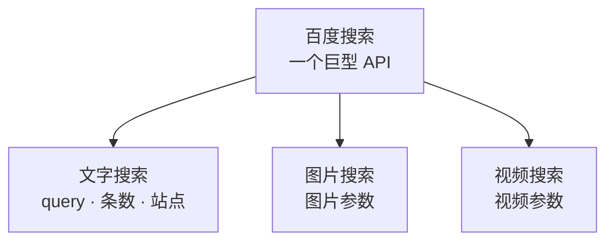
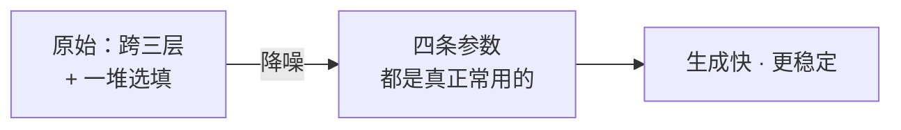
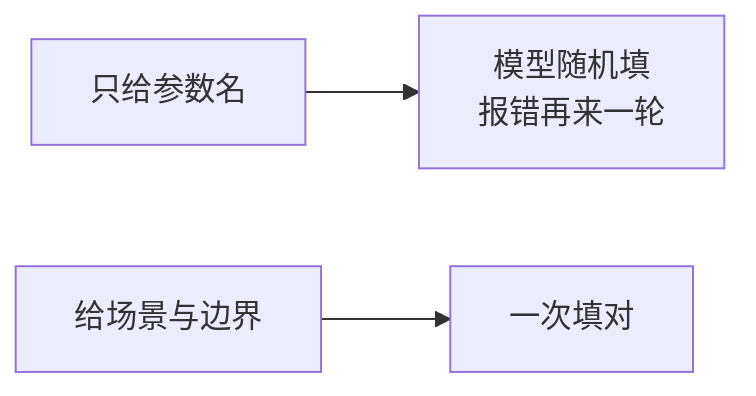

> 本文整理自课程文稿《13｜自定义工具封装：构建 Tools 的五步标准 SOP》。文稿末尾自注「内容由 AI 生成」，属整理稿而非逐字记录。
>
> 文中的接口结构与参数名沿用文稿原述，未做外部核验。

上一篇讲的是**为什么** AI 工具和普通 API 不一样。这一篇讲**怎么做**。

作者的开场很实在：上一讲讲完设计原则，大家可能还是没有实感——**「假设我已经有了一个现有系统、有了一些 API，到底怎么把它变成 AI 能用的工具？」**

于是他给了一套五步。

| 步 | 做什么 | 一句话 |
|---|---|---|
| 一 | 语义重构 | 把碎片聚合成完整语义，把巨型接口拆开 |
| 二 | IO 瘦身 | 降噪 + 增信 |
| 三 | 错误转译 | 错误码变成「原因 + 下一步」 |
| 四 | 工具描述 | 动词加名词，写清触发时机 |
| 五 | 参数描述 | 边界、赋值场景、示例 |

## 第一步：语义重构，两个方向

### 方向一：聚合碎片

传统 API 常常过于原子。他举了一个很典型的例子。

**改一个人的个人信息**——如果手上只有名字，老程序的写法是：

1. 用名字换 ID
2. 用 ID 查信息
3. 改其中一项
4. 提交更新

**两三个接口串起来才算完成一件事。**

而在 AI 场景里，**上下文里通常只有那个名字**，拿不到 ID。所以要把这一串聚合成**一个有完整语义的接口**。

### 方向二：拆解巨无霸

反过来的问题也存在。他直接拿百度搜索举例。

那个接口内部极其复杂：图片搜索、视频搜索、文字搜索、阿拉丁，**各种参数全都复合在一个大 API 上**。

> 大 API 有它的道理——对外只提供一个接口，程序按需调用就完事了。

**但交给 AI 就是负担。**

因为那些长得非常像的参数（图片搜索的、视频搜索的）会互相混淆。

**所以索性拆成三个工具：**文字搜索就只管 query、条数、站点；图片搜索就用图片的参数。

上图是这个拆法。**它把「选参数」变成了「选工具」**——先选对工具，参数就只剩几个。

他的评语很直接：**百度虽然说这个接口是给 AI 用的，但它的定义还是一个非常传统的设计。**

## 第二步：IO 瘦身，降噪 + 增信

### 降噪：把跨三层的结构压平

他展示了百度搜索原始的入参结构，我认为这段最能说明问题。

想搜索「在哪些网站里面搜」，**要跨三层数据结构才到那个数组**。时间范围也是套在 filter 里面、再套 range、才到日期。

而且连 query 都不是正经的 query。它**非要封一个 message 才给到后续逻辑**。

> 这样的数据结构，你想让 AI 正确生成你想要的，会非常麻烦。**而且你看它占多少 token——每个输出 token 都是时间。**

改造后的入参只剩四条：

| 参数 | 说明 |
|---|---|
| query | 搜索词 |
| 条数 | 返回多少条 |
| 时间范围 | 按年、按月、按周，而不是精确到某天 |
| 站点 | 在哪些网站搜 |

他特意解释为什么要砍掉精确日期：

> **很少有 AI 能精确定义到哪天。**它无非就是按年、按月、按周。

上图是这个压缩。**判据是「AI 到底能不能用得上」**，而不是「接口本来支持什么」。

### 增信：给返回结果加语义

这一条是我读完觉得最有价值的。因为他说了一件很多人没注意的事：

> **函数调用里，输出的那一侧是没有任何地方能写提示词的。**

也就是说，**模型拿到的就是那么一大坨原始结构**，它得自己猜哪个字段是什么。

而他举的例子很具体：里面有几个长得像的字段——这个 URL、那个 URL，或者 test 和 content 这种——**模型就很容易混淆，不知道到底哪个才是结果。**

改造做了两件事：

1. **精简结构**（降噪）
2. **增加语义信息**（增信）

比如：

- 明确告诉它「一共返回了多少条」
- 不用它原来的 content 字段名，而是给出 `id`、`title`、`url`、`摘要`

> **没有任何框架会帮你解释这些东西。**必须自己在接口设计里做这一层封装。

## 第三步：错误转译

他说原来那种错误码枚举，即使能拿到，内容也往往五花八门、定义不太好。**底层工具本身要先改造。**

而给 AI 的错误信息，他给了一个三段式模板。

| 段 | 内容 |
|---|---|
| 一 | 原来的错误信息，说明具体是什么错 |
| 二 | **可能的原因**：参数不对？网络失败？内部 bug？场景不适用？ |
| 三 | **下一步该怎么做** |

他解释为什么「原因」这一段最关键：

> AI 收到原因，React 回来以后，才知道怎么调整参数。

而「下一步」要具体到可以照做：

- query 写空了 → 赶紧填上值
- 超过 500 → 告诉它调小到 500 以内

**「AI 就是在不确定中找确定，这是控制 AI 的最好方法。」**

## 第四步：工具描述

这一段他讲得最长，因为**它决定了「AI 到底调不调你」。**

> 明明该调工具却没调、或者调了别的工具——很多时候不是模型的锅，是**工具描述没写好**。

### 名字：动词加名词

他给了一个很少有人讲的机制解释。

为了省 token，**在提示词里选择工具时，给模型看到的只有工具名**。schema 在另一处，但最贴近生成决策的那段提示里，**只有名字**。

**所以名字不能瞎起。**

> 百度搜索这个工具，你告诉它「百度」没用——它也不管你是不是百度。**直接说是「搜索网络信息」就完事了。**

### 描述：四段模板

| 段 | 写什么 |
|---|---|
| 功能描述 | 这个工具是干什么的 |
| 能获得什么 | 调用后拿到什么（比如网址和摘要） |
| **触发时机** | 什么时候该用它（他标为最重要） |
| 适用边界 | 能做什么，**不能做什么** |

### 为什么「触发时机」最重要

他给了一段我觉得是全篇最有洞察的解释。

**工具是按「功能」组织的，而人的需求是按「场景」来的。中间有一层逻辑转换。**

举例：你想获取某家公司的信息，而工具叫「网络搜索」。

> **这里就有一层逻辑转换：我要获得信息，所以我要去网络搜索。**

再比如数据库。**「我想保存一条信息」和「数据库数据插入」，中间也隔着一层。**

> 不是模型理解不了，**而是你凡是让它多理解一步，就增加了负担和不确定性。**

**所以干脆把逻辑转换去掉**——直接告诉它「你需要调研的时候用我」。

它拿到场景，发现当前场景就是触发条件里写的，自然就去用了。

### 适用边界为什么也要写

他举了 PDF 工具的例子。

你告诉它「处理 PDF 文档」，同时告诉它「Excel 和 Word 不归我管」。

**不写会怎样？**假设你只提供了 PDF 工具，模型遇到 Excel 没辙了——「反正也是文档，那就用你吧」——调一下报错，白烧 token。

> 如果工具有很多很长，**不告诉它不做什么，工具之间就没有互斥关系，很容易选错。**

## 第五步：参数描述

他说得很直白：**不能只给一个参数名让它猜。**

四样东西要写。

| 项 | 内容 |
|---|---|
| 参数说明 | 它是什么（比如「返回的结果条数」） |
| **取值与默认值边界** | 省得它填 100 然后报错回来再调一次 |
| **赋值方法与场景** | 什么场景填大、什么场景填小 |
| 示例 | 可选 |

### 「赋值场景」为什么必须有

这一段他讲得特别好，我原样保留。

拿 top_k 举例：

- **广泛搜索、要先捞大量信息** → 放到 10 以上
- **精确搜索**（比如问「某公司是什么」）→ 前五条就够，**相信搜索排序，反而省掉垃圾信息**

> 你自己都没概念的东西，指望 AI 选好，那就完全不靠谱。
>
> **它出来的东西就是随机的。那你还不如不给它这个参数。**

时间范围参数同理：

- **要最新资讯** → 至少放到天或周
- **搜概念性内容**（某个名词是什么意思）→ 不要设，**这类概念可能几百年前就有了**

上图是这个差别。**参数描述本质上是在替模型做它做不了的判断。**

## 回到真实案例

讲完五步，他拿百度搜索走了一遍。

改造前他没多讲，只说了一句很实用的做法：**把 API 的 Markdown 文档下下来，让 AI 自己去写。**

而改造后的工具，输入就是前面说的那四条（用 Pydantic 定义）。他特意说明：**语义重构这一步在这里不大涉及**，因为百度搜索本身就是单接口。

### 错误映射的具体分级

他给了一张很实用的对照，**按状态码决定「还能不能救」**：

| 情况 | 该怎么提示 |
|---|---|
| 500 | 别试了，换别的工具，服务器可能挂了 |
| 超时 / 502 | 等一会儿再重试 |
| API key 验证失败 | 找管理员查 key，agent 干不了什么 |
| 400 | 可能是参数错误，调一调参数 |

**这就是「错误转译」的具体形态**：不是告诉它错了，是告诉它「这个错还有没有救、怎么救」。

### 两个工程细节

**一、工具名有硬限制。**必须是英文、字母开头、中间只能有下划线和数字。他也吐槽：**「这非常反直觉，因为工具名本来是表达语义的地方，但又不能用中文。」**他说现在业界标准就是这样。

**二、结果格式化。**最终给模型的是拼好的字符串：找到多少条，每条包含 ID、标题、URL、内容摘要。

而他的结论很实在：

> 之前课程里所有用到的搜索工具，都是这个封装的版本。**它比较平稳、很少出错、该调用的时候都能调用。**关键就在于提前按 AI 能用的方式封装好了。

## 我的三点补充

以下是评注，不是原片内容；取舍由我负责。

**第一，「删除逻辑转换」这个说法把工具描述的本质讲透了。** 大多数人对工具描述的理解是「把功能说清楚」。而他的判据更进一步：**人是从场景出发的，工具是从功能出发的，中间那层映射是模型要付的成本。** 所以好的描述不是描述得更准确，是**把那个映射提前替它做完**。这也解释了为什么「触发时机」比「功能描述」更重要——功能描述只是说明工具，触发时机才是在替它做判断。

**第二，「函数调用的输出侧没有地方写提示词」这个观察值得单独记。** 它意味着**返回结构本身就是提示词**。你给字段起名 `content`，模型只能猜；你给 `摘要`，它就知道。所以「增信」不是美化返回，是**在你唯一还能影响模型理解的地方做设计**。

**第三，整套 SOP 的骨架其实是同一句话：把模型不擅长的判断，提前替它做完。** 聚合是替它记住 ID；拆解是替它选参数；降噪是替它过滤无关信息；增信是替它理解字段含义；错误转译是替它决定要不要重试；参数场景是替它选数值。**五步，五次「替它做判断」。** 而模型省下的每一次判断，换来的都是稳定性和成本。

---

一句话总结：**把 API 改造成 AI 工具，不是加个描述就完事，是重做一遍接口的取舍。** 原来按「机器怎么调」设计，现在要按「模型怎么判断」设计。
