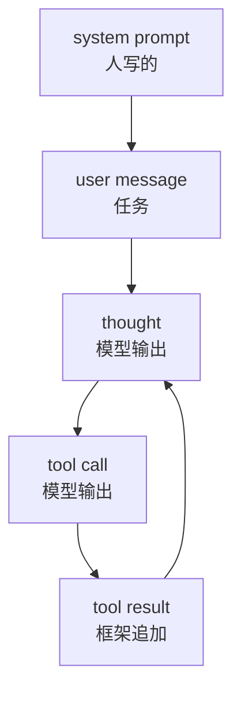
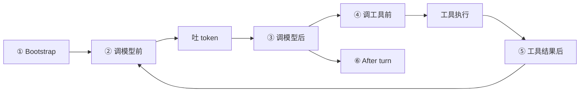
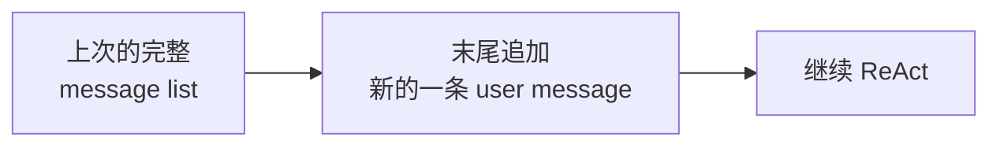
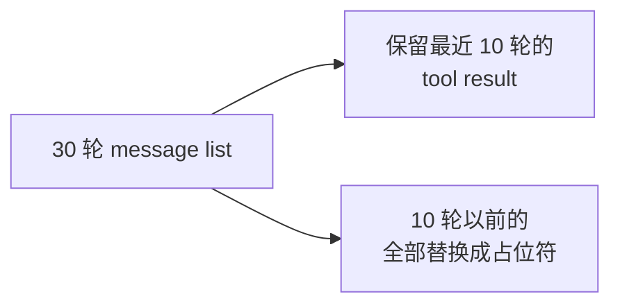
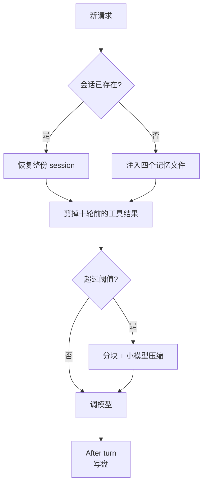

> 本文整理自课程文稿《19｜上下文的生命周期：Bootstrap、剪枝与压缩》。文稿末尾自注「内容由 AI 生成」，属整理稿而非逐字记录。
>
> 文中的阈值参数、函数行为与执行过程沿用文稿原述，未做外部核验。

上一篇讲清了记忆的本质。这一篇开始动刀：**怎么在运行中管住上下文。**

而它开篇第一件事，是先区分两种「不一样」。

## 工作流好管，Agent 难管

作者把两种情形的差别讲得很清楚。

**工作流里**：每次调模型都是程序的一步逻辑。**你完全可以把 message list 写死**——想放什么放什么，放哪儿都行。

**而 Agent 里不行。**

上图是 ReAct 的堆叠过程。

**关键在于**：system prompt 和第一条任务是你给的，**后面每一条 message 都是模型自己或框架追加的**。

> **你没有用程序构造任何东西**，所以也没法像工作流那样「往里添一个东西」——**因为你没有哪块逻辑能添。**

**Agent 的上下文是不断长出来的。**

**那能做什么？**

> 只有在一些特定的时间点，你可以挂一个钩子进去干预。

**这就是全部的操作空间。**

## 六个干预节点

这是全篇的骨架，值得完整记住。

| 序 | 节点 | 能做什么 |
|---|---|---|
| 一 | **Bootstrap** | 进循环前，**完全程序控制**：构造 system prompt 和第一条任务 |
| 二 | **调模型前** | 干预整个 message list，做剪枝、压缩 |
| 三 | 调模型后 | 异常判断、安全审查、纠正错误 |
| 四 | 调工具前 | 鉴权、屏蔽某些工具、改写参数 |
| 五 | 调工具后 | 审查、变更、**裁切工具结果** |
| 六 | **After turn** | 回答已产出，做存档、保存信息 |

上图是这六个点在一个回合里的位置。**注意 ② 到 ⑤ 是循环的。**

他特意强调了一句：

> **这是我们能够用代码控制 agent 行为的唯一方式。**

## Bootstrap：两条启动路径

### 路径一：新会话，注入记忆

第一次和助手对话时，**先把那套记忆文件加载进去**。

他举了几个实例：某些本地助手有七八个记忆文件；编码助手有写死的规则文件和一串配套文件。

**在框架里，他习惯把它注入到 agent 的背景设定字段**——这样能复用框架已有的机制。

而加载上去的内容分几类：**它是谁、你是谁、你们的共同记忆、它干活的流程**。

### 路径二：老会话，整体恢复

这条更巧。

> 如果这个 session 已经存在，**我就不再重新构造了，而是把原来那份上下文直接 load 回来。**

于是你拿回一个巨大的 message list，**然后在末尾追加一条用户的新消息**。

上图是这个接续。**而它带来的效果挺妙**：

> Agent 的感受是**感知不到中断的**。它觉得自己的 ReAct 一直在跑，只是给完一个回答之后，立刻又来了一条新问题。

**比只传对话历史更好的地方在于**：它带进去的是**完整的 agent loop 上下文**，包括中间那些工具调用，所以接得更平滑。

## 减法一：剪枝

启动讲完，就该处理那个老问题——**上下文会爆**。

### 判据：工具结果的价值随时间衰减

他的思路很直接：

> 价值最大的是用户的问题。**模型自己的思考、工具调用的入参，也相对重要。****但十轮、二十轮之前的工具返回，基本就不那么重要了。**

**所以剪枝的逻辑是**：留着最近的，砍掉老的。

具体一点：**把十轮以前的所有工具结果全部替换成一个占位字符串**。

上图是这个裁剪。**而「十」这个数字是可调参数。**

### 为什么敢砍

因为他给了一个兜底：

> 如果模型真需要用到之前的工具结果，**它可以再次调用那个工具去获取**。

**这个理由我觉得是关键**——它说明剪枝不是「丢信息」，是**把信息从常驻改成按需**。

## 减法二：压缩

剪枝只能砍工具结果。**但思考过程、工具入参这些 token 还在堆。**

所以还需要第二道。

### 做法：无损压缩

他用了「无损」这个词，而流程确实做到了可追溯。

| 步 | 做什么 |
|---|---|
| 一 | 触发阈值时，**把所有旧消息先持久化到磁盘** |
| 二 | 调一个**小模型**做摘要 |
| 三 | 摘要按结构化要素保留，写回上下文 |

**第一步我认为是最重要的设计**：原文写盘，**「我永远有这些原始信息」**。

### 阈值：不到一半就动手

他说自己「会比较相对激进一点」，**上下文填满三成多到四成多就触发**，不等它接近上限。

而他在反模式里专门批评了另一种做法：

> 过去大家用工具时，**都是等 token 超限了以后再压缩**。那时候其实非常不好。

**为什么？**因为到那一步，你要么被硬截断，要么压缩得太仓促。

### 分块：按 token 切

压缩不是整篇丢给模型，而是**按 token 数量切成块**。

他给的单位是**每块两千 token 左右**。然后逐块让模型压缩。

### 保留什么：结构化

压缩的提示词不是「给我压一下」，而是明确要求提炼这几类：

- 目标和用户要做的事
- 关键事实
- **待办**
- 中间的操作记录
- 观点

**而明确要求丢掉的是**：中间过程、失败的尝试、各种重复内容。

## 把它接到助手上

概念讲完，他用一个带记忆的助手走了一遍。设计分两块。

### 工作区里的四个文件

| 文件 | 内容 |
|---|---|
| soul | 自我认知：它是谁 |
| user | 服务对象是谁、画像 |
| agent | 平常干活的流程（SOP） |
| memory | **记忆索引** |

**而 memory 有个硬限制：两百行。**

理由很实在：

> 这个东西会一次性加载进 system prompt。**如果它巨大，system prompt 一上来就被撑爆**——「就像现在很多本地助手的问题一样」。

**而两百行怎么装下更多东西？**靠**渐进式披露**——索引里按主题分，需要时再去读对应的明细。

### 会话目录：两个文件

| 文件 | 用途 |
|---|---|
| 会话记录（jsonl 格式） | **完整历史**，每条 message 都在 |
| **压缩快照** | 下次进来直接用它恢复 |

**而两者的关系是**：压缩前先把原始全存下来，压缩后再存一份快照。**原始用于追溯，快照用于恢复。**

### 落地在哪几个钩子

他说得很省：**一共只用了两个地方。**

| 位置 | 干什么 |
|---|---|
| Bootstrap（注入背景设定，不用钩子） | 读四个文件，拼成 XML |
| **调模型前** | 恢复会话 → 剪枝 → 检查阈值 → 需要就压缩 |
| **After turn** | 把完整历史和压缩快照写回磁盘 |

上图是完整链路。**它就是这套记忆系统的全部实现——两个钩子加一个注入点。**

### 顺带记一个框架坑

他说本来想在「调模型后」那个钩子里存上下文，**结果发现框架那个钩子有 bug，用不了**。

**所以全部挪到了 after turn。**

> 大家如果用这个框架，实现时要特别注意这一点。

## 这套改造怎么验

他讲的是实现，但里面埋了几个可验证的口子。

| 验什么 | 怎么看 |
|---|---|
| 记忆有没有真加载 | 新会话问它「我是谁」，看是否命中四个文件里写的内容 |
| 会话有没有真恢复 | 二次提问时看它是否接着上次的结论，不用重新交代背景 |
| 剪枝有没有生效 | 检查 message list 里十轮前的工具结果是否已变成占位字符串 |
| 压缩有没有生效 | 看上下文占用是否回落，再确认磁盘上原始记录仍在 |

**其中「会话恢复」最好验**：他的做法是在回答之后追加一条新 user message，**如果上下文真接上了，模型会自然沿用上一轮的结论**；没接上，它会重新问你要资料。

而「压缩」这一步的验收要点是**两个文件都得在**——完整的会话记录和压缩快照。**只留快照就失去追溯能力，只留原始就等着再爆一次。**

## 反模式

### 一、Bootstrap 设计不到位

> 这个东西**需要经常重构、经常打磨**。不这样做的话，复杂度高了以后会变得非常冗余。

他说自己的四个文件不是一次写成的，而是反复调整的结果。

### 二、等超限了才压缩

前面说过。他补了成本这一层：**不管是为了上下文质量，还是为了调用成本，都应该主动压。**

### 三、压缩粒度太小 ⭐

**这一条是全文最锋利的例子，我原样保留。**

他说自己的做法是**按两千 token 一块**，这样块内有完整的语义。

而如果**一句一句压**呢？

> 假设用户回的就是一个 **yes**，那你压缩就完全没法压——**因为你不知道这个 yes 是在回答什么，你丢失了上面模型问他的那个语义。**

上图是这个失效。**这也说明为什么「压缩」不是文本缩减，而是语义重述。**

**但块也不能太大**——太大则损失的信息更多。

### 四、压缩时不加保护

> 压缩完的东西要放内存或写硬盘。**JSON 写入是有时间窗口的，一旦并发把结构写毁了，整个就废了。**

## 最佳实践

| 做法 | 说明 |
|---|---|
| **定期治理** | 他让自己的机器人**每周自动复盘、自己治理**，把该抽到索引的抽出去 |
| **静默压缩** | 利用对话中的空闲时间异步做，**别让用户等** |
| **结构化压缩** | 明确告诉它保留什么，**不能只说「你去压一下」** |
| **小模型做摘要** | 够用，且省成本 |

**「静默压缩」这条我觉得很实用**：它把压缩从「一次卡顿」变成了「后台动作」。

## 我的三点补充

以下是评注，不是原片内容；取舍由我负责。

**第一，六个钩子这个清单，本质上是「Agent 里你还能用代码说话的地方」的完整枚举。** 在 Agent 架构里，绝大部分控制权交给了模型——**你能插手的只剩这六个瞬间**。所以它不只是记忆篇的工具，后面讲安全、讲审计、讲成本控制，落点都在这六个点上。**记住这六个，等于记住这套架构的操作手柄在哪。**

**第二，「剪枝把常驻信息改成按需信息」这个思路，比「省 token」这个说法更值钱。** 因为它的前提是：**模型有能力在需要时重新取回**。所以剪枝成立的条件不是「这个信息不重要」，而是「这个信息可再获取」。**反过来，凡是不可再获取的信息，就不能剪——这就是为什么压缩前必须原文写盘。**

**第三，那个「用户只回了一个 yes」的例子，其实定义了压缩的最小语义单位。** 它说明压缩的对象不是消息，是**对话行为**——一问一答才算一个单元。这也解释了为什么结构化摘要里要保留「待办」和「操作记录」：**它们是把多轮对话粘成一个故事的骨架**。压掉了骨架，剩下的碎片再多也没用。

---

一句话总结：**Agent 的上下文你造不出来，只能在六个瞬间改它。** 所以记忆这件事，做到最后是两个动作——**留着可再取的，压成还看得懂的。**
