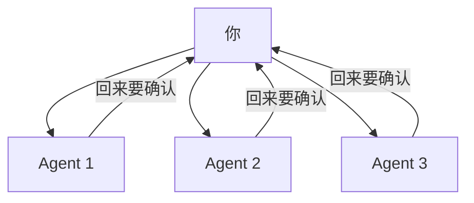

> 本文整理自课程文稿《24｜认知升级：从任务列表到数字团队》。文稿末尾自注「内容由 AI 生成」，属整理稿而非逐字记录。
>
> 文中引用的行业预测与作者个人体验沿用文稿原述，未做外部核验。

上一篇把任务级的多智能体收敛成了编排者范式。这一篇要说的是：**那条路走完，故事只到一半。**

## 先分清：工具还是员工

作者先给了一个很清楚的判据。

> 之前那一整套 Sub Agent 的方式，**其实还都是「完成任务」的思路。**
>
> 任务完成，子 agent **立刻清空消失。**只有主 agent 留在那里。

**所以那些子 agent 并不算员工。**

> **它们都只是工具。**

**而真正的数字员工不一样**：

| 有 | 意味着 |
|---|---|
| 自己的身份 | **知道自己是谁** |
| 自己的记忆 | **记得做过什么、做得好不好、偏好什么策略** |
| 自己的技能 | **同一类任务能越做越熟** |

**而最关键的差别是这一句**：

> 它**能跨任务持续存在**。

上图是这条分界。**它不是能力差别，是寿命差别。**

### 一个很朴素的类比

> 你招了一个人，**不是说完成一个任务你就开了他。**
>
> 你期望的是他能持续成长、有一套技能、能迭代技能，**然后你给他越来越复杂的事。**

## 为什么要按职位拆开养

这是全篇第一个我认为值得记的判断。

**先问一个反问**：如果有一个超级 agent 什么都能干好，为什么还需要分工？

**他的回答很干脆**：

> **现在这套技术和架构还做不到。**毕竟注意力是有瓶颈的。

**而「一个通用助手什么都干」的具体后果，他列了三条。**

### 后果一：进化方向模糊

> 什么都让他干，**他的进化方向会很模糊，技能会很散。**

### 后果二：技能多了反而选不准

> 虽然 skill 只需要加载名字和描述，**但你要是加载两三百个 skill**，占上下文也好、选的时候也好，**负担都非常大。**

### 后果三：记忆会混乱 ⭐

这条讲得最透，因为他说到了一个根本困难。

> 就算你把记忆按各种主题分好了，**但设置主题这件事本身就会带来很多歧义**。
>
> **你很难设计一套完全正交的系统，把所有的事情都放在一个合适的位置上。**

**「完全正交」这个词用得很准**：一个真实的人既是开发者又是投资者又是家长，**这些身份本来就互相重叠**。你硬要放进一套目录，边界永远有争议。

**所以他的做法是按职业分。**

> 我自己养了七八只 agent。**有的是写代码的，有的是做投资的，有的是做儿童心理的，有的是做商业分析的，还有做运营营销的。**
>
> **不同的 agent 掌握的技能、记忆、记录完全不一样。**

**而治理的成本也跟着下降**：**你只需要治理某一个领域的东西。**

**他还引用了一个行业预测**：到 2027 年，多数多智能体会是**专业化**的，而不是一个什么都能干的通用体。

> 原文在这里给了一个具体比例，**但属于外部预测、无法核验**，所以我只保留「专业化会占多数」这个方向判断。

## 然后是最真实的一段

讲完架构上的理由，他讲了一段我读完整篇后印象最深的话。

> 你可能以为养了那么多只 agent 就很轻松了——**不停派任务，它们在干活，你在喝咖啡。**
>
> **但事实上我前一段时间甚至神经衰弱。**
>
> 我睡眠多少年了，在公司一直没事儿，**然后这两天养 agent 养得我睡不着觉。**

**为什么？**

> 七八只 agent，**每只你一个消息扔出去，隔五六分钟就给你回消息。**
>
> 等的时候你还要并行指挥其他几只。

上图是这个结构。**注意每条线都是双向的——这就是问题所在。**

### 为什么人会是瓶颈

他分析得很实在：

> 你回复它的时候，**必须用大脑飞速运转，先消化它那一大篇报告，然后指出问题，再让它推进。**
>
> **整体效率看着是上去了，但所有的 agent 天天都在跟你聊。**

**他把这当成一次失败来复盘的**——不是抱怨工具不好用，而是承认**自己的用法出了问题**。

**而那句总结我认为是全篇最该被引用的话**：

> **其实你的 agent 越多，你其实是越忙的。**

### 这里有个反直觉的地方

**它的反直觉在于**：你雇了七个帮手，**却发现自己成了这七个人的调度员和审核员**。

> 你是所有 agent 串流程的那个人。**问题在这儿：那个 agent 有问题是找你问，而不是直接找另一个 agent。**

**所以对**。你被放在了拓扑的中心，而中心只能串行处理。

### 这次失败是怎么被定性的

他把失眠这件事归因得很准确，值得单独拆出来看，因为**归因方式决定了解法**。

| 如果归因为 | 那解法会是 |
|---|---|
| 工具不够强 | 换更强的模型 |
| 任务太多 | 少派点活 |
| **协作结构不对** | **改成团队制** |

**他选的是第三种。**

而支撑这个归因的证据，恰好是前面那三条架构理由的**反面印证**：

- 技能散、记忆混乱 → **说明一个通用助手扛不住**
- 每只都在等确认 → **说明缺的不是能力，是协作规则**
- 人成了拓扑中心 → **说明流程设计把决策全压在了同一个点上**

**所以他把失败落在了结构上，而不是能力上。**这也是为什么他的解法不是「再养一只更能干的」，而是「换一种组织方式」。

## 解法：从「环内」到「甲方」

他给了一个我认为很准确的术语切换。

> 这套更好的人机协作模式，**不叫 human in the loop，叫 human as 甲方。**

**甲方做什么？**

| 阶段 | 人介入 |
|---|---|
| 发任务 | **介入** |
| 中间协作 | **不介入** |
| 收结果 | **介入** |

> 剩下的时间，**你们自己该协作协作，该干活干活，遇到问题自己想办法解决。**

**「人当甲方」这个说法的好处是**：它明确了一件容易被忽略的事——**中间的确认环节不是价值，是成本**。

## 真正的意义：把任务放到更长的周期

讲完人的痛点，他给了一个更有分量的判断。

**他画了一条时间轴**。

| 时长 | 形态 |
|---|---|
| **分钟级** | 一问一答（最早用聊天产品时） |
| **小时级** | agent 能长时间工作（上一篇那个全栈开发） |
| **天级、周级、月级** | **数字团队** |

**而跨越这条线的标志是任务规模**。

> 我给它的命题不是开发一段代码，**而是：我有这样一个商业想法，你帮我落地。**

**那种规模要做什么？**他列了一长串：**产品调研、市场调研、合规分析、产品设计、开发、测试、上线、运维部署、交付。**

> 这么多领域，**每一个都需要一个非常成熟的 agent。**
>
> **这就不是一个超级 agent 带一堆 sub agent 能搞定的事了。**

上图是这条演进。**而每一级需要的不是更强的 agent，是更多的角色。**

## 关于一人公司

他顺带提了一个更远的设想。

> 现在很多人说 OPC（One Person Company），**我最近也在尝试。**

**而他的判断是**：

> 你要真想到达那个程度，**以现在这种「你盯着每一件事」的模式肯定不行，一个人会累死。**

**要走通，就必须**：

> **你只做老板**，中间的协作你不严格去看所有任务。
>
> **而且这些任务不是上节课那种小 task，而是相对大的任务。**

## 我的三点补充

以下是评注，不是原片内容；取舍由我负责。

**第一，「agent 越多你越忙」这句话，其实点出了编排范式的隐含成本。** 编排者范式优化的是**任务的执行效率**，但它把**所有决策点都集中到了主 agent**——而人就是那个最终的主 agent。所以每多一个子 agent，就多一条回到人的确认路径。**团队化的真正难点不在于能不能并行，而在于能不能让并行的那几路自己闭合。**

**第二，「完全正交的系统做不到」这个观察，解释了为什么按领域拆比按主题拆更稳。** 按主题拆（工作、生活、学习）会不断撞上跨界条目；**按职业拆则天然有边界**——因为职业本身就是社会已经替我们分好的类。这也说明数字员工的划分依据不是知识分类学，**而是责任制。**

**第三，「human as 甲方」这个说法值得留下，因为它把「人该在哪出现」讲成了合同关系。** 环内意味着你随时可能被打断；甲方意味着你只在两个时点出现。**而这个切换的技术前提是：那几路 agent 之间能直接对话**——否则所有协调仍然要经过你，甲方就退化回调度员。

---

一句话总结：**编排者范式让 Agent 干得更多，数字团队要解决的是让你少出现。** 而这两件事的难度完全不同——前者靠拆分任务，后者靠拆掉你自己那个位置。
