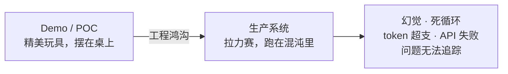
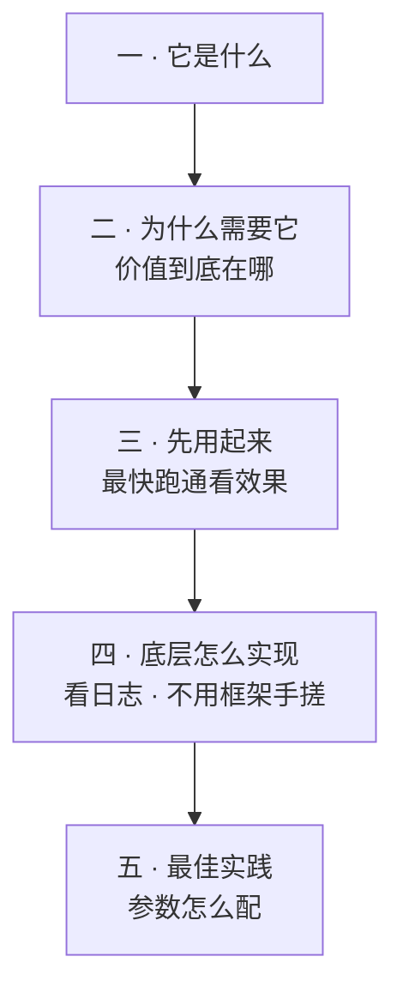
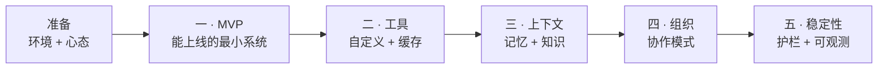

> 本文整理自课程文稿《05｜工程全景图：构建企业级多智能体系统的「施工蓝图」》。文稿末尾自注「内容由 AI 生成」，属整理稿而非逐字记录。
>
> 文中提到的框架名称与版本沿用文稿原述，未做外部核验。

第一章讲完了认知：四种范式、Agent 内部结构、多智能体协作、选型工具。

第二章换了个目标：**从零搭一套能上生产的多智能体系统。**

而这一篇是第二章的先导——在动手之前，先说清楚两件事：**差的是什么，以及怎么学。**

## Demo 和拉力赛

他先描述了一个很多人都处过的状态。

Agent 已经在测试环境里跑通了，甚至跑了很久，**但一直不敢用到线上业务。**

那个阶段搭出来的东西，他给了一个很准的说法：**一个非常精美的玩具。**什么都有，但它毕竟是摆在桌子上的。

而真正上生产，你要干的是另一件事——**不是让车跑起来，是跑一趟拉力赛。**

会遇到极端路况、极端天气，智能体可能已经跑得冒烟。而你要面对的是混沌里的各种问题：幻觉、死循环、token 超支、API 失败，还有各种诡异到没法调试追踪的问题。

**这中间差的，就是工程鸿沟。**

上图是这条沟的位置。注意右侧：这些不是能力问题，是工程问题。

## 填沟的还是最佳实践，但它有两层

他的答案回到第一章那个核心词：设计模式，也就是最佳实践。

但这次他把它拆成了两层，我觉得这是全篇最实用的一处区分。

| 层 | 管什么 | 例子 |
|---|---|---|
| 宏观 | 架构选型与组织方式 | 多智能体还是单智能体；混合怎么混；以谁为主导框架；中心调度还是路由；评估优化循环 |
| 微观 | 具体方法甚至参数 | 错误处理怎么写；迭代次数怎么控；每次调用的 token 怎么控；提示词结构 |

他强调了一个很扎人的观察：

> **线上挂了，有时候就是某一个参数没调，或者设错了。**

而微观这一层的坑有个特点：**它只在你真正动手时才浮出来。**

他举了一个很具体的例子。你写一个 skill，它本身也是代码。那它的错误处理怎么做？

**还能像传统接口那样，出错就抛一个内部错误就完事吗？**

「那可能就不大合适了，它的最佳实践会不一样。」

这句话背后是一个不小的转变：**工具不再是「被调用后返回结果」的黑盒，它返回的内容会变成模型的输入。** 所以错误信息写给谁看，性质变了。

## 五步深挖法

讲完差什么，他讲怎么学。

他先否掉了两种他不想要的方式。

**第一种：扒着代码讲 API。**「这个东西有哪些参数，分别是什么」——他说这非常无聊。

而且他给了一个判断：**写代码这件事迟早要被工具替代，真正怎么写已经没那么重要，重要的是如何设计好它。** 但你仍然需要知道它是什么，**这样你才能 review AI 写的代码。**

**第二种：只讲概念。**他提到一个具体的量级：这类框架的官方文档里提出的实体概念，数量在几十个。而第一章讲了很多概念，他认为有用，但「在实际实践过程中，好像暂时还没那么能用得上」——需要结合实践经验去消化。

所以他给了五步。

上图是这五步。他特别解释了为什么第三步之后还要有第四步。

### 为什么必须看第四步

他给的理由很实在：

> **开源框架在实践中的真正落地，还是有鸿沟的。**

他甚至直接说某个主流框架「bug 并不少」。拿它搭出来的东西，**有时候的确只是个 Demo。**

所以他的做法是：**借鉴框架的概念设计和方法，而不是把它直接搬进生产。** 而要做到这一点，前提是**你知道它底层怎么实现的**。

具体到课上，他的做法是三重：

1. 教你在框架里怎么写。
2. 教它底层原理、日志长什么样。
3. **教你怎么不用框架写出来**——就像第一章带着手搓一个 Agent 那样。

只有清楚底层，你才可能搭出稳定的线上系统。

## 第二层的最优解不是唯一的

讲到这里他补了一句很克制的说明，我觉得值得留着。

他说自己不敢保证讲的就是「最佳实践」——那只是在他的认知范围内、结合业内实践和自己的实践得出的结论。**这个东西需要不断完善，也需要和大家一起讨论。**

这不是客套。因为后面所有的方法论都建立在这个前提上：**最佳实践是会变的。**

## 施工蓝图：五个关卡

讲完方法，他给了整篇的路线图。

| 关 | 名称 | 目标 |
|---|---|---|
| 准备 | 先导 | 思想上准备好；把开发环境跑起来 |
| 一 | MVP | 没有复杂工具，但**是一个真能上线的系统** |
| 二 | 手眼通天 | 工具：自定义、缓存、最佳实践 |
| 三 | 大脑升级 | 上下文工程：记忆、向量库、知识工程 |
| 四 | 组织进化 | 从面向过程到面向组织；多智能体协作模式 |
| 五 | 稳定性 | 护栏、钩子、可观测性 |

有意思的是第一关的定义。他说 MVP **不是一个敷衍的 demo**，而是「一个实际可落地的东西」——只是没用复杂工具而已。

上图是这条路线。它和四关实战演练一一对应：MVP 关、工具关、context 关、协作关、稳定关。

## 一个值得注意的取舍

在讲第三关时，他说了一句很能代表他立场的话。

关于「让 Agent 更聪明」，他说：

> 我的理念一向是不太依赖模型的。生产中可能碰到各种各样的模型。

所以第三关的重点不是换更强的模型，而是**用工程方法让模型去做更简单、更确定的工作**。

这和他前面「不用太依赖模型能力，也许是我们工程没做好」是同一个立场。**在模型给定时，工程还有很大一块空间。**

## 我的三点补充

以下是评注，不是原片内容；取舍由我负责。

**第一，把最佳实践分成宏观和微观两层，解释了一个很常见的错配。** 大部分课程和文章讲宏观——选什么架构、用什么模式。但线上真正挂掉的时候，往往是微观的问题：一个迭代次数没设、一个错误处理写错了、一个 token 上限没控。**宏观决定你能不能跑到那条路上，微观决定你会不会在路上熄火。** 而后者只能靠动手撞出来。

**第二，那个「错误处理不能只抛内部错误」的例子，点出了一个容易被忽视的转变。** 传统工程里，错误信息是写给开发者看的，进日志就行。而在 agent 系统里，**工具的返回值会进模型上下文**——所以错误信息的读者变成了模型。写得含糊，模型就得瞎猜；写得清楚，它可能自己就能绕过。**这是一次读者对象的转移，很多人在写工具时还没意识到。**

**第三，「五步深挖法」里第一步是「它是什么」，最后一步才是「最佳实践」。** 顺序看起来理所当然，但实际学习时大多数人是从第一步直接跳到第五步的——知道概念，就去找参数怎么配。而中间那两步（先跑起来看效果、再看底层实现）恰恰是唯一能把概念变成手感的地方。**跳过第四步的代价，就是只会用框架，不会判断框架什么时候该被绕过。**

---

一句话总结：**能跑起来和能上线之间，隔着的不是能力，是那几十个没设对的参数。**而填这条沟的办法，只有动手和看底层两件事。
