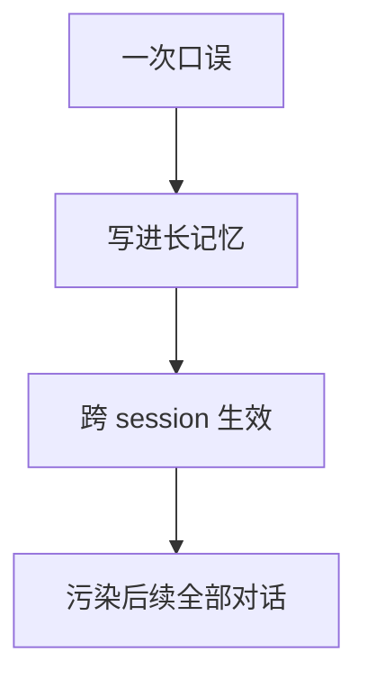
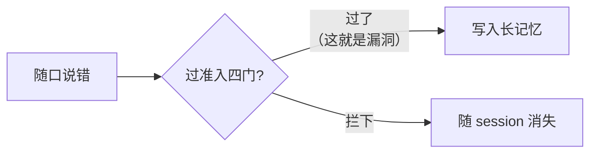
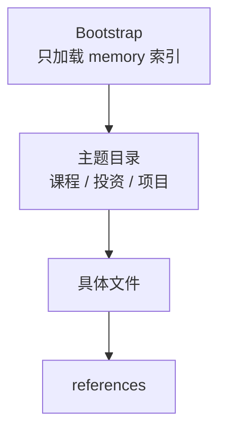

> 本文整理自课程文稿《20｜文件系统记忆：让 Agent 自己写记忆、自己学技能》。文稿末尾自注「内容由 AI 生成」，属整理稿而非逐字记录。
>
> 文中的行数阈值、案例数字与执行过程沿用文稿原述，未做外部核验。

上一篇讲的是「怎么把记忆加载进来」。这一篇补上另一半：**怎么让 Agent 自己写进去。**

而它给出的答案，是把写记忆本身做成一个 skill。

## 写入的本质：文件操作，但时机难

作者先给了一个让人觉得很简单的事实：

> 写记忆本身就是一个文件操作——把该写的文件按事先定好的规范写好就行。

**真正的难点在三个问题上**：

1. **什么时机触发**
2. **以什么规范写**
3. **写到哪个文件**

**而这三件事，恰好是 skill 最擅长的。**

所以范式很清楚：**做一个写记忆的 skill。**他称之为 memory-safe。

## 四步写入规范

他把这个 skill 设计成四步。

上图是这四步。**其中第一步我认为最有价值。**

### 第一步：四道准入

因为记忆会直接进 system prompt，所以**宁缺毋滥**。他给了四个问题。

| 门 | 判据 |
|---|---|
| 一 | **三个月之后还有用吗** |
| 二 | **有直接证据吗**（比如某条聊天记录） |
| 三 | **跟现有记忆重复吗** |
| 四 | **它是稳定属性吗** |

**第四条他举了个很妙的例子**：

> 今天是晴天——**你不能说每天都是晴天。**

**这四道都过了，才往下走。**

### 第二步：分类路由

因为记忆文件是一个体系，各有各的归属。

| 目标 | 装什么 |
|---|---|
| user | 关于用户的 |
| agent | 它自己的行为流程 |
| memory 索引 | 导航 |
| 各主题文件 | 具体内容 |

**所以 skill 里必须把这套目录结构写成规范**，它才能判断该写哪儿。**而这也顺带保证了读的时候好加载**——路由对了，索引才对得上。

### 第三步：写入前查行数

他给了两个阈值，分两档处理。

| 行数 | 动作 |
|---|---|
| **超过 150** | 写入时**给出警告** |
| **超过 180** | **必须先治理，再写入** |

**为什么 180 就要拦？**他解释得很清楚：

> 就算是渐进式披露，**每次也会把那个文件的全文加载进上下文**。太长就把上下文撑爆了。

**而「先治理」包括什么**：同位置合并、拆分成多文件、加索引做渐进式披露。

### 第四步：更新优于追加

这一条他讲得很重。

> **建议大家用更新的方式，而不是追加。**

**做法是**：在所有旧条目里找到相关的那一块，**把新信息合并进去**。

**只在纯新的东西上才追加。**

**而「无脑追加」的后果**，他说得很直接：

> 像写日志一样不停往下加，**就会造成记忆之间的相互冲突。**

## 另一半：把流程沉淀成 skill

记忆写的是「是什么」——年龄、偏好这类。**但还有一类东西要沉淀：做事的方法。**

他举的例子正好接前面几讲：**每天早上做投资早报，有五步**。

**一开始 Agent 当然不知道，你教一遍。那这一遍就该变成 skill。**

### 三个步骤

他用了官方那套 skill 创建规范，但指出完整版分七步，**日常只需三步**。

| 步 | 做什么 |
|---|---|
| 一 | **提炼实例**：从对话里抽出步骤，加上关键要求与规范 |
| 二 | **规范写入**：按模板写 frontmatter（名字、描述、触发时机）+ 正文（步骤、规范、关键规则） |
| 三 | **注册并验证**：写进指定目录、注册索引，再做一次回滚验证 |

**第三步他补了一个细节，很实用**：

> 不同助手的注册方式不一样。**而在这个项目里，要告诉它写到哪个目录、并且注册那个索引文件，最后做一次回滚验证。**

上图是这个沉淀。**注意最后那个验证**——它保证写进去的东西真能生效，不是写完就算。

### 什么时候用哪个

他给了一条很清晰的分界。

| 记什么 | 用什么 | 为什么 |
|---|---|---|
| **「有什么」「是什么」** | memory-safe | 直接进 system prompt，更直接，但别放太多 |
| **复杂的「怎么做」** | skill creator | 有标准结构，能完成重任务，还能拆给子 agent |

**他的判据是复杂度**：简单事实走 memory，**复杂 SOP 走 skill**。

## 减法：记忆会坏

到这里全是加法。**而他接下来讲的，是这一篇真正的重量。**

先给了个前提：按那份研究，harness 有三根支柱——**上下文管理**（上一课）、**行为约束**（后面讲安全）、**定期治理**。

### 为什么会坏

他把这件事比作熵增。

> 你真的把一个 agent 当助手养的时候，**你倾向于不停给它灌输新记忆、新知识**。它不符合预期，你又去教它。
>
> **写的东西越多，里面就越混乱。**

**而坏法有三种。**

**一、腐化。**记忆有时效性。**去年的事到了今年就会失真**——描述几月几月的时候就有问题。**结果就是说话驴唇不对马嘴。**

**二、增长。**这一条他给了一个真实案例，我认为是全篇最触目的：

> 一开始用同一个助手干同样的事，**一周一百多美元**。到后面，**一周就得一万多、四万多。**

**为什么？**三件事一起涨：**system prompt 越来越长、渐进式披露加载的记忆越来越多、跑的轮数越来越多。**

**三、污染。**这一条最隐蔽，而它来自一次真实的失败：

> 假设我跟 Agent 说「可口可乐和百事是一个公司」，反复聊，它信了。
>
> **在没有记忆的时候，这个错误随 session 结束就没了。**

**而现在它会被写进记忆系统——这就是那次失败的关键一跃。**

> 那它就**永远认为**这两家是同一个公司了。**一个小问题会扩散、污染大量的 session。**

上图是这条扩散链。**记忆把一次性错误变成了永久错误。**

### 什么时候打扫

| 时机 | 触发条件 |
|---|---|
| 同步 | 文件超行数时顺手做一次小治理 |
| **周期** | 每月定期 review 记忆与 skill，查冲突 |
| 用户主动 | 出了问题，要求审计 |

### 八项检查清单

他把它也做成了一个 skill，带一份清单。

| 检查 | 找什么 |
|---|---|
| 一 | 行数超没超，有没有**死链**（说「去读 A 文件」，但 A 不存在） |
| 二 | **野文档**：某个文件没被任何索引提到 |
| 三 | **路由错配**：该去 A 找，却指向 B |
| 四 | **表述冲突**：同一件事一处说白、一处说黑 |
| 五 | **表述冗余**：同一件事散在多个文件里 |
| 六 | **skill 健康**：脚本还能不能跑、描述有没有重叠 |
| 七 | **安全扫描**：有没有恶意内容混进来 |
| 八 | **过期**：180 天没更新也没读过 |

**其中「野文档」这一条他讲得最透**：

> 渐进式披露是一层层加载的。**你都索引不到，那个文件就是孤立的，基本没有任何意义。**

**而最后那条他给的理由更狠**：**「180 天都没更新、甚至都没读过，那这个东西先删了吧。」**

## 那三个 skill 实测下来怎么样

他说这一课「代码里没有什么东西」，跟前面几乎一致——**唯一的差别是加了三个 skill，并且把沙盒挂载改成读写。**

这一点值得单独指出：**因为要能创建新 skill，所以 skill 目录不再只读。**

### 三个 case 的验收口径

| case | 怎么说 | 看什么 |
|---|---|---|
| 写记忆 | 「我以后写 Python 尽量用中文注释，回复也在 200 字以内」 | user 文件里是否真的多了这两条 |
| 建 skill | 「每天的港股早报要有这几步」 | skill 目录下是否多出一个新技能并注册成功 |
| 治理 | 主动要求审计 | 能否扫出死链、野文档、冲突 |

**第一个 case 的执行过程他展示了**：agent 先加载 memory-safe，再读 user 文件，**做一次字符串替换把新条目并进去**——不是追加到末尾。

### 一次真实失败的链条

前面那个「两家饮料公司是同一家」的例子，其实是一次完整的失败复盘。

**失败怎么发生的**：他随口说了一个错的前提，agent 信了。

**为什么以前不会出事**：**因为那个错随 session 结束就消失了。**

**这次为什么出事**：它被判定为「值得记」，写进了长记忆。

**改进是什么**：这就是为什么写入前要有**四道准入**，以及为什么要有**安全扫描**这一项。**失败不在识别，而在放行。**

上图是那个判据的位置。**它说明准入不是用来筛价值的，是用来筛可靠性的。**

## 一个很准的比喻：记忆是一棵目录树

讲完三个 skill，他回到「为什么现在都用文件做记忆」这个问题。

**他的回答借了一段互联网史。**

> 2000 年前后的门户网站——你想在互联网上找分类信息，从首页点进目录，再点子分类，一层层点到最终那一条。

**这就是最标准的图书馆索引。**

**而这套文件系统记忆，用的正是同一种结构。**

上图是这套层级。**关键在第一层**：

> 关于课程、关于投资、关于项目的那些文件，**一开始全都没有加载，对上下文的占用是零。**

**等它需要了，再一层层读进来。**

> 所以我不用做全量预加载把上下文撑爆，**而是顺着索引一层层往下，把知识都管起来。**

**代价是什么？**他说得很坦率：**模型要多花几轮。**

## 反模式

### 一、记忆污染链

这一条他指出是一种攻击手段。

> 记忆在 session 里不会扩散。**但一旦写进长记忆，它就会扩散到整个助手。**而如果这个助手还跟别的东西共享记忆，**那范围会再扩大一圈。**

### 二、记忆贪婪症

**这一条最反直觉，我原样保留。**

> 不管什么东西都往记忆里写。**但在业界测试中，这种无差别写记忆的 Agent，基准成绩甚至比空记忆的还差。**

**为什么？**他给了机制：

> **记忆更多的是激活模型里已有的知识。**很多东西模型本来就知道，**记忆只是把它激活。**

**所以「记了什么」不如「激活了什么」。**

### 三、腐化

只写不治理。前面讲过了。

### 四、记忆泄露

这条是企业场景才有的。

> 多个用户共用同一套文件系统时，**写入路径是模型生成的**，就可能把 A 的记忆写进 B 的目录。

**而对策不是靠提示词**：需要**强校验**，加上**工具层的钩子**来保证隔离。

## 最佳实践

| 做法 | 说明 |
|---|---|
| 准入四门控 | **事先控制比事后清理省事** |
| **带时间戳** | 记录生产日期与有效期，模型才能判断哪条还有效 |
| 更新优于追加 | 别往下堆，就地合并 |
| **闭环治理** | 主动感知阈值，**最好有后台自动触发** |

## 我的三点补充

以下是评注，不是原片内容；取舍由我负责。

**第一，四道准入里最重要的其实是最后一道：稳定性。**「今天是晴天」这个例子说明，**记忆的判据不是「是否正确」，而是「是否会持续正确」**。这条判据把记忆从「记录事实」变成了「记录属性」。**而只有属性，才值得长期占着 system prompt。**

**第二，那个「一周一百多美元涨到上万」的案例，指出记忆的成本是复利的。** 因为记忆会进每一轮请求的固定底噪，**它不是一次性开销，而是每次调用都在付**。所以写记忆这个动作在写下那一刻看起来免费，**实际上是签了一份长期租约**。

**第三，「记忆贪婪症反而更差」这条反转，其实是整篇的收束。** 如果记忆的作用是**激活已有知识**，那无差别记录只会做两件事：**增加噪音、消耗注意力**。这也把所有减法机制串起来了——**准入四门、行数上限、八项检查、过期删除，全是在保护「激活」的效率，而不是在保管信息。**

---

一句话总结：**文件系统让记忆变得廉价，所以纪律才是稀缺品。** 写之前问四句，写完定期扫一遍——**否则你养的不是助手，是一份越来越贵的错误。**
