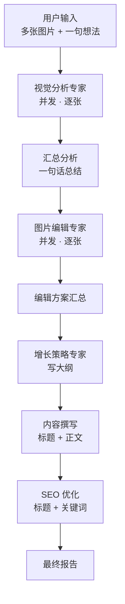
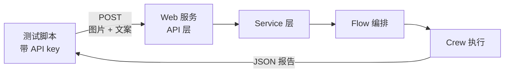
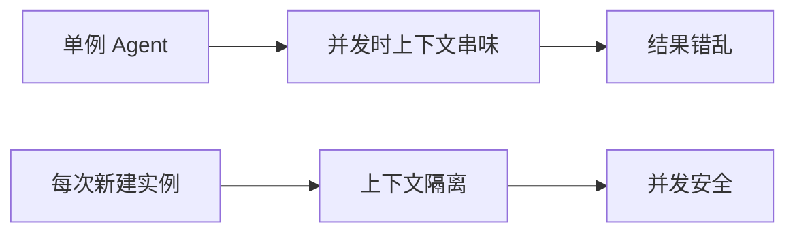
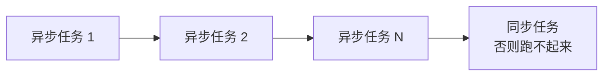
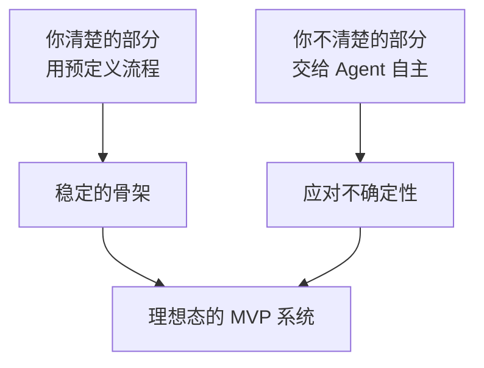

> 本文整理自课程文稿《11｜项目实践（一）：小红书爆款笔记生成项目》。文稿末尾自注「内容由 AI 生成」，属整理稿而非逐字记录。
>
> 文中的结构、参数名与框架行为沿用文稿原述，未做外部核验。

前面七讲，每一讲拆一个零件：Agent 怎么定义、Task 怎么拆、Process 怎么调度、图怎么看。

**这一讲把零件装成整机。**

## 先说清楚要做什么

产品需求很简单，也很真实。

**输入**：几张图片，加一句想法。小红书本来就是图片为主的平台，用户手里通常已经备好了七八张图。

**输出**：一份可以直接拿去发布的报告，里面包含三样东西。

| 内容 | 具体是什么 |
|---|---|
| 图片方案 | 选哪几张、哪张当头图、发布顺序、每张怎么精修 |
| 文案 | 标题、正文 |
| 标签 | 带哪些 tag |

他特意说明了范围：因为还没讲工具，所以这一版只到「报告」为止。**等学了工具，才能真的把笔记发出去。**

## 架构：两段并发 + 一条串行主线

这是整讲最该记的一张图。

上图就是这条流程。**注意它的形状**：前面两段是扇出的（八张图就是八个任务），后面是一条线。

而架构设计的第一个决定就藏在这里：**为什么视觉分析要并发？**

他的回答很实在：**为了整体时延可接受。**八九张图串行分析，用户等不起。

## 为什么不写脚本，而是写服务

接下来他做了一个我认为很有代表性的选择。

之前的课程都是「跑一个 Python 文件就出结果」。而这个项目**单独拆出来**，做成一个完整的 Web 服务。

理由讲得很清楚：

> 真正要上线，肯定不是一个脚本调用就 OK 的。

所以至少要有：一个 Web Server、一个对外的 API、用户 POST 上传图片和文案、返回 JSON 格式的报告。

**这就是最典型的 Web Service。**

上图是这个服务的形状。**注意那个 API key**——他的理由是：真做应用不可能让别人无限调用你，所以要有个安全限制。

### 先看效果

他先跑了集成测试脚本，用的是自己日常的减脂餐照片：三文鱼、沙拉、青菜。

想法是「分享最近开始用地中海饮食减肥」。

返回的 JSON 里有几样东西值得看：

- 标题（他吐槽不知道为什么是 Day3，估计模型觉得这样更吸引人）
- 正文，讲地中海饮食怎么不饿肚子减脂
- **发布顺序 03213**——五张图的具体排序
- 标签列表
- 每张图的编辑方案：统一曝光、裁切、饱和与对比、滤镜、**头图要不要加文案**
- 风险提示

后面他还专门点了一句：头图很关键，所以要写文案上去；其他图不需要。

## 工程层的四个决定

这一段是这一讲区别于前面所有课程的地方——**它开始谈工程规范了**。

### 一、先有框架，再有项目

他提供了自己的 Python AI 应用框架，基于 FastAPI，能集成 Crew。

目录结构是这样分工的：

| 目录 | 放什么 |
|---|---|
| 源码 / app | 主要功能 |
| API | 对外接口（v1 下面挂小红书） |
| core | 启动配置加载、安全校验 |
| crew | 业务层，所有 Agent 与流程配置 |
| db | 数据库封装（这个项目用不到） |
| schema | 所有数据结构定义，含 Task 的入参内核 |
| service | MVC 里 API 下来那层 |
| 可观测套件 | Logger、Metrics、Trace |

关于可观测那套，他讲得很具体：有 HTTP 埋点 trace、JSON 标准化日志、能导出到 Prometheus 的 metrics、trace log。

**但他说了一句诚实的话**：为了这个项目方便看，他没有配成 JSON 日志。

### 二、测试和代码同源

他的项目里有单测，也有集成测试。而他的评语很干脆：**「反正是 AI 生成嘛。」**

更值得注意的是另一条建议：**设计文档也建议和代码同源。**

理由不是给人看，而是：**这样能让 Claude Code 或 Cursor 更好地理解你整个项目。**

这是个挺新的工程动机——文档不只是给人读的，也是给 AI 读的上下文。

### 三、提示词要跟代码解耦

他在 crew 目录下单独放了 config，所有 agent 和 task 都定义在这里。

> 这也是框架非常推荐的做法：**prompt 跟代码本身解耦。**

好处他说得很清楚：把提示词写在纯文本配置里，就可以独立更新和编辑，**让它独立于程序去进化。**

他还补了一句：「现在我们最爱玩的那些小龙虾之类的，也是这样的逻辑。」

**注意这里没有自动进化机制**，只是先把结构搭成这个样子。

### 四、Agent 实例绝对不能用单例

这一条我读完觉得最有价值，因为它来自真实踩坑。

他说一般 demo 都会把 agent 做成单例，但这里不建议。原因：

> 框架自己有 bug，**在并发场景下用单例会有冲突，因为上下文没清干净。**

他还补了一句很有意思的话：**「我一边做这个课程，一边都在给框架提 bug。」**

所以他的做法是：每次需要 Agent 的时候，**生成一个新实例。**

上图是这个权衡。**代价是内存和初始化开销，换的是并发正确性。**

## 那个坦白的框架缺陷

讲 task 配置时，他提到有一类任务看起来很奇怪——**汇总任务**。

每批图片分析完之后，都要跟一个「把结果汇总成一句话」的任务。他解释了为什么必须加：

> 框架在实现上有个缺陷：**批处理节点后面必须跟一个同步节点**，否则整个流程跑不起来。

所以那个汇总任务不是产品需要，是框架需要。

上图是这个约束的形状。**最后一个节点必须是同步的。**

他还特意在代码里把最后一个节点的异步标志设成 false，并把汇总任务放在所有 task 的最后。

> 这类细节在文档里通常找不到，只能靠踩。**而它决定了你的批处理能不能跑起来。**

## 一次请求的完整旅程

他带着过了一遍代码路径，我按顺序整理。

### 第一段：视觉分析（并发）

1. 从 API 路由进来，先取到所有图片。
2. 因为是长耗时任务，**全链路异步**。
3. Service 层读配置、做校验、压缩图片。
4. 组装领域模型请求（也就是 Agent 的入参）。
5. 进入 Flow——**这才是真正的业务编排入口。**

在 Flow 里，他为每张图 build 一个 task，**异步标志打开**，所以全部并发执行。

然后按前面说的，末尾加一个同步的汇总任务。

接着创建 crew、异步 kickoff、**加超时时间防任务卡死**。

执行完拿到 task output 列表，逐个取出拼成视觉分析报告。

### 第二段：编辑方案（并发，但带上下文）

逻辑几乎一样，**唯一的区别是入参变了**：视觉分析的结果会作为变量填进 task 的模板里。

他说了三个槽位：图片 ID、图片信息、视觉分析结果。

**这就是显式传参的价值**——上一段的产出是这一段必需的输入，一眼能看出来。

### 第三段：主线（串行）

第三个 crew 跑三件事：大纲、初稿、SEO。

而这一段的报告传递方式不一样：不是靠 task 之间的隐式传递，而是**通过 crew 执行时的 inputs 参数**，把用户原始想法、视觉报告、编辑报告一起注入。

然后写大纲的 task **显式指定 context**，指向自己的上游；SEO 优化 likewise 引用前两个任务。

**为什么用 inputs 而不是纯 context？**因为这一段要的东西横跨前面所有阶段，显式列出来更清楚。

### 收尾：不调模型的拼接

最后组装报告时，他做了一件挺聪明的事：

> 这一部分完全是一个字符串拼接，没有再调模型。

原始意图、每张图的编辑方案、标题、正文、顺序、标签——全部拼起来就是最终报告。

**能不用模型就不用**，这是成本意识。

然后清理临时目录和压缩过的图片，返回结果。

## 模块一的收束

他给了这一模块的定性，我觉得说得很准。

> 这个项目虽然没用到太多工具，顶多用了多模态，**但它真能实际帮我们解决问题。**

然后是一个我认为整讲的点睛判断：

> 你不一定要求所有流程代码都是它自己写的。**一些你能控制的，就用 workflow 那样的预定义流程。**

而真正交给 Agent 自主决策的，是那些**你确实不知道的地方**：

- 用户给的是什么图——不知道
- 图片该怎么编辑——不知道
- 中间该一步步怎么想——不知道

**只有这些不确定的环节，才借助 Agent 的自主编排能力去完成。**

上图是这个分工。**而这也是整门课从第一讲就埋下的那条线**：不是全 Agent 最好，是知道哪里该用 Agent。

## 我的三点补充

以下是评注，不是原片内容；取舍由我负责。

**第一，那个「批处理后面必须跟同步节点」的坑，是这一讲最有实用价值的信息。** 因为它属于**只在运行时才暴露、文档里又不写**的那一类问题。而它有个很坑的特征：报错往往说不清是为什么，你会以为是自己的批处理逻辑写错了。作者把它点出来，等于替所有人省了一个下午。

**第二，「Agent 不能用单例」这条，本质是并发安全和上下文隔离的冲突。** 单例在传统服务里是省资源的标配，但 agent 是**有状态的**——它带着一段上下文在工作。共享实例等于共享上下文，并发时很容易串味。**这也印证了前面几讲反复出现的主题：上下文是这个领域的第一性问题。**

**第三，「预定义流程 + Agent 兜不确定」这个收束，把整门课的方法论讲完了。** 前面的四象限选型是在「一个应用该用什么范式」的层面，而这里是**在同一个应用内部**做同样的判断：哪一段确定、哪一段不确定。**粒度变小了，但判据是同一条。**

---

一句话总结：**第一次实战的成果不是那个小红书报告，是一套结构。** 而结构里最值钱的部分，是作者诚实地标出了哪些地方是框架的坑、哪些地方是自己的选择。
