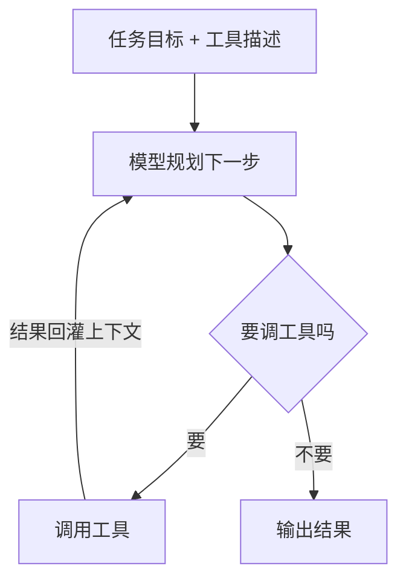
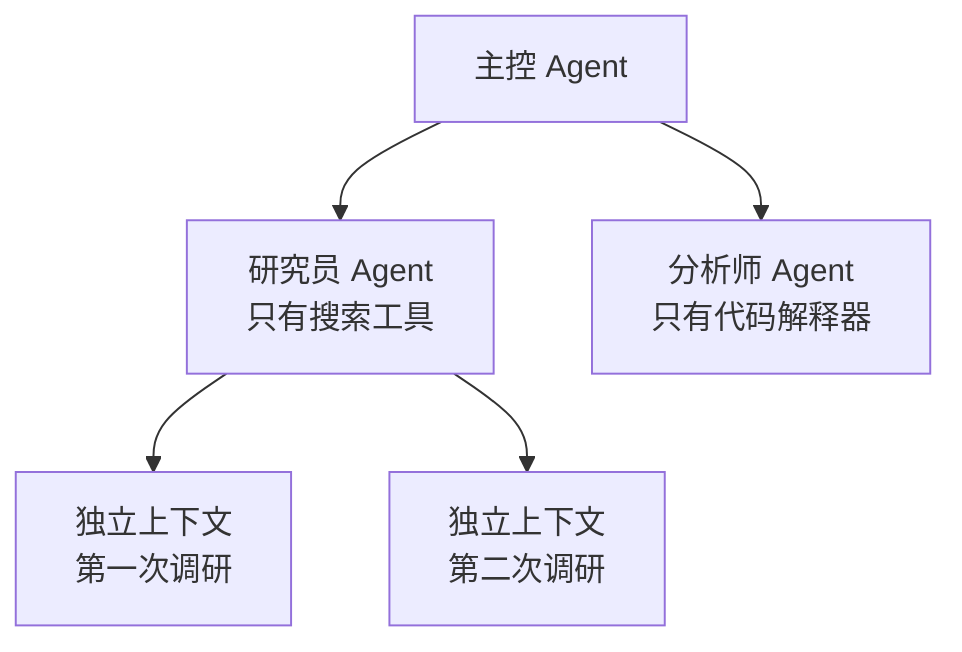
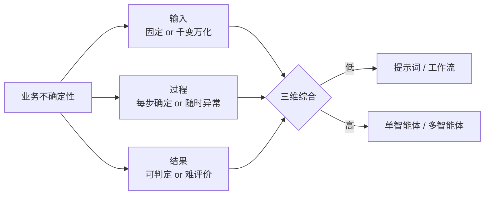

> 本文整理自课程文稿《01｜拨开迷雾：AI 应用开发的四种架构范式》。文稿末尾自注「内容由 AI 生成」，属整理稿而非逐字记录。
>
> 文中关于上下文长度的观察来自讲者自述的实践经验，没有给出测量方法，我照原样转述并标明这一点。

这门课不教某个框架怎么用。作者在第一段就说明白了：**他想谈的是 AI 应用本身怎么落地。**

而落地之前要先建立一件事：**当你遇到一个场景，该用哪种方式做。**

## 先承认概念已经乱掉了

他先花了一点时间骂这个概念环境，我觉得骂得有理。

提示词这个词，从最早出现到现在，怎么读都还有人争。RAG 是另一个。Agent 更是重灾区——有人坚持只有能自主决策的才叫 Agent，有人只要是多步调用工具的工作流也管它叫 Agent。同一个词，不同公众号写出来含义都不一样。

**所以这一篇要做的第一件事是拆掉这座巴别塔。**至少在这门课里，术语要有一套能互通的用法。

他用四种范式把这些词收进去，按自主性从低到高排列。

| 范式 | 谁决定下一步 | 自主性 |
|---|---|---|
| 提示词工程 | 没有下一步，一次生成 | 最低 |
| 工作流 | 程序员预先编排 | 低 |
| 单智能体 | 模型自己规划 | 中 |
| 多智能体 | 模型规划，加组织编排 | 高 |

## 一、提示词工程：拼好一个上下文

他给了一个很朴素的定义：**它研究的就是调用模型前那个 message list 怎么构建。**

后来这个词换过说法，一会儿叫提示词工程，一会儿叫上下文工程。但做的事是同一件——如何构造这段上下文，让模型更好地处理你的任务。

拿「生成一份竞品分析报告」举例，提词范式下要准备三样东西。

1. **知识**：因为模型没有工具、没有 action 能力，数据只能来自它自己或你手动贴进去的竞品资料。
2. **思维链**：你希望它按什么步骤处理。他强调这只是「期望」。
3. **任务目标与预期**：生成的到底是报告还是讨论，格式是什么，用什么语言。

三样拼在一起交给模型，一次生成。

### 真正的瓶颈：上下文不是越大越好

这一段是全篇我印象最深的判断，因为它跟当下的「长上下文竞赛」正好相反。

> 不能光看它能装多少，要看**能保持有效的那部分**有多少。这个区分需要实测，不能靠厂商的参数表。

他的实践观察是：**超过三五万 token，模型输出就会明显变慢，等待时间从几秒拉到几十秒的量级**；而且两件事会大幅下降——指令遵循（包括你写好的思维链），以及从大量信息里提取出真正需要的那部分。

他特意标注了这是自己的实践经验。这一点我觉得重要：它不是一个可以用来引用的定论，而是一个提醒你**别默认长窗口等于长有效**。

第二个问题是对模型能力的要求太高。「提示词做得再多，可能都比不上模型有一个好脑子。」

第三个问题更实际：**模型一迭代，提示词就得反复调**，项目迭代会被拖着走。

## 二、工作流：把路径写死

这是他认为**真正落地到工业实践里占绝大多数的范式**。叫 chain 也好，DAG 也好，本质是一样的：

> 由程序员通过硬编码，事先设计好路径，决定输入之后一步一步该怎么走。

区别在于，这条写死的路径上某些节点会调用模型能力。

他还是用竞品报告举例，把一条完整链路拆开看。

上图是这条链路的形状。注意每一格的职责都很清楚：**模型只出现在它擅长的地方**——非结构化信息的提取、文字生成、给定条件下的分类判断；而抓取、清洗、渲染这些确定的事交给工具和代码。

它的优点是稳定。「真的非常非常稳定。」

缺点是它的优点带来的：**边界清楚才编得出来。**一旦编不清楚，或者出现各种异常，就会非常麻烦，而且迭代效率不高。

## 三、单智能体：把下一步交给模型

从这一层开始，作者说他自己当初也觉得超出了程序员的想象。

因为写程序时，每一步都是我自己可控的。而到了 Agent，**变得不那么可控了**。

他对 Agent 的定义很严格，也很关键：**由模型自主进行规划的智能体。**

具体机制是这样的：模型作为大脑，你给它任务目标和一组工具描述。

1. 模型思考：下一步该干什么。
2. 基于这个决定调用工具。
3. 工具结果回到上下文。
4. 模型继续思考下一步。

那什么时候停？由模型自己判断。他举的例子很具体：搜索一次之后，模型可能觉得信息够了，就去生成；也可能觉得不够，就换个来源再搜。

上图是这个循环。**关键在第一个框**：谁决定下一步，这是 Agent 和工作的分界线。

他说设计 Agent 时真正重要的两件事：**给足工具并让它会调**；以及给一定的思维链，说明规划或拆解时应该怎么做。

## 四、多智能体：不是拆得更细，是隔开上下文

这一节是整篇最有价值的部分，因为他先狠狠地拆了一个流行误解。

### 什么不是多智能体

他说经常听人说「我们这个是 Multi-Agent」，进去一看——**只是在一个工作流里用了三段不同的提示词。**

在他的定义里，每个组成部分必须是一个真正的 Agent：能自主决策，能独立完成一个子任务。由这些 Agent 通过任务传递和流程编排，去完成一个复杂任务的系统，才叫多智能体。

### 为什么还要这么做

他也承认，有一种说法是有依据的：Agent 本身有不确定性，每多一个，出错的概率会上升；Agent 数量上去之后，整体成功率会明显下滑。

**但他的判断是，这属于对多智能体的误解。**

因为多智能体做的最重要的事，不是把任务拆得更细，而是——

> **上下文的隔离。**

这个解释很漂亮，值得展开。

**单 Agent 做竞品分析时**，每一次搜索的结果都会叠进同一个上下文。搜得越多，上下文越长，然后你就需要各种压缩、精简的技术去救它。

**多智能体时**，主控会把任务派给带搜索工具的研究员 Agent：先调研这家公司是做什么的，再搜它的商业模式。**每一次搜索都是独立子任务，上下文天然被切开。**

所以每次调用的上下文大幅缩短。而压缩终究不如隔离——这是他给出的判断。

### 第二个好处：工具专注

顺着这条线，他解释了 MCP 和 skill 的关系，我觉得是理解当下工具生态的一个好切口。

MCP 的每个工具本质上就是一个 API，要完整定义自己是干什么的、入参出参是什么。**当一个 agent 要调几十个工具时，光这些 schema 就能把上下文撑爆。**

skill 做的是在工具上加一层抽象：**先别告诉我参数，先告诉我这个工具是干什么的、一共有几个，给我一个目录。**然后我需要用哪个，再去看它的入参。

**多智能体是另一条路**：不给抽象，直接给每个 Agent 只配它需要的工具。研究员只有搜索，分析师只有代码解释器和数据分析工具。

效果是两重的：省上下文；**减少它在选工具、用工具时的幻觉和错误**。

上图是这两个好处的来源：**工具窄，上下文短。**

所以他把多智能体的价值收成一句：**靠组织的容错性，抵消单个 Agent 的不确定性，同时解决单 Agent 做不深的问题。**

## 选型判据：业务不确定性的三个维度

前面都是描述，这一节是决策。

他先引了一个概念：信息论里的阿什比定律——**只有多样性才能对抗多样性。**

这句话解释了一个现象：用工作流做很多事时，要么成本极高（因为要枚举所有情况），要么容错和效果上不去。

所以他给的判据只有一个东西：**业务不确定性**。而它有三个维度。

### 一、输入不确定性

输入是确定的还是不确定的。

- **确定**：比如用 AI 做数据清洗，从非结构化对话里提标签。输入形态固定。
- **不确定**：比如智能客服，用户带着各种目的来，给你各种任务。

### 二、过程不确定性

每一步执行时，中间结果确定吗。

- **确定**：像工作流那样，每一步给「是」或「否」，调用工具的结果无非「有」或「没有」。
- **不确定**：比如线上问题定位。每轮询一个模块有没有问题，结果都不确定——甚至查不查得到 trace、监控全不全，全是变量。

**而这种场景恰恰是工作流的死穴**：你得处理大量异常分支。交给 Agent 自主决策反而更好。

### 三、结果不确定性

目标是确定的吗。

- **确定**：通过或不通过。哪怕是金融风控这种核心业务，最终也是「能不能过」。
- **不确定**：比如让 AI 产出观点而不是数据。观点有没有价值，连人都难判断。

上图是这套判据的用法。他强调了一个后果，我认为比选型本身更重要：

> **没有落在最佳匹配区，就是欠设计或者过设计，这两种都很不好。**

## 四种范式的总结

他自己的收束是这样：

| 范式 | 一句话 | 什么时候会崩 |
|---|---|---|
| 提示词 | 我准备好了交给你，看你能不能一把出 | 上下文过长、模型换代 |
| 工作流 | 我全预先编排好 | 编不清楚、异常太多 |
| 单智能体 | 模型决定下一步 | 上下文堆积、工具过多 |
| 多智能体 | 靠组织给单 Agent 减负 | 组织本身有成本 |

最后他强调了一句，我觉得是全篇的态度：**不是什么东西都能一个大招搞定，一招鲜。**

## 我的三点补充

以下是评注，不是原片内容；取舍由我负责。

**第一，把「多智能体的价值是上下文隔离」听进去，很多事就顺了。** 大多数人一提多智能体就想到「分工」，然后困惑：分工用工作流不也能做？差别恰恰在这里——**工作流的每个节点共享同一段上下文，多智能体的每个子任务有自己的上下文。** 前者省编排，后者省上下文。而当上下文一旦成为瓶颈（他给的数字是三到五万 token），后者才是唯一解。

**第二，那个「三五万 token 之后效果骤降」的经验值得记住，但要当成经验。** 它跟厂商宣传的长窗口叙事相反，而作者自己也没给测量方法。我的读法是：**长窗口的价值在于「装得下」，不在于「用得好」**。装得下让你不必截断，用得好还需要别的机制——上下文隔离就是其中一种。

**第三，三个不确定性维度里，「过程不确定性」最容易被低估。** 输入和结果的不确定性大家都会评估：需求清楚不清楚、验收标准明确不明确。但很少有人问：**中间每一步的结果稳不稳。** 而线上排障、深度调研这类任务，恰恰是每一步都不稳、整体却必须完成——这类任务天生不适配工作流，再精细的编排也只是在枚举异常。

---

一句话总结：**四种范式没有高下，只有匹配。**选错的代价不是跑不动，是欠设计和过设计——两种都在烧钱。
