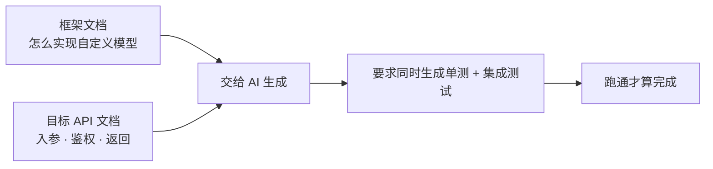
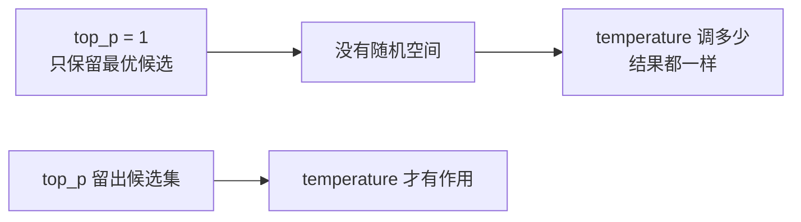

> 本文整理自课程文稿《06｜工欲善其器：课程学习的基础代码环境准备》。文稿末尾自注「内容由 AI 生成」，属整理稿而非逐字记录。
>
> 文中提到的平台、参数名与默认行为沿用文稿原述，未做外部核验。这一讲偏实操，如果环境已经搭好，可以直接跳到参数那一节。

这一讲分两半。

**前半段是搭环境**，内容很基础，作者自己也说「如果是实践基础很好的人，这节课其实不用太去关注」。

**后半段才是真正有用的部分**：把一大把模型参数按作用分组，讲清楚每组该怎么看。而这部分，我认为比搭环境重要得多。

## 前半段：三步把模型接通

### 一、拿一个国内能访问的 API

他选国内平台的理由很实在：网络条件友好，学员不会卡在访问上。

他顺带给了一条入口建议：**别从云厂商的大控制台进，直接进那个 AI 平台**，因为大控制台的服务跳转太乱。

关于选模型，他的立场一贯：

> 课程大部分场景用中档模型就够了，**我不倾向于用太强的模型**。

理由是性价比：与其换更强的模型，不如用工程手段把任务变简单。

### 那一处「找不到 API Key」的细节

他特意停下来讲了一个真实的坑：API Key 的入口藏得比较深，文档更新也不及时，而大控制台里有各种 service key 的入口，容易和模型的入口混。

他的提醒很实用：**别在控制台里到处乱点，认准那个小角标。**

拿到 Key 之后第一件事，他说得很重：**不要泄露**。他现场演示时刻意没有把 Key 露出来。

### 二、接进框架：改一个 base URL

这一步他说「非常简单」，因为主流平台都做了 OpenAI 风格的接口封装。

所以只需要三样东西：

| 配置项 | 填什么 |
|---|---|
| base URL | 从平台 API 文档里复制那个 SDK 调用的基础地址 |
| API Key | 放进环境变量，从环境变量读取 |
| model name | 你选定的那个模型名 |

配好之后直接调用，返回的就是标准的响应结构。想在 agent 里用，也只是把这个模型对象传给 agent 的模型参数。

### 三、企业内网 API：自己写一个模型类

如果要用公司内部的 API，就得自定义实现。他的做法是继承框架提供的基类，**只需要实现两个函数**。

**第一个是初始化。**把模型名、API Key 这些参数收进来，然后调用父类的初始化（模型、temperature 这两个基础参数）。剩下的都是自定义：鉴权方式、多机房端点、超时时间。

**第二个是调用函数。**它的入参是调用文本模型时的常见参数：

- message list
- tools（函数调用要传的东西）
- 回调函数列表
- 函数映射表
- 最大迭代次数（防止无限循环）

而函数体要做的事，就是**把这些参数拼成你的 API 请求，再把返回的 content 严格处理后，塞回约定好的数据结构**。

### 这一段最诚实的建议

讲完怎么实现，他立刻说：

> **我也不是很建议大家现在自己去写这个东西。**

因为 AI 编码已经很成熟了。他把框架的文档、目标 API 的文档一起丢给 AI，让它直接生成，**并且要求它把单测和集成测试都生成好、跑通**。

他还补了一句：**「其实我这部分代码也是生成出来的。」**

上图是他建议的做法。**注意最后一步**：让 AI 连测试一起生成并跑通，是保证这类适配代码健壮的关键。

## 后半段：参数分四组

进入正题，他说了一句我认为是这一讲的核心：

> 写代码的部分我不想讲太多，因为 AI 现在无所不能。**最关键的还是你的业务场景。**你要知道调模型时通常有哪些参数，以及业务中该怎么调。

然后他把参数分成三到四类。我按他的顺序整理。

### 第一组：模型效果

#### temperature 与 top_p

他说这两个是大家最眼熟的，也是教程讲得最多的——「什么情况用 0.3，什么情况用 0.7」。

**但他不建议背固定值。**理由是：**不同模型完全不同。**

他的建议是：**去读你要用的那个模型的推荐参数。**现在大多数模型会针对不同场景给推荐值，照它说的用就好，不要自己乱试。

> 想靠调参精确掌控模型输出，这件事本身是玄学的。你想掌握它，需要大量评测来支持，耗时耗力。**还不如想办法让工程把问题变简单。**

#### 这两个参数到底在做什么

他给了一段很扎实的原理解释，我觉得值得完整保留。

模型是一个 token 一个 token 输出的。当你说到「极客时间的」后面没了，模型会算下一个词该是什么。这里有两个环节。

**top_k（文稿里也写作 top_p 一起讲）**：召回几个候选词。

比如设成十，那「极客时间的」后面的「时」之后，就有十种可能的选择。

**temperature**：给这些候选词一个概率权重。

- **temperature 为零**：完全按模型算出来的相关性排序，取最好的那个。
- **设了 temperature**：虽然排序还是那样，但每个位置会被赋予一个权重概率，**随机完之后，输出的可能不是相关性最好的那个词**。

> 所以温度的本质，是让模型更发散——因为你在选择里加了一个随机因子。

#### 一条硬规则：它们会互相压制

他强调这两个参数的配合极为重要，并给了一个可以直接用的结论：

> **如果你把 top_p 配成 1，那 temperature 配什么都没用**。效果等同于把它设成零。

反过来，如果两个随便乱配，效果会非常不可控。

**所以反模式很清楚**：固定好模型推荐的 top_p，只调 temperature，别两个都动。

上图是这两个参数的关系。**先决定候选集多大，才谈得上在里面随机。**

#### 思考深度

第三个参数来自推理模型：思考的努力程度，通常分高中低。

- **高档**：大部分算力用来思考，用更多慢思考换效果。
- **低档**：简单想一下直接输出。

他提醒了一个成本角度：**思考过程全是输出 token**，既影响响应时间，也影响成本。

所以要不要思考，取决于场景。如果模型直觉就能反映出来的东西，没必要让它想。

### 第二组：稳定性（他认为最该认真挑的）

他说这组「非常重要」，并且**「我非常建议大家好好去挑」**。

#### 超时

他讲得很直接：传统工程里超时多重要，在模型这种长耗时场景里只会更重要。**「你不去控制好超时，你不等着雪崩吗？」**

> 这就是要把传统工程的实践，迁移到 AI 时代。

#### 最大重试次数

他的理由很清醒：**到现在没有哪家厂商敢说在模型的基础上能达到三个九、四个九的可靠性。**输入不确定性那么高，什么情况都可能发生。

所以超时加重试，是这一层的基础配置。

#### 最大输出长度

这一条他讲得最细，因为它有两头的坑。

**设得太短**：生成报告那种场景，你会得到半截的东西。而且它会影响效果——**模型会倾向于输出更少**。

**设成无限长**：也不行。尤其小尺寸模型偶尔会陷入异常，一直重复一段话，一直重复到上限。

> 虽然这是极端情况，但会发生。**一旦发生，在你的线上就是一个大长尾。**

他描述了这个长尾的具体危害：占用连接、占用排队资源、拖慢响应时间。

而它最难处理的地方在于：**平时大部分请求五秒返回，就这一个请求要六百秒。**

所以他的建议很朴素：**你的场景用多少，就配多少。**

### 第三组：功能性开关

#### stop

就是上一篇讲 ReAct 时那个 `stop` 参数——遇到指定字符串立即停止。

他说这里也有反模式：**如果你设的那个词太常见，或者设计时没考虑让它在日常输出里不出现，就会被误截断**，产生 bad case。

#### 流式输出

很多场景很好用，但**跑批的时候开流式就没必要了**，而且会大量占用连接数。

#### 调试开关

有一个参数能把候选词的概率全部返回出来。真正精调模型效果时可以用，**但生产环境别开**——「性能一定非常差」。

## 参数分组表

把散落的内容收成一张表，是我读完之后最想留下的东西。

| 组 | 参数 | 该调吗 | 反模式 |
|---|---|---|---|
| 模型效果 | top_p | 用模型推荐值，固定 | 和 temperature 一起乱调 |
| | temperature | 只调这个 | top_p 已配 1 还去调它 |
| | 思考深度 | 按场景选档 | 简单任务开高档，白烧 token |
| 稳定性 | 超时 | 必须配 | 不设，等雪崩 |
| | 重试 | 必须配 | 假设服务可靠 |
| | 最大输出 | 按场景配 | 无限长，制造长尾 |
| 功能性 | stop | 谨慎设 | 用了常见词，误截断 |
| | 流式 | 按场景开 | 跑批时开，占连接 |
| | 调试开关 | 仅开发期 | 生产打开，性能崩 |

## 我的三点补充

以下是评注，不是原片内容；取舍由我负责。

**第一，那个「top_p 配 1，temperature 就失效」的规则，是这讲最实用的一条。** 因为它把一个「调参玄学」变成了一个可以判定的工程事实：**temperature 是在候选集内部做加权随机，候选集只有一个的时候，随机无从发生。** 很多人反复调 temperature 却感觉不到变化，原因往往在这里。

**第二，「设太短会让模型倾向于少输出」这一点，比「输出被截断」更隐蔽。** 大部分人只知道截断会丢内容，不知道长度上限还会**反过来影响生成倾向**。这不只是够不够长的问题，是模型行为会变。

**第三，整讲最有分量的其实是一句方法论：不要试图靠调参掌控模型，而是让工程把问题变简单。** 这个立场在整门课里反复出现——前面讲「不用太依赖模型能力，也许是我们工程没做好」，这里讲「与其耗大量评测去调参，不如把任务拆简单」。**它把调参从「主要手段」降级成了「兜底手段」，这个优先级判断比任何参数技巧都值钱。**

---

一句话总结：**参数分四组，各管一件事——效果、稳定、开关。**而真正该花力气的是中间那组，因为它决定了你的系统会不会在半夜雪崩。
