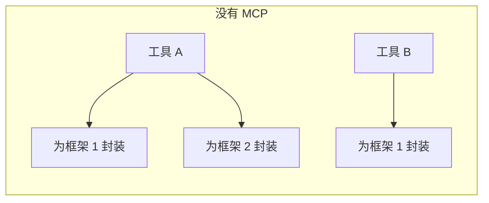
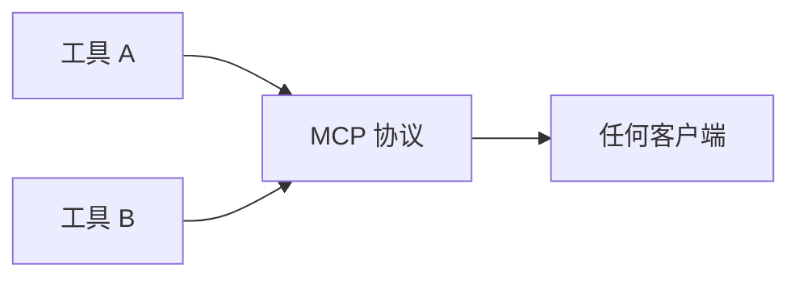
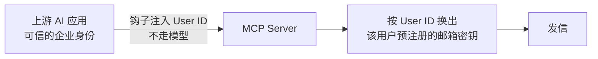
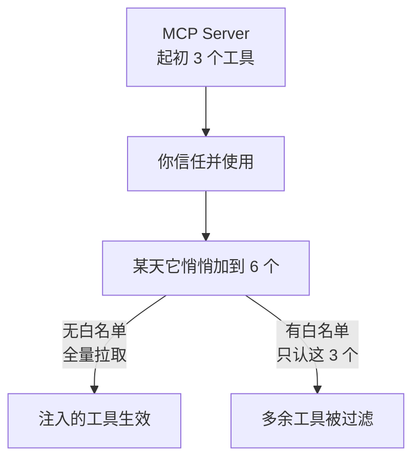

> 本文整理自课程文稿《14｜MCP 协议：标准化定义工具接口》。文稿末尾自注「内容由 AI 生成」，属整理稿而非逐字记录。
>
> 文中的协议行为、框架实现与端口沿用文稿原述，未做外部核验。

上一篇结尾留了一句：有人说 MCP 已死。这一讲就来回答它到底是什么。

## 先纠正一个误解

很多人以为 MCP 是个开源软件。**它不是。**

> MCP 是一套工具调用协议，2024 年由某家模型公司提出。

**协议的意思是：我定一个标准，大家尽量按这个来。** 就像 HTTP，只要都遵守，就能用同一套语言说话，于是形成生态。

而它把整个体系分成两端。

| 端 | 是谁 | 干什么 |
|---|---|---|
| Client | AI 应用 | 连工具、拉列表、发调用 |
| Server | 工具提供方 | 暴露固定的 MCP 接口 |

作者补了一个观察：**MCP 的设计主要是以调用远端服务为主。**默认理解是远端有一些服务器，各自提供不同工具，AI 只要知道地址就能用。

这和最早那批 Web Service 的思路是一致的。

## 三种能力，不只有工具

一个 MCP Server 通常支持三类东西。

| 类型 | 是什么 |
|---|---|
| Tools | 工具 |
| Prompts | 一批提示词，可让 AI 加载 |
| Resources | 文件内容，可定期更新 |

他顺手点了一句：**Prompts 这一类其实很像现在 Skills 的概念**。理由是「有时候 prompt 即服务」。

## 协议本身做了什么

接口层面很朴素：每个服务端暴露固定接口，其中有一个是**列出工具**。

**典型的一次连接是这样：**

1. AI 请求工具列表
2. 服务端返回有哪些工具，每个带 JSON Schema 描述入参
3. 选定工具后按固定格式调用
4. 结果返回给 AI 继续用

传输层也演进过：**最早用 WebSocket，后来改成 Streamable HTTP**，所以支持流式。

## 它到底解决了什么

这一节我认为是理解 MCP 价值的关键。

他先描述了没有 MCP 的时代有多难受。

那时候各种框架都起来了，自己也手搓了不少 AI 应用。**每当要接一个工具，就得专门封装一次**——像前面封装搜索 API 那样，每个都写一遍描述、写一遍适配。

**更糟的是换框架。**换到另一个框架，同一套调用逻辑要重写一遍。

而如果你是个工具提供方，想让别人用你的工具呢？**别人看着你的 API，还是得自己写代码。**

**所以状态是完全割裂的。**

上图是这种 N × M 的连接。**每加一个工具或一个框架，都要重新接线。**

MCP 的做法是：**协议统一之后，工具开发一次放在那儿，谁来接都不用管。**

> 有人来接，它就自动给一个工具列表——我有什么工具、有什么 prompt、有什么 resource。需要的时候调就完事了。

上图是它的形状：**从 N × M 变成 N + M。**接口只写一次，两边都按协议走。

## 生态现状：去哪儿找

他给了四个去处。

| 去处 | 形态 |
|---|---|
| 官方站点 | 收录典型或相对官方的 MCP，也有个人发布 |
| 各客户端的市场 | 比如编辑器里直接有 MCP 商店和排行榜 |
| 托管基站 | 自己写了没服务器，扔上去变成 Web Server |
| 开源社区 | 各种 awesome 清单，收集的是**地址**不是代码 |

他也提到两种交付形态：**有的直接给你一个地址就能调，有的给你源码要自己起。**

### 谁在提供 MCP

他有一个很有意思的观察：

> 要不然说 AI 先卷的还是开发者呢？**毕竟开发者最懂开发者。**

所以网上的 MCP Server 分四波，占比差别很大。

| 波次 | 类型 | 例子 |
|---|---|---|
| 第一波（最多） | 开发相关 | 排查错误、流水线、Git、数据库连接 |
| 第二波 | 通用 AI 工具 | 浏览器、搜索、文档处理 |
| 第三波 | 大厂 API | 地图、即时通信、文档管理 |
| 第四波（最少） | 垂类应用 | 金融、法律、股票行情 |

### 和 Skill 的关系

这是 13 讲留下的悬念，他给了判断。

> Skill 起来之后，MCP 生态确实受冲击。**但两者不是纯竞争关系。**

他的理由很直接：**MCP 仍然是如何执行工具的更好封装。**「你不能指望所有东西都拿 Skill 的 script 去封装。」

## 实作一：起一个邮件 MCP Server

他给了两个代码库：一个是客户端（框架里怎么接 MCP），一个是**基于 FastAPI 的 MCP Server 框架**。

框架本身把企业级那套都封装好了：**支持流式 HTTP、异步高并发、API key 鉴权、JSON 日志、Prometheus 指标、日志分级**。

而写一个工具，只需要**一个装饰器**。

### 邮件服务的三个工具

| 工具 | 作用 |
|---|---|
| 列出邮件 | 拿邮件列表 |
| 邮件详情 | 拿正文 |
| 发送邮件 | 发出 |

支持国内三家邮箱，想扩展只要填对应的 IMAP 和 SMTP 地址。

### 🔴 铁律一：密钥绝不能让模型管

这一句他说得很重，值得单独拎出来。

> **密钥不能交给模型管**。
>
> 所有让模型调用接口去生成密钥，都是非常不安全的东西。

**为什么邮箱这个场景特别明显？**因为发邮件需要私钥，而私钥一旦让模型经手，就等于把凭证放进了上下文——**而上下文是可以被构造的。**

他的做法是这样的链路：

上图是这条链路。**注意第一段**：用户身份是钩子直接传进来的，模型碰不到。

而且前提很硬：**如果这个用户事先没在 MCP 上注册邮箱和密钥，就根本发不出去。**

他给的接口只有两个：**注册邮箱**（一次性，注册后加密存在服务器上）、**MCP 工具调用**（请求头带用户 ID，映射到对应邮箱密钥）。

## 实作二：客户端怎么接

客户端这边反而简单，但要看清几个配置。

### 工具白名单（🔴 铁律二）

他在配置里加了一个**静态工具白名单**。

他说这个「为了安全控制非常重要」，而理由是一个很具体的攻击场景：

> 假设你调的是一个不可信的 MCP。开发的时候它还是好好的，你就直接用了。**结果用了一段时间，它看开发者用得差不多了，往里加了一堆黑客注入的工具。**

**然后你一次工具列表拉回来，就被黑掉了。**

所以他的做法是：**不管你提供什么工具，我只接受这三个。**

上图是白名单防的是什么。**它防的不是第一天的恶意，是第 N 天的变质。**

### 执行流程

他还带看了一遍真实运行。

**第一步，初始化时就请求工具列表。** 日志里能看到一次 `tools/list` 请求，返回每个工具的名字、描述、入参 schema。

**第二步，框架给工具改名。** 它会用 host 加 MCP 前缀拼出工具名——**这是框架自己的处理**，为了多个服务器的工具不冲突。

**第三步，模型思考后决定调哪个。** 当它发现要调的是那个带前缀的工具时，**框架自动映射回对应的 MCP 客户端**去真实调用。

**第四步，结果回灌，进入下一轮 ReAct。**

他说完这段的总结很实在：

> 你只要改一下 URL 和一些参数，就能让你的 AI 连接网络上的**任何** MCP 服务。
>
> **这就是 MCP 的价值——它让 AI 使用工具的成本变得非常低。**

## 这次实作里踩到和验证到的

原文散着几处实测细节，收在一起看比较清楚。

### 三个可验证的观察点

| 观察 | 怎么看 |
|---|---|
| 工具列表什么时候拉 | agent 初始化时就会发一次 `tools/list` |
| 工具名会被框架改写 | 日志里带 host 前缀，说明框架做了映射 |
| 改一个 URL 就能接新服务 | 「同样地，改一下 URL 和参数，就能连网络上的任何 MCP」 |

第三条是他反复强调的价值点，而它本身就可以用手验证：**换一个 MCP 地址，其它代码不动，看还能不能跑通。**

### 两个真实失败

**失败一：那个 20 多个工具的 MCP。**

他给了一个具体数字：**一个 MCP 返回二十几个工具，工具列表本身就要 13,000 token**。

后果很直白——上下文处理能力一般的模型，光装工具列表就撑不住了。他还顺手解释了一个长期疑惑：为什么浏览器那类 MCP 用起来总是不顺，**就是因为工具太多，模型扛不住。**

**失败二：白名单防的那个场景。**

他描述的是一次他没踩、但明确预见的事故：一个不可信 MCP，开发时好好的，用熟了之后往里加塞注入工具。**没有白名单，下一次 `tools/list` 全量拉取，直接就中招。**

他给的对策很干脆：**不管服务提供什么，只接受白名单里的那几个。**

## 反模式与最佳实践

### 一、MCP 不能太大

他给了一个很具体的数据：

> 一个 MCP Server 的 list 返回二十多个工具，**直接干上去就是 13K，相当于 1.3 万 token。**

**后果**：如果模型上下文处理能力不够，基本就废了。

他还顺手解释了一个长期疑惑：**为什么浏览器那类工具用起来总是不太顺？**

> 就是因为模型能力真的扛不住这么大的 MCP。

**但也不能太小。**因为每套都是 schema，太小的话多次交互同样浪费 token。**还是回到工具设计的原则。**

### 二、别同步阻塞

Streamable HTTP 本身是长连接。**如果底层工具跑太久，你不要同步阻塞在那里**——「那样很有可能就超时断开了。」

### 三、身份参数不能走模型

这条前面说过，他又强调了一次：**用户身份参数一定要放在 HTTP 头里，不能让模型生成。**

### 四、最佳实践：无状态 + 幂等

> 最好做成无状态的 MCP，并且保证幂等，这样才能更好地让 AI 去用。

## 我的三点补充

以下是评注，不是原片内容；取舍由我负责。

**第一，「工具白名单防的是变质而不是恶意」这个视角值得单独记。** 大多数安全讨论假设敌人在一开始就存在，所以「先审查再用」看起来够用。**但 MCP 是个远程连接，服务端随时可以改。** 你今天审过的东西，明天可能不是同一个东西。白名单的价值就在于：**它把「信任」从一次性判断变成了持续约束。**

**第二，「密钥不能让模型管」这条和上一篇的权限铁律是同一条原则的两次出现。** 上一篇讲的是「权限传递不走模型」，这一篇讲的是「密钥不经模型手」。**共同点是：凡是安全凭证，路径都必须绕开模型这一层。** 因为模型读的是文本，而文本可以被构造——**模型不是一个可以承担安全责任的组件。**

**第三，那个「20 多个工具 = 1.3 万 token」的数字，解释了 MCP 生态的一个隐性成本。** MCP 让接工具变得极便宜，**但每个接上的工具都在常驻消耗上下文**。所以它的自由是双向的：接得快，也堆得快。这也解释了为什么作者一直强调「工具要小、要专注」——**在 MCP 时代，克制比能力更重要。**

---

一句话总结：**MCP 把「接工具」从一对一的活，变成了一个协议。** 代价是每条连接都要重新问一遍：这个工具我真的需要吗，它明天还是我审过的样子吗。
