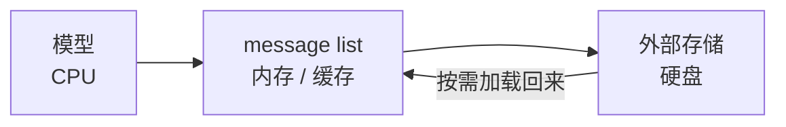
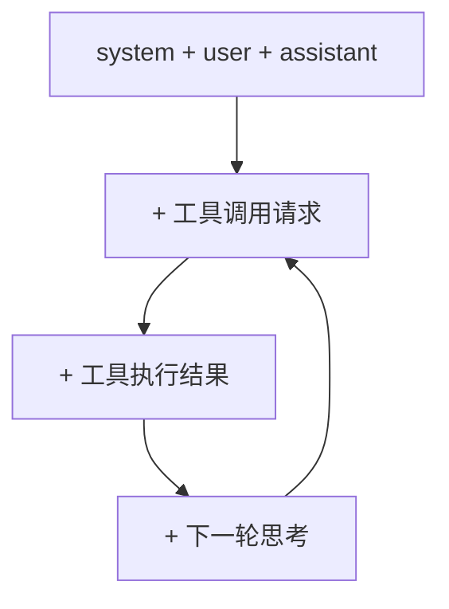
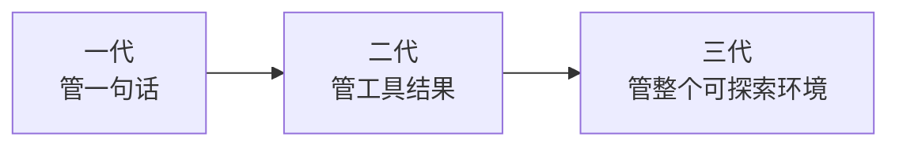
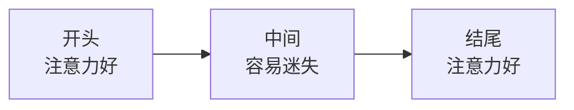
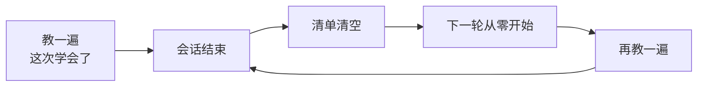

> 本文整理自课程文稿《18｜从 Prompt 到 Harness：记忆与上下文的设计范式》。文稿末尾自注「内容由 AI 生成」，属整理稿而非逐字记录。
>
> 文中的研究结论与数值沿用文稿原述，未做外部核验。

这一讲是记忆模块的开篇，概念课，没有代码。

而它从一个很尴尬的现场开始。

## 那个助手失忆了

作者先问了句：上一课的东西消化得怎么样。

那一课做出了一个个人助手——工具齐全，能干很多事。**但真正用起来，他说表现是「一个大型的失忆现场」。**

三种症状，都很熟悉。

| 症状 | 具体表现 |
|---|---|
| 不记得你是谁 | 说过「写周报要先总结再计划」，下次还是老样子 |
| 说过的话要反复提 | 昨天查过航班，今天问「上次航班几点」，答不上来 |
| 教过的流程会忘 | 行情分析的步骤教了一遍，第二遍又不会了 |

> 你工具给得再多、能做的再强，但**它记不住事儿**。那这个助手完全不像你的——**每一次都是你要重新认识的陌生人。**

## 记忆的本质

这一节是全篇的地基，我觉得值得反复读。

他先破除一个直觉：

> 记忆最本质的东西，**并不是模型真的记住了你之前说的话**。

**为什么？因为模型是静态的。**它每一次请求和之前每一次都完全独立。

**那它靠什么「记住」？**

> 靠我们给它的那份 message list。

**你的身份、你的偏好、你们共同经历过的事，全在那份清单里。** 发过去，它才知道。

### 一个很准的类比

他把这套关系比作一台机器。

上图是这个分工。

- **模型像 CPU**——只做当下这一步运算，不存东西
- **message list 像缓存**——容量有限，用完就没了
- **真正的持久化在外部存储**——你需要自己组织、自己加载回来

> **其他所有记忆其实没有记忆，它只有信息流。**我如何把过去的信息放回 message list 里去。

**这句话我认为是整篇的题眼。**它把「给 Agent 做记忆」这件事，从「让模型记住」变成了「设计一份清单」。

## 三代范式

搞清本质之后，他梳理了一条演进线。这条线我很喜欢，因为它解释了「为什么 prompt engineering 会被说已死」。

### 第一代：提示词工程

**时间**：大约从 2022 年到 2024 年中。

**产品形态**：一问一答。

**上下文长什么样**：一条 system prompt，加上用户说的和助手说的，**没有别的东西**。

**那时候的清单条数很少**：一条 system、一条用户输入、一条回复，就三条。**没有工具调用，也没有工具结果。**

**所以核心工作**：怎么把这一次输入写好。用角色法、写思维链、精心选词。

**因为输入是人敲的、粘的**，所以功夫全花在这一句上。

### 第二代：上下文工程

**转折点**：函数调用出现了。

**变化**：模型不再是「回答问题的东西」，而是**工作流里的一个节点**。而那个 message list 开始被塞进大量工具调用结果。

再往后 ReAct 出现，自主 agent 每一轮都在往清单里追加东西。

上图是这个膨胀过程。**清单开始爆炸。**

**于是第二代的工作变成了**：怎么更有效地管理这份正在爆炸的清单——什么时候删、什么时候剪、工具该怎么调。

### 第三代：harness 工程

**触发点**：skill 出现。

这一代的变化最反直觉。

> 过去不管是 ReAct 还是工具，清单里的东西**都是工具返回的**。也就是说，**我控制好工具就可以了**。

**而 skill 之后不一样了。**

因为渐进式披露给了一个**更广阔的探索环境**：读到一份 skill，里面说「要那个知识就去读另一个文件」；读完那个文件，又说「碰到什么情况去加载某个脚本」——**一层层无限衍生**。

**而这个过程你控制不了。**

> 因为完全取决于模型当时的判断：它觉得该按需加载什么。

**所以第三代要管的东西，从「工具」变成了「整个环境的架构」。**

上图是这三代各自的对象。**一层比一层大。**

### 顺便回答了那个老问题

他补了一段，我觉得挺通透。

**为什么早期 prompt engineering 要搞那么复杂？**因为换个词，输出就不一样了。

**那为什么现在有人说它已死？**因为模型强了——**换个说法不重要了，模糊的表述也能给出想要的结果。**

> 所以过去的这部分不用再考虑，**要考虑的变成了更系统的东西**：工具的返回是什么样，skill 在探索中的结果是什么样。

**paradigm 的变化，本质是「模型变强之后，人的注意力该往哪挪」。**

## Harness 到底包含什么

他引了一段研究，把 harness 工程拆成四块。

| 块 | 内容 |
|---|---|
| 一 | message list 的上下文管理 |
| 二 | 工具 |
| 三 | 约束 |
| 四 | 环境的清理 |

**而它的核心思路是**：把原来「用工作流或 ReAct、由工程手动管理上下文」的做法，**转成让模型自主探索**。

**核心的逻辑支点是 skill。**

## 加减法：一切归结为两件事

不管范式怎么变，他说管上下文只做两件事。

### 加法：给它什么

| 加什么 | 例子 |
|---|---|
| 预加载的人设 | 身份、规则、记忆索引、自我认知文件 |
| 工具返回 | 工具结果与自动调用上下文 |
| 记忆检索 | 以检索为引导拿知识 |
| skill 按需加载 | 让它自己决定加载什么 |

**这些都在做加法，都是让模型能把当前任务办好。**

### 减法：怎么让它别爆

> **只做加法不做减法，上下文会爆，而且会腐化。**
>
> 在真正做企业级工程时，**最需要掌握的技能是减法**。

他给了四种手段。

| 手段 | 做法 |
|---|---|
| 压缩 | 对话太多就做摘要 |
| 截断 | 近 10 轮的记录就够用，没必要读 20 轮 |
| 选择性遗忘 | 低价值信息不再加回清单 |
| **多 agent 隔离** | 主 agent 精简，子 agent 独立上下文 |

**而这一篇后面几课，讲的全是减法。**

## 为什么必须做减法

这一节是全文最硬的部分，因为它给了机制解释。

### 上下文腐烂

他说虽然现在有很长的上下文窗口，**但研究结论是一致的**：

> 上下文只要超过一定比例（**原文口径是 100K 里的四成**），**模型性能会立刻显著下降**。

**更早的时候更极端**：在 8,000 到 16,000 token 这个量级的窗口上，某些模型超过约 8,000 token 就基本不能用了。

**而现在的模型做得更好，但下降依然存在。** 从性能、成本、模型能力三个角度看，都有明显损失。

### 注意力是有形状的

他补了一个机制上的解释：**开头和结尾的注意力更好，中间容易被迷失。**

> **「中间迷失」——你在中间放的东西基本上都会被忽略。**虽然你放进了上下文，但效果很差。

上图是这条分布。**它意味着：塞得越多，被浪费的越多。**

### 所以他对长窗口的态度很明确

> 我现在**不建议大家用太多长 token 的上下文模型**。因为它让你容易无节制地使用。
>
> 最终塞满的效果，**不如前面做好治理、精选出最关键的信息**。

## 那些「失忆」是怎么被验证出来的

他说这一课没写代码，但失忆这件事本身就是上一课实测出来的。三组现象值得单独摆出来，因为它们各自对应一种缺失的方式。

| 现象 | 缺的是什么 | 判据 |
|---|---|---|
| 不记得你是谁 | 缺预加载的稳定信息 | 同一指令换个日子就不生效 |
| 昨天的事今天答不出 | 缺跨会话的持久化 | 换个 session 就问不出来 |
| 教过的流程第二遍就忘 | 缺可复用的流程载体 | 第一次学会、第二次退回原样 |

这三条的共同点：**它们都不是模型能力问题。** 三件事它都做得到，只是**没被放进那份清单里**。

### 一次没有剪掉的失败

作者很坦白地讲了「小炮」失败的样子，而且用的是第一人称的挫败感：

> **每一次都是你要重新认识的陌生人。这种感觉非常差。**

他还给了一个可复现的细节：**港股行情分析，他让助手先做这个、再做那个，每一步怎么做。好不容易教会了一遍，第二遍又傻了。**

这个失败的价值在于它**排除了「提示词写得不好」这种解释**——他教得很具体，问题不在措辞，**在于教完没有存下来**。

上图是那个循环。**只要没有外部存储，每一轮都在原地打转。**

## 之后的路线

他给了后面几课的地图，很清晰。

| 课 | 内容 |
|---|---|
| 19 | 上下文生命周期：bootstrap、剪枝、压缩 |
| 20 | 记忆的存储：**文件就是最好的方式** |
| 21 | 搜索：少量记忆靠文件，海量记忆只能靠检索 |
| 22 | 实战：把它升级成有长记忆的助手 |

**第 20 课那个比喻我觉得很好**：文件记忆像早期的门户网站——**你需要一个东西，就在索引里找，点进子链接，再进子链接**。

**而第 21 课给了边界**：文件搜索在少量记忆时非常有效，**这也是为什么现在那些编码助手表现好——因为它的记忆量小**。但企业级一旦成倍上升，**唯一能取到知识的方式一定是搜索。**

## 我的三点补充

以下是评注，不是原片内容；取舍由我负责。

**第一，「记忆不在模型里，在清单里」这个转述，把一整类模糊需求变成了可施工的对象。** 用户说「让它记住我」，听起来是要模型变聪明；**但实际要做的是：设计一份文件、一份索引、一套加载时机。** 这个转换的价值在于——**它把不可控的部分（模型）换成了可控的部分（你拼什么给它）。**

**第二，三代范式其实是「上下文里最多能有什么」的三次扩容。** 第一代只有人写的字；第二代多了工具返回值；第三代多了模型自己探索出来的知识。**而每一次扩容都让「管理」难一层**——因为第三代的内容不是你能预先枚举的。这也是为什么 harness 的核心从「写规则」变成了「设计环境」。

**第三，「四成就下降」这个结论，反过来说才是它对工程的意义。** 它不是让你去卡一个阈值，而是说：**长上下文窗口是能力上限，不是工作区间。** 你能塞进去，不代表它还能用得上——**中间那段被迷失的内容，你不用付 token 的钱吗？**

---

一句话总结：**Agent 的记忆不在它脑子里，在你递给它那份清单里。** 所以这件事从头到尾都是编辑工作——加什么、减什么、什么时候换。
