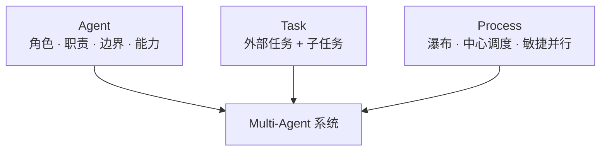
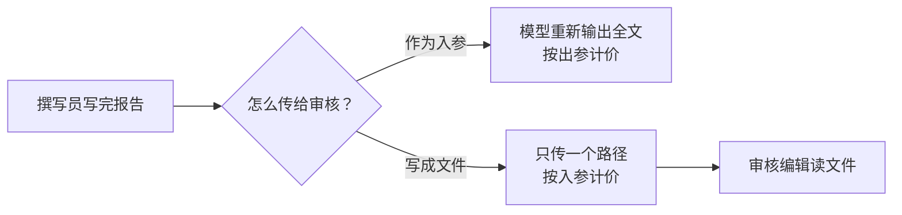
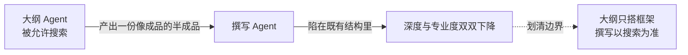

> 本文整理自课程文稿《03｜Multi-Agent 系统：Agent、Task、Process 的协作美学》。文稿末尾自注「内容由 AI 生成」，属整理稿而非逐字记录。
>
> 文中的耗时描述沿用文稿原述（该任务从 15:33 运行到 16 点），未做外部核验。

上一篇拆完 ReAct，留了一道课后题：**这套算法看起来已经很漂亮了，它到底会有什么问题。**

这一篇先答题。

## 答上一题：ReAct 死于上下文

他的答案很直接：**上下文会崩溃。**

业界给这件事起过不少名字——上下文腐烂，或者长度爆表。但他说，长度只是最表面的那一层。

### 第一层：长度

回头数一下那次调研：三次搜索、五六次网页查看。**上下文已经超过五六万了。**

而超过这个量级之后，速度会变差，效果也会变差。

### 第二层：污染

这一层比长度更麻烦。

你给模型的整个上下文都会影响它的输出。虽然注意力机制能让它聚焦在当前这件事上，**但前面所有的信息都在参与预测。**

他给了一个极其具体的例子，我觉得这是全篇最容易复现的一个实验。

**场景**：先让模型写一份报告，它会带上思考过程——怎么写的、步骤是什么、为什么这样更好。

**然后**：接着这个上下文，让它评价这份报告。

**结果**：它会直接拿刚才生成报告时思考过程里的话当评语。「这里很好」「那里也不错」，完全说不出客观问题。

**而如果你把报告（去掉思考部分）粘到一个新上下文里，用同一个提示词审核，结果会变得非常客观。**

**同一个模型、同一份报告、同一个提示词，只因为上下文不同，结论质量天差地别。**

这就是上下文污染。

### 第三层：多指令负担

他说单 Agent 执行时，你要它搜索、写代码、做文件操作，还有网页抓取、知识库，光工具 schema 就占很大一块上下文。

**而且工具还得反复给。**因为在运行过程中，模型的注意力可能把该调哪个工具忘了，于是框架隔一段时间就要重新塞一遍工具定义。

再加上 ReAct 的核心是 act——每一步都调一次工具。**一旦工具调用出错**，不管是内容错、参数幻觉，还是数据结构不对，整个流程就走不下去了。

上下文越长，这件事出现的概率越高。

> 所以单 Agent 很难长时间运行。回头看那份调研报告，虽然能用，但**细看还是挺糙的**。

## 三个词搭出整个系统

讲完问题，他才给定义。而这里他先划了一条线，跟上篇一脉相承：

> 不要把工作流里跑几段不同提示词就叫 Agent。**Agent 是在明确职责边界下，能自主规划、独立完成一系列任务的角色。**

有了这个前提，Multi-Agent 才算有定义。

他拿最熟悉的研发团队举例：产品经理、研发、测试。

| 角色 | 职责 |
|---|---|
| 产品经理 | 产出产品分析与需求 |
| 研发 | 系统设计与写代码 |
| 测试 | 测研发的东西，提 bug 给反馈 |

而他强调：给角色定义的就是四样东西——**目标、职责、边界、能力**。

### Task：两种来源

任务有两种。

**外部任务**：用户把这个场景要完成的事写成一个整体输入。
**子任务**：Agent 之间协作产生的。

产品经理做完，派给研发一个子任务；研发做完，派给测试一个子任务；测试发现 bug，再派回研发一个子任务。

「最终形成的就是整个团队的运行。」

他们还可以共用一套项目信息作为 memory，让协作更顺。

### Process：谁来定协同方式

这是第三个要素，他打了个比方：**像 PMO。**

同样的角色，同样的任务，协同方式可以完全不同。

- **瀑布式**：产品经理完了固定交研发，研发完了固定交测试。
- **中心调度**：一个 PMO 分发任务，每完成一步，PMO 看下一步该干嘛。
- **敏捷并行**：产品经理写需求时，研发已经在做技术调研；研发写代码时，QA 已经开始写用例。

**三个东西凑齐，才叫 Multi-Agent 系统。**

上图是这个定义的形状：不是「有多个 agent」就叫多智能体，是三者共同作用。

## 一个真实案例：四个角色，两个任务

他用两三百行代码搭了一套——他说其中大部分还是提示词。

### 角色一：深度研究专家

**只写大纲，不干活。**

他解释了为什么不指望它直接执行：**单 Agent 全局性会差。**

所以先让一个角色分析任务，产出「3 到 8 个清晰的执行步骤」加一份完整大纲，交给后面去完成。

这个角色**没有工具**，也**不允许向别的 Agent 分发任务**。

### 角色二：报告撰写研究员

干活的那个。

流程是：先把大纲落到文件里，然后按步骤一段段写。而每一步都有硬要求：**必须先委托网络搜索专家拿到明确信息，才能开始写正文。**

它有三个工具：写文件、读文件、列目录。**注意它没有搜索工具**——搜索是别人的事。

它允许向下派活（这个参数后面会出事）。

### 角色三：网络搜索专家

只管搜索。

它的产出不是网页，也不是原始内容，而是**论据列表**：每条包含核心内容、原文片段、原文地址。

它有自己的搜索和网页查看工具，开了缓存避免重复抓取，且不允许再往外派活。

### 角色四：报告审核编辑

只给意见。

它的工具最少——**只有一个文件读工具**。读完，把审核意见返回去。

### Task：为什么拆成两个

他把「生成大纲」和「写报告」拆成两个任务。

而第二个任务里有一条很关键的配置：**它引用第一个任务的产出。**

他特意提醒了一个细节：

> 虽然写的是上下文引用，但它实际只把上一个任务 final answer 传过来。**不是整段中间过程，只要最终答案。**

## 一处精巧设计：为什么用文件传递

这一段是全篇最实用的技术判断，我自己读的时候停了一下。

写完一段报告后，撰写员要把它交给审核编辑。**为什么不直接把它作为入参传过去？**

因为模型是在 action input 里输出入参的。**如果报告作为入参，就意味着模型要把刚才那份报告读完，再原样输出一遍。**

「这非常浪费输出 token，全是钱。」

**而如果用文件传递，文字就完全通过文件系统和工程流转。**审核编辑接到的入参只是一个文件路径。

> 而入参的 token 比出参便宜很多。

上图是这个取舍。看起来只是个工程选择，本质是**把一份可能几千字的文本，从「模型必须重新生成」变成了「模型只需要读」**。

## 运行起来的现场

日志里能看到每个角色的行为差异。

**深度研究专家**因为没有工具，一上来直接给 final answer。

他顺势点出一个 Agent 的性质：**没有工具、没有 action 可做时，它只能立刻输出最终答案**，不会在自己的想法里反复迭代。

**撰写研究员**接手后，第一步是把大纲写进文件——「那个人家比较懒，连文件都不愿意写，那我来写」。

然后开始真的调研。这时出现一次任务委托：请搜索专家查「极客时间平台的基本信息」。

**搜索专家**开始自己的 ReAct：想、搜、看网页、再搜。因为提示词里要求「摘要里能拿到的就不必看网页」，它更多用搜索摘要，为的是性能和效果。

它的 final answer 是一个结构化列表：每条信息的摘要、原文片段、来源。

**然后回到撰写员。**这里有一处机制值得注意：它调用其他 agent 这件事，在日志里被封装成了一次 `using tools`。工具名就是那个 agent，工具入参就是任务名和任务内容。

写完一段后，它先写文件，再调用审核编辑去审。审完按意见改，覆盖原文。**如此循环到所有步骤完成，最后整合成一份最终报告。**

### 最终产出与单 Agent 的对比

报告结构很完整：执行摘要、方法论、发展历程、里程碑、产品体系、核心功能模块、用户体验评估、课程分类、讲师资源、商业模式、用户画像、市场反馈、竞争对手、SWOT 分析、结论与战略。

他的评价很直接：

> 从长度上就没法比，从专业度、深度、效果上，完全不在一个 level 上。

## 为什么多智能体做得更深

他把原因归到四点。

### 一、上下文纯净

每个子任务的上下文只有自己那一段。搜索 Agent 每次只有当次搜索的上下文；审核编辑只有那一步的上下文。

**唯一上下文长的是撰写员。**但就算它长，它拿到的也是**纯净的论据**——核心内容、原文片段、来源，而不是一堆原始网页。

「这个非常非常重要。」

### 二、任务单一专注

写大纲的就只写大纲；撰写员只做文件操作和分派；搜索的只管搜索；审核的只读文件给意见。

**任务越单一，执行难度越低。**

他在这里说了一句值得记的话：

> 甚至不用太依赖模型能力。我们总说模型还不够用，其实也可以反思一下——**是不是我们工程没做好。**当一件事由非常专注、上下文很纯净地构成时，**一个小模型也能解决得掉。**

### 三、任务拆解天然

如果让单 Agent 写一条覆盖全部流程的思维链，它会非常长。用工作流写就更不用说了。

而用多智能体，可以**基于角色理解的职责边界**来拆解。

### 四、容错更高

这一条他预料到会被反驳，因为流行说法是「每多一个 Agent，出错概率就乘一次」。

他的反驳是：**每个 Agent 都有自主决策能力。**

> 自主决策意味着，当它调用下游出问题时，它可以用别的方式解决——重试也好，换一条路也好。**只要有自主决策，把错误隔离掉就行。**

具体举例：搜索 Agent 卡死了，无非是超时或没返回。上层看到这次调用失败，那就再调一次，或者换一个副本。

「如果架构设计得好，容错一定是越完善的结构越能屏蔽单点问题。」

## 但它有三个真实代价

讲完成本优势，他立刻转向劣势，而且讲得很实在。

### 代价一：总 token 消耗急剧上升

虽然每次调用的上下文纯净了，但因为交互次数暴增，**总消耗量反而急升**。

他提到自己已经用了一些技巧去减交互的 token，但仍然如此。再加上调度开销，最终成本一定更高。

### 代价二：耗时长

这个任务：单 Agent 版本几分钟，多智能体版本**从 15:33 跑到 16 点，半小时**。

因为链路调度显著增加延迟，即便中间可以用并发。

### 代价三：设计难度高

**「这个示例代码我调了一整个下午。」**

而难点就一个：**怎么把每个 Agent 的职责边界划清楚。**

## 一次开错参数的复盘

他把自己踩的坑讲了出来，我觉得这段比成功案例更有用。

**他的第一个版本，把「允许分派任务」这个参数给撰写员开了，而且觉得挺合理**——既然要产大纲，让 Writer 帮帮忙、顺便调调搜索，大纲是不是能更好？

**结果：** 看日志发现，它一上来就自己疯狂调搜索、反复完善大纲，**像单 Agent 一样，把大纲写得快成成品了。**

而这只是单 Agent 水平的效果。

**更糟的是后果**：等把这份「已经很丰富」的大纲交给真正的撰写员时，**它会完全陷在既有结构里**，报告的专业度和深度都大幅下降。

他给了一个很具体的现象：大纲里因为没搜索，很多「所属公司」之类的内容是它自己编的。而它一旦写了 Web 端和 Android 端，后面就出不来了。

**权责边界模糊，会让两个角色互相污染。**

修法是补提示词：写大纲时任明确要求不得产出具体观点；撰写时若搜索结果与大纲冲突，**一律以搜索为准**。

上图是这次失败的链条。他补了一句：给大纲角色更多搜索工具，同样会出问题。

## 思维方式的升级

讲完这些，他把话题抬到了方法论层面。

**旧的设计思维是面向过程的。**看到一个任务，先在脑子里想步骤是什么，然后按那个流程写程序。流程是预先定好的。

**新的设计思维是组织式的。**在框架里设计时，最重要的事变成：**权责利怎么划**——它有哪些工具、哪些职责边界、哪些任务边界。

这两个不是技巧差异，是思维方式差异。「这种设计思维的升级还是非常重要的。」

## 我的三点补充

以下是评注，不是原片内容；取舍由我负责。

**第一，那个「用文件传递」的判断，是把成本意识落到了具体代码行上。** 大部分人讨论 token 成本时停留在「少放点上下文」。而它指出一个更隐蔽的杠杆：**入参和出参的计价不一样，而很多人把本该走文件系统的内容塞进了工具参数里**。这一个小动作的省钱幅度，可能比任何提示词精简都大。

**第二，那个「把大纲写太满反而害了下游」的复盘，本质是流程设计的经典陷阱。** 上游做得太完整，下游就失去判断空间——这在人类组织里同样成立。**分工的目的不是让每个人都干得多，而是让每个人在自己的边界里有充分的信息和充分的自由。** 他开那个参数时的想法（顺手帮一把）非常自然，结果正好证明了边界为什么必须硬。

**第三，他说「不用太依赖模型能力，也许是我们工程没做好」，这句话值得单独记。** 因为它把一个流行叙事倒过来了：大家习惯等更强的模型，而他的经验是，**当任务足够专注、上下文足够纯净时，小模型也能干得不错**。这不是说模型不重要，而是说在模型给定的时候，工程还有很大一块空间没被用掉。

---

一句话总结：**多智能体不是让 AI 更聪明，是让每个 AI 只面对一小块干净的上下文。**它用时间和钱，换了效果上限和可靠性。
