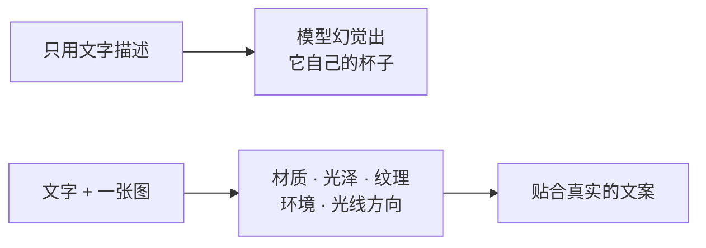
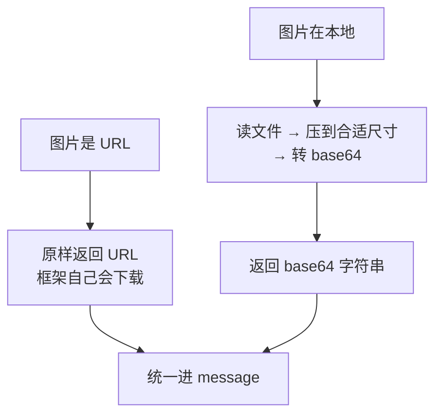
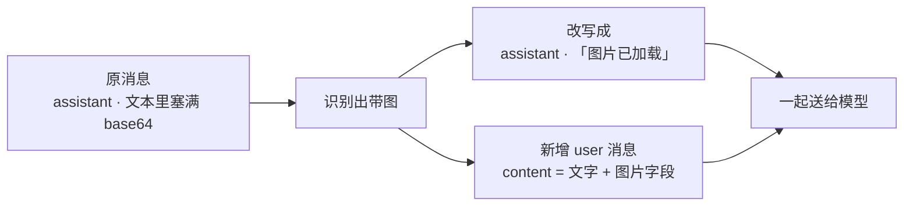
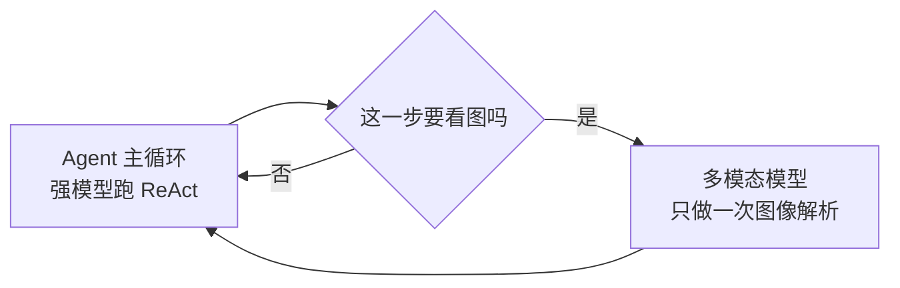

> 本文整理自课程文稿《10｜多模态模型：让你的 Agent 拥有「眼睛」》。文稿末尾自注「内容由 AI 生成」，属整理稿而非逐字记录。
>
> 文中的模型行为与工具名沿用文稿原述，未做外部核验。

这是第一个模块的最后一个单元。前面已经把 Agent、Task、Process 都讲完了，现在补最后一环：**Agent 怎么看到图片。**

而作者开局先做了一个界定，因为这个领域的词太容易混。

## 先分清：不是所有「多模态」都是同一件事

他强调，这里说的多模态模型，指的是**多模态输入、文本输出**的那一类。

不是生成图片的那种——那个属于另一个话题。

而这类模型的输入，除了文字，主要是图片、声音、视频。

## 原理：一串数字的事

他讲原理讲得很朴素，但抓住了一个关键点。

大语言模型处理文字时，其实也是把每个字、每个词映射成 token，再变成一串数字向量，扔进神经网络。

**图片、声音、视频，走的是同一条路。**

- **图片**：先是 base64 编码，再转成 token、转成向量。
- **声音**：数字信号本身就是编码，一样能喂进去。
- **视频**：一帧帧图片加声音，序列化之后同理。

只要模型见过足够多的这类信号，它就能学会处理。

他补了一句现状：端到端是一回事，实际工程里声音更多还是走**子任务串联**——先 ASR 转成文字，再交给模型。

> 所以这一句可以记住：**图片本质上就是一串有特殊含义的 base64。**

## 为什么必须给图，而不是用文字描述

他给了一个很具体的例子，我觉得这段最有说服力。

假设你有一个杯子，想让模型基于它写一段文案。

**不给图，只用文字描述**：模型不知道你脑子里想的是什么，它会幻觉出各种各样的杯子——而且大概率都是它自己理解的那个绿色的杯子。

**给了图**：这张图隐含的信息非常多。杯子的材质、中间的光泽、里面的纹理、所处的环境、光的方向。

**这些都不是文字能完全描述得了的，但一张图就搞定了。**

他把这个叫做**锚定的实体**。

上图是这个对比。**注意左边那个「它自己的杯子」**——不是随机，是模型用先验补全了你没说的部分。

## 但光给图也不行

他说实际应用里很少「直接扔一张图让它生成文字」。

原因很直接：**模型不知道你想干嘛。**

一张图扔过去，它会随机输出一些文案，基本不符预期。

**所以标准做法是：图片 + 一段提示词。**

他给了对照：同样一张图，只说「分析这张图」它不知道重点在哪；说「分析杯子的材质」，注意力就集中到杯子上了。

> 他甚至提到一个细节：你现在用豆包、Gemini、GPT 的时候，光拽一张图进去，它背后其实是发现你没给文字，**自己给你配了一段文字**。

## 工程实现：两个必须自己动手的地方

进入代码。他说这个 demo 结构很简单：一个 Agent、一个工具、一次多模态调用。

**但有两个地方框架帮不了你。**

### 缺口一：框架只认公网 URL

他说框架内置了一个图片工具，也有「是否使用多模态」的开关。

**但它只支持图片在网上的 URL**——因为它内部就是把 URL 提出来，渲染成一个消息给模型。

**它没有加载本地图片的能力。**

而在企业级应用里，你不可能给每张图都挂一个云盘或 CDN，**而且那个链接还得外网可访问**——门槛很高。

所以他写了一个本地版本的工具：把本地图片转成 base64，再喂给多模态模型。

上图是这个工具的两种分支。**注意那个压缩步骤**——因为模型对图片尺寸有限制，太大的图要先缩。

而统一出口都是「一个 URL 字段」：网图就是 URL，本地图就是 base64 串。

### 缺口二：消息结构要重构成多模态格式

这是他改的第二个地方，也是这讲技术含量最高的一段。

因为 ReAct 的流程里，工具返回的结果是作为一条 assistant 消息回到上下文的。**而模型不认识「一条文本里夹着一大串 base64」这种形式。**

所以他在调用模型前，加了一步预处理：

1. 遍历 message 列表。
2. 只看 assistant 的那条（ReAct 里工具结果都在这）。
3. 判断内容里有没有那个图片工具的名字，以及图片前缀。
4. 命中就说明这条消息带图。

命中之后做三件事：

| 动作 | 内容 |
|---|---|
| 原文改写 | 把那串 base64 换成一个固定字符串「图片内容已加载」 |
| 新增一条消息 | role 从 assistant 改成 **user** |
| 内容是列表 | 文字部分 + 一个图片 URL 字段 |

**然后就不再把原来那条消息给模型，而是给转换后的版本。**

上图是这个转换。**最关键的一步是把 role 从 assistant 改成 user**。因为在多模态协议里，图片是用户提供给模型的东西，不是模型自己说出来的。

### 顺便解决了模型选择

同一步里他还做了一个判断：**如果这批 message 里有图片，就换用多模态模型；没有，就用原来的模型。**

这就引出了整讲最反直觉的一条。

## 反直觉：多模态模型的脑子很差

他说自己做了个小改造——把「用多模态时用哪个模型」和「不用时用哪个模型」分开配置。

**原因说得很直白：多模态模型的脑子差到什么地步呢？差到可能连 ReAct 都做不好。**

而 agent 的底层就是 ReAct。**连 ReAct 都做不好，流程根本走不下去。**

所以他的方案是：**把真正调用多模态模型的范围压到最小**——只在需要看图的那一步用它，其余步骤全用正常模型。

上图是这个分工。**多模态模型不是主力，是被叫来干一件活的临时工。**

这是个很实用的工程判断：**别指望一个模型既会看图又会推理。**

## 这条路踩过的三个坑

把原文里散落的失败点收在一起，它们恰好构成一份排错清单。

| 坑 | 现象 | 改法 |
|---|---|---|
| 框架只认公网 URL | 本地图片根本传不进去 | 自己写工具转 base64 |
| 消息结构不对 | 模型把 base64 当普通文本，看不懂 | 重构成多模态格式，role 改 user |
| 多模态模型推理弱 | 连 ReAct 都跑不动，流程卡住 | 双模型分工，只在看图那步用它 |

第三条最容易被误判成「模型不行、换个更好的」。**而实际原因是把两件事压在了一个模型身上。**

## 跑起来看

他给了一张实拍图——中午吃的轻食，一份三文鱼沙拉。

日志里的执行过程很清楚：

1. 调用本地图片工具 → 返回 base64。
2. 基于这个结果调用多模态模型。
3. 输出结构化的分析结果。

最终结果里能看到：文件名、主体描述、风格、构图、打分。**这就是前面定义的那个图片分析数据结构被真正填满了。**

这一步算是端到端验证：从本地文件读出、转编码、进模型、按结构吐出来，整条链走通。

## 三条反模式，两条最佳实践

### 反模式一：像素倾倒

给一堆巨大的图片，而其实根本不需要那么大。

他的判断很实用：**你的目标往往只是检测语义逻辑，一张糊的照片有时就够了。** 所以先处理分辨率。

### 反模式二：拿多模态模型做 OCR

这一条他讲得最透。

**纯做 OCR，就用专业 OCR 模型。** 理由两个：不经济；而且多模态模型的准确率远不如专业 OCR。

**但有一类例外**：有格式的文档，多模态更强。

> 传统 OCR 通常只能识别出字，**丢失位置关系之后语义也丢了**。

他举的例子很具体：大量表格、流程图、程序设计里常用的设计图。

**所以判据是：纯文字用 OCR，有格式的文字用多模态。**

### 最佳实践一：给图片配一段 VCOT

既然前面说了必须图文一起给，那这段文字可以更有结构——**写成 VCOT**，用描述引导它更好地解析图片。

### 最佳实践二：低清到高清

这一条给了个可以省钱的思路，而且是从真实产品里观察来的。

你看 ChatGPT、Gemini 处理图片时，常常是：**先用很小很糊的分辨率分析一遍，定位到你要的区域，再局部裁出高清图分析第二遍。**

**这样能大幅省 token。**

同理，批量图片可以先用低清粗筛，找到有效的那张再提分辨率。

> 他的落点很实在：**一张图片转成的 token 比文字贵得多。**

## 我的三点补充

以下是评注，不是原片内容；取舍由我负责。

**第一，「双模型分工」这个判断，其实承认了一件很多人不愿承认的事：能力是分项的，不是整体的。** 多模态模型看得见，但推理弱；强模型推理好，但看不见。硬要一个模型全包，结果是两项都打折。而拆成两个模型各干一件，代价只是多一次调用——**这笔账几乎总是划算的。**

**第二，那个「图片已加载」的占位符替换，是个很小但很聪明的动作。** 它同时解决了两件事：避免上下文被几十万字符的 base64 撑爆；让模型知道「这里原本有图，图我看到了」。**如果只是删掉 base64，模型会困惑；如果原样保留，上下文就废了。** 一个占位符两头都照顾到。

**第三，「低清到高清」这个做法值得单独记，因为它把成本意识变成了具体工序。** 大多数人优化图片成本的方式是「压得更狠」，而它换了个思路：**先用低成本的方式看清哪里值得看。** 这是把「注意力」本身当成一种可以分阶段投入的资源。

---

一句话总结：**给 Agent 装眼睛，难点不在看图，在两件事——把本地图变成模型认得的格式，以及接受「会看图的模型往往不会思考」。**
