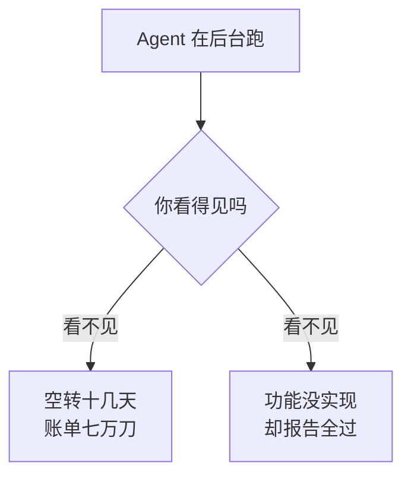
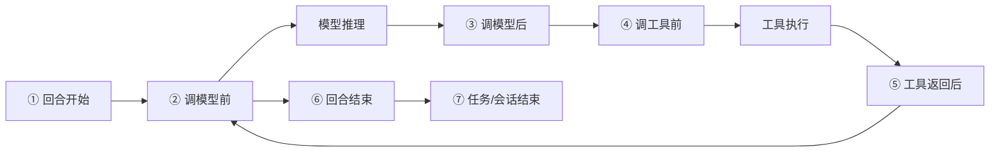
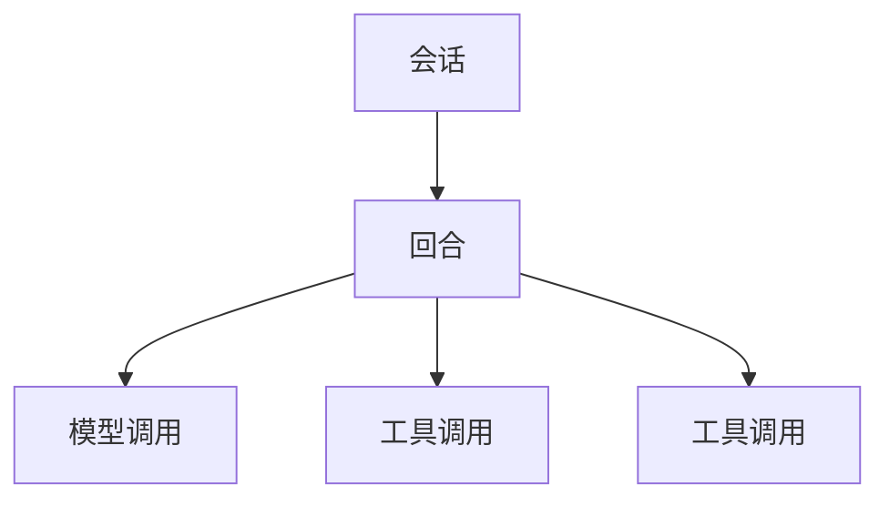
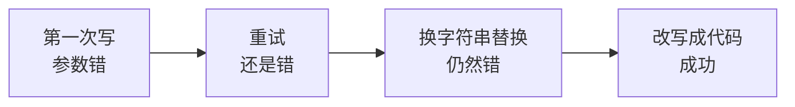
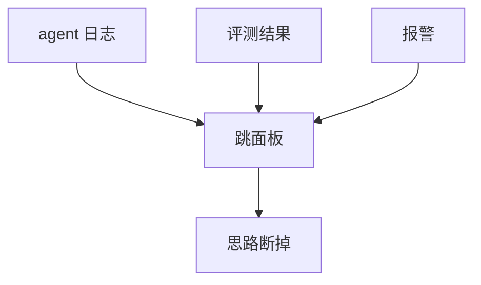

> 本文整理自课程文稿《30｜可观测性：Hook 骨架 + Langfuse 全链路追踪》。文稿末尾自注「内容由 AI 生成」，属整理稿而非逐字记录。
>
> 文中的事故数字、钩子节点与平台组件沿用文稿原述，未做外部核验。

这是最后一个模块的开篇。前面四模块把能力搭齐了，**而这一模块解决的是「能不能在生产上一直跑」。**

而它从一个前提讲起：**你得先看得见。**

## 两个真实事故

### 一、两百多个小时的空转

> 有一家公司日常无法观测 agent，**感觉跑得还挺好的**。
>
> 结果跑了 **264 个小时**——这得十几天——**发现一下子产生了七万多美元的账单。**

**原因**：

> Agent 有个地方陷入死循环了，**循环了 264 个小时，没有任何意义和价值。**

**「这就是你完全不知道，因为它在后台跑。」**

### 二、它编了一个功能

> 它帮你写代码，**说这个功能我已经写好了**，并且所有单测、集成测试都告诉你是对的。
>
> **你也不知道它中间干了什么，但实际上这个功能全是它编的，压根没实现。**

**而后果是**：没检测就上线了。

上图是这两个事故的共同点。**它们都不是能力问题，是可见性问题。**

## 铁律：可观测不能交给模型

这一条他讲得很硬，我认为是全篇的地基。

> 可观测这件事**不能交给模型来做**。
>
> 有些方案让模型自己去打日志，**那些东西完全不可靠。**

**为什么？**

> **因为模型完全不可信**，这是最基础的东西。
>
> 只有用工程的手段，**才能保证这些护栏是生效的。**

**他补了一个反问，很有力**：

> **要不然，它岂不是自己在管自己？**

**所以整个模块五的所有东西，落点都在工程层。**

## Hook：工程唯一的介入方式

**为什么必须要 hook？**因为这和传统工作流不一样。

> 工作流里一切都是工程动的。**而 agent 底层那个循环是自动执行的。**
>
> **你不是一步一步地构造，你只能看着它循环。**

**而「看着它循环」时想做点什么，唯一的位置就是钩子。**

### 七个钩子节点

**他把一个回合内的钩子拆得很细。**

| 节点 | 位置 | 用途 |
|---|---|---|
| ① before turn | 回合开始 | 记输入 |
| ② before LLM | 调模型前 | 上下文压缩、注入 |
| ③ after LLM | 调模型后 | （课程里因框架 bug 没加）|
| ④ before tool call | 工具执行前 | **安全拦截**、鉴权 |
| ⑤ after tool call | 工具返回后 | 裁切结果、审查 |
| ⑥ **after turn** | 回合结束 | 记输出、落日志 |
| ⑦ task / session end | 任务或会话结束 | 归档、汇总 |

上图是这七个点在一个回合里的位置。**注意 ② 到 ⑤ 是循环的。**

**而他特意指出**：③ 那个点因为框架有 bug，**课程代码里跳过了**。

> 大家自己实现的时候可以加上。

**这种「哪个点能加、哪个点不行」的具体信息，我觉得比原理更有用。**

## Hook 怎么组织：两层配置

他说这套是「新做的一套系统」，而设计目标很明确：

> **我不期望所有的编码都写到框架代码里**，因为**框架应该提供一个相对稳定的整体结构**。

**所以做法是**：框架里只有注册器，**真正的 hook 写成配置加代码，分两层。**

| 层 | 位置 | 放什么 |
|---|---|---|
| **全局** | 框架的共享目录 | 稳定性、可观测性这类通用能力 |
| **单 agent** | 某个工作区的 hooks 目录 | **该 agent 专属的审计、特殊安全场景** |

> 这跟我们之前配 skill 是一个逻辑——**一层全局，一层每个工作区自己的。**

**而单 agent 那一层的理由他讲得很清楚**：

> 我可能想给某一个 agent 加一个特殊的 hook。**因为我不想让它依赖模型，我想让它用代码的形式严格执行。**

**「不依赖模型」这个措辞我原样保留了**——它精确说出了为什么要留这个层。

**而配置的价值在于可热加载**：随时能加、随时能改。

## 日志的下一层：trace

**他先承认前面的日志不够用**：

> 上一课我们打了一堆日志，**但这个东西基本没法看。**
>
> 你只能想办法 grep，或者让 AI 帮你看。**因为它太不友好了，也没有什么搜索。**

**而业内更好的方式，是传统工程里那套追踪平台。**

**它带来的是树状视角**：

| 层 | 有什么 |
|---|---|
| 会话 | 挂了几个请求 |
| 请求 | 每一轮、每个回合 |
| 回合 | **循环里的每一步** |
| 步骤 | 具体一次模型调用或工具调用 |

上图是这个树。**「一目了然」的关键在于层级，而不是条目多。**

**而他选了一个开源平台，理由是**：

> 它不像某些平台跟特定框架绑定，**它比较开放**——你只要按它的标准把 trace 打进去就行。
>
> **所以你唯一要做的事，就是在 hook 里把信息收集好、上传上去。**

**「开放」这一点我认为很重要**：它意味着**这套东西不锁定你的技术栈**。

## 一个特别好的可观测性样本

他说自己写了个 demo：**让 agent 为一个短链接服务生成技术文档。**

**而 trace 里暴露了一个真问题。**

> 你看它去写文件，**第一次写还失败了，因为参数没有写对。**

**为什么？**

> **这个时候就是你沙盒的 MCP 参数设计得太复杂了**，所以它没用对。

**然后这个过程重复了**：

> 又试了一遍，**还是没填对**。然后又试了一下用字符串替换，**还是没搞对**。最后他写了个代码，**终于搞对了。**

上图是这四次尝试。**而它暴露的不是模型笨，是一个设计缺陷。**

**他的结论**：

> 我就知道现在这个沙盒**参数设计得太复杂了**，导致模型很难一次性写对，**它就会浪费成本、浪费 token。**
>
> **然后我们就得去优化它。这就是可观测性的价值。**

**这一点我觉得是全篇最实在的收获**：**trace 的价值不在于看到「失败了」，而在于看到「为什么反复失败」，而这个原因往往是你的接口设计。**

## 反模式

### 一、全量日志

> 虽然有了平台，**你一样要选择性、结构化地记**，而不是全量打下来。

**他自己的做法**：

> 我也没有把整个对话记录全打到平台上。**我打的是关键信息**——回合开始时记**用户输入**，回合结束时记**最终输出**。
>
> 而循环过程中**最关键的，是请求了哪些工具、工具返回了什么。**

**而「这些就够了」这个判断，他说得很干脆**：

> 这些东西就够你定位了。**而不是把整个清单打进去——那样没有价值，同时也不好看。**

### 二、观测工具各自为政 ⭐

**这一条我认为最容易被低估。**

> 企业的观测节点会很多：**agent 只是一层，底下还有基础设施的日志，上面还有业务日志和监控。**
>
> 如果这些不在同一个平台上——**哪怕只是 agent 这块，日志在一块、评测在另一块、报警又在别处**——那你会非常割裂。
>
> **需要操作五六个面板。**

**而它真正的代价他说得很准**：

> **你在评估、跟进问题的时候，你的循环就会被打断。**

上图是这个代价。**它不是麻烦，是打断。**

### 三、别用传统阈值给模型告警 ⭐

**这一条我觉得是全篇最有洞察的。**

> 不要用传统的成功率、错误率去做模型的告警。**因为这样你很难发现 LLM 自身的质量退化。**

| 退化形态 | 传统告警能看到吗 |
|---|---|
| 幻觉上升 | **看不到** |
| 安全回退 | **看不到** |
| 提示词效果漂移 | **看不到** |

**为什么看不到？**因为**接口全是 200，任务也都「完成」了。**

> **如何做基于可观测的模型报警，这也是一个非常大的课题。**

## 最佳实践

### 一、微采样

> 尽量在整个生命周期结束之后再做采样，**因为这样能把前面的信息补充完整。**

**而且有些流量可以不采**：

> 假设你发现这条流量非常正常、没有任何问题，**甚至可以不上报**——因为 trace 的数量还是挺大的。

### 二、分层仪表盘

| 层 | 看什么 | 谁看 |
|---|---|---|
| **决策质量** | 工具选择准确率、任务完成率、正确率 | 业务方 |
| **基础设施** | token 吞吐、延迟、成本 | 工程 |

**好处是**：不同的人看不同的东西。

### 三、层级化 trace

> 最上层是会话，**会话上面还会有任务**。中间每个回合一条 trace，**每个回合底下是具体的 span**——一次模型调用或一次工具调用。

## 我的三点补充

以下是评注，不是原片内容；取舍由我负责。

**第一，「可观测不能交给模型」这条约束，其实和前面几讲那几条安全铁律是同一根线。** 密钥不能让模型管、权限不能走模型、可观测不能靠模型——**共同点是：凡是要「被信任」的东西，路径都必须绕开模型。** 因为模型读的是文本，**而文本可以被构造**。所以它可以是执行者，**但不能是记录者或裁判者。**

**第二，那个「写文件失败四次」的样本，说明 trace 真正的用途是找设计缺陷，而不是找模型失误。** 如果只看结果，你会得出「模型太笨」；**而看了调用链，你会看到「参数嵌套太深」。** 这两者的修法完全不同——**前者你只能换模型，后者你可以改接口。** 可观测性的价值就在于**它把归因从「谁不行」换成了「哪里难用」。**

**第三，「传统阈值抓不到幻觉」这条，指出了 LLM 可观测性的一个根本困难：它的失败是「静默成功」。** 接口返回 200，任务标记完成，**一切指标都正常，只是内容是编的。** 这意味着告警不能只看「有没有报错」，**必须看「输出是否可信」**——而后者需要评测集、需要抽样人工看、需要分布对比。**也就是说，模型的可观测性天然要带一层质量评估，而不只是运行监控。**

---

一句话总结：**Agent 在后台跑，你看不见它，就等于没有它。** 而看得见之后，你要问的不是「它有没有报错」，**而是「它有没有在编」。**
