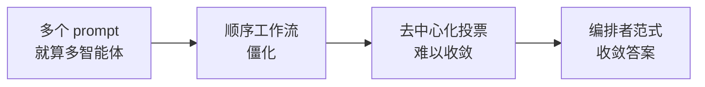
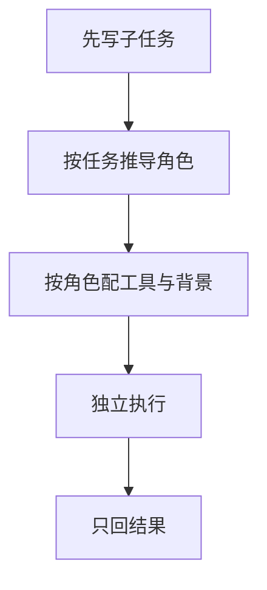
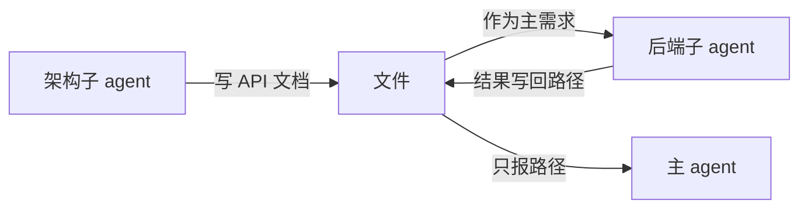
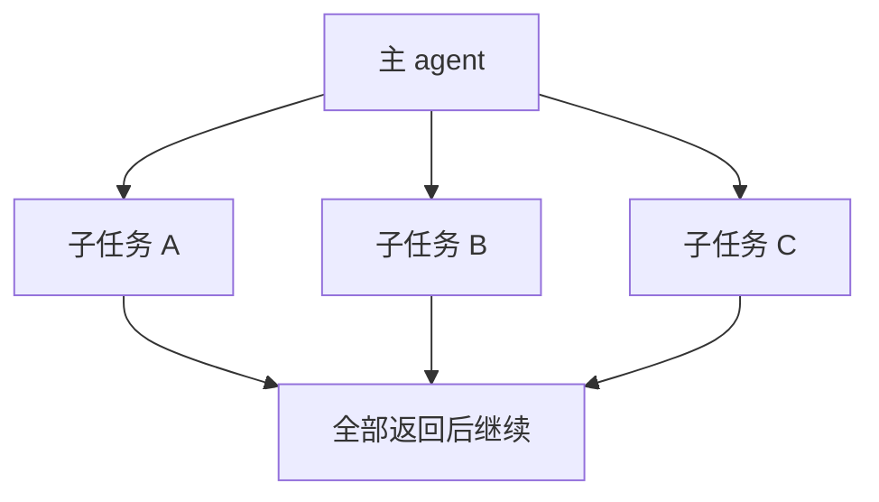
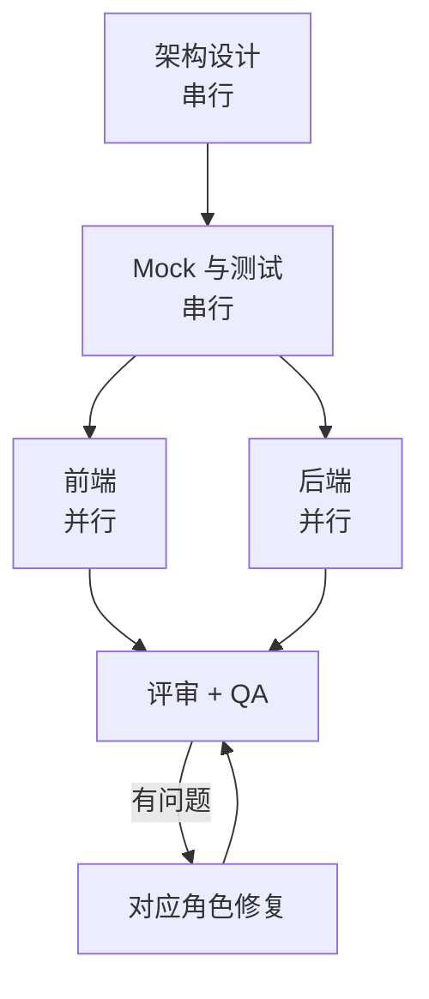
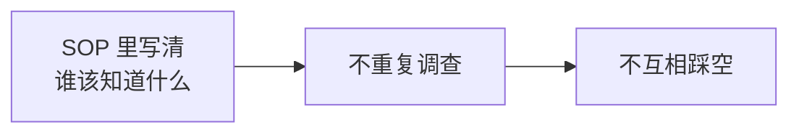

> 本文整理自课程文稿《23｜Orchestrator 范式：任务层的主 Agent + 子 Agent》。文稿末尾自注「内容由 AI 生成」，属整理稿而非逐字记录。
>
> 文中的模式名称、工具配置与成本案例沿用文稿原述，未做外部核验。

模块三讲完了记忆。这一讲开模块四，先做一个前置动作：**把多智能体的设计范式收敛成一条线。**

而从单 Agent 的瓶颈讲起。

## 单 Agent 的三重天花板

他先承认前面那些方案是有效的，**但只是推迟，没有根治**。

| 方案 | 局限 |
|---|---|
| 剪枝 | **只剪工具结果，其他部分照样长** |
| 压缩 | **摘要就意味着大量信息损失** |

**他还补了一个现象**：

> 上下文长到一定程度，**模型自己也会决定回答得更敷衍。**

### 三重瓶颈

| 维度 | 问题 |
|---|---|
| **效果** | 任务越复杂，推理质量越往后越差——**注意力有上限，而需要关注的点并没有变少** |
| **性能** | 串行执行，**时间随任务规模线性增长** |
| **成本** | 上下文一直处于较满的状态，**消耗很高** |

**第二条他给了个很具体的画面**：

> 一个项目二三十个问题出去，**就算有子 agent 帮忙，它们也是串行跑的**。基本上是等不起的。

**所以根本解法是**：**把上下文切开。**

## 多智能体的演化史

这一节很短，但把几代探索的失败原因说明白了。

### 第一代：多个提示词就叫多智能体

> 一个写死的工作流，步骤一有个 prompt，步骤二有个 prompt，**就说这是多智能体**。

**他说这也不能算错——取决于当时怎么定义 agent。**

### 第二代：顺序工作流

从「一个 prompt 一步」升级成「一个阶段性目标一步」，每个 agent 有不同的背景、工具、目标。

**问题在于**：

> 全都是事先编排好的，**很难动态调整，流程相对僵化。**

### 第三代：去中心化的尝试

> 有投票机制，让各种 agent 协作跑，**没有明确分工**。

**结局他讲得很干脆**：

> 基本上最后都被认为**难以收敛**，效果不好。
>
> **这种去中心化的东西，在完成任务时已经被验证是不太 work 的。**

### 所以收敛了

> 现在业界在完成长程任务时，**基本已经收敛成一个统一的范式**——编排者。

上图是这条演化线。**三次尝试之后只剩一个。**

## 最关键的那个转向 ⭐

这是全篇我认为最该记住的一点。

### 老思路：以 Agent 为中心

团队式框架的设计是：**把每个 agent 的角色、背景写得非常清楚**，然后让它们协作。

**他承认这套设计「非常好」，但指出一个前提问题**：

> 在复杂的动态任务里，**你不一定确定现在需要一个什么样的 Agent。**

**所以「以多个 Agent 作为编排核心」这条路走不通。**

### 新思路：以任务为中心

> 主 Agent **先把子任务写出来**。写完之后再问：**适合这个子任务的是什么样的子 agent？**
>
> 它应该有什么工具、什么背景？**这个时候再动态设定出一个子 agent。**

上图是这个顺序。**注意第一步是任务，不是角色。**

**他的总结**：

> 从原来**以 Agent 为视角**的多 Agent，**变成了以 Task 为视角**的多 Agent。这是一个范式的转变。

### 顺便解释了四种模式的共同点

他说主流编码工具有五种模式，除去团队模式，**剩下四种都是主 Agent 加子 Agent，只是变体不同**。

| 变体 | 差别 |
|---|---|
| 通用型 | 子 agent 由任务现造 |
| 继承型 | 子 agent **继承主 agent 全部上下文** |
| 预定义型 | 子 agent 有**预先定义的固定角色** |
| 协调者型 | **主 agent 不许干活**，子 agent 才能干；且子 agent 不能再生成 agent |

**共同骨架完全一样。**

## 协作靠文件

范式定了，那子 agent 之间怎么传东西？

> **都是通过文件去传。**

他给了一个很具体的链路。

**例：做一次后端开发。**

1. 主 agent 先让一个子 agent **写好 API 文档**
2. 架构师把文档写完后，**后端开发看到的就这份文件，作为主需求**
3. 后端写完，**把结果写到指定路径**
4. **把路径告诉主 agent**

上图是这个交换。**主 agent 全程不知道内容，只知道路径。**

**而它的好处很直接**：

> 子 agent 写代码期间的所有上下文、所有细节，**主 agent 都不关心**。
>
> 它看到的只有：我派了个后端开发、他给了个结果。

## 三个收益

### 一、上下文分割

> 主 agent 的全局上下文**不用管理子 agent 的事**，子 agent 的事就在自己里面。

### 二、并发执行

**这里有个关键前提**：编排器起子 agent 有两种模式。

| 模式 | 适用 |
|---|---|
| 串行 | 有依赖，必须等 |
| **并行** | 几个子任务**互相没有依赖** |

> 并行模式起多个 agent 各自干活，**陆续返回结果**，主 agent 等全部回来再往下走。

上图是这种扇出。**它是性能收益的来源。**

**举个量级**：如果一次开发要出五六个独立模块，串行跑就是五六个来回；**并行起，总耗时只等于最慢那一条**。

### 三、验收机制要隔离 ⭐

这一条他讲得最细，也是我认为最容易做错的地方。

> 主 agent 本身作为评审方来看子 agent 的输出，**这个非常关键。**

**而关键在哪？在于「两边上下文必须隔离」。**

> 执行者在执行过程中，**上下文里会有大量逻辑来证明他做的东西是对的。**
>
> 如果评审者看到这些逻辑，**他有可能被这些逻辑影响。**
>
> **而如果没看到，他就能更客观地用自己的标准去看产出。**

**所以他的判断是**：

> 验收时**必须要有一个第三方**——可以是主 agent，**也可以是一个专门的评审子 agent。**

## 实战：一次全栈开发

概念讲完，他跑了一个真实项目：**员工休假管理系统**。

- 前端：一个表单页面（HTML 加 JS）
- 后端：FastAPI 写接口
- 两者用 HTTP 串联

**输入就是一份需求文档。**

### 主 Agent 只给三个工具 ⭐

这是全篇我最想抄的设计。

| 工具 | 作用 |
|---|---|
| 串行起子 agent | 有依赖时用 |
| 并行起子 agent | 无依赖时用 |
| **读文件** | 只能读 |

**注意缺了什么：没有任何写工具。**

> 他自己是不能做任何写操作的。
>
> **我不让主 Agent 干事情，你主 Agent 的所有事情都由子 Agent 去干。**

他说这和主流编码工具尚未开放的**协调者模式**是同一个思路。

### SOP 写成一个 skill

**主 agent 拿到的不是代码，是一套流程。**

顺序是这样的。

| 阶段 | 谁做 | 为什么这么排 |
|---|---|---|
| 一 | 架构师 | 设计接口参数，**产出架构文档与接口规范** |
| 二 | Mock 工程师 | **先做 mock 和测试**，让前后端能复用 |
| 三 | 前端 + 后端 | **可以并行**，因为互不依赖 |
| 四 | 评审 + QA | 出审查报告与测试报告 |
| 五 | 修复 | 有问题就回到对应角色 |

**第二步的理由他解释得很清楚**：

> 先按 TDD 把测试建好，**后面前端就能复用 mock 做自己的测试，后端也能复用同一套接口测试**。
>
> **所以不光做了一个文档，同时做了一套 mock 和单测。**

上图是这个流程。**注意两个串行卡点：架构完成前不能写代码，mock 完成前前后端不能动手。**

### 他刻意要求中间产物

这一条是我认为最实用的工程经验。

> 你想给 agent 长程任务时，**最好的方式还是做里程碑和中间产物**——**一定要要求它中间产出哪些东西。**

**他列的产物很具体**：

| 产物 | 要求 |
|---|---|
| 架构设计文档 | 必须先出 |
| 接口规范文档 | 必须先出 |
| **全部 mock 与测试** | 写完才准写代码 |
| 审查报告 | **注明问题清单的原因**，并要求改 |
| 测试报告 | **把所有通过情况写全** |
| 交付报告 | 最终产物 |

**他说完给了一句总结**：

> 用这样的方式去看中间产物，**他才能够真正很好地完成整个长任务的执行。**

## 反模式

### 一、没有终止条件 ⭐

**这一条带了一个真实事故**：

> 如果一直让它跑，**没有任何终止条件，真的有可能循环到配额耗尽。**
>
> 有真实案例：**一个请求在中间不停试错，最后六百美元出去了，什么都没出来。**
>
> 他提到这类长任务的常见量级：**一个项目二三十个问题出去**，如果全靠串行，**光是等待就足以让这件事做不成。**

**所以他说**：**需要手动设置中间的 hook 和干预。**

### 二、主 Agent 规划失误，全链路放大

> 主 agent 一旦规划错，**整个链路都会放大这个错误**。
>
> 所以主 agent 通常用**更强的模型**，子 agent 可以稍弱。

### 三、并行写的冲突

> 并发几个 agent 干活时，**一定要互相规范好各自写什么**。
>
> 因为一旦写同一个文件，**就会出现并行冲突。**

**所以「什么时候必须串行」是设计的一部分**——就像前面那个流程，mock 和依赖 mock 的代码之间**必须是串行**。

### 四、平铺的 Agent 队伍

> 如果没有层级结构，**就是一堆 agent 自己决策谁干什么**——那这种基本上会放大误差。

**他提到这是某项研究的结论**：一个 agent 出错，N 个 agent 之后**误差会指数级上升**。

> 原文在这里给了一个具体倍数，**但语意前后不一致、无法核验**。**所以我只保留「误差随 agent 数量显著放大」这个定性判断，不照抄那个数字。**

## 最佳实践

| 做法 | 理由 |
|---|---|
| **验收 agent 独立出来** | 独立评审**没有任何包袱**，才能真正评审；既执行又评审不行 |
| **不要一上来就上多智能体** | 先跑单 agent，**执行不了那么长再扩** |
| 每一步可靠性先提上去 | 整体可靠性才提得上去 |
| **显式传递上下文** | 该传什么信息，**主 agent 一上来就规划好** |

**最后一条他给了一个很典型的教训**：

> 同一个任务，**三个子 agent 重复调查了同一个 bug**，互相之间上下文完全没有共享。
>
> 所以**该让哪个 agent 知道哪些事，要在 SOP 里写清楚。**

上图是这条的价值。**它是省成本，也是省时间。**

## 我的三点补充

以下是评注，不是原片内容；取舍由我负责。

**第一，「先写任务，再推导角色」这个转向，把多智能体从「组队」变成了「派活」。** 组队要求你事先知道需要谁，而派活只要求你说清要做什么。**这个差别在动态任务里是决定性的。**因为复杂任务里最不确定的，就是「该由什么角色来做」。**所以顺序反过来之后，**agent 成了任务的产物，而不是前提。**

**第二，「主 Agent 只给读权限」这个设计，本质是用工具清单来强制分工。** 只靠 prompt 说「你不要自己干活」，在长任务里很容易破功。**而收走写工具之后，它想干也干不了。** 这和前面几讲那两条安全铁律是同一个手法：**把约束从「叮嘱」挪到「机制」上。**

**第三，「中间产物」这条经验的价值，在于它把长任务的验收变成了可插手的节点。** 如果只要求最终交付，那你要么等到最后才发现错了，要么中途完全看不见。**而要求先出架构、再出接口、再出 mock，等于在这条长链上插了几个检查点**——每个检查点上，你都能看见东西、也能叫停。

---

一句话总结：**多智能体不是一个团队，是一条流水线。** 你不必先想清楚要雇谁，**只要把活写清楚，人会自己长出来。**
