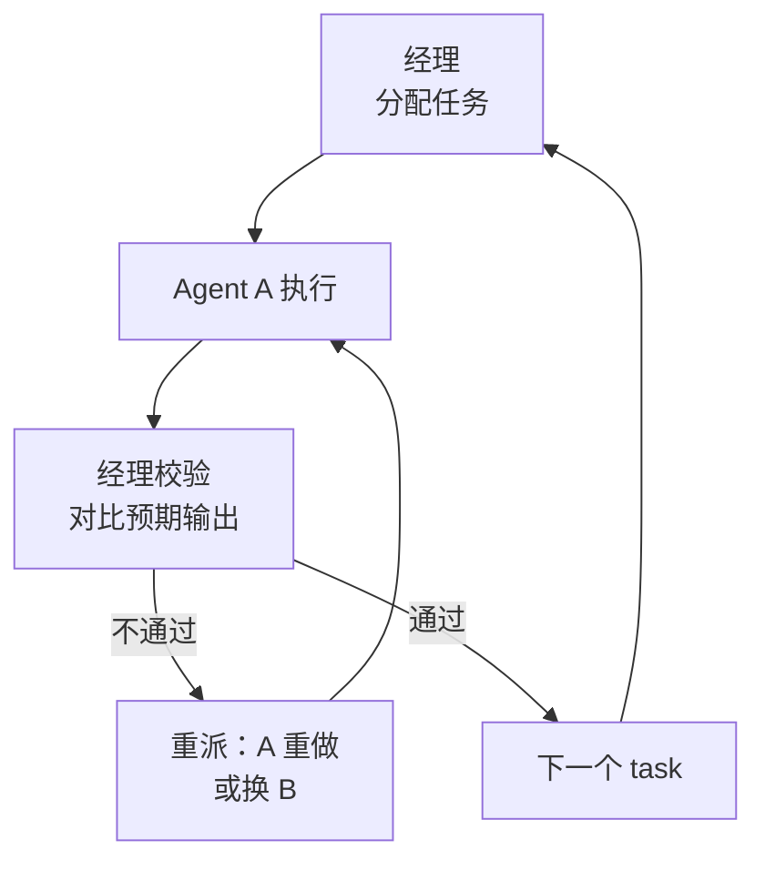
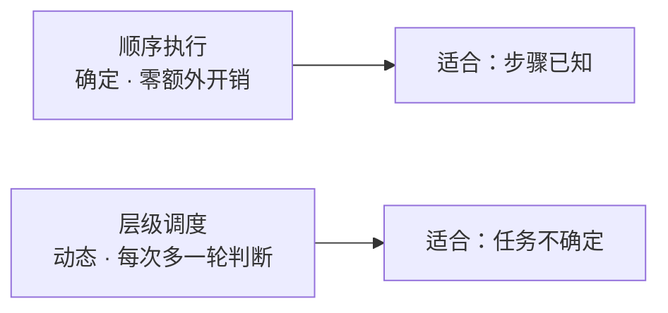
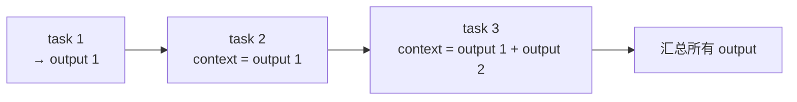

> 本文整理自课程文稿《09｜定义 Process：任务调度与信息传递》。文稿末尾自注「内容由 AI 生成」，属整理稿而非逐字记录。
>
> 文中的框架行为与字段名沿用文稿原述，未做外部核验。

三件套的最后一个：**定人、定事，现在定流程。**

而作者开局就给了一个会让人重新理解这个词的定义。

## Process 不是流程图，是调度方式

他说在框架里，流程的本质定义其实是——**任务的调度方式。**

这个说法一开始有点绕，但顺着前面两篇就能通：

1. 复杂任务被拆成一个个里程碑。
2. 每个里程碑就是一个子任务。
3. 这些子任务组成一个 task list。

**而 task list 就是执行过程本身。** 真正的问题是：执行时该怎么调度。

框架原生支持两种。

## 调度方式一：顺序执行

最直接的做法：**每个 task 在定义时就写好了交给哪个 agent。**

于是执行逻辑变得极简——从第一个 task 开始，一个一个往下做，每个 task 交给它固定分配的那个 agent。

**非常线性的流程。**

## 调度方式二：层级调度

第二种不一样：**不预先分配 agent，而是中间有一个经理角色来分配。**

而经理做的**不只是分配**。他特意强调了这一点。

流程是这样：

1. 遍历到某个 task，经理根据「这个 task 是什么」和「各个 agent 的描述」决定交给谁。
2. Agent A 尝试完成，把产出交回经理。
3. **经理拿这个产出和预期输出比对**，判断有没有做好。
4. 如果 A 给的是报错或不合格，经理决定：让 A 重做，还是换 B 试。
5. 通过了才进入下一个 task。

上图是这个闭环。**注意那个校验环节**：它让流程具备了自我纠错能力。

## 但生产环境里，八九成用顺序执行

这是这一讲最实用的一个判断。

他给了一个比例：事实上的落地案例里，**绝大多数用顺序执行就够用**——按他的说法是十个里面有八九个（原片口径，未做外部核验）。

他的表述是：**在生产场景里，我们其实是在不确定中找确定。**

原因有两条。

**第一，确定。** 没有花哨的调度，agent 和 task 是一一绑定写死的，每个任务的执行者都明确。

**第二，没有额外开销。** 而层级调度里，经理拿到 task 要先判断该给谁，**这个判断本身就是一次完整的模型调用**。一次成功几秒到几十秒，加上每次判断都要付 token——链路一长，这笔开销会累积成可观的分钟数。

上图是两者的分工。

### 顺序执行的两个真问题

他也把代价说清楚了。

**问题一：不确定场景用不了。** 比如个人助手接到用户任务时，压根不知道这任务属于哪类，没法预先定义该给哪个 agent。**这时必须有经理来做需求拆解和分析。**

**问题二：成败押在单个 agent 身上。** 第一个 agent 执行第一个 task 失败，整个流程就卡住、直接报错返回。

而层级调度能救两件事：经理能发现异常后重新分配；**经理也能校验「agent 说自己完成了」这种幻觉**。

> 有些时候 agent 自己幻觉着「我把任务完成了」，其实没有。这种在非顺序执行的机制里能被兜住，但顺序执行就很强调单个 agent 必须搞定。

## 信息怎么在任务之间传递

顺完调度，他往下讲了一层更细的东西：**task 之间怎么传信息。**

### 一个 task output 结构里装了什么

每个 task 执行完，产出会装进一个 task output 结构，里面有几样东西：

| 内容 | 说明 |
|---|---|
| task 描述 | 这个任务是什么 |
| **原始输出** | 上一个 agent 的 final answer 全文，原样保留 |
| 解析后的 JSON | 如果你定义了 JSON 输出 |
| 结构化对象 | 如果你定义了数据结构 |

后两项**不一定有值**——取决于你有没有要求结构化输出。

### 两种传递方式

**隐式传递（默认）**：你不做任何设置，框架会把上一个任务的结果自动放进下一个任务的 context。

**显式配置**：在 task 里用 context 数组指定「我要哪些上游产出」。

他给了个例子：SEO 优化这个任务，可能既需要图片分析的结果，又需要文案撰写的产物——**那就显式把这两样都列进去。**

而他的建议很明确：

> **生产环境尽量用显式传递。** 这样代码更确定，大家也清楚这个任务到底依赖什么。

## 一个三步链路跑通

代码环节他用小红书场景串了三个 agent。

| 步骤 | Agent | 输出 |
|---|---|---|
| 一 | 内容策略专家 | 素材评估、受众画像、核心痛点、建议标题、大纲、诱饵设计、关键词布局 |
| 二 | 内容编辑 | 最终标题、完整正文、**图片列表（含顺序）** |
| 三 | 搜索优化专家 | 优化后标题、优化思路、优化后正文、优化后图序、标签 |

**第二个输出里那个「图片列表」值得留意**——他要求 agent 合理排序，因为**头图最重要**。这是一个不带技术含量但很真实的业务约束。

而第三个任务只需要前两个的产物，**不再需要视觉分析报告**——所以显式指定 context 时把它排除掉了。

## 日志里看到的两件事

**第一，context 是拼在 user message 末尾的。**

日志里能看到这样一句话：**This is the context you are working with**，紧跟着就是上游任务的 final result。

而第二个任务和第三个任务拼的内容不同：第三个拼的是「大纲分析 + 撰写好的 title 和 content」，**没有视觉报告**——显式配置生效了。

这一点可以直接验证：打开任意一次运行的日志，核对每个 task 的 user message 末尾那行提示，看后面跟的是哪些上游产出。三个任务的日志里，第二个和第三个各自拼进来的内容明显不同，可以逐条对照。

**第二，那个「中间产物保存」工具又出现了。**

第一个 agent 的 ReAct 全过程：先评估整张图，调工具存一次；再定义目标受众，存一次；再分析痛点，存一次；然后才生成标题和大纲。

**这就是前一篇讲的那个技巧在真实流程里的样子**：它把一个本来会一步完成的思考拆成了四步。

## 底层：两个数组加一个循环

他照例拆了框架实现，而这次的结论特别简单。

> 手搓也很简单，就是**两个数组加一个循环**。

具体是：

1. 定义好任务列表。
2. kickoff 后做初始化（填入 inputs 变量），建一个空的 task output 列表。
3. 遍历 task1：分配 agent → 填入 context（第一个任务没有上游，跳过）→ 执行 → 把 final answer 存成 output1。
4. 遍历 task2：分配 agent，**从 output 列表里取到 output1 填进 context**，执行，再存 output2。
5. 循环到最后一个 task，把所有 output 汇总成最终结果。

上图是这个循环。**它的关键设计是那个 output 列表**——所有历史产出都在里面，每个任务按需取用。

## 三条反模式，两条最佳实践

### 反模式一：上下文超载

他说得很直接：**不要把所有的 output 都填到每一个 task 里。**

原理是前面反复出现的那句：**在整个 agent 运行过程中，做减法是最重要的。**

他给了一个具体例子：SEO 那一步把图片的东西也塞进去行不行？行。但**多出来的 token 和浪费掉的模型注意力，都会影响最终效果**。

### 反模式二：步骤拆得太粗或太细

- **太细**：里程碑特别小，会额外地耗大量 agent 交互，占用更多 token 处理各种 task output。
- **太粗**：效果又不好。

**这就是拆分粒度的手感问题。**

### 最佳实践一：显式定义

他反复强调过很多遍了，这里是第三次：要有显式设计的意识。

### 最佳实践二：顺序执行里，错误处理必须由 agent 自己扛

这一条我认为是这讲最有分量的提醒。

> 顺序执行里**没有经理帮你管失败**。所以你必须让每个 agent 自己处理好失败——**到底是快速失败，还是有边界地重试**。

也就是说：**你省掉了经理那一轮调用的成本，就得把那份职责写进 agent 里。**

## 我的三点补充

以下是评注，不是原片内容；取舍由我负责。

**第一，把 Process 定义成「调度」而不是「流程」，是一件很有解放意义的事。** 因为「流程」听起来像一张要画出来的图，而「调度」只是一个策略选择：谁做、按什么顺序做、失败了怎么办。**这张图其实早就在 task list 里了，Process 只回答剩下那一个问题。** 想通这一点，很多复杂的编排焦虑会消失。

**第二，顺序执行的真正优点不是「简单」，是「确定性可审计」。** 经理调度看起来更聪明，但它引入了一次不可预测的模型判断——同一个任务，今天派给 A，明天可能派给 B。而顺序执行里，你随时能回答「这一步是谁做的、输入是什么」。**在需要复盘的场景里，这个性质比聪明更值钱。**

**第三，那个「顺序执行要自己扛错误」的提醒，把成本和责任对齐了。** 层级调度花一次经理调用，买的是「失败重派 + 幻觉校验」两项保险。你不用它，就得自己补上这两项——**否则省下的成本会以线上事故的形式还回来。**

---

一句话总结：**Process 不是画流程，是决定谁做事、失败谁兜。** 而绝大多数生产场景，答案就是：按写好的顺序来，每个 agent 自己治好自己。
