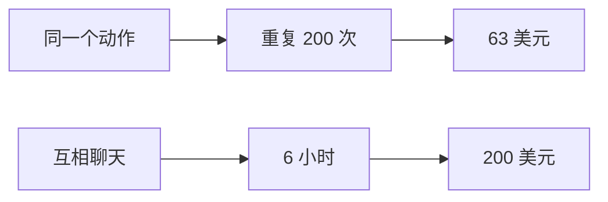
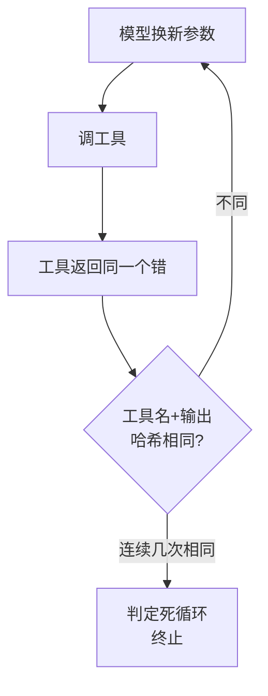
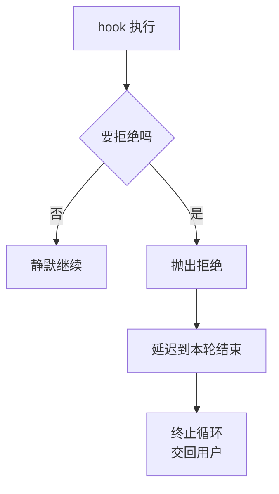
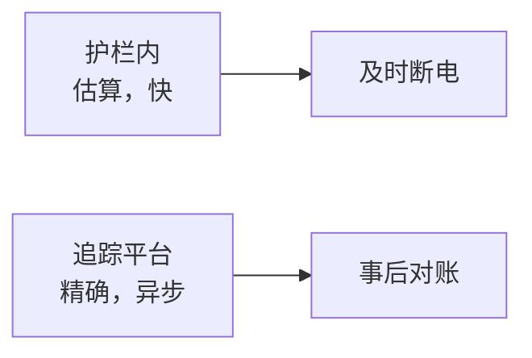

> 本文整理自课程文稿《31｜可靠性：重试、循环控制与成本围栏》。文稿末尾自注「内容由 AI 生成」，属整理稿而非逐字记录。
>
> 文中的事故数字、阈值与函数行为沿用文稿原述，未做外部核验。

上一篇解决了「看得见」。这一篇要解决的是另一半：**管得住。**

**而它开篇就说明了为什么「看得见」不够。**

## 光看见没用

> 你能看到调了几轮、用了什么工具、花了多少 token——**但你没有控制它。**

**为什么？他给了三个理由，都很实在。**

| 理由 | 说明 |
|---|---|
| 你不可能一直盯着 | **没人盯着大盘看** |
| 看到了也没辙 | **总不能去 kill 进程** |
| **损失发生时已经晚了** | 成本涨上去了，就是已经花掉了 |

**所以护栏的本质是**：

> 真正的护栏**不光在观测**，最重要的事情是**在这些 hook 节点自动去干预。**

## 三个通用痛点

**他先声明了一个前提**：

> 我讲的痛点**是相对通用的**。**但你在自己的业务里，要发现自己的痛点。**

**他还举了行业特有的例子**：

> 如果是金融或有信息安全的场景——**它打印了用户的身份证号，你可能立刻要拦住它。**
>
> **或者它在向工具请求时，把身份证号发出去了。**

**「这类是金融独有的，那你就需要把它加进策略里。」**

**而通用的三个是这样的。**

### 痛点一：长任务单步失败

> 任务已经跑了两三个小时，**突然弹出一个错误。**
>
> 弹出来以后也没办法，**只能前面全都白跑。**

**而他说这类错误往往是**：

> **因为模型的不稳定、抖动。**那就非常崩溃。

### 痛点二：陷入死胡同 ⭐

**这一条他给了两个具体数字。**

> 相同的参数**重复了 200 次**，**花了 63 美元**。
>
> 或者说**互相聊聊天聊了 6 个小时**，**花了 200 美元**。

上图是这两种浪费。**注意第二种更荒诞——不是失败，是空转。**

**换算成秒更刺眼**：六小时是 21,600 秒，**每一秒都在付钱，而这一秒里没有任何产出。**

### 痛点三：活干了，但很贵

> 它确实在干活，**但比我预期的贵得多。**

**为什么会这样？他解释得很清楚**：

> 这一个问题也许是我问得有问题，**或者我只是让它在测试和开发之间自己迭代。**
>
> 它迭代的过程中每次改一点、改了很多次，**超过了一个很夸张的循环次数**，一下就花了很多钱。
>
> **但我这个问题本身价值就没那么多。**

**「我虽然干了活，但我的方式很贵。」**

**而他补了一个很关键的判断**：

> 其实这时候**应该停下来去调整 SOP**，但你实际没有，**那就造成了整个成本的浪费。**

## 策略一：重试，但要分清该不该

**他先澄清了一个边界**：

> 重试本身**不是在 hook 上**，因为重试是**调度层**的东西。
>
> **hook 能帮你做的是重试的追踪**——看该重试多少次比较合适、线上哪些东西一直在重试。

### 什么该重试

| 情况 | 为什么 |
|---|---|
| **429 限流** | 拉长时间重试就好 |
| **500、502** | 对方服务器抖动，**模型或工具都可能** |

**共同点**：**它们是瞬态的。**

### 什么不该重试 ⭐

| 情况 | 为什么没用 |
|---|---|
| **400 系** | **你的参数就有问题、框架有 bug** |
| **权限问题** | **它没法自愈**，你不解决就一直有 |
| 上下文溢出 | 压缩没压好，**再试还是溢出** |

**「无论你多少次，请求参数就有问题。」**

### 一条很容易忽略的机制

**他给了重试次数要少的理由，而这个理由很具体**：

> 因为 Agent 循环的重试有个特点——**每次失败，那些失败信息都会加进去。**
>
> **它可能加一到两千 token。**

**所以**：

> 几次重试过后，**你可能上下文就一大堆东西了。**

**换算一下更直观**：三次重试就多带三四千 token，**而这部分开销是每一轮请求都要重复付的。**

上图是这条副作用。**「重试本身会加剧失败」——所以两三次就够。**

## 策略二：循环检测，两道闸

**他先讲了第一道，也讲了它为什么不够**。

### 第一道：总迭代上限

> 这是比较粗暴的限速器——**最多迭代多少次。**各种框架都有。

**但它很难配**：

> 有的场景就是要更多步骤、更多次迭代**才能解决**。
>
> **而有的场景并不复杂，它就是一直在循环**，结果也干到 200 次。

**「所以你没法用一个数字同时满足两边。」**

### 第二道：哈希去重 ⭐

**这一道的思路我觉得很巧。**

> **我在调用工具的时候，连续几次调用的工具名、以及这个工具给我产出的回复**——这个组合去做哈希。
>
> **如果连续几次都相同**，那现在再调这个工具**没有任何意义。**

**为什么会出现这种情况？他描述得很准**：

> 模型一直在试着**用不同的输入**给到工具。**但工具本身可能挂了**——它的输出一直是权限问题、参数问题。
>
> **那模型换着法儿地试，它也成功不了。**

上图是这个判据。**注意它检测的不是「模型重复」，而是「结果重复」**——模型每次可能都在努力换参数，**但只要结果一样，就说明撞的是同一堵墙。**

### 终止之后做什么

**他给的处置不是静默退出**：

> 我需要有一个信号给到模型，**说当前这个需要终止了，你需要去询问用户应该怎么解决。**
>
> **当然给用户抛一个错，用户也会去解决的。**

**「把问题交回给人」——这和上一篇那个「兜底」是一条线。**

## 策略三：成本围栏

### 关键：实时算

> 成本围栏最重要的事情是**一定要实时计算。**

**时点**：

> 正常来说应该在**每次请求模型回来的时候**，算一下当前已经用了多少。
>
> 但因为这个框架有 bug，**所以我们在请求工具前做这个计算。**

**「时点不同，但效果一样」**——他把这个妥协说清楚了。

### 超了就断电

> 当我发现已经超预算了，**赶紧断电**——让它直接走停止过程，**或者直接输出最终回答。**

## 一个必要的升级：从报警到断电

**这一段是接上一篇的，我觉得是这篇的技术核心。**

> 上一课我们做了 hook 框架，**但当时那个分发器只能做报警**——**因为它没有把输出变成「让循环停止」。**
>
> 这一课把它升级了，**变成了一个「闸门」。**

**效果是**：

> 当 hook 执行时最终返回的是「拒绝」，**我们就会立即停止，把整个循环结束，让用户去解决。**

**他用了「保险丝」这个词，我觉得很准**：**报警器会响，保险丝会断。**

**而实现上要注意一点，他也说了**：

> 为了不让一个 hook 影响全局，**只有需要拒绝的部分上升上去**，其他错误仍然静默。

上图是这个升级后的路径。**注意中间那个「延迟」**——不是立刻中断，**而是等这一轮 loop 走完再停**，这样状态不会半途撕裂。

## 反模式

### 一、所有错误都重试

> **重试肯定只是重试瞬态错误。**

### 二、把成本控制写在提示词里 ⭐

**这一条他讲得最重。**

> 有人这么做：把成本算下来，**然后在上下文里告诉模型「你现在成本多少了，不要超」。**
>
> **但提示词本身的执行力，很多时候基本做不到。**

**他的结论很硬**：

> **通过一句提示词说「你要有成本意识」「不要超成本」，是没有任何价值的。**
>
> **所以一定是在框架上做这个事情。**

### 三、用请求数做限流 ⭐

**这一条给了一个量级判断。**

> 有些人用请求数做限流——**不管是循环次数还是 token 成本。**
>
> **但对 agent 来说，一定要以 token 为准。**

**为什么？**

> **你光拿请求数做限流和成本控制，真正算到 token，成本可能差几百倍，就没有任何意义。**

**他还把它推广到了容量规划**：

> 包括整个 agent 的限流，**这些东西都要换算到 token 更合适。**
>
> **因为你服务器能扛多少，很多是取决于 token 数。**

## 最佳实践

### 一、重试前先保证幂等

> **我更建议：只要给模型用到的工具，一定要都是幂等的。**
>
> **因为模型的不确定性，真的会导致它不知道多少次地调用这个工具。**

**「幂等是重试的前提」**——如果工具不幂等，重试就是在制造副作用。

### 二、两层循环检测都要有

总迭代上限 + 哈希去重，**双保险**。

### 三、token 估算：够用就行 ⭐

**这一条很务实，我觉得值得单独记。**

> 如果想做**最精确**的计算，成本很高——**你要把整段话先拆成 token 序列，再基于序列算。**
>
> **甚至需要额外调一个分词 API。**

**而他的做法是估算**：

| 语言 | 系数 |
|---|---|
| 中文 | **约 1.5** |
| 英文 | **约 1.2** |

> 这样先估算，**其实就大差不差了。用在护栏上足够了**——**因为最终成本差不了多少，不用搞那么精确。**

**而精确计算放在哪儿？**

> **最终的计费，肯定是要精确地、异步地在追踪平台里把成本算好。**

上图是这个分工。**护栏要的是及时，对账要的是精确——这两件事不必用同一套算法。**

## 我的三点补充

以下是评注，不是原片内容；取舍由我负责。

**第一，「哈希工具名加输出」这个判据的妙处，在于它绕开了「模型是否在重复」这个不可靠的问题。** 模型每次都会换参数，**所以从行为上看它一直在努力。** 而结果相同才说明：**它在撞同一堵墙，只是每次都换个姿势。** 这个判据把「循环」的定义从**行为重复**改成了**结果重复**——而后者才是真正无意义的信号。

**第二，把成本控制从提示词挪到框架，是这一讲最重要的判断。** 因为提示词能影响的是**模型的意愿**，而成本超支是**账户上的事实**。**你用意愿去约束事实，中间隔着一层它可能根本没看、或者看了也不算的机会。** 所以凡是「必须成立」的约束，**都得落在代码里**——这和前面几讲那条「收走写工具」是同一个手法。

**第三，「护栏估算、对账精确」这个分工，其实承认了护栏的性质是熔断而不是记账。** 熔断要的是**在超支前的一瞬间知道大概**，差几个百分点完全可以接受；**而账单要一分不差。** 把两者分开，既省了实时算 token 的高成本，也没有牺牲最终准确性。**这也解释了为什么护栏里用系数估算就够了——它不需要对，只需要及时。**

---

一句话总结：**看见账单已经花掉了，所以护栏必须是能断电的那种。** 而断电的判据要落成代码：**该不该重试看错误类型，是不是死循环看结果哈希，超没超预算看实时累加。**
