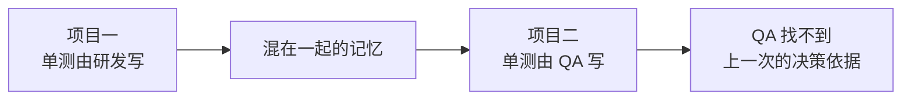
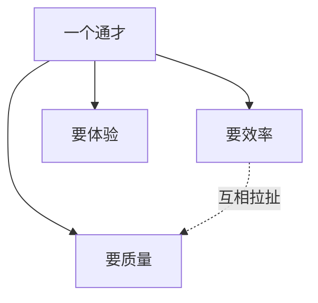
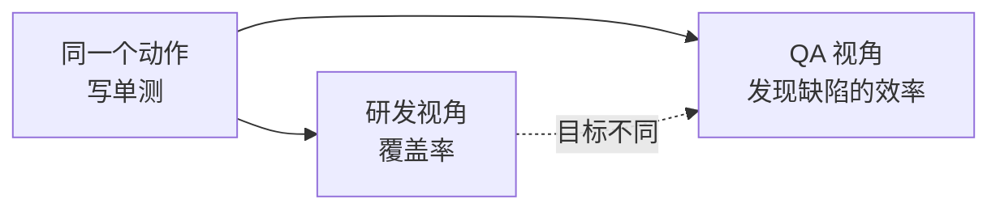
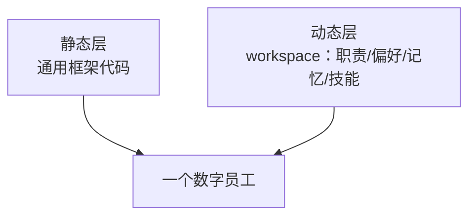
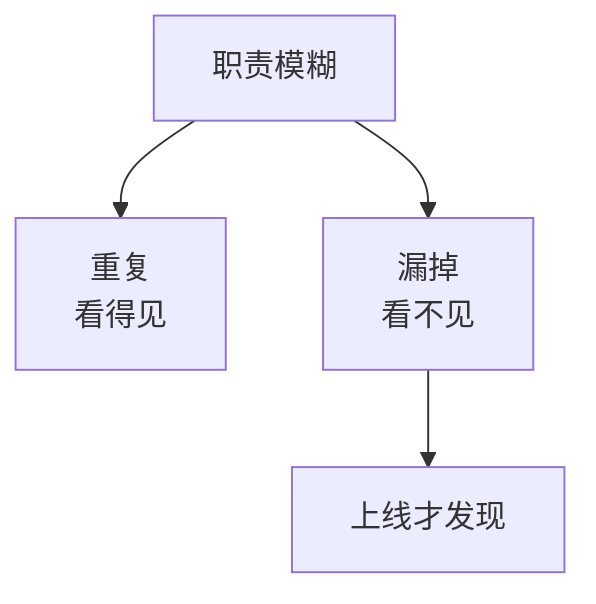
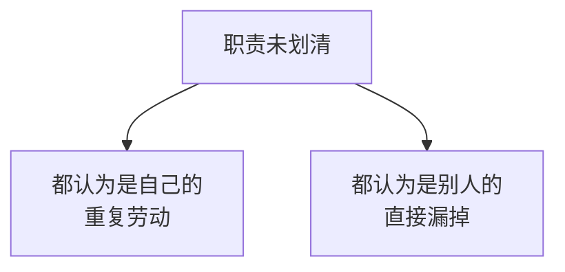

> 本文整理自课程文稿《25｜团队角色体系：分工设计与行为规范》。文稿末尾自注「内容由 AI 生成」，属整理稿而非逐字记录。
>
> 文中的判断方法、角色案例与代码结构沿用文稿原述，未做外部核验。

上一篇说数字团队得分工。这一篇说的是**怎么分**。而它先论证了「不分工」为什么会崩。

## 通才为什么会崩

他给了三条，我觉得都很实在。

### 一、上下文撑不住

> 通才的 agent，**你的上下文就得什么东西都有。**
>
> 就算你用渐进式披露、用 skill 做了各种优化，**但复杂任务里你要让它变通才，skill 一定塞很多、SOP 也塞很多。**

**而塞多了的后果很反直觉**：

> 真正每一个 skill **被调用到的概率会越来越低**，最终**直接崩溃和停摆**。

**「越全越用不上」**——因为候选太多，选不准。

### 二、记忆会互相污染 ⭐

**他给的例子很具体，说清了污染的机制。**

> **研发需要记住的东西，跟产品需要记住的东西是不一样的**，QA 要记的也不一样。
>
> 如果所有人的记忆混在一起，同一个任务一会儿给他、一会儿给他——**那他回忆历史记忆的时候就会混乱。**

**而混乱的具体形态是这样的**：

> 上一个项目，**单测是研发写的**；下一个项目，**单测变成 QA 写了**。
>
> 那 QA 写这个单测的时候，**他一定记不住之前研发那堆东西当时是怎么决策的。**

上图是这个失效。**注意问题不在「谁写」，在「决策依据丢了」。**

### 三、判断方向会乱 ⭐

这条他讲得最透，也是我认为最容易被忽略的。

> agent 本身是**非常主观而且容易被引导的**。你想引导它，只要在 system prompt、角色定义、甚至前面聊的几句里**多说几句**，后面所有画风都会往那个方向转。

**他判断这是模型的特性**：

> 这是现在大模型**愿意去迎合用户**的特质。**它有时候有效**，但很多时候**也会带来问题**。

**而如果它是通才呢？**他这里点出了一个很妙的词：

> 那它就**精神分裂**了——一会儿要这么想，一会儿要那么想，**大概率想不好。**

**为什么？因为不同角色的决策偏好本来就互相冲突。**

| 角色 | 一门心思要的 |
|---|---|
| 研发 | **交付效率** + 架构影响、成本 |
| QA | **质量**，线上没有缺陷 |
| 产品 | **用户体验**，只要能更好就都想做 |

上图是这个冲突。**所以「决策偏好」必须是一个角色的固定属性，而不是每次临时判断。**

### 一句总结

> **通才列十个 agent，可能不如只有三个、但分工非常鲜明的 agent 好用。**
>
> **这个对比不是修辞**——它说明角色数量和团队产出**不是同一条曲线**，过了某个点就是负担。

## 三种分工模式

在给判断法之前，他先把业界的几种做法摆了一遍。

| 模式 | 怎么运转 | 问题 |
|---|---|---|
| **固定流程型** | 产品完→研发→QA→OP，角色按流程固定 | **很死**，应对不确定性差 |
| **松散协作型** | 角色明确但无人管理，谁需要谁就自己去找 | **N×N 交互网，很难管** |
| **中心协调型** | 一个 manager 接需求、派活、收结果 | ✔ 业界最多 |

**「松散型」他描述得挺生动**：

> 用户来了找产品，产品搞完需要开发**自己去找研发**；研发要做事**自己去找 QA**。

**而中心协调型为什么胜出**，他给了一个复杂度解释：

> 它能把复杂度**从 O(n²) 变成 O(n)**。
>
> **换算成条数更直观**：五个角色完全互联是二十条沟通路径，加了 manager 之后只剩五条。

**他点了几个实例**：**团队模式里有 team leader**，开源项目的实现里也都会有一个 manager 角色。

**而它和上一篇那个编排者的区别在于**：

> 原来那个是**任务 owner 管一件事**；**而 manager 是管所有任务**，甚至整个团队的运行方式都由它管。
>
> **可以理解为编排模式的增强版。**

## 三维隔离法 ⭐

这是全篇最实用的部分：**到底该拆几个角色。**

判据是三个维度。**只要有一项差异足够大，就该独立。**

### 维度一：记忆数据有没有本质区别

他拿研发和 QA 举例。

| 角色 | 记住什么 |
|---|---|
| 产品 | 产品流程、线上已有方案 |
| 研发 | **代码** |
| UI/UE | 产品流程 + **具体设计稿** |
| QA | **测试用例、缺陷** |

**关键判断是这一句**：

> 产品跟研发**肯定不能是一个角色**。**而 QA 和研发的记忆有一定重合，但也各有独特的东西**——所以还得看另外两个维度。

**注意这个推理方式**：单一维度不足以决定，**要三个一起看**。

### 维度二：技能体系差多少

> 如果流程方法跟其他角色**一致或雷同**，那这俩角色**就该考虑合并**。

**他把研发和 QA 的 SOP 摊开对比了。**

**研发的流程**：写设计 → 评审 → 写代码 → 代码审查 → 安全扫描 → 单元测试 → 交付。

**QA 的流程**：测试设计 → 设计用例与风险 → 写自动化代码 → 提测后执行测试。

> **两者的 SOP 差异比较大。**

### 维度三：决策偏好是否冲突

**这一条他说「非常关键」**，而且给了一个我认为全篇最好的例子。

> 研发和 QA，**研发的偏好是交付效率**；**而 QA 是要规避风险、注重质量**。

**而最能说明问题的，是同一个动作在两种偏好下的不同标准**：

| 谁写单测 | 衡量什么 |
|---|---|
| 研发 | **覆盖率**（这是研发的指标） |
| QA | **这单测能发现缺陷的效率** |

> **「覆盖率」和「发现问题」是不一样的。**

上图是这个差异。**它说明偏好不是态度问题，是衡量标准问题。**

### 反过来用：该合并的例子

**这套方法不只用来拆，也用来合。**他举了 QA 和安全。

| 维度 | QA 和安全 |
|---|---|
| 记忆数据 | **雷同**（都是缺陷、反模式、用例） |
| 技能体系 | **相似**（了解项目、了解代码） |
| 决策偏好 | **一致**（都是红蓝对抗里的蓝军视角，都要找问题） |

> **所以 QA 跟安全就应该尽量合并成一个角色。**

### 一条重要的默认值

> **角色一开始越少越好，然后逐渐扩展。**
>
> 因为**角色一多，协调成本就更高。**

## 四层框架

角色定了，那一个角色的定义该怎么写？

他给了四层，并指出一个前提：

> 框架能提供的能力是**静态固定的**。**不同数字员工唯一的不同，就是这四个东西。**

| 层 | 是什么 | 例子（manager） |
|---|---|---|
| **职责层** | **一份「宪章」**：该负责什么、不该负责什么 | 哪些事它做、哪些事该别人做 |
| **偏好层** | 一门心思要达成什么 | **把整个任务推完** |
| **记忆层** | 独属于它的记忆 | 完成过多少任务、谁干得好、下次该找谁 |
| **技能层** | 它自己的 skill | 接任务怎么做、派活怎么做、怎么验收 |

**而每一层的落点很具体**：

- 偏好层 **写在自我认知文件里**
- 记忆层和技能层**前面几讲已经讲过**
- **只有职责层的写法他单独强调了**

### 职责层必须有 Never 清单 ⭐

他说得很直接：

> 职责的时候，**你不能光说你的职责有什么**。你**同时一定要给它一个清单，写明我这个职责没有什么、你不能做什么。**

**理由**：

> 这样**才能让整个东西运行得会更强。**

**而这一条和第一模块那个「行为边界」是同一个东西**，只是这次落到了团队层面。

## 一个结构上的变化

讲代码之前，他说了一句我认为很值得记的话。

> **我们越发少地需要去改真实代码了**，而做的更多的事情是**给这个数字员工维护好它的 workspace**。
>
> 今天讲的记忆、soul、user，**全都是这一部分的问题。**

**所以他做了两层分离**。

| 层 | 是什么 |
|---|---|
| **静态层** | 一套通用的「数字员工」执行框架（含剪枝、压缩、会话恢复、hook） |
| **动态层** | workspace 里的四个文件 + skill |

**而这个设计的好处，他说得很实在**：

> 一旦出 bad case，**你就可以独立去定位**——到底是框架代码的问题，**还是 manager 的某个问题。**

上图是这个两分。**注意框架本身「不知道你是什么员工」**——角色完全由 workspace 决定。

### 一个细节：任务模板变简单了

他还提到一处反差。

> 现在的 task description 和预期输出**变得相对简单**了，就是一个模板，**最重要的就是用户请求那一条**。
>
> 这其实模拟了**你给编码助手发指令时的样子**——**你的那一条消息，就是全部输入。**

**而这意味着**：不再像早先那样重度依赖结构化输出契约——**因为 skill 里已经写清了该怎么做。**

## 那两个角色实测跑成什么样

这一课他说「还不会串联团队」，只跑了两个**独立**的数字员工做验证。

| 角色 | 给的任务 | 产出 |
|---|---|---|
| manager | 做一个智能日常助手项目，**设计团队里的人员分工** | 一份任务清单，按角色分配 |
| 开发 | 某个自然语言日程解析模块，**只出设计文档** | 一份完整设计文档 |

**注意 manager 那个任务本身就是个有意思的设计**：让它做的第一件事，就是**设计团队**。等于用一次真实任务来验收它的角色认知。

### 一个真实的失败形态

反模式里那条「职责没划清」，他描述的是**两个方向都会出错**。

> 单元测试这件事如果没分清 owner——**有可能两个人都认为是自己的，全都去干；也有可能都认为是别人的，结果就漏掉了。**

**而这是这一讲里唯一一个具体的失败形态，它的价值在于**：它同时说明了「职责模糊」的两种症状，**而这两种症状的排查方式完全不同**——重复劳动看得见（两份测试都在），**漏掉看不见（谁都没做，也没人报错）。**

上图是这个差别。**所以职责清单的价值，主要不是防重复，是防那个静默的缺口。**

### 隔离怎么验

他把记忆和沙盒都做成按角色隔离，这本身给了验收口径：

| 验什么 | 怎么看 |
|---|---|
| 记忆有没有混 | 两个角色的记忆目录里，是否只出现自己领域的记录 |
| 沙盒有没有隔离 | 各自请求不同的容器与 MCP 端点 |
| 定位是否可分离 | 出 bad case 时，能否判断是框架问题还是角色配置问题 |

**第三行是他做静态层与动态层分离的真正理由。**

## 反模式

### 一、让 manager 自己动手 ⭐

> **一旦他陷入细节，就一定失去全局视野**，整个团队执行效率都会更低。

**这和上一篇「主 agent 不给写工具」是同一条原则。**

### 二、职责没划清

他给了一个非常具体的失效形态：

> 假设单元测试这件事**你没给它分清楚**，那谁也不知道 owner 是谁。
>
> **有可能两个人都认为是自己的，全都去干；也有可能都认为是别人的，结果就漏掉了。**

上图是这两个方向。**注意漏掉比重复更危险——重复只是浪费，漏掉是缺口。**

### 三、角色过度分化

> **agent 越多，维护成本越高**，复盘和后续优化的成本也越高。
>
> **够用就行，先用起来。**

## 最佳实践

| 做法 | 说明 |
|---|---|
| **用 Never 清单 + 技能白名单** | 双重限制行为 |
| 记忆目录按角色隔离 | **不要放在一块** |
| 加角色前先判断 | **默认先不加**，跑出问题再说 |

**其中「技能白名单」这条，他说比 Never 清单还高一档**：

> 每个数字员工都有自己的 skill loader 配置。**你可以通过这份配置限制它到底能加载哪些 skill**，从而限制它的行为。

**这又是一个「把约束从叮嘱挪到机制」的例子。**

## 我的三点补充

以下是评注，不是原片内容；取舍由我负责。

**第一，「决策偏好冲突」这条其实解释了分工的深层理由。** 我们通常以为分工是为了**效率**（各干各的更快），但他给的例子显示，分工是为了**避免同一个判断被两种标准同时衡量**。研发看覆盖率、QA 看发现缺陷的效率——**这两个标准无法共存于一个决策者身上。** 所以分工的本质不是切工作量，**是切价值排序。**

**第二，三维隔离法真正妙的地方在于它是「合并判据」而不只是「拆分判据」。** 大多数组织设计的讨论都在论证「为什么要多设一个角色」，而他那套 QA 和安全的例子是在论证**「为什么这两个该合成一个」**。这让它变成了一把双向的尺子——**而能用来做减法的工具，才是好工具。**

**第三，「改代码越来越少，维护 workspace 越来越多」这个观察，其实是整门课的一个转折点。** 前面十几讲都在写代码（工具、MCP、沙盒、记忆系统），而从这一讲开始，**工作重心变成了写配置文件**。这意味着能力上限不再取决于工程实现，**而取决于你把角色描述得多清楚。** 换句话说：**从写程序变成了写组织。**

---

一句话总结：**别问「要不要多一个角色」，问三个问题：记忆像不像、技能像不像、偏好冲不冲突。** 三项都像就合并——**因为角色多了，协调本身就是成本。**
