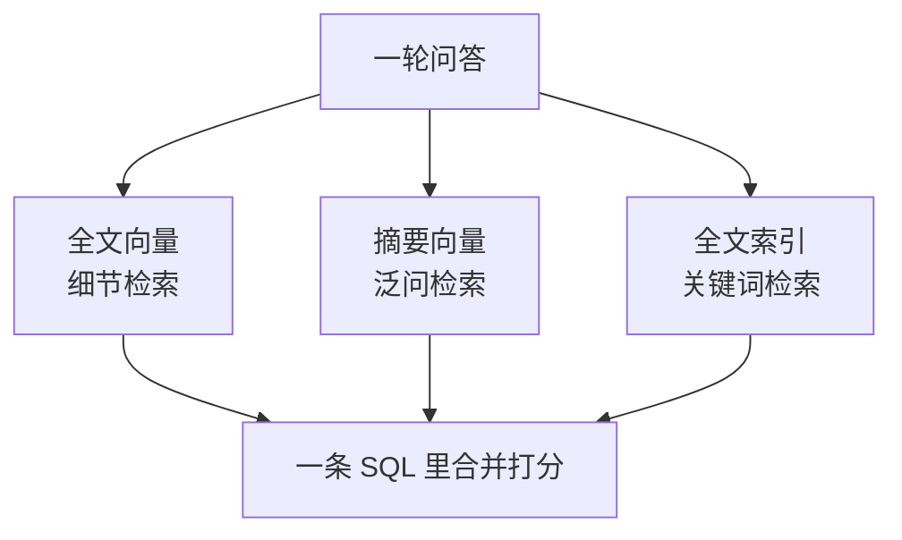
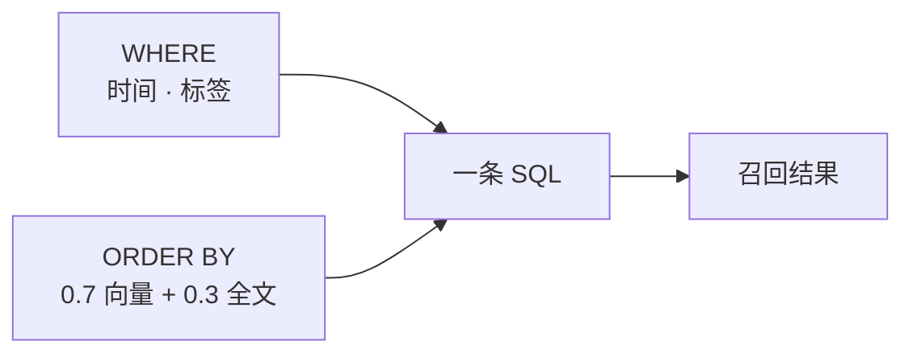
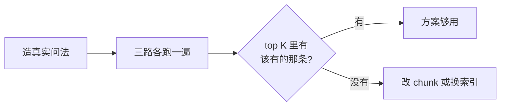

> 本文整理自课程文稿《21｜搜索驱动的记忆系统：企业级海量记忆管理方案》。文稿末尾自注「内容由 AI 生成」，属整理稿而非逐字记录。
>
> 文中的权重参数、向量维度与代码路径沿用文稿原述，未做外部核验。

上一篇结尾留了个问题：**既然目录树那么好用，搜索引擎为什么取代了黄页？**

这一讲就回答它。而答案的开头，是纠正一个很流行的混淆。

## 目录与搜索：两种找法

他先不谈 AI，只说人。

**第一种：目录树。**早期门户网站就是这样——分若干大类，每类再分子类，一层层点进去。

**而企业知识库到现在还在用这套**：左边一棵目录树，部门信息、人员信息、业务信息，逐层点进去。

**但信息量突破某个临界点，它就不够用了。**

> 你经常有这样的需求：**我就知道一个关键字**。而同一件事，A 分类和 B 分类的放法可能不一样。

**于是需要第二种：搜索。**

上图是这次切换。**它换的不是工具，是入口**——从「先选路径」变成「先说问题」。

**而人怎么找，Agent 就怎么找。**

> 编码助手其实没用什么复杂检索，**它就是用关键字去扫整个文件系统**。

## 纠正：RAG 不是向量库

这一节我认为是整篇最该被传开的部分。

> 想到 RAG，你立刻会想到**向量库**、**embedding**。**但这其实都是后来的迁移和演变。**

**最早 RAG 是什么？就是搜索。**

> 它本身的名字就是「检索增强生成」。**而最早那批检索，搜的是搜索引擎，不是向量库。**

**向量库出来之后，大家发现它跟语义搜索很搭**，后来就把它和 RAG 强绑定了。

> **其实根本没有这回事。**

### RAG 的三步

他给的标准范式很朴素。

| 步 | 做什么 |
|---|---|
| 一 | **建索引**（用什么方式都行） |
| 二 | **检索**（工作流里写死，或 agent 自己决定） |
| 三 | **增强生成**（把召回结果当工具结果喂回去） |

**而索引可以是什么？**他说得很宽：

- 一个全库（不建索引）
- MySQL 的 where 条件
- 向量
- 知识图谱

**「这些都无所谓。」**

## 四种检索方式

### 一、全库扫描

就是 grep 加 glob——**一个关键字扫全库，没有索引，原理上是 O(n) 匹配。**

**为什么编码助手敢这么干？**他给了两个理由。

**理由一：代码天然可精确匹配。**

> 它解决的大部分是代码问题。而**类名、字段名、接口名，全都是非常标准、可以精确匹配的东西。**

**所以召回够用。**

**理由二：慢一点没关系。**

> 无索引扫描通常比较慢。**但这是相对于建了索引的传统工程。**而对大模型工程来说，**模型输出本身就够慢了，工程上慢一点问题不大。**

**而最大的好处是：不用建库。**

> 一旦涉及建库，就多了一件新事——**我这个库建得好不好。**

他接着给了一句很狠的判断：

> 知识图谱大家都知道好，**但业内真正落地的非常少**，就是因为**没人能把那个库建明白**。
>
> **向量库也一样。**

**所以「与其搞一个建不明白的库，还不如不建库」。**

他把这称为**一个很克制的工程决策**。

### 二、字段加关键字

什么时候该升级到这一层？他给了两个条件。

| 条件 | 说明 |
|---|---|
| 对准确性要求高 | 业务场景不是写代码 |
| **大多是模糊匹配** | 没有那么多能精确匹配的东西 |

**他补了一个很实在的观察**：

> 如果你用编码助手去处理业务，**会发现它找不到的情况还是很多的。**
>
> 因为业务场景更依赖文件目录那一套，**而关键字精确匹配在这里效果差很多。**

**这一层的做法**：分词 → 倒排索引 → 按相关性打分。

**再加各种可过滤的字段**：

- **标签**（精确匹配）
- **时间**（标量范围）
- 任何能提出来、能提升召回的字段

**而这一层考的是什么？**他说是**数据结构抽象能力**。

> 你能把数据结构抽象好，**检索召回就一定好。**

### 三、向量检索

他先用最通俗的方式讲 embedding。

**基本逻辑**：文本、图片、语音，到底层都是 01 串。**embedding 模型把这串东西算成一个浮点数数组**——这就是向量。

**而它的能力是**：语义相近的东西，算出来的向量也相近。**用余弦距离一比，分数越接近，语义越近。**

> 过去想知道两个词意思像不像，只能**建一堆相似词词表**。现在不用了。

### 为什么向量库大家用不好 ⭐

这一节我觉得是全篇最有洞察的地方，因为它把失败原因讲到了机制层。

**问题的根子在于：向量检索要求语义真的近。**

**而 chunk 切分经常破坏这一点。**他举了个很具体的例子：

> 一段话其实说了**七八件事**。那你拿其中**一件事**去跟它比的时候，**相似度不一定很高。**

**反过来也成立**：

> 也可能是某句话本身并不是好知识，**但它跟这个查询匹配上了，相似度就很高。**

**还有一个更隐蔽的失败**：

> 如果你的搜索词本身很泛——比如就搜那三个字母——**库里大量原文都带这三个字**，那你就很难精确召回当前场景最像的那个。

**以及语义跨度问题**，这个例子特别好：

> 我关心的是「国际形势现在怎么样」。而搜出来的结果是「某两国在打仗」。
>
> **这两者中间转了好几个弯。**所以语义相似度不一定很近。
>
> **而你搜「国际形势」，可能召回更多的是真的跟这个词面相近的 chunk**，反而搜不到想要的。

**结论很直白**：**取相似度终究是相似度问题。**

> 说白了就是**你的库建不好**。要靠自己想办法让语义更原子化、更相近。

### 四、知识图谱

**它解决的是另一类问题：搜的不是一条知识，而是知识之间的关系。**

他举了个我认为最能说明问题的例子。

> 我在搜「前端团队」相关的事。**但我其实需要知道整个技术部的背景。**
>
> 而你怎么可能搜得出来？**不管语义搜还是混合搜，召回的都是前端的原子语义。**
>
> **兄弟团队、后端团队的信息，基本不会被召回。**

**因为 where 条件在这里根本用不上。**

**所以知识图谱的判据很清楚**：**你搜的是关联关系时，才需要它。**

别的例子：**代码的抽象语法树**——你搜到一个 API，**但想知道它下游调用了什么**，这个条件搜不出来。

### 但他说了句更重要的

讲完知识图谱，他立刻给了一个反向判断。

> 这个东西本身**也不是不可替代**。

**因为现在有 ReAct agent。**

> 当它发现只搜到前端团队的知识，**而那条知识里提到了「技术部」**，它就会立刻切一轮，**以「技术部」去搜。**

上图是这次范式转变。

> **你不需要建知识图谱的库**，而是在前端团队那条记录里**告诉它「你隶属于技术部」**。
>
> 等它需要那个部门的规范时，**它自己会去技术部里找。**

**这个判断我觉得很清醒**：**关系要梳理清楚，但不必预先材料化成一整张子图。**

## 实战：两条索引一起建

概念讲完，他落到代码。改动集中在一处。

### 写入时机：一轮结束之后

> **在每一轮用户提问结束之后**，也就是回答将要给出时，**异步建索引。**

**注意「异步」这两个字**：

> 我不会阻塞你和模型的对话。

### 一条记录长什么样

他选了 PGVector，因为**它能同时支持向量和标量混合检索**。

**而一条 chunk 就是一轮问答**，理由是：

> **一轮问答的语义应该是相对完整的。**如果不完整也没关系，**可以用上下文信息帮它抽象。**

**字段设计是这一节最值得抄的部分。**

| 类型 | 字段 |
|---|---|
| 标量 | 会话 ID、渠道、原始用户提问、助手回复、**摘要**、**标签**、创建时间、对话时间戳 |
| **向量一** | 全文的向量（**1,024 维**） |
| **向量二** | **摘要的向量** |
| 全文 | 数据库内置全文索引（近似 BM25） |

**为什么要建两个向量列？**他的解释很到位：

> 有的一轮回答**内容就是一份报告**。这种东西你拿语义一致性去比，**几乎没法命中任何查询**——因为向量要求相对原子。
>
> **那它就会用到 summary 那一列。**摘要是提炼过的，**召回更容易。**

上图是这个三路设计。**它的好处是同一条记录能按三种方式被找到。**

### 读取：把策略交给 skill

他没有把检索写死成一个固定流程，而是**封装成一个 skill**。

**skill 里告诉模型三件事**：

1. **这个库长什么样**（有哪些字段）
2. **什么情况该怎么搜**（检索策略）
3. **怎么调**（参数、模式）

**而搜索模式有三种，让模型自己挑**：混合、纯向量、纯全文。

> 最终召回的前几条（top K）作为工具结果返回，**由模型决定怎么搜、用什么关键字、不符合预期怎么迭代。**

**而这个 K 值是可调的**——他提到模型会自己判断该拿几条，**因为条数拿多了，全是没有强相关的噪音。**

## 一个关键细节：0.7 加 0.3

他提到某个本地助手的做法，我认为这是混合检索最实用的配方。

> **向量得分 0.7，全文得分 0.3**，加权后统一排序。

**而它的形态是一条 SQL**：

- where 条件里放**时间、标签**
- order by 里放**向量得分或全文得分的加权**

**为什么这样更好？**

> 标量库做精确匹配，向量库做语义召回。**两套东西合在一条 SQL 里。**

上图是这个结构。**而它的前提他说得很清楚**：

> **你库里存的每一条怎么定义，这个非常重要。**

## 这套检索怎么验

他提到「基于评测发现这个东西 work」——而评测在这里不是空话，他给了几个可操作的口径。

| 验什么 | 怎么验 |
|---|---|
| 该不该建索引 | **先用最简方案跑评测**，work 就不升级 |
| chunk 设计好不好 | 造若干真实问法，看 top K 里有没有该有的那条 |
| 三种索引是否互补 | 同一个查询分别走全文、向量、混合，比较召回差异 |
| 混合权重是否合适 | 就是那组 **0.7 比 0.3**，调它看排序变化 |

**而第一行是他反复强调的**：**「你基于评测发现这个东西 work，那就不要用向量库了。」** 也就是说评测不是用来证明新方案更好，**是用来证明旧方案够用**。

### 一个具体失败的验收方式

他描述的那个「国际形势」案例，其实就是一条测试用例。

> 查询「国际形势现在怎么样」，正确结果是一条「某两国在打仗」的新闻。

**而这个用例的价值在于：它区分了「字面相似」和「语义相关」。** 全文检索会在这一步失手（没有共同词），纯向量也可能失手（中间转了好几个弯）——**所以它是一条能真正拉开方案差距的样本。**

上图是这个循环。**注意它先改 chunk，后换技术栈**——这是他的排序。

## 反模式

| 反模式 | 后果 |
|---|---|
| **无节制建索引** | 不是所有东西都该进库，**错误信息进去就会一直影响** |
| 只写不删 | 过期的搜出来，**你没法判断哪个才是真相** |
| **top K 全是模糊相关** | 任何查询都能命中，**浪费 token 又没用** |
| 记忆投毒 | 库里同样会被植入物污染 |

**第二条他补了一个常见误解**：

> 搜索有个好处是**可以按外部条件过滤掉一部分**。**但这同样需要你设计好**——不会自动成立。

## 四条最佳实践

### 一、chunk 设计比技术栈重要得多

这一条他讲得最重。

> **软件工程的核心其实就是数据结构。**到了 Agent 时代也一样。
>
> 只是**过去的数据结构写在代码里，Agent 的数据结构写在设计里。**

**而它的推论很实用**：

> 你哪怕自己不会，**让 Agent 跟你讨论设计的时候，在 chunk 上多花点心思**，效果远远大于你做任何流程性的东西。

### 二、一行记录挂多种索引

> 一种方式查不到，可以换几条。**这样不需要两套系统**，一套系统的一致性有保证，**只是用哪种方式搜的问题。**

**他还类比了人**：

> **人搜索也一样**，这个词不行就换个词。**Agent 也一样。**

### 三、检索策略要用 skill 封装

> 不能只给它一个工具让它去查。**因为检索策略本身就是 Agent 的强大能力。**

**他要的是**：agent 自己不停换查询、想办法把它搜出来。**而不是你写死。**

### 四、先简单再演进 ⭐

这一条是全篇的收尾，也是最该记住的。

> 编码助手为什么用 grep？**grep 能搞定，你干嘛用别的。**
>
> 如果不用向量、只用一个标量库，全文检索能索引出来，**你基于评测发现它 work，那就不要用向量库**——又慢又难建。
>
> **不用知识图谱就别用**，除非你的关系特别复杂、而且**一定强依赖一次性把关系全拉出来**。

**「先简单再演进。当你碰到问题了，再去用新技术。」**

## 我的三点补充

以下是评注，不是原片内容；取舍由我负责。

**第一，把 RAG 从「向量库」这个等号里解出来，意义比技术选型大。** 因为一旦等号成立，**「我要做 RAG」就等于「我要建向量库」**，于是所有人从最难的那一步开始。而他的顺序是反的：**先问我的数据能不能精确匹配，能不能用 where 条件过滤，最后才考虑向量。** 这个顺序把「建库」从起点挪成了终点——**而建不明白的库，比不建库更糟。**

**第二，「grep 够用」这个案例真正示范的是「克制的收益是少一个失败源」。** 不建索引，你损失的是速度；建索引，你多的是**索引质量这个新的不确定变量**。而向量索引的质量靠 chunk 设计和语义原子性，**这两样极难调**。所以对小规模、可精确匹配的场景，**不建库是净收益。**

**第三，「Agent 自己遍历关系」这个转变，把知识图谱从「必须」降成了「可选」。** 关键是**成本从预计算挪到了运行时**——你不用一次性把子图materialize出来，只要在记录里写好「我隶属谁」，让 agent 顺着线索多跑两轮。**代价是延迟和轮数，收益是省掉一个极难维护的库。** 而这笔交易在 agent 时代划算，因为**多跑两轮比维护一个建不明白的图谱便宜得多。**

---

一句话总结：**RAG 的本义是「先检索，再生成」，从来没规定检索必须用向量。** 所以真正的选型问题是——**你的数据能不能精确匹配？能，就别建库。**
