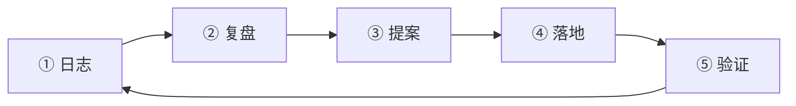
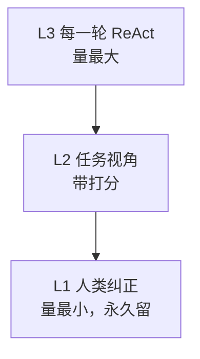
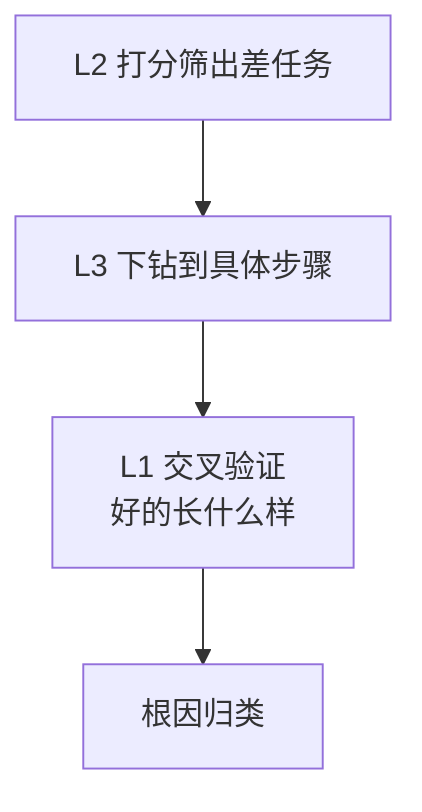
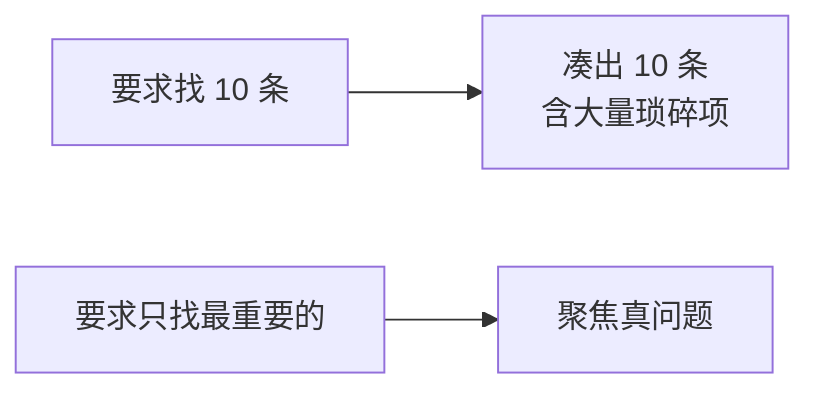
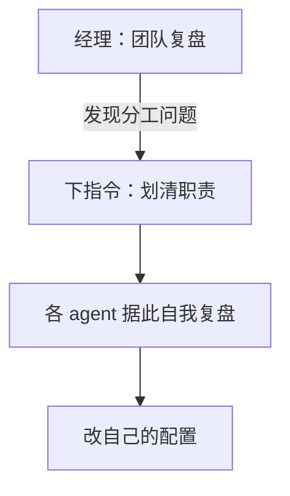

> 本文整理自课程文稿《28｜数字员工的自我进化：让 Agent 团队越用越好》。文稿末尾自注「内容由 AI 生成」，属整理稿而非逐字记录。
>
> 文中的保留期限、审批档位与执行过程沿用文稿原述，未做外部核验。

前面几讲把团队搭起来了：有身份、有分工、有协作、有人类介入点。**但团队还是静态的。**

这一篇解决的是最后一环：**怎么让它越用越好。**

## 先问一个问题

作者的切入很直接。

> 假设你建了个团队，第一天检查点通过率就很低，你给他提意见，没问题。
>
> **但如果上线一年了，每次该说的时候你还得说，他自己没有任何进化——你会怎么想？**

**「总觉得我教过你一遍的东西，你应该会了。」**

**而数字员工的现状恰恰是这样**：

> SOP 跟他聊好了，每个人的技能也固定了，**但接下来他做事情的时候，你总会发现这里那里的问题。**
>
> 你去提炼他，**但是下一次他还会再犯。**

## 进化闭环：五步

| 步 | 做什么 |
|---|---|
| 一 | **日志与记录**（最底层） |
| 二 | **复盘**（从日志推出该改什么） |
| 三 | **提案**（有提案就有审核） |
| 四 | **落地**（安全地改） |
| 五 | **验证**（回看有没有真改好） |

上图是这个闭环。**注意最后一条边回到起点——它转一圈就该比上一圈好。**

**而他对第一步的判断很硬**：

> 如果只是静态地让它自己看哪里会出问题，**那永远迭代不出好东西。**
>
> **只有当它自己犯错、同时拿着犯错的日志回头复盘，才可能进化。**

## 三层日志 ⭐

这一节我认为是全篇最实在的工程细节。

> **不要只留最底层的日志。**因为只留底层，**分析工作量巨大，你也很难找到抓手进入复盘。**

**所以要有三层。**

| 层 | 记录什么 | 保留 | 用途 |
|---|---|---|---|
| **L1** | **人类交互**（检查点上的纠正与认可） | **永久** | **定方向** |
| **L2** | 任务级：接到什么任务、做得怎么样、**带质量打分** | 九十天 | **挖掘问题** |
| **L3** | 一轮 ReAct 的完整 message 记录 | 三十天 | **定位** |

上图是这三层的漏斗关系。**越往上，量越小、价值越高。**

### 为什么 L1 是黄金数据

> 人类纠正：**到底是「我要纠正它」还是「我直接认可了」？那我又是如何纠正的？**
>
> **这个东西最有价值**，也是团队真正达到甲方要求、不断提升里最重要的东西。

### 为什么 L2 要在沉淀时打分

**他给的理由是成本**：

> 如果我分析的时候再重新扫一遍、重新做这件事，**成本一定太高了。**
>
> **不如在沉淀的时候就把分打好。**

**而打分靠的是旁路的模型**：

> 一个任务最终完成得好还是坏，**它自己一定说不准。**
>
> **一个旁路的模型拿到任务的输入输出之后，去判断到底有没有完成。**

**而它的打分维度不止结果**——他补了一个很实用的观察：

> 假设这个任务中间迭代了很多次，**中间出现大量调用错误**——**那它一定也做得比较差。**

**「过程中的挣扎」本身就是一个质量信号。**

## 复盘漏斗 ⭐

日志有了，怎么从上千条里定位出「该改什么」？

他给了一个漏斗，四步。

### 一、先捞最差的任务

> 我用 L2 的定量打分，**把打分比较差的那些任务先捞出来**，先解决最严重的问题。

### 二、下钻到具体步骤

> 我要看到这个任务底层整个 ReAct 过程到底什么样，**到底差在哪一步。**

### 三、用 L1 交叉验证

这一条我觉得最妙。

> 我可能还需要用 L1 的结论再去交叉验证一下——**看人类真正做这个任务、给意见的时候是怎么给的。**

**它能解决什么问题？他讲得很清楚**：

> 这里面解决的是：**我知道这个任务做得差，但做得好的应该是什么样。**

上图是这个漏斗。**注意第三步补的不是「哪里错」，是「应该对」。**

### 四、根因必须落到文件上

**这一步他说「大部分复盘容易死在这里」**。

> 你只看到有问题，但**不知道问题如何发生**，那这个东西就会漏过去。

**而他给的技巧叫「以终为始的枚举分类」**：

> 当我发生一个问题的时候，我首先要把根因分类到：**我最终如果要改，应该改谁。**

**因为数字员工的好坏，全在那几份文件里。**

| 根因类型 | 该改哪儿 |
|---|---|
| **SOP 缺步骤 / 指令模糊** | 那份行为规范文件 |
| **决策偏好有问题** | 那份自我认知文件 |
| **知识经验不足** | 记忆文件 |
| **协作接口不清** | 协作部分的描述 |
| 技能不够 | 对应的 skill |

**他说得很直接**：

> 我要引导的**不是让它复盘「为什么出现这个问题」**。因为模型大部分会复盘到「**当时模型抽了一下**」，或者说「**下次我会努力**」。
>
> **这对复盘没有任何帮助。**
>
> **唯一有帮助的是：我最终落到那几份文件里。**

**「当时模型抽了一下」这个说法我原样保留了。**它精确描述了那种对改进没有帮助的复盘结论。

### 一次失败的复盘长什么样

前面那句「模型抽了一下」，其实就是**最常见的失败复盘形态**。值得把它单独拆开看，因为认清它才知道该拦住什么。

| 失败结论 | 为什么没用 |
|---|---|
| 「当时模型抽了一下」 | **不可修改**——没有对应的文件段落 |
| 「下次我会努力」 | **不可验证**——没有判断改好了没有的判据 |
| 「这次表现不好」 | **不可定位**——不知道是哪一步、哪一条指令 |

**三条的共同点是：它们都是描述，不是指令。**

而他给的改法是**反过来做**：先定死「最终只能改那几份文件」，再让模型往这个终点上归因。

> **我要引导的不是让它复盘「为什么出现这个问题」**，而是**我最终落到那几份文件里**才有帮助。

**这也解释了为什么「改前怎么写」不能为空**：它是防止模型编造一个不存在的问题。**因为要填「之前怎么写」，它必须先去读原文。**

## 复盘结论的结构

他说输出要有约束，而其中两条我认为很关键。

| 字段 | 要求 |
|---|---|
| 问题 | 发现了什么 |
| **证据** | **落在具体任务、具体步骤上，不能为空** |
| 根因 | 归到哪一类 |
| 改哪里 | 哪个文件、哪一段 |
| **之前怎么写 / 之后怎么写** | **改前的内容不能为空** |

**为什么「改前」不能为空？**

> **为了防止幻觉。**

**因为没有改前的内容，你就无法判断这个提案是不是基于真实情况写的。**

**还有一条数量约束，理由很有意思**：

> 每次复盘**不建议复出来太多东西**。一个是人处理不过来，**另外它会倾向于找一堆特别小的点。**
>
> **你给它的复盘数量越多，它越倾向于找一些特别小、特别细的点。**

上图是这个倾向。**它说明「限制条数」不是为了省事，是为了提高质量。**

## 两种复盘：自己不出的那一半 ⭐

这一段我觉得是全文最有洞察的部分。

> 自我复盘时，**你的视野只在自己的任务上。**
>
> 就像前面说的：**是不是我整个团队的分工出问题了呢？因为职责边界模糊，才导致我这边出问题？**
>
> **这类问题很难通过自我复盘产出来**，因为 agent 只看自己的情况。

**所以需要第二种：团队复盘。**

**由经理来做，而且它看的层不一样**：

| | 自我复盘 | 团队复盘 |
|---|---|---|
| 视野 | 自己的任务 | **整个团队** |
| 看什么 | 细到 message 级 | **只看提了哪些任务、人类如何反馈** |
| 能发现 | 我的执行问题 | **分工、边界、跨 agent 的模式** |

**而它能做的事很具体**：

> 经理发现「这是研发和 QA 的单测职责不清」——那它就分配：**研发把单测领下来，QA 以后不要碰单测。**

上图是两者的配合。**注意经理不直接改别人——它只划边界，改由各自的复盘去落地。**

## 三档审批

复盘产出提案后，怎么批？他给了三档，**判据是「改的是什么文件」**。

| 档 | 改什么 | 怎么处理 |
|---|---|---|
| **一档** | **记忆** | **可自动落地**，只加限量规则 |
| **二档** | **技能、分工** | 经理预审 → 人类批准 |
| **三档** | **框架代码、自我认知** | 人类审 + 独立校验 |

### 为什么记忆可以自动改

> 如果只是记忆的改动，**它经常无伤大雅**——可能就是当时那一句没记住。
>
> **这种完全第一档，真的可以自动落地。**只要限制规则，比如**一天只能改三条**。

### 为什么自我认知必须严管

> **自我认知非常重要，因为它代表决策方向。**
>
> 它一旦出问题，**可能价值观会有问题，而且非常难排查。**

**「难排查」这个理由很关键**——不是因为它危险，是因为**出了问题你找不到原因**。

### 第二档的实际流程

他描述得很具体，值得记：

> 复盘完后先报给经理，**经理自己会有预审**，会给建议。没问题才找人。
>
> 然后通过邮箱问人类：这次的东西该怎么改。**而人类可以说：你的第一、第二条可以落，第三条再这么改改。**

**「挑几条批准、其余打回修改」**——这是最真实的审批形态，而流程必须支持它。

## 落地之后：一定要验证

他特意强调闭环没在「改完」结束。

> 我还要继续观察 agent 在工作，**用结果指标来看：这个问题到底改了没有？后续是不是不再犯同样的问题了？**

**所以第五步是验证，然后回到第一步继续记录。**

## 反模式

### 一、只记结果，不留过程

> **日志不能只记结果。**只做 L2 不够，**L3 那份具体的 message 记录得留着**，这样才能复盘过程。
>
> **因为你如果不可观测，基本就不可复盘、不可改进。**

### 二、样本太少就复盘 ⭐

**他给的数字很具体**：

> 样本量不足的时候——比如你一共就俩样本，又让模型去复盘——**那模型往往会在里面卷，找出一些特别小的点。**
>
> **这时候复盘效果会非常差。**

**而对照是**：

> 如果你给它**五十条日志**，它从里面捞出最差的几条再改，**效果会远比这个好很多。**

**「样本不足就不要强行复盘」**——这条我觉得最容易被忽略。

### 三、完全自动、不加审批

> 一旦选一个方向，**模型一定要在这个方向做出成就。**
>
> 而每一次的补丁**只会让自我认知、SOP、行为规范变得越来越长**，**最终这个东西就不可治理。**

**所以他还提了一个概念**：

> 长期来看，**还是要有一种规范性的复盘**——就像一次小的重构或整理，**让数字员工保持相对精简的状态。**

上图是这条熵增。**它和前面记忆篇那个「定期治理」是同一个问题。**

## 最佳实践

| 做法 | 理由 |
|---|---|
| **所有提案加证据** | 没证据，人也没法判断对不对 |
| **分级处理** | 什么都交给人，人看不过来 |
| **历史版本都记好，且分开记** | 出问题能回退，**而且能只回退某一条** |

**「分开记」这个细节很实用**——整体回退会把好的改动一起撤掉。

## 我的三点补充

以下是评注，不是原片内容；取舍由我负责。

**第一，三层日志的分层依据不是「重要性」，是「分析时的用途」。** L3 只用于定位（所以只留三十天，量大），L2 用于挖掘（带打分，留九十天），L1 用于定方向（永久）。**这个划分的妙处在于它承认了「你不可能每次都从头分析」**——所以在沉淀时就把打分做掉，把成本前移。

**第二，「根因必须落到文件」这条约束，本质是给复盘定了一个可执行的下界。** 因为「模型当时抽了一下」无法被修改，**而「SOP 第三段缺一个步骤」可以被修改。** 前者是描述，后者是指令。**这也解释了为什么以终为始的枚举分类有效：它把开放式的归因变成了有限选项的选择题。**

**第三，自我复盘和团队复盘的分工，其实承认了一个结构性盲区。** 任何单一 agent 都看不到「自己为什么被安排做这件事」——**那属于上一层的信息。** 所以团队复盘不是自我复盘的加强版，**它看的是另一个层级的事实**：谁被派了什么、边界清不清。**这也说明层级结构不只是为了并行，是为了让每一层都能被上一层复盘。**

---

一句话总结：**Agent 不会因为你教过就记住，它只会因为你把教训写进配置文件而改变。** 所以复盘的关键不是找出原因，**而是找到那一行该改的字。**
