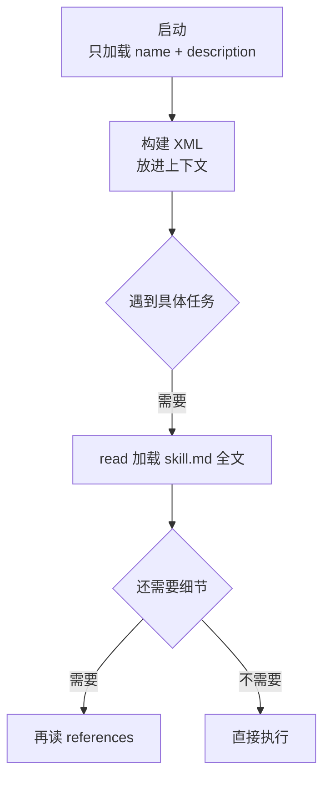
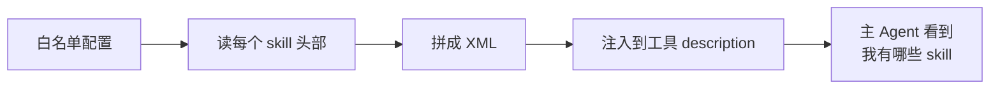
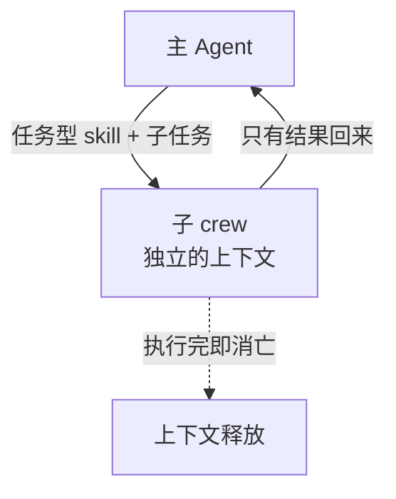
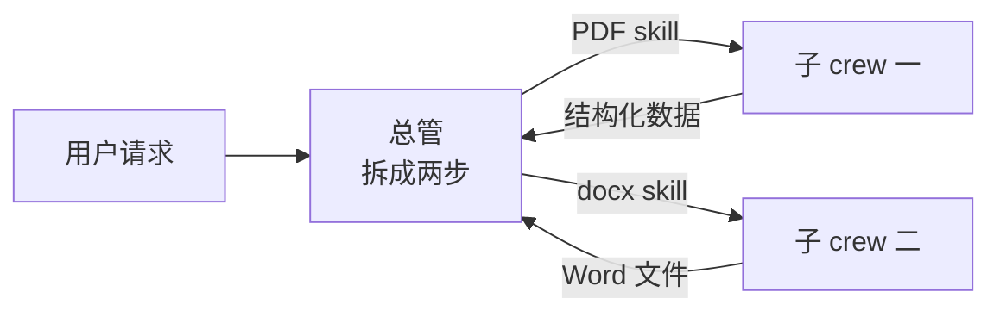

> 本文整理自课程文稿《16｜Skills 生态：让 Agent 接入大量工具》。文稿末尾自注「内容由 AI 生成」，属整理稿而非逐字记录。
>
> 文中的容器配置、脚本命令与执行过程沿用文稿原述，未做外部核验。

前面几讲都在装工具。这一讲换了个层面：**怎么让 Agent 拥有大量能力，而不撑爆上下文。**

而它的答案，跟过去所有工具的思路都不一样。

## 先划线：Skill 不是工具

他给的定义很干脆。

**MCP 的形态是**：我有一堆工具，Agent 自己决定用哪个。

**Skill 的形态是**：**一本操作手册。**它不只有工具，还写着什么场景用、具体怎么用。

对比一下就很清楚：MCP 里那套「什么时机用」「这个参数该填什么」的描述，**你很难扩展得很大**。而 Skill 就是用来承载这些的。

## 拆开一个真实的 skill

他拿官方的文档处理 skill 举例。

结构分三块。

| 部分 | 内容 |
|---|---|
| 头部 | name、description（**写明什么时候该用**）、license |
| 正文 | **五百多行**，全在教「怎么操作」 |
| scripts / references | 现成脚本，以及超长时的延伸资料 |

而正文里写的都是这种话：

- 要读和分析文档，用某个库去做解析
- 要新建文件，建议用某个 Node 库
- 要编辑，先打开、读并改 XML，重新打包，再检查

**「这其实是在教 Agent，如果你想操作这类文件，应该怎么做。」**

### 底层的核心逻辑

他在这里给了一句我觉得是整讲的题眼：

> **Code is all you need.**

或者说，**shell 就够用了**。

他揭了一个反直觉的事实：那些很火的本地助手，**最底层的工具只有四个**——读文件、写文件、编辑文件、执行命令行。

**「我不需要那么多花哨的工具。」**

要干什么，现写代码去干；如果 skill 提供了脚本，直接调那个脚本。

上图是这个逻辑。**工具不再按功能枚举，而是退到最小集合，能力靠代码生成。**

## 两类 skill

### 参考型：只讲规范

最典型的例子是一份「算法艺术」文档：**没有任何脚本，也不教任何代码**，只写代码规范、guideline、checklist。

它怎么工作？**加载进上下文就行。**模型读到之后，后续生成自然会参考。

他说这类在企业里非常有用：**企业有大量规范，它们不完成具体任务，只告诉你应该怎么做。**

### 任务型：教你怎么完成某件事

比如那个文档处理 skill：想解析文件就加载它，里面告诉你怎么解析。

**仍然是文档，但同时提供了场景，以及该场景下应该怎么执行。**

## 精妙之处：渐进式披露

讲到这里他抛出了问题：**如果每个 skill 都是几百行，全都塞进上下文呢？**

答案当然是撑爆。

所以有了第二个核心机制。

### 启动时只看头

系统初始化时，**不加载任何 skill.md 全文**，只加载每个 skill 头部那两段：**name 和 description**。

只有这两段会进 system prompt。

他给了一个数量级：**每个 skill 的头部一般不到 200 个 token**，一百个加起来也只占两千多 token。

> 注意，这时候 skill.md 根本没加载进去。

### 需要时才读

接下来模型拿到这些头部信息，构建成一段 XML 放进上下文。

当它遇到具体任务、发现「我这儿有个 skill 可能有用」时，**才调用一个加载工具**。

而这个加载工具**本质上就是一个 read 工具**。它顺着目录去读那个 skill.md。

上图是这个三段式加载。**按需读取，一层层往下。**

他专门对比了 MCP 时代：**一个工具要带名字、描述、schema，schema 里每个参数还要一大段说明**。**十个工具，光 schema 里的字段条数就能把上下文撑爆。**

而 skill 启动时只占一个头。

> **这就是为什么第三代 AI 应用能爆发**：过去能给的工具很少，因为上下文不够用。

## 顺带解决的第二个问题：知识沉淀

这一节我觉得是他讲得最有说服力的推论。

他对 RAG 那套东西的评价很直接：「到目前为止我没有看到真的在企业里用起来、并且非常有效的案例」。

**难在哪？**难在建索引。

**而 skill 好做。**好做到什么程度：找一个专家，跟 AI 聊天，让 AI 把专家的经验写成 skill.md。

> 我们专门有一个叫 Skill Creator 的 skill。

于是流程变成：

上图是这条路径。**而它天然适合被 agent 读取**——渐进式披露本来就是按需的。

他的判断很直接：**「它远比 RAG 的效果要好得多。」**

## Skill 和 MCP：合作又竞争

这两样都是同一家公司提出的概念，难免被拿来比较。

### 合作：Skill 教你怎么用 MCP

> MCP 写 API 时很难把「怎么用」写清楚，因为太占上下文。

而 skill 正好补上这一层知识。**「说白了，skill 就是手把手地教 Agent 怎么做 MCP。」**

### 竞争：简单的 MCP 被替代了

过去那些做文件读写、格式转换的 MCP Server，**现在 skill 几行就搞定了。**

包括 MCP 里的 prompt 那一类——**知识型 MCP，现在写进 skill.md 就完事。**

### MCP 还剩什么

他给了三条，我认为这条分析很清醒。

| MCP 的优势 | 为什么 skill 补不上 |
|---|---|
| **权限认证** | skill 本质是「有知识了以后写代码」，你没法安全地在写代码过程中传 API key 和身份 |
| **安全合规与审计** | 本地根本控制不住——代码写完就跑了，你只能靠提示词约束 |
| 外部集成（数据库、API） | 核心也是权限 |

**所以最好的模式是组合**：**skill 做知识层，教模型怎么调；MCP 做能力层，管权限和审计。**

这样 MCP 自己的描述还能写简单点——因为 skill 已经教过了。

## 实战：给一个不支持 skill 的框架接上 skill

这一段技术含量最高。

他先承认了一个现实：**用的框架到现在还不支持 skill。**

> 「我也没想到技术发展那么快，一开始选型时觉得它挺好。」

于是他做了三件事。

### 改造一：自己写一个 Skill Loader

它本质上是个工具，入参两个。

| 参数 | 内容 |
|---|---|
| skill name | 要加载哪个 |
| 子任务描述 | 参考型留空；任务型要给完整描述：目标、预期、输入输出文件、**沙盒内的绝对路径** |

**而这工具最关键的一处是它的 description。**

因为他要做渐进式披露，所以**它一开始是空的**。要到 Agent 初始化时才动态构建：

1. 读一份 skill 白名单配置（这样可以精细控制，区分参考型和任务型）
2. 对每个 skill，读它的头部
3. 拼成一段 XML，写进工具描述

上图是这个动态构建。**它把「渐进式披露」这件事落在了工具描述上。**

### 改造二：把执行放进沙盒

他特意强调：skill 天然要用 bash，**如果让 AI 在你电脑上随便跑 bash，安全完全不可控。**

> 那些本地助手确实这么干，**但我们要做企业级应用。**

所以他把 skill 的所有执行都映射到前面讲过的沙盒里。

而这里有个挺巧的细节：**本地和沙盒之间用文件卷挂载打通。**

- workspace 的输入目录**只读挂载**进沙盒
- 沙盒里的输出目录**映射回**本地

于是 agent 在给子任务时，**传的是沙盒路径**；最终返回时，**转换成本地路径**。

上图是这个映射。**它解决了「文件怎么在两个环境间对流」这个问题。**

### 改造三：用子 crew 做上下文隔离

这一条我认为是最关键的架构判断。

**渐进式披露只解决了启动时的占用。**但任务型 skill 一旦加载进来，skill.md、references、写代码调试的全过程，**都会永久留在 message 列表里**。

所以他的做法是：**任务型 skill 一律丢进一个新的子 crew 执行。**

| 类型 | 处理方式 |
|---|---|
| 参考型 | 直接加载进主 Agent 上下文（它本来就是要参考的） |
| **任务型** | **起一个子 crew，主 Agent 只留任务和结果** |

于是主 Agent 的上下文里只有两样东西：**「我调用了某个 skill，任务是什么」和「结果是什么」。**中间那一坨全被封装在子 crew 里，执行完自动消亡。

上图就是这个隔离。

### 他顺手点了两个对照

**对比那些火热的本地助手**：它们最大的问题就是成本——**因为它用单 Agent 结构，skill 加载后就永远留在上下文里。**

**对比主流编码工具**：它有子 agent，会为子任务起一个，**但没有做到 skill 级的隔离。**

**而他们要做的，是「skill 级的子任务隔离」。**

## 实测：PDF 转 Word

任务很具体：从一份 PDF 里提取关键信息，生成一份 Word。

**总管的动作**：分析出两步——先提取，再整理成 Word。然后判断这两步都该走任务型 skill。

**第一步**：调用 skill loader，加载 PDF skill。loader 内部起了一个子 crew，里面有一个「skill 执行专家」，工具只有沙盒。

这一步中间**失败过一次**，值得单说。它读 PDF 时遇到了 UTF-8 编码问题：按 skill 里给的方案没解决，报错退出，于是它自己换了个思路，**改用另一个 PDF 库**，才把内容完整读出来。**这次失败没有卡住流程**，因为模型能改代码重试。

上图是这次绕行。**注意它没有卡死**，而是在 skill 给的方案失效后自己找了替代路径。这正是「模型会写代码」带来的容错。

**第二步**：同样走 docx skill，把数据写成 Word。

上图是这次执行。**注意中间回来的只有数据，没有过程。**

而他对成本的评价很直白：

> 加载一个 PDF 或 Word 工具的成本极低。**我只要把它拷到 skill 目录下，配一下，就能用。**

## 治理才是真问题

收尾他讲了一段我认为全讲最重要的。

> 用 skill 最重要的还是那件事——**治理。**
>
> **做加法谁都会，做减法很难。**

他点了一个具体案例：某个很火的助手做了大量加法，减法没做好，成本和安全的坑就全出来了。

### 三个反模式

**一、相似的 skill 太多。**

后果很具体：**每次执行它都要在 A 和 B 之间反复试**，效果不好还要来回换。

**二、skill.md 太长。**

即使有渐进式披露，**每次加载进来后太长同样会造成注意力衰减。**

他的建议是拆 references，但他立刻补了边界：

> 也不能拆太多。拆多了复杂度上升、效果更随机。**而且读文件时只读前 200 行**，可能读不完整，规则就失效了。

**三、安全问题。**这一条他讲得很重。

skill 太简单了——拷个目录就能用，**很多框架还提供一键安装**，甚至一条命令从某网站下载。

> **但你如果不去看它写了什么**：它完全可以自己写 shell，沙盒虽然能拦一层，**但它仍然能访问沙盒里的所有东西**。
>
> 它可以把沙盒里所有东西扒下来发到某个服务器。

而他给的例子很刺眼：**某个 skill 市场里排第一的 skill，理论上最可信，里面都有可能会被注入攻击。**

**「所以不要相信任何人，每个 skill 安装前都要读一遍。」**

### 三个最佳实践

**一、能固化的就用脚本。**

> 你每次都让模型写代码，写完不对又要调，成本很高。

而把确定性场景固化成脚本，**既省成本，也更可控**。他还补了一句：**脚本不一定要你自己写，可以让 AI 写完沉淀进去。**

**二、Skill 做知识层，MCP 做能力层。**前面讲过了。

**三、企业级治理要有一套标准**：命名规范、怎么 review、怎么控版本、使用统计。

## 我的三点补充

以下是评注，不是原片内容；取舍由我负责。

**第一，「Code is all you need」这个判断，把工具的角色整个换了位。** 以前工具是「能力单元」——你有什么工具，就能做什么事。现在工具退化成四个基础操作，**能力上限变成「会不会写代码」**。这个转变的后果是：**装工具的边际收益大幅下降，而模型质量与 skill 描述质量的权重上升。** 这也解释了为什么 skill 让「低成本接入大量能力」成为可能。

**第二，「渐进式披露」解决的是加载，而子 crew 解决的是驻留——这是两个不同的问题。** 很多人只学了前者，以为 skill 天然省上下文。**但一个任务型 skill 一旦读进来，它和它触发的调试过程会一直占着上下文**。所以真正省上下文的，是**用完即弃的那个子 crew**，不是那个头部。

**第三，那句「做加法谁都会，做减法很难」，其实是这一讲的真正落点。** 前面所有机制——渐进式披露、子 crew、脚本固化、白名单——**全是减法**。而 skill 之所以危险，正因为它让加法变得极其廉价：拷个目录就能用。**所以门槛下降的地方，治理必须跟上，否则你收获的是能力，也收获一个不可审计的黑箱。**

---

一句话总结：**Skill 让 Agent 廉价地获得海量能力。** 而代价是——你必须开始认真地做减法：删掉相似的、拆开过长的、审过每一个外来的。
