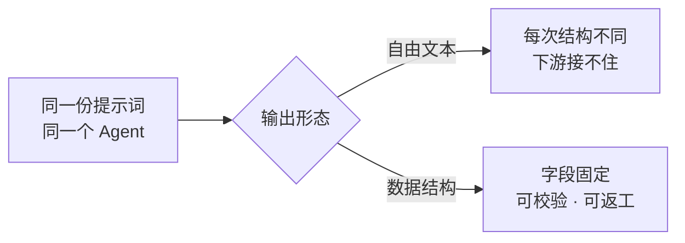

> 本文整理自课程文稿《08｜定义 Task：从「步骤控制」到「契约驱动」》。文稿末尾自注「内容由 AI 生成」，属整理稿而非逐字记录。
>
> 文中的代码片段与字段名沿用文稿原述，未做外部核验。

上一篇讲定人，这一篇讲定事。

而作者开局先给了一个更大的判断：**一切 AI 应用本质上都在执行任务。**

聊天机器人是有输入输出、可重复迭代的任务；智能客服、ChatBI 也都是。区别只在交互怎么重复、产出是什么形态。

所以任务的通用定义很朴素：**有输入，经过一段过程，产出清晰的、有目标的交付物。**

## 一个常见但会失效的拆法

复杂任务要做拆解，这没有争议。有争议的是怎么拆。

**传统想法**是：大任务是写完这个东西，那第一步干嘛、第二步干嘛、第三步干嘛。

他给了一个很形象的比喻：**这像是在铺火车轨道。** 你得把每一段轨道、每一个岔口、每一个边界都事先定义好。

**而这就是工作流的思路，不是 Agent 的思路。**

为什么在 Agent 场景失效？因为不确定性场景里，你要覆盖所有分支就得把所有边界都写死——那么难，已经不是设计问题了，是给自己找麻烦。

## 换一个比喻：定向越野

他换了一个画面。

起点在这里，终点在那里，**中间的路径是混沌的**。你直接跑过去很难，但可以设几个中间点。

**这就是里程碑。**

上图是两种拆法的差别。**铁轨式把虚线也规定了，里程碑式只规定方框。**

**关键在最后那句**：具体从我这里怎么到里程碑，不写死。我不管你怎么干，你完成这个阶段性目标就行。

他说这非常像企业里用的 OKR——目标在这，关键结果是什么。**里程碑就是 Key Result。**

而给了关键结果之后，你没有规定「第一步干嘛第二步干嘛」。**怎么干是员工自己的事。**

## 里程碑到底是什么

他把这个抽象概念落到了一个可以写进代码的定义上：

> **里程碑 = 交付物 + 交付标准。**

用调研报告举例。一上来就让它直接写报告会很难，那就设里程碑：

1. 你写好了一份大纲。具体怎么写的我不管。
2. 第一章写好了、第二章写好了，一直到第八章写好。共 8 章，每章达到某个交付标准，比如经过搜索、经过审核。
3. 全部章节写好后整合、审核完，交付。

**「具体你怎么调、怎么弄我不管，我要求的是这几个东西到位。」**

而落到框架里，一个 task 只有两个必需字段——就这两个，没有第三个：

| 字段 | 内容 |
|---|---|
| description | 任务描述 |
| expected output | 交付物 + 交付标准 |

## 最实用的一条：结构化

接下来是这一讲我认为最有价值的部分。

他对比了两种交付标准。

**第一种，纯文本。** 比如「写一个大纲」。你用一堆文字描述它，最后产出的东西没有规则，也不容易校验。

**第二种，结构化。** 用 JSON 或一个数据结构把它框起来。

> 我非常推荐大家把任务的预期输出全都设计成结构化。

理由只有两条，但都实在：

1. **输出会稳定。**
2. **你有校验点**——输出有问题，立刻让它返工。

他说这比「输出一段你都不知道是啥的文本」要稳得多。

### 那个被故意留下的坑

他坦白说，上一节课的示例里**故意留了一个坑**：小红书文案的输出虽然很专业，但结构乱、每次都不一样。该有的信息都有，但下游不好用。

这一讲就是来填坑的。

做法是先**定义几个数据结构**。

**第一个：图片分析结构。**

因为小红书笔记都是配图的，内容策划 Agent 首先得理解用户给的是什么图。字段包括：文件名、主体（人、物体还是场景）、风格、情绪价值、**细节**、质量评价、**最抓眼球的视觉锚点**。

他解释为什么必须定义结构：

> 就算用多模态，你给一张图让它自由描述，出来的东西也千奇百怪，每次都不一样。有时候告诉你一个分类，有时候告诉你一些场景。

**而这些都不足以支撑写笔记。** 所以要把「写笔记真正需要的信息」提前用字段固定下来。

**第二个：内容的输入结构。**

包括用户的原始文字诉求（比如「我想卖个杯子，目的是带货」）、图片列表、以及所有图片的整体视觉基调总结。

**第三个：输出结构。**

这是第二个里程碑的产出，字段都在回答「一篇好笔记需要先想清楚什么」：

| 字段 | 回答什么 |
|---|---|
| 深度洞察 | 素材好不好，劣势在哪 |
| 目标受众 | 以市场角度看，这篇是给谁看的 |
| 核心痛点 | 给用户解决什么问题，提供什么情绪价值 |
| 标题 | 正式开写的第一笔 |
| 笔记大纲 | 开头、中间、结尾各是什么 |
| 关键词布局 | 用户会怎么搜到它 |

这份输出结构一共定下六个字段。**注意它们的顺序**：前三个全是分析，第四才轮到标题。分析没做好，标题怎么写都是空的。

他特别标出了两个字段：**点赞/评论的诱饵钩子，和收藏的诱饵钩子。** 因为要让模型重点分析这两件事，不显式写进结构，它可能就不输出。

### 一个立刻能验证的对比

讲完结构，他说了执行效果。

**上一讲**（无结构）：final answer 就是一堆字。

**这一讲**（有结构）：先是整体素材评价，优势劣势各有总结；目标受众写得很具体（独居女性、小资生活）；核心痛点不是「杯子能喝水」，而是「一个有热量有重量的、关于自身节奏掌控的东西」；然后才是标题、大纲、评论钩子、收藏钩子、关键词。

他的评价很克制也很准：

> 先不说效果，**它一定是更可控的**。而在更可控的情况下，才有利于下一个节点完成更好的任务。

上图是这个对比。**注意左边那两个「同一」**——变量只有一个：输出形态。

## 一个用来做单测的小技巧

讲实现时他提到一个很实用的做法。

如果每次都跑整个多智能体系统来测一个任务，非常麻烦。所以他的做法是**伪造上游任务的输出**。

具体是：按上游任务的数据结构手工构造一份结果，然后作为 context 传给当前任务，这样就能单独测这一个 task。

> 这是单测某一个任务时的技巧。

## 底层：还是提示词，但注入位置有讲究

他照例拆了框架实现。

看日志里的 user content，能看到框架做了三件事：

1. 放入任务描述
2. 放入 expected output
3. **把数据结构转成 schema，写进提示词**

原文那句话很关键：**final answer 必须按这个 schema 输出。**

然后模型的输出会被框架尝试解析成 JSON，再拿 schema 去解成对象。

### 由此推出一条最佳实践

> **提示词最好写在数据结构的字段描述里，效果更好。**

理由他讲得很具体：**那部分提示词是系统主动注入的，都在相同的位置，模型的注意力更集中。**

所以字段描述不能只写「这是什么类型的字段」，还要写**它的含义、判断标准**。

## 三条反模式

### 一、任务拆得太粗，或者拆得不专注

他给了两句很具体的判断：

- **如果人看到任务都不知道怎么干，就别让模型干了。**
- **关联性不大的目标，不要塞进同一个里程碑。** 否则 Agent 执行时会混乱、没逻辑。

### 二、目标不给明确标准

后果很直接：**Agent 可能一直不输出 final answer**，因为它压根没理解 expected output 是什么。

### 三、思维链写得太细

这一条和前面呼应：**流程写到极细，就和任务定义冲突**，而且通用性差，碰到异常分支就不知道该怎么走。

> 他补了一句更重要的话：**还是要相信模型的能力。** 你给大致方向、结果定义和衡量标准就够了。写太细会限制模型自身的发散与涌现。

## 我的三点补充

以下是评注，不是原片内容；取舍由我负责。

**第一，「铺铁轨 vs 定向越野」这个比喻，把工作流和 Agent 的分界线画在了任务定义这一层。** 前面几篇讲的是「范式怎么选」，这一篇往下走了一层：**同样是 Agent，你怎么写它的任务，决定了它到底在自由探索还是在执行脚本。** 把思维链写到每一步，你其实是在 Agent 里面重建了一个工作流——用了更贵的引擎，跑更死的路径。

**第二，「结构化输出」这件事的真正价值不是好看，是可校验。** 自由文本的失败模式是「看起来对但没法判断」；结构化的失败模式是「字段缺失，立刻退回」。**前者把问题推给下游，后者把问题留在当下。** 而在多智能体系统里，一次漏检会沿着链路放大。

**第三，把提示词写进字段描述这条，是这一讲最容易被忽略的实操细节。** 它背后的机制是注意力位置——注入在同一处的指令，比散落在正文里的指令更容易被遵循。这也解释了为什么很多人把规则写在任务描述里却没生效：**位置错了，写多少遍都弱。**

---

一句话总结：**不要告诉 Agent 怎么走，告诉它走到哪算完。** 而「算完」要能被机械判断——这就是结构化输出存在的理由。
