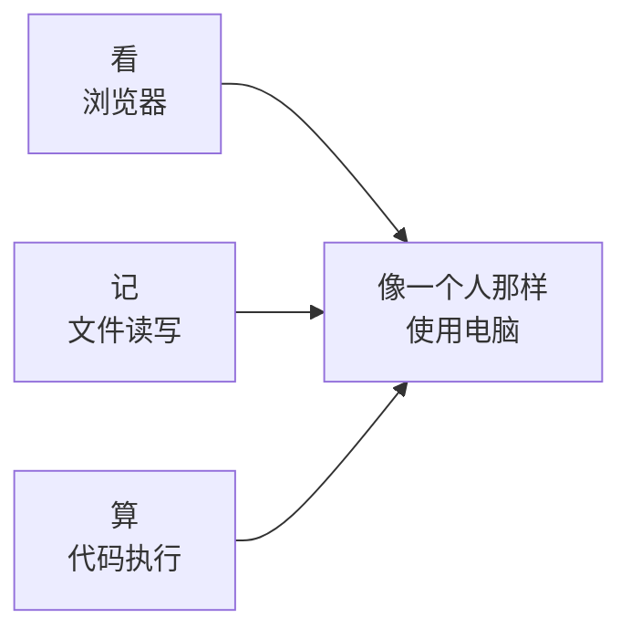
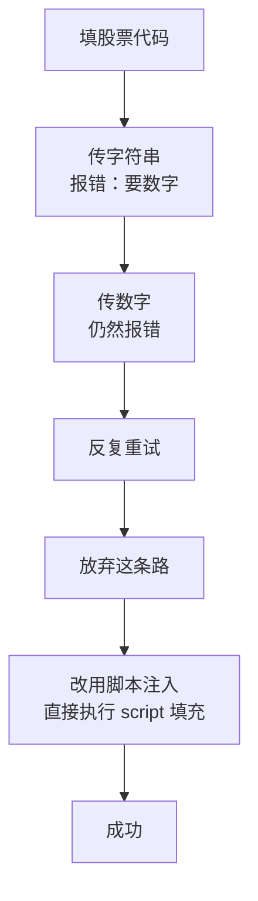

> 本文整理自课程文稿《15｜王牌超能力：代码解释器与无头浏览器》。文稿末尾自注「内容由 AI 生成」，属整理稿而非逐字记录。
>
> 文中的工具行为、参数名与实测过程沿用文稿原述，未做外部核验。

MCP 那一讲解决了「怎么接工具」。这一讲回答另一个问题：**接哪些工具才算真正强大。**

作者给了三样，并且把话说得很重：**这是让 Agent 像钢铁侠一样的三块核心。**

## 三个超能力

| 能力 | 具体是什么 |
|---|---|
| 文件操作 | 读（带行数与分页）、写、**以 diff 方式局部编辑** |
| 代码解释器 | 跑 bash，写并执行 Python / JavaScript |
| 无头浏览器 | 基于 Playwright，能看网页，**也能操作网页** |

### 为什么是这三个

他给了一个很漂亮的对应关系：**这三样恰好覆盖了一个人在电脑上能做的全部事。**

**第一，看的能力。**浏览网站、搜索信息——它把外部世界变成 Agent 可获取的东西。

**第二，记的能力。**能读能写，就意味着能持久化。

**第三，算的能力。**能执行代码，就相当于接了一个万能接口。

上图是这个对应关系。**人靠眼睛、笔记本和计算器；它靠这三样。**

### Skill 的底层其实只是文件读

他在这里拆了一个很多人没想过的点。

Skill 的本质是什么？**就是用 read 工具加载那个 SKILL.md**。而这份文件里写着：其他有用的东西在 references 或 scripts 目录下。于是 Agent 会顺着去读那些目录。

> **说白了，就是把要给 Agent 的知识做了一次结构化整合。**而它底层依赖的，就是文件读取能力。

同理，为什么某些 Agent 能「自我进化」？**因为它能改自己的配置文件、写自己的 skill。** 能写是关键。

## 然后：不要裸跑

讲完能力，他立刻转向风险，而且语气变重了。

> 如果你让它在自己的宿主机上裸奔，**大概率会碰到灾难**。

他举了两个真实的例子。

**例子一：rm -rf。** 不用别人恶意攻击，光是 Agent 时不时自己来一下，就够受的。

**例子二：自己把自己的网断了。** 他提到网上有人养的 agent，觉得某个进程没必要，结果**把自己的网络权限删掉了，再也回不来了**。

**所以他的结论很硬：企业级应用不要在宿主机上裸跑这三样东西。**

### 容器解决了什么

他对比得很清楚。

| | 裸跑 | 容器里 |
|---|---|---|
| 能访问什么 | 任意文件、任意地址 | 只有容器内 |
| 数据泄露 | 有可能 | 隔离 |
| rm -rf 的后果 | 整个系统崩 | 只毁掉容器 |
| 出事之后 | 收拾残局 | 删掉，起一个新的 |

> 你做的事情就是不停通过容器接口递交任务，拿结果。**容器崩了就崩了，毁掉重启一个就完事。**

## 那个 All-in-One 沙盒

他推荐了一个现成镜像，理由是它把三件事合到了一起：**过去要做浏览器沙盒、代码沙盒、文件沙盒三套，现在一个就够。**

它带来的效果是**文件在浏览器、代码、上传下载之间是通的**：

上图是这种连通性。**这也是他说的「一站式」的真正含义**——不是三个工具放在一起，是它们共用一套文件系统。

## 实战：一个股票早报助手

他做的项目很具体：**阿里港股早报。**

流程分四段。

| 步骤 | 做什么 |
|---|---|
| 一 | 拿最新行情 + **过去 30 天 K 线** |
| 二 | 量化分析（金叉、压力位、价量关系） |
| 三 | 抓舆情资讯，判断利好利空 |
| 四 | 汇总成一份早报 |

**第二步值得单独说。**他说自己「也没告诉它怎么算」——**只说要量化分析，AI 自己生成代码去算。**

### 架构上的一个选择

他特意对比了另一种做法。

> 有些单 agent 架构会把所有功能都加载到主 agent 的上下文里。

**而他的做法是拆出一个专门的「沙盒 Agent」。**

理由回到前面几讲讲过的那个点：

> 单 Agent 和 Multi-Agent 最大的区别在上下文管理。单 Agent 里你一直得想办法压缩，因为它时不时就爆。**而主 Agent 委派给子 Agent 时，子 Agent 只用自己那段上下文，任务交付完就没了。**

**所以沙盒这种又重又脏的活，最适合丢给一个专门的 Agent。**

### 沙盒 Agent 的一个特殊要求

他在 prompt 里加了一条自己的偏好：**要求它时不时把中间产物写进沙盒文件。**

理由有两层，第二层我读完觉得很妙：

1. **能激活上下文**，让任务完成得更好。
2. **你能去沙盒里查这些记录**，看到它到底怎么执行的、有没有偏差。

**这其实是把「思考过程」变成了可检索的日志。**和前面几讲那个「中间产物保存工具」是同一个思路，只是这次落到了文件系统上。

## 那段很长的翻车现场

这一讲最有价值的部分，是作者没有剪掉的一段失败。

**任务**：去雅虎财经查阿里港股。

**第一步顺利。**它打开无头浏览器，进了雅虎财经主页，里面一堆冗余信息，但它还是找到了那个输入框。

**然后卡住了。**

它要往输入框填港股代码，但 MCP 工具报错：**这个参数必须是数字，不是字符串。**

于是它改用数字。**但还是错**——因为它用的是字符串形式的数字。

**它在这个问题上折腾了很久。**

上图是这段折腾的轨迹。**注意最后那一步**：它不是把参数改对了，而是**换了一条完全不同的路**。

### 他给这个失败的归因

> 因为我用的沙盒自己封装的那套工具描述**并不适合 AI 调用**。它期望数字，但**怎么让它传数字这件事没写明白**。

这个归因正好回到 13 讲那套 SOP：**问题不在模型，在工具描述。**

他甚至说「我应该给它改一个提示词，告诉它需要用数字」。

### 但失败之后，它做对了

值得记的是后半段。

它绕开输入框之后，**直接写脚本让浏览器去执行填充**。然后一路走通：拿详情页、拿历史行情、**自己写 Python 算 30 天数据**，输出短期与中长期趋势、支撑位、价量关系。

他特意强调了一句：**「我没有给它更多的提示，它都是纯自己写代码分析出来的。」**

前面 12 讲反复说「错误信息要告诉模型下一步怎么办」，这里给了一个反面印证：**信息写得含糊，它就要用很多轮去猜。**

## 反模式与最佳实践

### 反模式

| 反模式 | 后果 |
|---|---|
| **宿主机裸奔** | 灾难，见前文 |
| 控制台不干净 | 代码解释器通常把 stdout 当工具返回，**你 print 一堆东西，JSON 就乱了** |
| 生吞 HTML | 直接给源码，模型很难用 |
| 忽视异步渲染 | 页面还没渲染完就去拿结果，拿不到 |

**「控制台不干净」这一条我认为最实用**，因为它在日常开发里极易踩到：一次调试用的 print，就能让下游解析失败。

### 最佳实践

**一、给工具设定优先级。**

他说这条非常有用，而且理由很具体：

> 当你同时给了文件、代码、浏览器之后，**它能完成一件事的路径非常多。**

拿行情数据举例：刚才它折腾那么久，是因为**它在按人的方式用浏览器**。但其实可能有搜索 API，或者有专门的股票数据包——**装个包写几行代码就拿到了，效率远高于浏览器。**

**而这个优先级，需要你教给它。**

**二、事先把依赖装好。**

> 为了速度和稳定性，尽量在沙盒里预装足够的依赖包。

他还补了一个更巧的做法：**在 MCP 描述里把已装的包告诉模型。** 这样它会基于现有依赖写代码，而不会先去折腾装包。

**三、把伪装打开。**

用真实 User Agent、屏幕分辨率、设备指纹。**因为现在很多网站只要识别出是机器人就拦掉。**

**四、用强模型。**

这条他说得最直接：

> 这些超能力真的非常依赖模型能力。**换个特别弱的模型，基本上就卡住了。**

## 我的三点补充

以下是评注，不是原片内容；取舍由我负责。

**第一，「看、记、算」这个三分法比任何工具清单都稳定。** 因为工具会变——今天是 Playwright，明天可能是别的东西。但**人使用电脑的方式不会变**。所以判断一个 Agent 缺什么能力，可以直接问：它现在不能看、不能记，还是不能算？**这个框架不随工具迭代失效。**

**第二，那段翻车现场的价值，在于它展示了「模型换路」的机制。** 它没有把参数类型改对，**它放弃了这条路径，换了一条**。这说明在工程上：**当工具描述写得不清楚时，你得到的不是「报错后修正」，而是「绕路」。** 绕路能成功，但代价是几十轮试错和一堆 token。**所以工具描述的质量，直接决定了 Agent 是走直线还是绕迷宫。**

**第三，「在 MCP 描述里告诉模型预装了哪些包」，这个做法其实是在给它画能力边界。** 模型不知道自己有什么可用，就会倾向「先装一个」。而你说清楚「这些已经有了」，它就直接写代码。**这和省 token 无关，和减少不确定性有关。**

---

一句话总结：**三个超能力让 Agent 能碰到电脑上的一切。所以得先划一块它碰不到东西的地方出来。** 沙盒不是限制它，是让它可以放心乱来。
