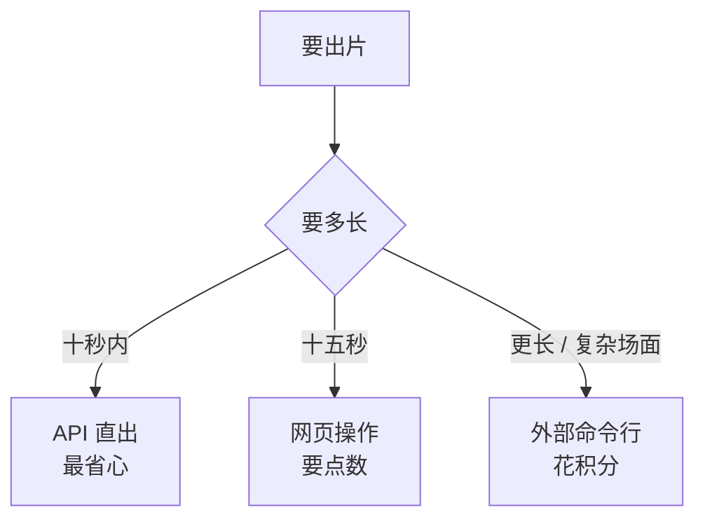
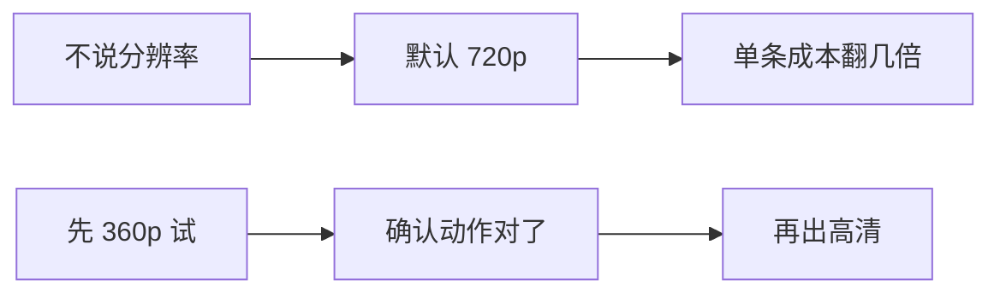
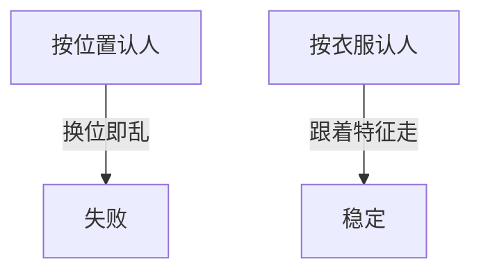
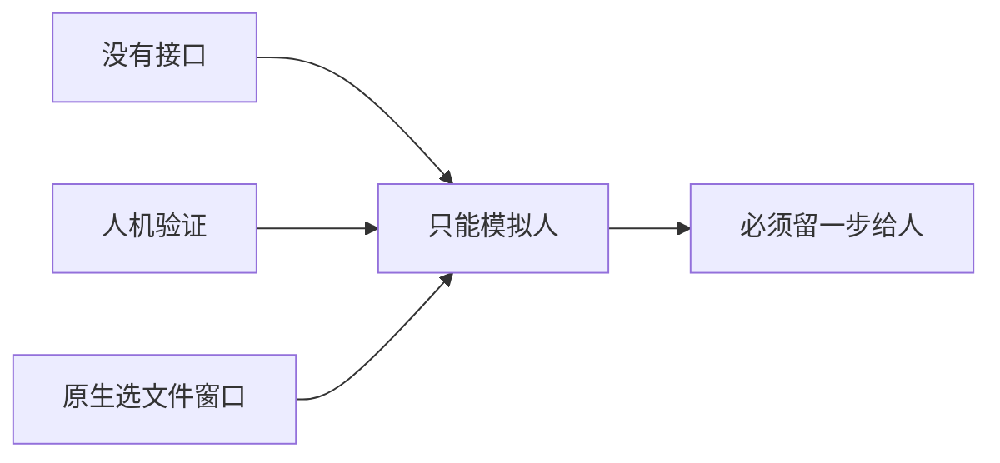
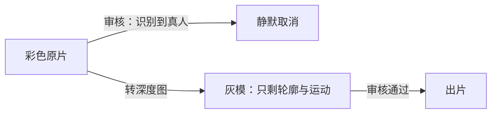

> 本文整理自一篇中文技术博客的实操记录。内容属整理稿而非逐字照搬。
>
> 文中的产品名、价格、额度与工具行为沿用原文，**未做外部核验，也不构成推荐**；这些信息变动很快，动手前请自行确认。

## 先看它缺的那一块

**作者的上一篇讲的是「反推」**：看到一条爆款视频，作者不给提示词，**丢给 Agent 让它把镜头、运镜、节奏反推成提示词。**

**而他说那篇写完很别扭**：

> 前面看片、反推、画定妆照，**它全能干**；一到出片，**我还得自己打开网页、传图、点生成、等、下载，再丢回给它检查。**

**而他把问题定位得很准**：

> **最麻烦的不是点几下鼠标，是闭环断了。**
>
> **它看不到成片，就没法对着原片挑错、改提示词、再跑一版。**
>
> **来回搬运一次，我就得在场一次。**

上图是断掉的链路。**注意中间那两跳都是「人」——而每一跳都要求你在场。**

**而接上之后，分工变成这样**：

| 谁 | 做什么 |
|---|---|
| **人** | **说清要做什么片子、花钱前点头、看样片、拍板** |
| **Agent** | **看原片、定角色、写提示词、选通道、提交、下载、配回原声、抽帧对比、不合格自己改一版** |

**「不合格自己改一版再交」——这一条才是闭环真正的标志。**

## 三条通道，一句话说清

**他给了个对比表，我觉得这张表本身就能当决策依据。**

| 通道 | 花什么 | 特点 |
|---|---|---|
| **API 直出** | **会员赠金（美元）** | 纯后台跑，**最省心**；参考视频**最长十秒** |
| **网页操作** | **会员点数** | 能喂**十五秒**参考视频；**但它没有接口**，得模拟人操作，审核严 |
| **外部命令行** | **第三方积分** | 谷歌两条卡住时兜底；**长镜头、多人复杂场面更稳** |

上图是这个选择。**注意它的分支依据是「时长与复杂度」，不是「哪个更好」。**

## 那条最省心的路：API 直出

**他先讲了原理，而这段解释很干净**：

> API 就是程序之间的「窗口」。**Agent 把「参考视频 + 角色图 + 提示词」打包发给模型**，模型在云端生成，
> **Agent 每隔一会儿去问一次好了没，好了就下载。**
>
> **全程不开网页、不占你的屏幕。**

**而这条路有三个前置步骤，第二个是真正的坑。**

### 第一步：把赠金领出来

> 打开 AI Studio，左下角有「领取免费 API 赠金」的卡片。**会直接弹出领取窗口，选好结算账号，点「兑换并继续」。**
>
> 领完以后，**在结算页能看到一行、状态「可用」，就是领到了。**

### 第二步：先预充一笔，赠金才用得上 ⭐

**这是我认为全篇最实用的一个坑**：

> 我领完赠金去调接口，**结算页弹了一条黄色提示**：
> **此账号已转为预付款结算方式，余额需大于零美元方可恢复服务**，符合条件的赠金会优先抵扣。
>
> **这一步很多人会卡住：赠金领到了，接口还是调不通。**
>
> **我是先预充了最低额度，服务才恢复。**充完以后，**调用费用会优先从赠金里扣。**

**「领到了但用不上」——这类失败最难自查**，因为它看起来像「没领成功」。

### 第三步：密钥不进对话

**他的做法很干净**：

> **密钥别直接贴进对话里。**存成本机的一个文件（权限设成只有自己能读），**然后告诉 Agent 文件在哪。**

**这和前面几讲那条「密钥不进对话」是同一条纪律。**

## 四条边界，都是踩出来的 ⭐

**这一节我给了最多的篇幅，因为它是「不知道就会白花钱」的类型。**

### 一、参考视频最长十秒

> **模型能输出十五秒，但你喂给它当参考的原视频，超过十秒直接被退回。**
>
> 想复刻十五秒的片子，**就切成两段分别跑，再拼起来。**
>
> **拼接处人物衣服、站位可能对不上。**

### 二、参考视频要先去掉声音

> **带音轨的视频传上去，秒拒，连原因都不细说。**
>
> **先把声音去掉再传，出片以后再把原视频的音乐配回去。**

**「连原因都不细说」——这类拒绝最耗时间**，因为你会往参数、格式、权限上猜，**而答案在音轨上。**

### 三、参考视频不能比成片短

> 你要八秒成片，**参考视频就得大于等于八秒**——**哪怕短半秒也会被拒。**
>
> **剪的时候多留一点点最稳。**

### 四、不说分辨率，默认给你最贵的那档 ⭐

**这条最贵。**

> **我第一次没注意，两条九点五秒的 720p 直接花掉三块多美元**，一条一块五八。**而会员一个月才十美元。**
>
> **先用 360p 试，构图、动作都对了再出高清。**

上图是这条纪律。**它的价值不在省钱，在于「把试错和交付分开计费」。**

## 提示词那几条规则

**他给的这几条我觉得都来自真实纠错。**

### 按衣服认人，别按位置认人 ⭐

> **多人舞台一换位，「左一换成 A、左二换成 B」必乱。**
>
> **要写「穿黑袖白衬衣的那位换成 A」，模型会跟着衣服追。**

### 告诉它角色图只管长相

> 角色定妆照一般是站着摆拍，**不说清楚，成片里人物会照着定妆照的姿势站桩。**
>
> **加一句「角色图只锁长相和服装，动作完全照原片」。**

### 背景要锁死

> 不写的话，**模型会把定妆照里的背景搬进来。**
>
> 写清「**保留原片的舞台、灯光和机位，只换台上的人**」。

### 提示词短一点反而好 ⭐

> **我堆过一大串「必须、严禁」，结果请求直接校验失败**；**删到简洁清楚，一次过，动作还更自然。**

**这一条我觉得反直觉但有说服力**——**「写得多」在提示词里不等于「约束得准」**。

### 出片后要抽帧对比

> 让 Agent **从原片和成片各抽六帧拼成一张图并排看**，比你自己拖进度条快得多。

上图是第一条的机制。**它其实是在说：给模型一个不随位置变化的锚点。**

## 第二条路：操作网页

**这条路存在的原因是三个 API 没有的好处**：

| 好处 | 说明 |
|---|---|
| 能直接喂**十五秒**参考视频 | 不用切段 |
| 扣**会员点数**，不花赠金 | 两种预算分开 |
| 出片后可**补少量点数升到 1080p** | 比重新生成便宜 |

**但它有三道坎**：

> ① **没有官方接口，只能模拟浏览器操作**；
> ② **有人机验证，会拦「一看就是机器」的无头浏览器**，必须是真的浏览器窗口；
> ③ **上传文件走的是系统原生的选文件窗口，脚本点不进去。**

上图是这三道坎。**注意第三道直接决定了「有一步必须你动手」。**

### 那个最大的坎：真人视频过不了审 ⭐

**这一段我觉得是全文最有洞察的。**

> 我第一次直接把女团的打歌原片拖进去，**进度跑到八成多，卡片直接消失了。另一条连卡片都没出。**
>
> **没报错，也没扣点。**

> **平台对真人脸和有版权的画面审核很严，会在后台静默取消。**

**「没报错、没扣点、卡片消失」——这是最难排查的一种失败**，因为它不给你任何可查的痕迹。

### 解法：深度灰模

**他给的方案很妙，而我先把概念说清**：

> **深度灰模就是把彩色视频洗成「离镜头近的发白、远的发黑」的灰色剪影**——
> **五官、衣服花纹、台标全没了，只剩人在哪、怎么动、镜头怎么推拉。**

> **审核看不到真人和版权内容，就放行了；而模型照样能读出站位和运镜。**

上图是这个绕过。**注意它不是骗审核**——**它确实没有使用受版权保护的具体形象，只保留了可复用的结构与运动。**

**而代价他也讲清楚了**：

> **深度灰模丢掉了表情和手指这些细节。**适合「同构图、同节奏」的二创；
> **要逐帧一比一复刻舞蹈，不如第一条路。**

## 第三条路：外部命令行

> 谷歌两条路各有卡点：**API 参考视频只能十秒，网页审核严**。
> **碰到十五秒以上的长镜头、四五个人来回换位的复杂场面，我就换第三方平台。**

**而他的观察挺有意思**：

> 现在很多视频平台**都出了命令行工具或 MCP，本来就是给 Agent 用的。**
>
> **Agent 会跑命令，你把文档丢给它，它自己就能学会怎么用。**

### 模型没有绝对的好坏，看任务 ⭐

**他给了一个很好的对照**：

| 模型 | 在这个任务上的表现 |
|---|---|
| A | **二十五秒一条，四个角色从头到尾不串不变形，节奏稳** |
| B | **十五秒，很多原片真人没被换掉，还留在画面里** |

> **换个简单点的任务，结论可能不一样。**

**「换个任务结论可能不一样」——这个提醒比任何排名都有用。**

### 一个接续长片的技巧

> **尾帧续写**：积分不够一次跑完、或者想往后接一段，
> **就把上一段成片的最后一帧截下来当参考图**，连同原片接下来那段一起喂进去，再出一段。

> 我用这个办法把二十五秒接到了三十四点五秒，**衣服、光影、站位都接上了，拼起来看不出接缝。**

## 那份真实账单

**作者给了具体数字，而它回答了「够不够用」这个问题。**

| 项 | 用量 |
|---|---|
| **赠金** | 十美元，**折腾完只剩三块九毛五** |
| **点数** | 从一千零四十七用到七百七十九，**用掉二百六十八** |
| **第三方积分** | **一条二十五秒约五百积分**，跑完三条只剩四百多 |

**而大头在哪他说得很清楚**：

> **大头是一开始没设分辨率**，两条 720p 就花了三块多；
> 后面全改 360p 试，花得慢多了，**但来回十几版，还是花掉了一大半。**

**他还点了一个容易误判的地方**：

> **账单有延迟**：Agent 当时查到的余额比实际多，**别全信实时数字，隔天再看一眼。**

### 他的结论

> **想先把流程跑通、偶尔做一两条好玩的：够用。**
>
> **想拿它日更、起号：撑不住。**

**「跑通」和「量产」是两种完全不同的额度需求**——这个区分我觉得很实用。

## 我的三点补充

以下是评注，不是原片内容；取舍由我负责。

**第一，这篇真正的主题不是「怎么出片」，而是「怎么把断掉的闭环接上」。** 因为看片、反推、写提示词这些能力早就有，**卡住的是那两跳人工搬运**。而人工搬运的代价不只是麻烦——**是「你必须在场」**，于是整条链路无法无人值守地迭代。所以接上闭环的收益，不是省了几次点击，**是让「不合格就再来一版」这件事变得免费。**

**第二，那四条硬约束有个共同点：它们都是「不报错但失败」的类型。** 带音轨会被秒拒但不说原因；参考视频短半秒会被拒但看起来像参数问题；不说分辨率不报错但按最贵算；真人视频过不了审**连卡片都会消失**。**这类失败最消耗时间，因为它们不会告诉你该改哪儿**——而作者把它们一条条记下来，等于替读者省掉了这段试错。

**第三，「深度灰模」这个解法值得单独想一下。** 它绕开审核的方式**不是伪装**，而是**真的把受保护的部分（脸、花纹、台标）去掉了，只留下可复用的结构（站位、运动、镜头）**。所以它在技术上是诚实的：**你确实没有在复制那个作品的具体表达，你复用的是它的编排。** 而这个区分——**「表达」与「结构」**——恰好也是版权讨论里最核心的那条线。

---

一句话总结：**Agent 能干的活早就够多了，卡住的一直是「它看不到自己的产出」。** 而把这一环接上，**你才从「操作者」变成「审片人」。**
