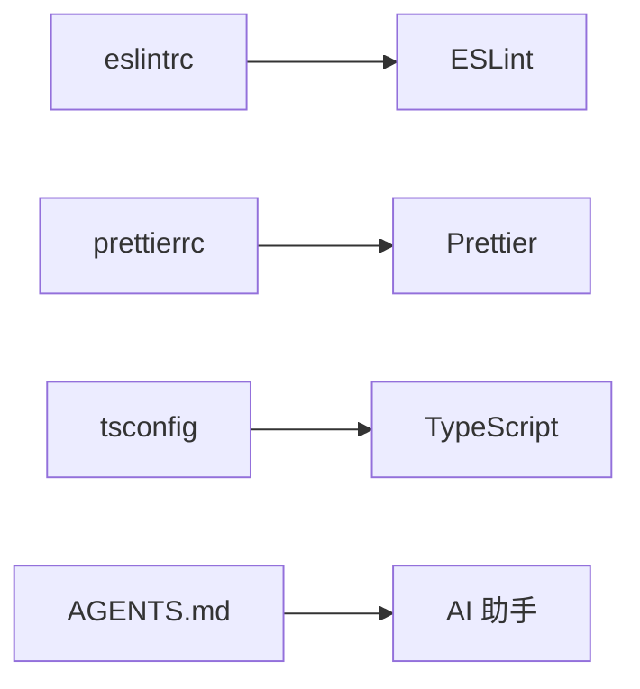
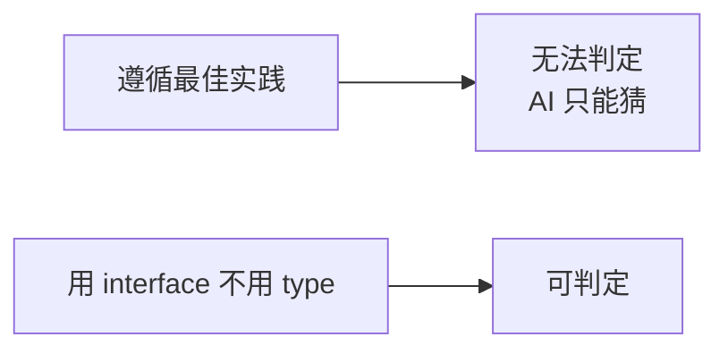
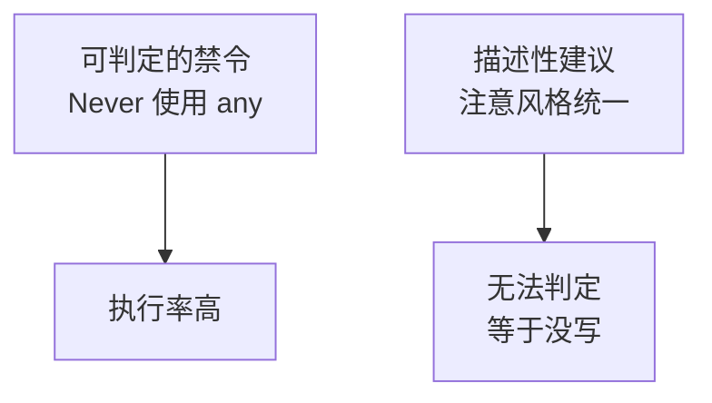
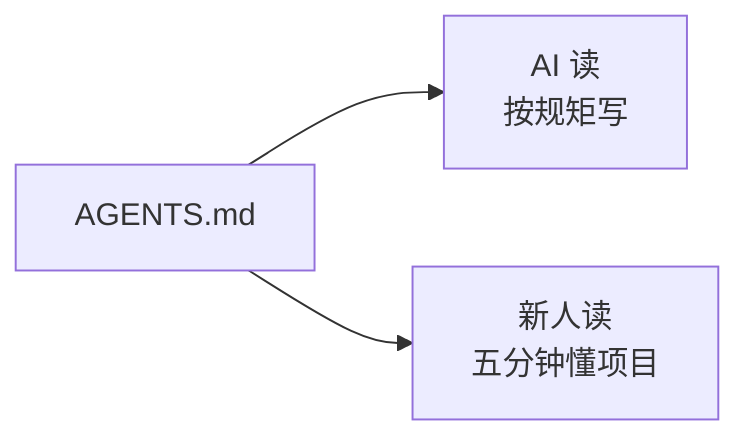
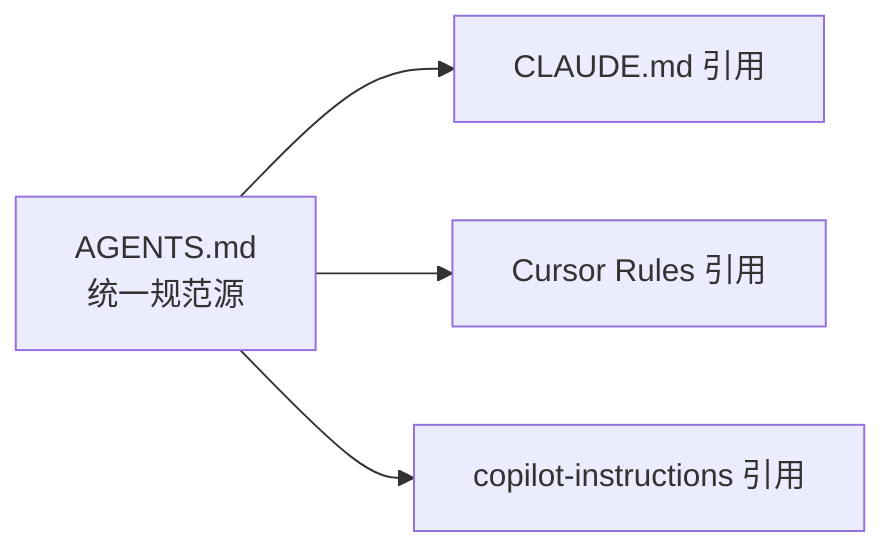

> 本文整理自一篇中文技术博客的实战总结。内容属整理稿而非逐字照搬。
>
> 文中的效果数据来自原作者自己项目的抽检统计，**样本与口径未做外部核验**，看结论时请注意这一点。

## 先回答那个更根本的问题

**作者开门见山**：上一篇讲团队 AI 提效，评论区问得最多的是「**`AGENTS.md` 到底怎么写，能不能给个模板**」。

**但他先不急着给模板，而是先答一个问题**：

> **为什么一个 Markdown 文件，就能让 AI 写出的代码质量发生质变？**

**他的定义只有一句**：

> **`AGENTS.md` 是写给 AI 编程助手看的项目规范文件。**

**而那个类比我认为是全文最好懂的入口**：

| 文件 | 给谁看 | 管什么 |
|---|---|---|
| `.eslintrc` | **给 ESLint 看** | 代码风格 |
| `.prettierrc` | **给 Prettier 看** | 格式化 |
| `tsconfig.json` | **给 TypeScript 看** | 类型检查 |
| **`AGENTS.md`** | **给 AI 看** | **项目规范、目录结构、编码约定、禁止事项** |

上图是这个对应关系。**注意前三个都是机器读的格式，只有最后一个是自然语言**——所以它能让 AI 理解「不成文」的东西。

**而他的落点是一句很准的话**：

> **没有它，AI 就是一个能力很强、但不知道团队规矩的新人。**
>
> **有了它，AI 知道你的规矩，按你的规矩来。**

## 三个场景看差距

**他用三个真实场景做对照，这个比讲道理有说服力。**

### 场景一：写一个复制按钮

**没有规范时，AI 写的代码问题清单是这样的**：

| 问题 | 具体 |
|---|---|
| **类型** | 参数是 `any`，完全没有类型定义 |
| **样式** | 用了内联样式，而团队用 CSS Modules |
| **命名** | `CopyBtn`，团队规范是完整拼写 |
| **交互** | 没用来提示组件做成功反馈 |
| **位置** | 文件没放进组件目录 |

**有规范之后，五条全对**：`interface` 定义 Props、引入样式模块、用了提示组件、命名补全、放进正确目录。

**他的评价很传神**：

> **后者像团队里有三年经验的同事写的，前者像实习生第一天写的。**

### 场景二：调用接口

**没规范时**：在组件里裸写 `fetch`，`useState` 存数据，`useEffect` 里发请求。

**有规范后**：**API 封装到服务层、用框架提供的请求方法、有完整类型、用请求 Hook 管理状态**。

**差别在于「代码放在哪一层」——这是规范真正管的事。**

### 场景三：提交代码

> 没规范：`git commit -m "fix button"`
>
> 有规范：`git commit -m "fix(components): 修复复制按钮在某个浏览器下复制失败的问题"`

**一个随意描述，一个符合规范。**

## 六个章节

**他说一份合格的 `AGENTS.md` 包含六个核心章节，每章都标注了重要度。**

### 第一章：技术栈声明（必填）

**写法要点他给了三条，都很具体**：

| 要点 | 为什么 |
|---|---|
| **用列表而非段落** | **AI 解析列表的准确率更高** |
| **写明版本号** | **React 18 和 19 的写法不同** |
| **写明包管理器** | **否则 AI 可能给你 `npm install` 而不是 `yarn add`** |

**第三条我觉得是最容易漏的**——包管理器写错，**AI 给你的每条命令都是错的**，而你还以为是它笨。

### 第二章：目录结构（必填）

> **AI 最需要的信息之一——知道文件放哪里。**

**写法要点**：

| 要点 | 说明 |
|---|---|
| 每个目录后**加注释**说明用途 | — |
| **只列到一级目录** | **太深了 AI 反而会困惑** |
| **写清命名规范** | 比如 PascalCase |

**「只列到一级」这条很重要**——它承认了**上下文不是越多越好**。

### 第三章：编码规范（必填）

**而这里他给了一条我认为是全篇最实用的写作原则**：

> **越具体越好——不要写「遵循最佳实践」，要写「使用 `interface` 不用 `type`」。**
>
> **给出正确用法示例——AI 读示例比读规则更准确。**

上图是这个差别。**「最佳实践」这四个字对 AI 来说是零信息**。因为它的训练数据里，有一百种互相矛盾的「最佳实践」。

### 第四章：构建命令（建议写）

> AI 帮你调试问题时可能需要运行命令。**如果它不知道你用 `yarn serve` 而不是 `npm start`，就会给你错误的指导。**

**而作者在这里补了一段我认为很有分量的警告**：

> **这一节也是全文最容易过期的**：包管理器一换（`yarn` → `pnpm`），命令就成了陷阱——**AI 照着旧命令跑，失败几次后很可能开始乱改配置。**
>
> 命令变了记得同步；有条件的话，**让 CI 直接执行下面列出的 lint / build / test，文档和脚本对不上就挂。**

**「AI 照着旧命令跑，失败几次后开始乱改配置」——这个连锁反应值得单独记住。** 它说明**过期的文档比没有文档更危险**。

### 第五章：Never 规则（最重要）⭐

**他说这是价值最高的章节，而理由很反直觉**：

> `Never` 规则告诉 AI「绝对不能做什么」——**这比告诉它「应该怎么做」更重要。**

**为什么？他给的解释我完全认同**：

> **因为 AI 犯错的成本远高于人类。**
>
> 人类改错了自动生成的目录，**会很快意识到「哦，这个不该改」**。**但 AI 不会——它会认认真真地把自动生成的代码改了，然后你下次构建就炸了。**

**「它会认认真真地改错」——这个描述比「AI 会犯错」精确得多。**

#### 底线：可判定 ⭐

**这是本章我认为最重要的一句**：

> **写这类规则有个底线：可判定。**
>
> 「Never 使用 `any`」「Never 修改 `src/.umi/`」——**每条都能在代码里对上号**。
>
> **「注意代码风格统一」这种描述句，无法判定做没做到，约等于没写。**
>
> **模型对明确禁令的执行率，远高于建议句。**

上图是这条判据。**它给了「怎么写规则」一个可操作的检验：这条规则能不能被机器对上号？**

#### 持续演进

> **每次 AI 犯了一个你不希望它犯的错，就往 Never 规则里加一条。**
>
> 这是一个**持续演进**的过程。**我现在的 Never 规则有 11 条，都是从真实踩坑中积累出来的。**

**他给的典型清单我原样保留，因为每一条都能想象出事故现场**：

| 规则 | 大概是为了防什么 |
|---|---|
| 不改自动生成目录 | **构建直接炸** |
| 不改构建产物 | 改了也没意义 |
| 不用 `any` | 类型等于没有 |
| 不用内联样式 | 风格分裂、没法换肤 |
| 不硬编码颜色 | **切主题时全崩** |
| 渲染路径不做耗时操作 | 卡顿 |
| 列表渲染不省 `key` | 状态错乱 |
| 不改 lock 文件 | 依赖漂移 |
| **不用 `git stash`** | **多 agent 并发时互相吞改动** |
| **不切换分支** | 同上 |

**最后两条说明了一件事**：**这些规则长在「AI 真的在并行干活」这个新场景上**——它们不是传统代码规范，**而是人机协作产生的新坑。**

### 第六章：约定与协作（团队必写）

**这一章专门管多 agent 场景**：

> **禁止 `git stash`｜禁止切换分支｜只 commit 自己修改的文件。**

**这三条其实是同一个问题的三个方面：多个 agent 并发时，共享工作区会被互相干扰。**

## 效果数据（带着保留看）

| 指标 | 之前 | 之后 | 变化 |
|---|---|---|---|
| **规范遵循率** | 约六成 | **九成五以上** | ↑ 三成五 |
| **一次通过率** | 约四成 | **八成以上** | ↑ 四成 |
| **手动修正时间** | 约八分钟 | **约一分钟** | ↓ 八成七 |
| **新人上手** | 三到五天 | **一天** | ↓ 七成以上 |

**而作者自己标了口径**：

> 以上数据基于实际项目**三周**使用期间，对 **五十多次** AI 代码生成的**人工抽检**统计。**不同项目和技术栈可能有差异。**

**我觉得这个标注很负责**——它说明了样本量和评估方式，**而不是把数字当成普适结论。**

**而最后一个数据他给了一个我没想到的解释**：

> **`AGENTS.md` 对新人也有用。**因为它不仅是给 AI 看的，**也是一份精简的项目开发规范**。
>
> **它是项目文档的一个超级浓缩版。**

上图是这个双用途。**写给人看时要求完整，写给 AI 看时要求可判定**——而这两者在这个体量上恰好重合。

## 进阶技巧

### 一、`DESIGN.md`：把视觉规范也抽出来

> `AGENTS.md` 管的是「代码怎么写」，**`DESIGN.md` 管的是「UI 长什么样」**。

**内容就是品牌色、文字色、间距系统。**

> 有了它，**AI 在写样式时就不会用 `color: blue` 这种硬编码颜色值。**

**这个拆分值得学**：**规范和规范之间也要分文件**，否则一份文件会越写越长。

### 二、`AGENTS.local.md`：个人偏好

> 创建一个 `AGENTS.local.md`（**加入 `.gitignore`**），写个人偏好：回复语言、注释语言、写法偏好。

> AI 会同时读项目规范和个人偏好。

**「入仓库的」和「不入仓库的」分开**——这个设计解决了一个真问题：**团队规范要统一，但每个人偏好不同。**

### 三、Never 规则的演进日志 ⭐

**他建议给 Never 规则维护一份日志**：

| 日期 | 新增 | 原因 |
|---|---|---|
| 某日 | 不改自动生成目录 | **AI 把自动生成的路由配置改了，构建报错** |
| 某日 | 不硬编码颜色值 | **用了固定色而不是主题变量，切主题时全崩** |
| 某日 | 不用 `git stash` | **多 agent 并发时，一个把另一个的改动 stash 了** |

> **每一条 `Never` 规则背后，都是一个真实的踩坑故事。**

**我觉得这个日志的价值不在记录本身，而在它让规则变得可解释**——**新人不理解某条规则时，能看到它是拿什么换来的。**

## 七个常见问题

**我挑三个最有信息量的。**

### Q3：写多长合适

| 档 | 长度 |
|---|---|
| 最小可用 | **三十行**（技术栈 + 目录 + 三条 Never） |
| **推荐** | **六十到一百行** |
| **不建议超过** | **两百行** |

**这个上限很重要**——它和前面「只列一级目录」是同一个理由：**上下文有限，写得越多，单条被遵守的概率越低。**

### Q4：多个 AI 工具都能识别吗

**这里作者的回答有个前后不一致，值得指出来。**

**他先写「已验证四个工具都支持」，紧接着又更正**：

> 更准确地说，**`AGENTS.md` 是统一规范源文件，不是所有工具都原生直接读取它**。
>
> 不同工具需要接入自己的规则入口：**有的用 Rules，有的用 `CLAUDE.md` 引用，有的用 `.github/copilot-instructions.md`，有的用 `.windsurfrules`。**

**我把这个更正保留下来，因为它比原结论重要**：

上图是实际形态。**它不是「一份文件所有工具都读」，而是「一份文件当正本，各工具各连一根线」。**

**这个区别在实践里很要命**：**如果你只写了 `AGENTS.md` 就以为万事大吉，很可能一个工具都没读到它。**

我自己就踩过这个——**项目根目录同时有 `AGENTS.md` 和 `CLAUDE.md`，而真正承载规则的是那份更长的 `CLAUDE.md`，`AGENTS.md` 反而是一份没填完的占位骨架**。**两份文件并存时，谁生效取决于工具读哪个，而不是哪份写得更全。**

### Q7：它会不会过时 ⭐

**他答得最诚实**：

> **会，而且这是它最大的隐性坑。**
>
> **目录重构之后，旧规则还躺在文件里，AI 拿着过时的结构硬套，比没有这份文件还糟。**

**而对两条漂移他给了不同的对策，我认为这个区分很专业**：

| 漂移类型 | 对策 |
|---|---|
| **结构变更** | 写进提交前 checklist 或 PR 检查项——**「改结构的那一刀必须带上它」** |
| **命令变更** | **交给机器守**：让 CI 直接执行文件里列的 lint / build / test，**对不上就挂** |

**而命令那一条的后果他讲得更细**：

> 包管理器从 `yarn` 换成 `pnpm` 之后，**AI 还会照着旧命令跑；失败几次，它可能开始去改配置——错上加错。**

**他还补了两个边界，我觉得是内行才会提的**：

> **`serve`、`watch` 这类长驻命令不要放进 CI**；**校验的锚点始终是 `package.json` 的 scripts，`AGENTS.md` 只是引用。**

**「文档只是引用，真值在 scripts」——这句话把主从关系定死了。**

### Q6：不做计算机方向也能用吗

**这个问题我觉得是全文覆盖面上最有价值的一段。**

> **能，它不挑领域。**本质是「写给 AI 编程助手看的项目规矩」。
>
> 把前端示例换成自己的场景即可：**技术栈换成 Python 加数据分析库**；**目录换成「原始数据、处理后数据、脚本、结果」**；
> **Never 规则写「不改原始数据」「不覆盖已有结果」。**

> 科研场景里「不改原始数据、不覆盖结果」这类规则尤其值钱——**可复现性从规矩层面就兜住了。**

**「可复现性从规矩层面兜住」——这个说法说明 `AGENTS.md` 的用途远超前端。**

## 我的三点补充

以下是评注，不是原片内容；取舍由我负责。

**第一，「可判定」这条判据，其实同时解释了为什么 Never 规则有效、以及为什么「遵循最佳实践」无效。** 因为 AI 不缺知识，**它缺的是「在这个项目里哪条知识优先」**。「用 `interface` 不用 `type`」是一条**可判定的选择**，而「最佳实践」在它的训练数据里有一百个版本。**所以写规范的本质不是传递知识，是在冲突的选项里做排除。**

**第二，那份演进日志的真正价值，是把规范从「权威」变成了「案例」**。一条孤立的「禁止 `git stash`」看起来像限制；**而配上「多 agent 并发时互相吞了改动」这个事故，它就变成了经验**。而经验能被接受，权威只能被服从——**这也是为什么新人读过之后能举一反三。**

**第三，Q7 那个「比没有这份文件还糟」的判断，值得单独警惕。** 因为过期文档的害处不是「没帮上忙」，**而是让 AI 带着错误的前提去执行**——它会照着旧目录结构找文件、照着旧命令跑构建，**失败之后开始自己「修」**。所以维护这件事的门槛，**不是「要不要写」，而是「写了之后谁保证它和现实同步」**。而他的答案里有半句最关键：**让机器守。**

---

一句话总结：**AI 缺的不是能力，是「这个项目里哪些选项已经被排除了」。** 而一份好的规范文件，就是把那些排除项写成一句句能被机器对上号的话。
