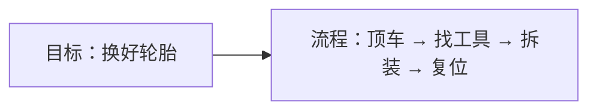
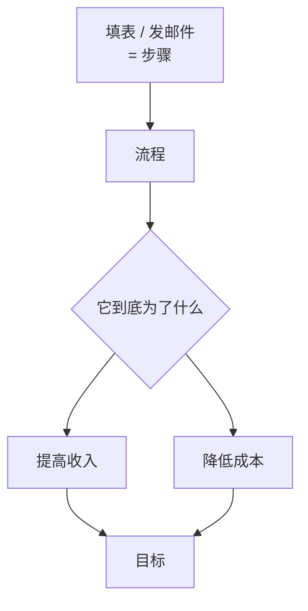
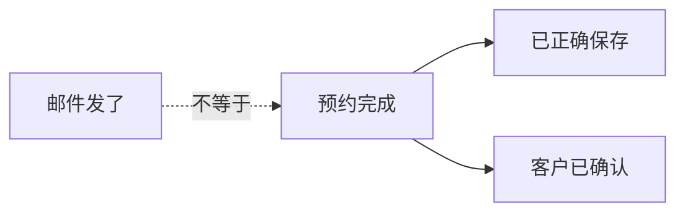
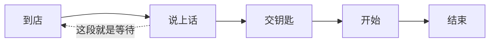

> 本文整理自一篇面向非技术读者的官方教程类长文。内容属整理稿而非逐字照搬。
>
> 文中提到的产品与功能描述沿用原文，**未做外部核验，也不构成推荐**。

## 开场那个拆法

**作者说自动化「意外地难做好，即使对天天做的人也是」**，然后给了一个极简的拆法。

> 自动化其实只是一种**思维方式**，任何人都能学。**它就是系统性地、有逻辑地想事情，把事拆成小步骤，同时心里记着目标。**

**而它只有两部分**：

| 部分 | 是什么 |
|---|---|
| **目标** | **你最后想拿到的东西** |
| **流程** | **你怎么到达那里** |

**他举了两个日常例子，而这两个例子选得很好——一个偏「配方」，一个偏「应变」。**

**烤苹果派**：买齐材料、组装、烘烤、放凉。

**换轮胎**：

> 你可能需要**想办法把车顶起来**，才能碰到轮胎；**找到工具**拆下旧的、换上新的；**然后把一切装回去**。

上图是这个关系。**注意换轮胎的流程里有「想办法」——它不是一个照单执行的配方。**

## 自动化的定义

> 自动化还是这两件事，**只是多了一样东西：机器**。
>
> 比如面包店用来批量烤派的机器；**或者代码**——软件工程师以前手写代码，就是为了自动化那些计算机能做的事。
>
> **关键是把事拆成通往目标的步骤，再把流程自动化，这样你就不必每次都亲自做。**

**而他点出了这轮变化的意义**：

> 一两年前，自动化**只属于那些懂怎么造机器、或会写代码的人**。
>
> **现在，凡是用电脑能完成的事，非技术的人也能做到了。**

## 先说目标，而且别把流程当目标 ⭐

**这一节我认为是全篇最该记住的。**

> 我经常看到的一个错误，**是人们把流程误当成目标**。
>
> 比如你在工作上已经有一套很明确的流程。**但目标不是「填完一张表」，也不是「发一封邮件」——那只是流程里的一步。**

**而正确的问法是**：

> 想想最后的目标：**这套流程是为了什么？它在业务里处在什么位置？**
>
> **它是在帮公司提高收入**（比如成交一笔、做出新功能），**还是在降低成本**（比如刚好订到合适数量的库存）？

**如果答不上来，他给了很实在的建议**：

> **跟你的经理或同事聊聊，或者干脆让机器人帮你一起想清楚。**

**而「先定目标」的好处他说得很清楚**：

> **明确目标是最好的起点，因为它把你和机器人都聚焦在最终结果上。**
>
> **你甚至可能发现，机器人能想出办法让流程更高效**——**所以别太执着于某个具体流程，它毕竟只是手段。**

上图是这条追问路径。**它的作用是把「我在做什么」换成「我为什么做」。**

## 那套交代流程的方法 ⭐

**这是全篇最实用的部分，而它的关键建议是「别先整理」。**

> 给机器人这些信息**最好的方式，是用语音输入边说一阵**——
>
> **把完成这项工作所需知道的一切一口气说完，不用担心中间跳跃，也不用先整理思路。**

**该说什么，他给了六项**：

| 说什么 |
|---|
| **你通常走的步骤** |
| **你会留意、会特别注意的事** |
| 你用的应用和工具 |
| **你怎么检查这项工作做对了** |
| **你从哪里拿到需要的信息**（邮件、即时消息、工单、某个应用或网站） |
| 你从哪里拿到关于「做得怎么样」的反馈 |

**「不用先整理思路」这个建议我觉得有反直觉的价值**。**因为整理的过程往往是丢失细节的过程**：你会把「我当时想了一下才决定」这类关键判断当成废话删掉。

### 而那句提示词里有个重要的约束

> 在开始之前，**用简单的英文复述你认为我的目标和流程是什么**，这样我可以给你反馈和确认。
>
> **我不要你现在就开始执行**——我们先把流程规划好。

**「先复述，别执行」——这个顺序很重要。** 因为一旦它开始执行，你的注意力就会被具体动作吸引，**而错误的目标会被一路执行到很深的地方。**

**而他给了一个很宽容的提醒**：

> **别担心第一遍就做对。**看它说了什么，然后用更多信息去纠正它。
>
> **这样来几次之后，你应该就有了一个自己满意的东西。**

## 那些「你根本没意识到自己在做」的判断 ⭐

**这一节是全文我认为最有洞察的。**

> 解释一个流程时，**很容易忘掉一件事：有多少判断是你根本没想就做了的。**
>
> 如果你在帮客户预约，**你大概知道哪些服务更耗时、谁能做哪一项、两个预约之间什么时候该留余地。**

> **这些决定在你看来可能显而易见，但你的机器人也需要这些上下文。**
>
> **想一想：你自己做这件事的时候在留意什么？什么会让你改变做法？**

**而他补了一条我认为特别实操的**：

> 还要告诉它**你从哪里得到这些信息**，以及**你怎么检查这项工作被正确完成了**。
>
> 比如：**一封邮件和你的预约系统显示的时间不一致，它应该信哪个？**

**以及那个「不算完成」的例子**：

> **一笔预约不是「邮件发出去了」就算完成。**预约要被正确保存，客户要拿到确认。
>
> **如果还在等某些细节，让机器人记着这件事**，以便它之后接着做，**而不会不小心又建了一笔重复预约。**

上图是这个区分。**它和前面几讲那条「已提交部署不等于成功」是同一种错。**

### 一种让 AI 帮你找盲区的方法

**他给的那句提示词我觉得设计得很好**：

> 「帮我弄清楚，关于这个流程**还有哪些是我没告诉你的**。请就这些方面问我问题：
> **我怎么做判断、我从哪里拿信息、我怎么检查工作、以及什么时候该来找我帮忙。**
>
> **一次问一个问题**，然后带我走几个例子，让我在自动化之前能给你反馈。」

**「一次问一个问题」这个限定很关键**——**因为一次抛五个问题，人会挑最好答的那个答。**

## 让机器人自己去拿反馈 ⭐

**这一节把「改进」这件事从人身上挪到了系统上。**

> 机器人跑起流程之后，**给它反馈让它改进很重要**。
>
> **最好的方式是：给它配好应用和工具，让它自己去拿到那份反馈。**

**他的思路是一句反问**：

> 我会想：**如果是我在做这件事，而且我想自我改进，我会怎么做？**

**具体例子**：

> 假设由机器人负责预约排期，一个让它自己改进的办法，**是让它盯着邮件、社交媒体或者点评站上的用户评价**。
>
> **它可以留意这些反馈，然后主动提出流程改进建议。**

**而那个诊断场景很具体**：

> 也许有客户在点评网站上写「等了很久才有人接待」。
>
> **如果它能自己去查这条信息，同时查出你那天关于这位客户的所有记录，它就能看出可能哪里出了问题。**

### 数据越多，自动化越强

**他说得很直接**：

> **从这个意义上说，你的业务越「计算机化」，对机器人和自动化越有利。**
>
> **这些数据的可得性，才让机器人有能力提出更好的改进。**

**而这里有一个我觉得最聪明的提议**：

> 最好的部分是——**它还能帮你造工具来拿到这些数据。**
>
> 比如你经营修车服务，**你可以让它给你做一个应用**，在电脑和手机上记录客户到店的细节。

**记什么？他给了一条时间线**：

| 时间点 |
|---|
| 客户到店 |
| 能跟服务顾问说上话 |
| 你把钥匙交出去 |
| 服务开始 / 结束 |

> **你就能算出他们等了多久，也更能诊断出为什么。**

上图是这条时间线。**注意它把「等待」变成了一个可测量的区间**——**而原本这个体验只是「感觉等了很久」。**

### 那个关于「身份」的技术前提

> 如果你有某种 ID——**某个编号或者唯一的文本，比如邮箱地址，能给数据一个身份**——机器人就能跨多个来源交叉比对。
>
> 这可以是**客户 ID、邮箱、订单号、零件号、条码、员工编号**等等。
>
> **如果你用多个应用和服务，让这些工具里都有唯一且一致的 ID**，能帮它把数据聚合起来，**让它完整理解发生了什么。**

**「唯一且一致的 ID」这条听起来像技术细节，其实是自动化的地基**——**没有它，数据就是一堆互不相认的碎片。**

## 什么时候自动跑

> 下一个问题是：**机器人该什么时候干活？**
>
> **是收到邮件时、有人发消息时，还是按固定时间表？**

**而他给了一个分阶段的做法**：

> **没有 routine 的时候，机器人只会在你要求时才干活。**
>
> 刚开始用的时候这样没问题，**但如果你想精简流程，就得想办法让它自动做——这样你才不再是瓶颈。**

**「你不再是瓶颈」——这句话点出了自动化的真正门槛**：**不是能不能做，而是每次都要你说一声。**

## 我的三点补充

以下是评注，不是原片内容；取舍由我负责。

**第一，「把流程误当目标」这个错误之所以普遍，是因为流程是可见的，而目标是抽象的。** 你能看见自己在填表、发邮件、点按钮；**但「这降低了成本」不在任何界面上**。所以人会自然地把注意力放在看得见的东西上——**而自动化的价值恰恰藏在看不见的那一层**。这也是为什么「这个流程为了什么」必须刻意去问。

**第二，「用语音一口气说完，不用先整理」这条建议，其实是在保护那些最容易被删掉的信息。** 因为**你一整理，就会按「重要性」排序，而把「我当时犹豫了一下」这类判断当成废话删掉**。**但那恰恰是流程里最需要被自动化的部分**，因为它最难、最费神。所以「不整理」不是偷懒，**是防止信息的自我审查。**

**第三，「让机器人自己拿反馈」这一步，把自动化从「执行」升级成了「改进」。** 而它成立的前提很硬：**反馈必须能被机器读到**。所以那句「业务越计算机化越有利」不是推销，**是这套方法的结构性条件**——**没有数字化的反馈，机器人只能执行你教的流程；有了它，机器人才可能发现你没教的那些。**

---

一句话总结：**自动化不是把动作录下来重放，是先想清楚「我要什么结果」，再让它自己找路径。** 而它真正的门槛不在技术，**在你愿不愿意把那些「不用说也懂」的判断说出来。**
