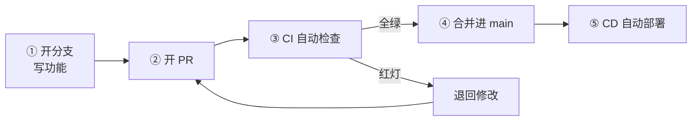
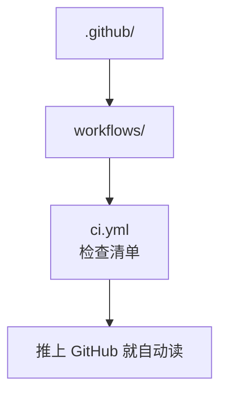
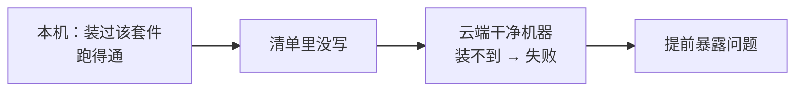
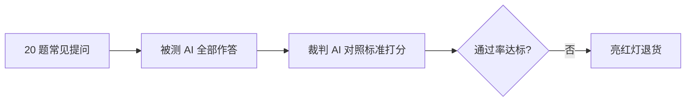

> 本文整理自一支 13 分钟的繁中教学视频，面向非技术背景的 Vibe Coder。文稿由字幕整理而来，属整理稿而非逐字记录。
>
> 文中的工具名、指令与流程沿用原片口述，未做外部核验。

## 开场：一句让人懵的话

作者从一个非常具体的场景切入，我认为这个开场选得很好。

> AI 写完一个功能，问你要不要开 PR。**你按下同意之后，AI 下一句突然回你：好，那我们等 CI 检查通过之后再 Merge。**

> 对非技术背景的人来说，**听到这句话大概只会满头问号**。
>
> **「我知道 PR 是什么，但 CI 又是什么东西？为什么要等它检查？」**

**他的定调很稳**：

> 虽然 CI 听起来很恐怖，**但它其实是软件开发里非常重要的一环**。
>
> **它也是你在 AI 时代打造自动化写程序的软件工厂时，不可或缺的自动把关机制。**

**而它要解决的具体病症，他说得很形象**：

> 只有在项目里把这道防线建立起来，**你才能比较放心一直往上叠新功能**，不会**做 A 坏 B**，**陷入找 bug、打地鼠的无限循环**。

## 先看完整流程：五步

**他沿用了一个记帐软件的案例**：主角把它推上 GitHub，也部署到部署平台上给朋友用。

**而当他想加一个新功能时，看起来只要三步**：

> 先叫 AI 把功能写完 → 推上 GitHub 开 PR → 然后部署上线。

**但实际上**：

> AI 跟平台**在背后默默帮你跑了一连串的自动检查跟自动部署**。**而这整套机制就叫 CI/CD。**

**拆开来看是五步。**

| 步 | 做什么 | 属于 |
|---|---|---|
| 一 | **开一条新分支**写功能 | — |
| 二 | 推上 GitHub，**开一张 PR** | — |
| 三 | **CI 自动检查** | **CI** |
| 四 | 检查全绿后**合并进 main** | — |
| 五 | **部署平台自动发布** | **CD** |

上图是这五步。**注意那条红灯回路——它就是「防坏」发生的地方。**

### 第一步为什么要开分支

> 避免把主线的程序码搞得乱七八糟。

**这句话很朴素，但它就是分支存在的全部理由。**

### 第三步：打开 PR 后会看到什么

> 打开 GitHub 页面，**你会看到画面底下突然开始转圈圈，自动跑出一排项目。**

**「这就是第三步，叫做 CI。」**

> 英文 Continuous Integration，**中文叫持续整合**。
>
> **其实简单讲就是 GitHub 在帮你测试你的软件**：把新旧程序码合起来做一次通盘检查。

### CD 有两种，差别在最后那一下

**这一点我觉得讲得很清楚，很多人会混。**

| 说法 | 含义 |
|---|---|
| **Continuous Delivery**（持续交付） | **准备好随时能上线，但最后要人工按确认** |
| **Continuous Deployment**（持续部署） | **电脑自动把新版部署出去** |

> 而现在像这类平台帮我们做到的**是更进一步的持续部署**。

### 一句总结 CI/CD 的角色

> **就是把握原本最繁琐的两件事——检查有没有改坏、打包传上网站——全部变成自动化。**

**而反过来想会更清楚**：

> 如果今天没有 CI 跟 CD，**他每次改完一个功能就不能只推上 GitHub 然后拍拍屁股走人**。
>
> **你必须自己打开网页，把所有功能从头到尾手动测试一遍**；结束后**还要自己把整包文件手动上传去更新网站**。

> 当产品越做越大、改版速度越来越快，**这种手动流程不只花时间，还超级容易因为一时疏忽，就把有问题的版本直接更新出去。**

## CI 的本质：一份检查清单

**他先拆掉了 CI 的神秘感。**

> 其实 CI 没有你想的那么玄，**它本质上就是一份自动化的检查指令清单**。

**而「是清单」这个属性带来一个关键推论**：

> 既然它只是一份指令清单，**就代表里面要检查什么并不是系统写死的，我们是可以定制化的。**

### 这份清单长在哪

> 现在这个用 AI 写程序的时代，**大多数时候你使用的 AI Agent 都会帮你这把这份检查清单设置好**。

**具体位置**：

> 项目里有一个叫 `.github` 的数据夹，点开底下的 `workflows`，**里面就会有像 `ci.yml` 这样的 YAML 文件**。
>
> **这份文件就是 AI 帮你写好的 CI 检查清单。**

上图是这个路径。**记住它，因为你要改 CI 就是改这个文件。**

## 保底的三关（其实是四道）

**他说「通常保底都会跑三道基本检查」，实际上讲了四个指令。**

| 关卡 | 指令 | 抓什么 |
|---|---|---|
| **Lint** | `npm run lint` | **AI 写程序的坏习惯** |
| **Typecheck** | `npm run typecheck` | **资料类型对不上** |
| **Test** | `npm run test` | **有没有改坏旧功能** |
| **Build** | `npm run build` | **打包能不能成功** |

### Lint：抓 AI 的坏习惯 ⭐

**他给的判据很具体**：

> AI 写程序**常常图快，留下垃圾或危险写法**。

**两类问题。**

**第一类：垃圾残留。**

> 比方说 AI 改完程序后**常常忘记把用不到的旧组件清掉**。Lint 扫过去就会提醒你删掉。

**第二类：看起来没错，但跑起来会出事。**

**他举的例子我觉得是这一节最有价值的**：

> AI 写前端很爱用 `useEffect`，**一不小心没写好，就会让网页一直重复更新、卡死在无限循环里**。
>
> **所以直接把禁止使用 `useEffect` 写进 Lint 规则里**——AI 只要一写出来，**跑一次检查就会亮红灯并退货。**

**「把禁令写成规则」——这其实和前面那些讲护栏的思路是同一个。**

### Typecheck：抓类型错

**他用一个很直白的例子**：

> 记帐软件要计算这个月总共花了多少钱，**计算总额的地方规定只能用纯数字来做加减**。
>
> 结果 AI 改另一个页面时不小心写错了，**把「一百元」这种纯文字当成数字送去做加减**。
>
> **报表出来不是金额变成乱码字串，就是直接算错变成无效数字。**

**而它的优势在于**：

> **只要花几秒钟把程序码扫一遍，不用真的把网站跑起来**，就能立刻把这种错误拦下来。

### Test：一份标准验收考卷 ⭐

**这个比喻我觉得最好用。**

> 这些测试脚本的目的，**就像先帮软件写好一份标准验收考卷**——把每个功能正常运作时该有的结果，全部写成检查题。

**而它的实战价值，在于回答一个问题**：

> 你今天请 AI 加了「汇出月报表」的新功能，**你怎么知道它有没有在改程序的时候，不小心把原本好好的新增记帐或会员登入给改坏了？**

**具体怎么跑**：

> 电脑会扮演一位虚拟用户——**可能先帮你试记三笔假帐，看金额加总对不对**，接着再试试看汇出报表跟登入功能正不正常。

> **不管是新功能算错钱，还是旧功能被意外搞坏，这一关都会马上亮红灯拦下来。**

### Build：预演组装

**他解释「为什么要打包」讲得很清楚**：

> AI 平常写程序时**为求好修改，会把程序码拆成几百个零散的小文件**，而且**里面的内容是一般浏览器直接看会看不懂的开发语法**。
>
> 所以在网站发布出去之前，**一定要先经过 Build 这道手续**。
>
> **它把几百个零散的零件全部翻译成浏览器看得懂的标准语言，再压缩组装成一个完整的网站成品包。**

**而它抓的是一类很特别的错**：

> 单看每一个小文件或许很少出错，**但全部拼在一起的时候才会发现东缺一个、西缺一个**。

> 所以必须在合并之前跑一次，**预演组装**，**不会等推上线才发现整个网站打不开。**

## 为什么要用一台「空白电脑」⭐

**这一段是全片我觉得最容易被忽略、但最能解释原理的部分。**

> 只要把设定档放好，每次一开 PR，**它就会自动在云端借一台全新的空白电脑**，把程序码下载下来，照着清单把检查全部跑完。

**为什么非要借一台干净的？**

> 因为他自己的电脑**平常早就装了一堆开发工具、旧套件跟暂存档**。
>
> **有时候 AI 写新功能用到了某个套件，刚好他的电脑以前装过，却忘记写进项目的安装清单里。**

> 这时候**在他自己的电脑上跑完全没事**，**但一推到正式网站就会因为找不到套件而当机。**

上图是这个陷阱。**「本机跑得通」是一个假象，因为它依赖了你没有记录的环境。**

> 所以为了排除这些残留环境的干扰，**得用一台完全干净的空白电脑，从零开始下载安装、重头跑一次**——**测出来的结果才最准确。**

## 那个绿色打勾和红色叉叉

**这一节把界面和机制对上了，很实用。**

> PR 列表上每张 PR 旁边都会挂着一个图标跟数字。**像绿色的打勾写着「3 / 3」**，就代表**三个检查项目全部过关**。
>
> 如果看到**红色叉叉写着「2 / 4」**，就是**四个项目里只过了两个**。

**而查错路径是**：

> 点进这张 PR，**切换到上方的 Checks 分页**，就能看到那台云端电脑照着设定一步一步执行。
>
> 万一某一关亮了红叉，**点旁边的 Details 就能看到具体的错误报告**。

**他还给了一个很实用的做法**：

> **甚至不用自己看懂全部的英文。**直接请 AI 通过 GitHub 的连接器去读取报错信息，**叫它修好再重新推上来就行了。**

## CI 通过之后：还有半步

**他特意澄清了一个常见误解**。

> GitHub 其实**只是保管程序码的仓库**，**按完合并后它自己并不会去更新网站**。

**那是谁在更新？**

> 靠的是当初把项目部署到平台时，**在后台绑定的连接**。
>
> **部署平台会在旁边随时盯着 main 主线**，只要发现有新的程序码合并进来，**它就会自动把最新版抓过去、重新打包、直接发布成最新的正式网站。**

**几分钟后，朋友打开网页就能用到新功能。**

**而他也说了现状**：

> 现在对于这类平台，**CD 早就做成开箱即用的标准功能了**——**只要一开始有把 Repo 跟部署平台绑定好，上线这件事平台自然会帮你处理掉。**

## 往上叠：两个进阶关卡

**基础三关讲完，他给了两个可选武器。**

### 一、Playwright：真的把网站点一遍

> 机器会在云端**真的把你的网站打开，模拟真实用户从头到尾点一遍**——确认画面没白屏，**按钮也真的点得动。**

**但他说了一个很重要的原则**：

> 如果你把网站每个页面每个按钮都塞进去，**每次开 PR 光等测试就要超级久，开发进度会大幅降低。**

> **所以只有一个原则：只有流程已经稳定、而且坏掉会直接影响核心体验的路径才要加。**
>
> 像是**登入、付款、或记帐软件的汇出报表**。
>
> **至于还在摸索排版的早期原型，或是随时会大改的实验功能，就先不用写进去。**

### 二、LLM as a judge：给 AI 输出打分 ⭐

**这一条是给 AI 产品专用的，我觉得很聪明。**

> 如果你在记帐软件里加了一个 AI 理财顾问，**让用户问「我这个月吃饭花了多少、该怎么省」**——
>
> **因为 AI 每次生成的文字都不一样，传统 test 只检查一加一是不是等于二，根本测不出这段回答写得好不好。**

**做法是**：

> 准备**二十题常见的用户提问**。只要你有改到 AI 相关的提示词或逻辑，**就让它全部答一遍**。
>
> 再把这些回答、**连同原始帐目数字、以及你定好的评分标准，交给另一个专门当裁判的 AI 模型去打分**。
>
> **检查它有没有算错金额、有没有答非所问或瞎编数字。**

> **只要通过率低于设定的门槛，CI 就直接亮红灯退货。**

上图是这个机制。**注意它是「用模型测模型」——因为传统断言测不了自然语言。**

**而他最后给了一句我觉得是全片最重要的态度**：

> **你不一定要知道所有程序码具体该怎么做一行一行写出来**，**但一定要知道 CI 的工具箱里有哪些武器**。**这样才有能力根据项目需求去跟 AI 沟通，叫它把这些防线加上去。**

## 最后一节：CI 全绿只是底线 ⭐

**收尾这段他没有吹 CI，反而给了限制，我觉得很诚实。**

> 不管往 CI 里塞了多少检查，**目的都只有一个**——确保产品永远处于「真的能用、体验没坏」的状态才被发布出去。

**但是**：

> 上面这些 CI 关卡**不管加得多严格，它们能拦住的全都是你事先定义好的问题。**

**为什么？**

> **真实世界是混乱的**。用户不会照着你事先写好的测试剧本一步一步点。**他们会在各种意想不到的状态下操作你的软件。**

**所以他给了一个双层防线**。

| 层 | 靠什么 | 管什么 |
|---|---|---|
| **底层** | CI/CD 自动化流水线 | **每次改动都能安全打包、顺利上线** |
| **上层** | 实机验证（让独立 AI 像真人一样乱点） | **补真实世界的各种意外** |

**而上层那层他描述得很具体**：

> 在合并之前，**再派另一批「完全没写过这段程序码」的独立 AI**，**像真实用户一样进到软件里到处点击验证**，**录下实机证据，确认玩不坏才放行。**

**「没写过这段代码的独立 AI」这个限定很关键**。它保证检验者没有「我知道我为什么这么写」的先入之见。

### 他最后那句判断

> **在 AI 写程序越来越快的时代，越来越多人遇到的开发瓶颈，已经变成「你有没有足够的品管机制去接住 AI 的产出」。**

## 我的三点补充

以下是评注，不是原片内容；取舍由我负责。

**第一，「借一台空白电脑」这个细节，其实解释了 CI 的本质不是「跑测试」，而是「换一个环境重跑」。** 因为本机测试的通过与否，混入了太多没被记录的状态——装过的套件、改过的配置、遗留的暂存档。而 CI 的价值就在于它**只有一个环境定义**（依赖清单），**跑得通就说明清单是完整的**。所以 CI 抓的第一类问题，往往不是代码错，**是「你的环境描述不完整」**。

**第二，那一句「把禁止使用 `useEffect` 写进 Lint 规则」，示范了纪律的落点。** 你没法靠反复叮嘱让 AI 不犯某个错（前面几讲讲护栏时也是这个结论），**但你可以把它写成一条机器每次都会执行的规则**。这和「收走写工具」「密钥不走模型」是同一个手法：**把约束从口头挪到机制里。**

**第三，Lint、Test 和 LLM as a judge 这三关，其实对应三种不同的「对错标准」。** Lint 判**风格与禁令**（能不能这么写），Test 判**行为是否符合契约**（该输出什么），judge 判**质量够不够好**（写得好不好）。**前者可以完全自动化，后者天然模糊**——所以它只能用统计（二十题、通过率门槛）来代替断言。**这也说明了「哪些东西能被 CI 管」的边界在哪。**

---

一句话总结：**CI 是一份你自己定的检查清单，在每次合并前用一台干净机器替你重跑一遍。** 它防的是「本机跑得通」，**而不是「真实世界不会坏」——后者得靠第二层防线。**
