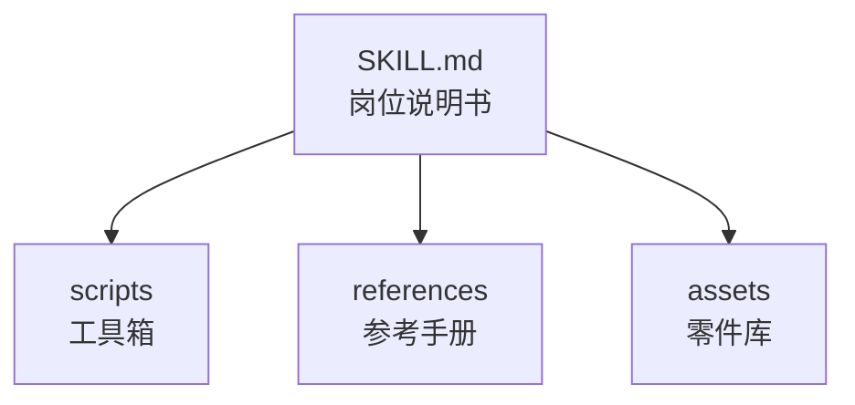
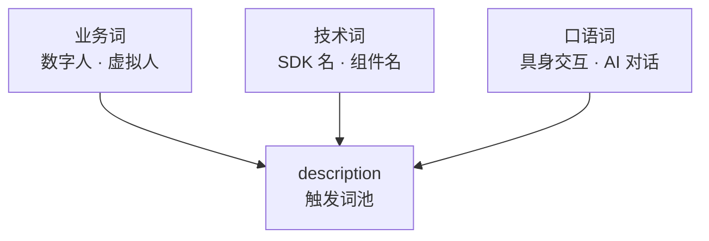
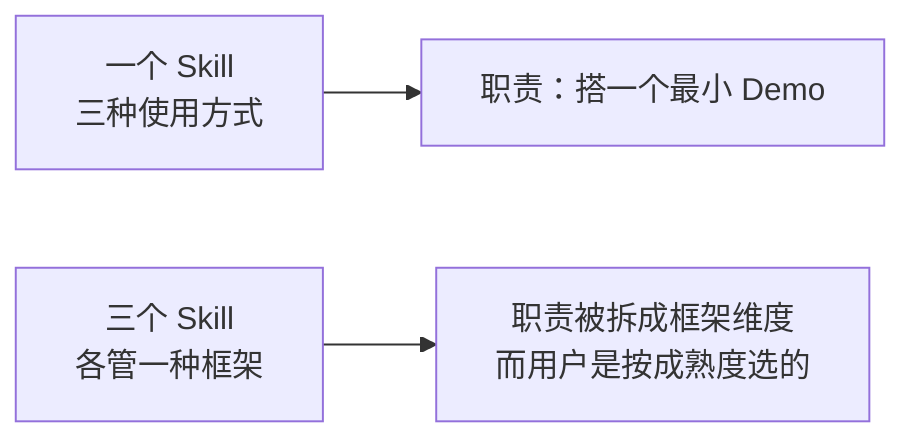
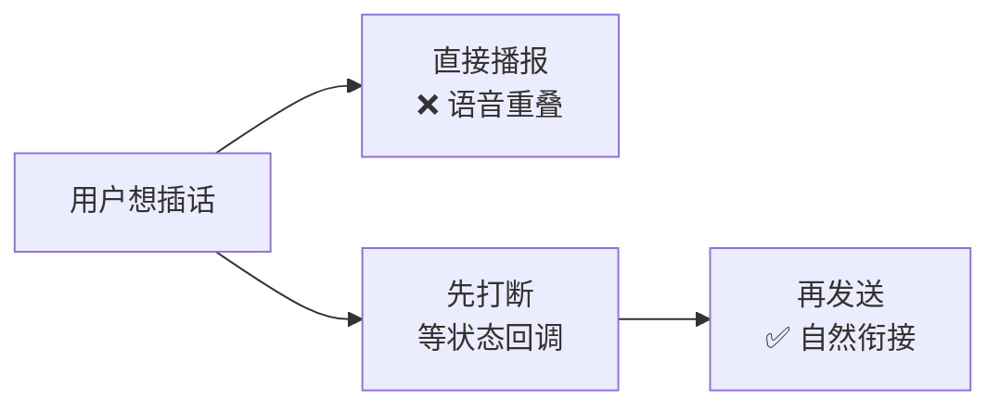

> 本文整理自一篇中文技术博客，原文以某 3D 数字人 SDK 的集成技能为实例。内容属整理稿而非逐字照搬。
>
> 文中提到的 SDK 名称、接口签名与邀请码沿用原文，**未做外部核验，也不构成推荐**。

## 从一个 Demo 说起

**作者的路径是**：先被「具身交互智能」这个概念吸引，用 SDK 做了个 Demo。**然后撞上一个很现实的问题。**

> Demo 几行代码就能跑起来，**但由于主要基于前端技术栈构建，其他技术栈的开发者想上手，依然有不小的认知成本。**
>
> **后端同学、移动端同学、甚至非技术产品经理，看到一堆 HTML/JS 代码可能就直接劝退了。**

**所以他做了一套技能模板。**而他对这件事的定性，我觉得说得挺好：

> 这就是 Skills 带来的**技术平权**：**不是降低技术本身的天花板，而是抬高地板**，让每个人都能站在更高的起点上。

**「抬高地板」这个词用得很准**——它没有假装人人都会写代码，**只是把入场券从「会写」降到「会说清需求」。**

## 什么是 Skill

**他的定义很简洁**：

> 一项技能就是一个**包含 `SKILL.md` 文件的文件夹**。该文件包含元数据（名称和描述）**以及向执行特定任务的代理提供操作指南的指令**。
>
> 技能还可以整合脚本、模板和参考资料。

**而结构的四层分工他给了个类比，我觉得这个表可以直接用**：

| 层 | 职责 | 类比 |
|---|---|---|
| **`SKILL.md`** | **灵魂文件：身份、指令、边界** | **岗位说明书** |
| `scripts/` | 可运行的自动化脚本 | 工具箱 |
| `references/` | 深度参考文档 | 参考手册 |
| `assets/templates/` | 开箱即用的模板与资源 | 零件库 |

上图是这个结构。**注意箭头方向——所有东西都从 `SKILL.md` 指出去，它是指挥中心而不是仓库。**

**而他对这套结构的评价是**：

> 用**最小的文件结构**，承载**最大的能力密度**。

## 七条原则

**他先列了七条，然后逐条落地。**这条清单本身值得先看一遍。

| # | 原则 | 解决的问题 |
|---|---|---|
| 一 | **边界明确** | 模型判断执行时机的偏差 |
| 二 | **渐进式披露** | 降低模型加载压力 |
| 三 | **输入输出结构化** | 无歧义、可解析 |
| 四 | **步骤明确可执行** | 模型能直接落地 |
| 五 | **工作流与反馈闭环** | 规范顺序、校验质量 |
| 六 | **失败策略完备** | 避免模型随意发挥 |
| 七 | **职责绝对单一** | 规避冗余与不确定性 |

上图是我对它们关系的一种读法：**前两条管「何时进场、带多少东西」，中间两条管「怎么交互」，后三条管「怎么收尾」。**

## 一、`description` 是最关键的字段 ⭐

**这一条他讲得最细，而我认为它确实是全篇最实用的部分。**

> `description` 是整个 Skill 最关键的字段，**Agent 通过它决定是否加载这个 Skill。**

**三个原则**：**说清楚做什么、说清楚什么时候触发、说清楚支持哪些模式。**

### 那个反面案例

> ❌ `description: 处理 AI 交互相关任务`
>
> **太模糊，Agent 不知道什么时候该用它。**

### 那个正面案例

> ✅ **「快速创建某 3D 虚拟人交互应用，支持 AI 对话能力。当用户提到数字人、虚拟人、3D 交互、SDK 名、具身交互、AI 对话时使用。」**

**他拆解说**：**功能、触发关键词、支持能力都清晰。**

### 触发词要三层覆盖 ⭐

**这是他给的最具体的一条技巧**：

> 除了**业务关键词**（数字人、虚拟人），还要覆盖**技术关键词**（SDK 名、组件名），**甚至用户可能的口语化表达**（具身交互、AI 对话）。
>
> **触发词越丰富，命中率越高。**

上图是这三层。**而它的逻辑是：用户不会用你的术语来提问。**

**这一条我觉得比大多数「写清楚 description」的建议都实用**，因为它给了一个可执行的检查：**把你这个领域的词分三栏写下来，缺哪栏补哪栏。**

## 二、角色定义：给一个视角，不是给一堆形容词

**他说角色定义是「人格设定」**，告诉 Agent「你是谁、你擅长什么、你的边界在哪里」。

**而他的例子有个细节值得注意**：

> 「你是一名**精通 Web 前端开发与 Web 3D 交互的架构师**。你的核心职能是**基于最佳实践，协助开发者快速搭建最小化可行的数字人 Web Demo**，并提供高级功能扩展的架构指导。」
>
> **注意：该 SDK 具备自带背景渲染能力，初始代码无需手动处理背景层。**

**这段做了三件事，他自己也点了出来**：

| 做了什么 | 具体 |
|---|---|
| 明确专业领域 | Web 前端 + Web 3D 交互 |
| **界定核心职能** | **最小化可行 Demo**（不是「完整产品」） |
| **预设技术约束** | **自带背景渲染，别手动处理** |

**第三项我认为是最容易被忽略的**——它把一条**容易犯的错**直接写进了角色里，**而不是等到护栏那一节**。

**「最小化可行」这个限定也很关键**：它预告了后面「方式一」的存在，**免得 Agent 一上来就给你搭个完整工程。**

## 三、渐进式披露：`SKILL.md` 只做导航 ⭐

**他给了这个原则一个很具体的操作**：

> 当技术背景内容较多时，**不要在 `SKILL.md` 中堆砌**。可以在 `references/` 下创建一个文件，把详细内容写进去，**然后在 `SKILL.md` 中只保留一句话概述 + 引用路径。**

> 这样做的好处是：**`SKILL.md` 保持轻量，Agent 按需加载详细资料**，既降低了初始 token 消耗，又保证了深度信息的可获取性。

**而他把这一点贯穿到了整份技能**——文末给了九份参考文档的索引：

| 文档 | 什么时候会查它 |
|---|---|
| 平台介绍 | 需要理解背景时 |
| **学习路径** | 初次接触 |
| API 完整参考 | 写代码时 |
| Widget 与自定义 UI | 要改界面时 |
| Vue 集成 | 用 Vue 时 |
| **完整对话集成** | 要接 ASR + LLM 时 |
| 兼容性说明 | 遇到环境问题 |
| 版本记录 | 排查行为差异 |
| **问题排查** | 出错了 |

> **一份索引，九种深度，按需获取。**

**这句话我觉得是这一节最好的总结。** 而它的代价是**写的人要多写九份文档**——**这就是「渐进式披露」真正的成本所在。**

## 四、分级使用步骤 ⭐

**这一节我认为是最有产品意识的部分。**

> 直接给出技术使用步骤时，**应该从简到繁、分级提供**。

**他给了三种方式，从最简到最灵活。**

| 方式 | 形态 | 适合 |
|---|---|---|
| **方式一（默认）** | **纯 HTML，一个文件**，打开浏览器就能跑 | 只想看效果 |
| 方式二 | **Vue 模板项目**，含 AI 对话 | 要集成到项目里 |
| 方式三 | **只给核心 API**，框架适配自己做 | 已有工程，要深度定制 |

**而他的理由是**：

> 不同用户的需求不同：**有人只想看看效果，有人要集成到项目里，有人需要深度定制**。
>
> **一个 Skill 覆盖三种场景，比写三个 Skill 更实用。**

**注意这个判断和第七条原则（职责单一）看起来矛盾，其实不矛盾**：

上图是这个区分。**它们的目标是同一个（搭 Demo），分级的只是「复杂度档位」**——而拆成三个技能，就会变成按框架分裂，**用户反而要在选技能上先做一次决策。**

**这个细节值得记：单一职责说的是「一个核心能力」，不是「一种实现方式」。**

## 五、护栏：四条红线 ⭐

**他说得很直白**：

> **与其让 Agent 自由发挥后出错，不如提前画好跑道。**
>
> **每一条红线背后，都是一个真实的踩坑故事。**

**四条红线的分法，我按严重程度整理一下。**

### 红线一：生命周期

> **必须保留**页面关闭前的销毁逻辑（`beforeunload` / `onUnmounted` → `destroy()`）。
>
> **原因**：防止用户直接刷新页面导致 token 未释放，**触发「10005」错误**。
>
> **严禁**在初始化未完成时调用播报等状态接口。

### 红线二：API 幻觉

**这一条我认为最实用**：

> SDK **没有内置视频播放器**，遇到视频需求**必须用 HTML `<video>` 标签自行实现**。
>
> SDK **没有 PPT 渲染器**，遇到 PPT 需求**必须用 HTML `` 自行实现**。
>
> **不要自行编造 SDK 不存在的 API 方法。**

**「明确说出没有什么」——这是防幻觉里最少被写、却最有效的一招。** 因为模型编造 API，往往不是因为它想编，**而是因为你只告诉了它「有什么」，它就默认「别的应该也有」。**

### 红线三：配置

> 不要硬编码 AppID 和 AppSecret，**必须用输入框或环境变量**。
>
> 不要省略错误处理。
>
> **不要移除 SDK 自带的背景渲染层**——这条对应角色定义里那句预设约束。

### 红线四：语音打断

**这条最细，而它正是「体验」所在**：

> **严禁直接调用播报接口覆盖正在播放的语音。**
>
> **必须先调用打断接口**，监听状态回调，**在状态变为空闲或结束后再发送新指令**。

上图是这个差别。**它是「能不能用」和「好不好用」的分界。**

## 六、学习路径：分层开放

> 对于初次接触的开发者，建议按渐进式路径学习。

| Lesson | 时长 | 内容 |
|---|---|---|
| 一 | **五分钟** | 在网页中显示 3D 数字人 |
| 二 | **十分钟** | 状态切换与播报 |
| 三 | 进阶 | 字幕控制、流式播报、语音打断、屏幕适配 |
| 四 | **生产环境** | **安全鉴权、错误处理、房间限流** |

**每个 Lesson 对应一份独立参考文档，用户可以按自己的节奏逐步学习。**

**而他的设计思想是**：

> **不要一次性给用户所有信息，而是根据用户的掌握程度，逐步开放更复杂的能力。**

**注意第四课被单列成「生产环境」**——这是个很实在的划分：**前三课解决「跑起来」，第四课解决「敢上线」。**

## 七、反馈验证：把质量门禁前移 ⭐

**最后一步是自检清单，而它问的问题很具体。**

| 检查项 | 防什么 |
|---|---|
| 密钥是否用占位符或用户输入 | **泄露** |
| 初始化是否在销毁之前 | **顺序错** |
| 是否包含错误处理 | **静默失败** |
| 事件名是否与文档一致 | **拼写错** |
| 是否有页面关闭时的销毁逻辑 | **资源泄漏** |
| 是否遵循用户技术栈要求 | **跑偏** |
| 页面是否真能打开并显示 | **根本没跑通** |

**而他的定位说得很准**：

> 目的是：**让 Skill 产出的不只是「能跑的代码」，而是「经得起交付的代码」。**

> 对于 Skill 作者而言，**这份清单也相当于把质量门禁从「人工 Review」下沉到了「生成时自检」**，减少了大量的来回修改成本。

上图是这个前移。**它不是让人不看了，是让人只看「清单没覆盖的部分」。**

## 最终产物

**他的技能目录最后长这样**。

| 部分 | 内容 |
|---|---|
| `SKILL.md` | 核心文档 |
| **`references/` 九份** | 平台介绍、学习路径、API 参考、Widget、Vue 集成、完整对话、兼容性、版本history、问题排查 |
| `assets/templates/` | 纯 HTML 模板 + Vue 完整项目 |
| `scripts/` | 快速启动脚本 |

**而效果是**：

> 在对话框里只需要一句话，**不到一分钟，一个可运行的数字人 Demo 就搭好了**——不用翻 API 文档，不用手动配环境。

## 我的三点补充

以下是评注，不是原片内容；取舍由我负责。

**第一，`description` 那三层触发词，其实是「用用户的词汇表覆盖你自己的词汇表」。** 开发者习惯用自己的术语写描述（SDK 名、组件名），**而用户是按场景和感觉提问的**（「让 AI 有个形象」「说话的时候有动作」）。**只缺这一层，技能就永远命中不了它最该命中的那些请求**——因为它写得对不对无关紧要，**匹配不上就是匹配不上。**

**第二，「明确说出 SDK 没有什么」，是防幻觉里最被低估的一招。** 大多数技能描述都在罗列能力，**而模型的默认推理是「没说不行的，大概都行」**。所以那句「没有内置视频播放器，必须用 `<video>` 自己实现」，**真正的作用不是提供信息，是关掉一条它本来会走错的路。** 这和前面几讲那条「收走工具比叮嘱有效」是同一类手法：**用否定句划边界，比用肯定句指望它自律更靠得住。**

**第三，「一个技能覆盖三种使用方式」和「职责单一」并不矛盾，区分点在于分级维度。** 按**复杂度**分级（先跑起来 → 再集成 → 最后定制），用户能顺着往上走；按**框架**分裂（Vue 一个、React 一个、原生一个），用户就得先做一个他没能力做的选择。**所以判断标准不是「这个技能管了几种情况」，而是「这几种情况会不会逼用户先做一次额外决策」。**

---

一句话总结：**好 Skill 不是把知识写全，而是让 Agent 在正确的时机、拿到刚好够用的那部分。** 而它的验收标准只有一条——**生成出来的东西，能不能不经修改就跑起来。**
