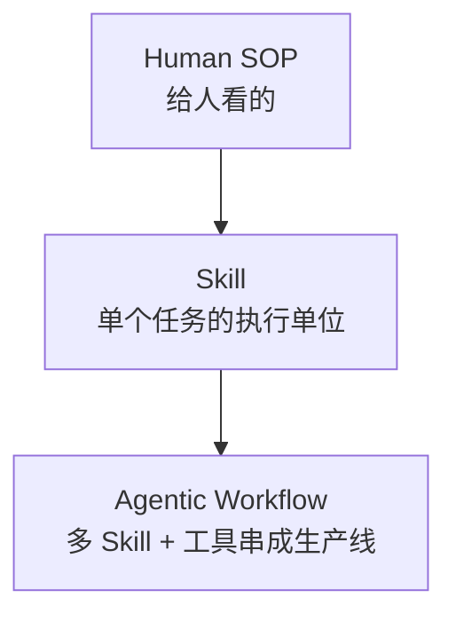
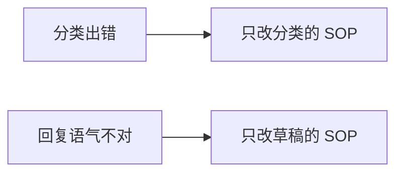
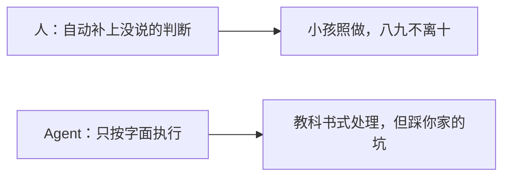
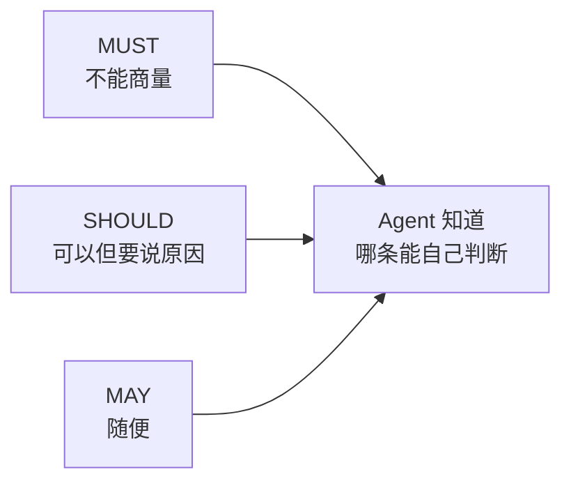
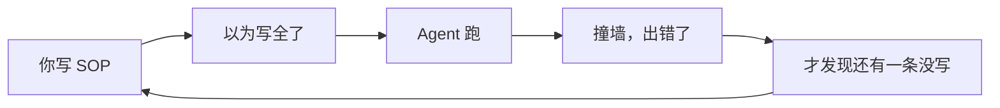
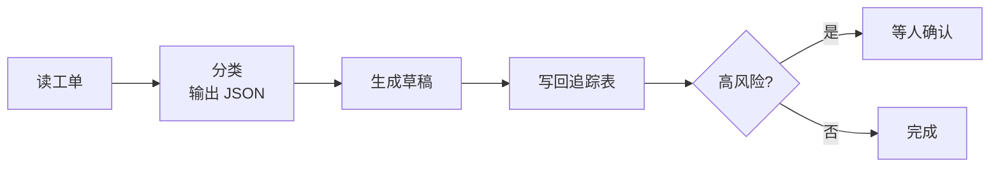

> 本文整理自一支 21 分钟的繁中教学视频。文稿由字幕整理而来，属整理稿而非逐字记录。
>
> 文中的概念引用、组织名称与行业动态沿用原片口述，**未做外部核验**。

## 开场那个判断

**作者说他收到很多来信，问能不能细讲 Agentic Workflow 里的关键观念。**

> 今天要聊的是 **task decomposition（任务拆解）**。
>
> **现在前沿模型的能力绝对已经够强，能胜任绝大多数任务。**但很多人还是觉得模型表现不佳、产出不靠谱。
>
> **根据我过往的咨询案例，大多数人只是不知道如何把一个大任务拆成 Agent 跑得动的小任务。**

**而他给的两类读者各留了一句话**：

| 你是谁 | 拆解能力对你意味着什么 |
|---|---|
| **技术人员** | 能帮你**构建一个更稳定的系统** |
| **非技术人员** | **更要知道怎么把自己的日常执行拆小，再委派给 AI** |

> 而不是**一大包丢进去，导致 Agent 消化不良。**

## 先把三个词分清 ⭐

**他说不先分清这三个，后面会听得一头雾水。**

| 层 | 是什么 | 一句话 |
|---|---|---|
| **Human SOP** | **传统流程文件** | **给人看的纸本流程** |
| **Skill** | **把方法论、判断标准、踩过的坑打包成文件夹** | **给 Agent 的执行单位** |
| **Agentic Workflow** | **多个 Agent、工具、Skill、数据源组成的工作流** | **一条生产线** |

上图是这三层的递进关系。**注意 Skill 对应的是「单一任务」，不是整条流程**——这个区分后面会反复用到。

### Human SOP 为什么对 Agent 不友好

**他先承认它对人是没问题的**：

> 这类文件给人看完全没问题，**因为你的脑中会自动补进一堆 context**，会自己判断哪一步可以偷懒、哪一步一定要做。

**他举的例子我觉得特别准**：

> 比如 SOP 里写「申请完之后送主管签核」。
>
> **你会判断：如果是两百块以内的小金额，主管宁愿你不要去烦他；但如果金额超过五千块，你就得照规矩来，或者至少口头知会一声。**

> 这些判断**可以被写进 SOP**，**但需要花时间去把例外状况列出来**。
>
> **更何况很少人真的热爱维护文件**——口头提醒一下新同事，永远比维护文件方便。

**而 Agent 拿到这份东西的处境是**：

> **对 Agent 来说这就是一坨非结构化的文字**，理解成本高，执行时容易忘东忘西。
>
> **只要你没有明确说明，AI 不会知道对你们团队来说两百块跟五千块有什么差别。**

**「不是写得不好，是它读不出你没写的那部分」——这是问题的本质。**

### Skill 里通常有什么

**他给了三件套**：

| 件 | 内容 |
|---|---|
| `SKILL.md` | **人类写给 Agent 的 SOP 加心法**，核心文件 |
| `references` | **额外参考**：范例输出、术语表、踩坑记录，需要时自取 |
| `scripts` | **可直接执行的脚本**，处理确定性操作（解析、格式转换） |

**而他点了一个设计难点**：

> 在设计中，**这个 Skill 的防守范围要拆多大是关键**。
>
> **防守范围太大，容易样样通但都做得差强人意；范围太小，就变成每走一步都要去读 Skill**——**等于把现在的模型当小孩，什么都要听人类的。**

**「防守范围」这个词用得很形象**。**它把 Skill 的粒度问题说成了一件可以商量的事，而不是一个技术参数。**

## 为什么「换个更强的模型」不管用 ⭐

**这一节我认为是整篇最有力的部分。**

**他先提出那个常见的期待**：

> 反正现在模型能力越来越强，或者有一天达到 AGI，我也不用说那么多了，**指哪打哪、使命必达**。
>
> **但答案大概率是不行。**

### 请人打扫的那个比喻

> 假设你要出远门，临走前请了一位帮手，**只交代他「把家里打扫干净」，然后什么都没多说就出门了。**
>
> **等你回家，大概率会出事。**

**为什么？**

> **因为你跟他对于「干净」这个词的定义可能完全不一样。**

| 你心里的干净 | 他心里的干净 |
|---|---|
| **地板不黏脚** | 东西有归位就好 |
| **桌面清爽没一堆纸** | 看得顺眼就算 |
| **厨房水槽没有碗** | 角落、柜子后面不用特别去动 |
| **垃圾都倒掉了** | — |

> 结果就是：**表面上好像有扫，但你在意的那些地方一个都没动到。**

**而他的结论是**：

> 所以问题**从来不是帮手够不够聪明、或者模型表现好不好**。
>
> **就算他什么都会、什么都懂，你没告诉他在想什么——只要没有读心术，他就永远满足不了你的需求。**

上图是这个错位。**注意它的关键：双方都没错，只是定义不同。**

### 磨合那一段

**他接着假设了「就算 AGI 来了」的情形**，而这段说得很细：

> 你还是得跟他磨合。**所谓磨合，就是他得透过日常相处，慢慢累积你的偏好。**
>
> **第一个月**他知道你是极简主义者，桌面只想要有必要的东西。
> **第二个月**他知道你很爱惜自己的不沾锅，所以刷的时候要用菜瓜布黄色的那一面。

> **这些事没有写在任何说明书上，但你就是很在意。**
>
> **而不知道这些事情的机器人，再聪明都会看起来像笨蛋。**

**「再聪明都会看起来像笨蛋」——这句把「上下文」和「智力」的关系说透了。**

### 于是有了 Mega Agent 的失败

**他描述了新手的默认做法**：

> 很多人第一次接触 Agent，直觉就是**找一个最强的模型，把任务整包丢给它，让它从头跑到尾**。
>
> **这就是所谓的 Mega Agent**——也就是前面说的那个帮手。

**而具体会怎样？**

> 你跟它说「帮我优化整个开发流程」，**它通常会做点东西出来**：
> **可能写一份洋洋洒洒的优化建议，可能改一堆配置，可能重构一个你根本不该动的模块。**

**但问题在于**：

> **你完全不知道哪一段推理是对的、哪一段工具调错了、哪一段是它幻想出来的、哪一段根本不该让它自动跑。**

> **整坨丢进去，整坨吐出来，中间发生什么你看不见。就算想 review 也找不到下手点。**

**而他点出了新手的两个错误反应**：

> 我看过太多新手卡在这个地方，**他们第一个反应永远是「再换一个更强的模型」，或者「再写一个更详细的提示词」。**
>
> **但其实问题不在模型，也不在提示词，而是任务本身太大、太模糊**——**所以每次执行都像是在买彩票。**

上图是这个循环。**注意它是个闭环——因为归因错了，所以解法也在错的方向上打转。**

### 拆开之后

> 反过来，如果你把任务拆成一串小 task，**每一个都有明确的 input、明确的 output、明确的成功标准**，那就完全不一样了。

**他给的例子是客服工单**：

| Agent | 只负责 |
|---|---|
| 一 | **分类** |
| 二 | **查数据库找相关历史记录** |
| 三 | **写回复草稿** |
| 四 | **专门做质检**，确认有没有事实错误或不妥表述 |

> **每个 Agent 或许都很笨，但每个都做一件很明确的事。**
>
> **出错了你回去看日志，发现是分类时把客诉判成了咨询需求——那你就改分类那一份 SOP 就好。**
>
> **不需要动查资料的，不需要动写回复的，不需要动质检的。哪里坏改哪里，对症下药。**

上图是这个可维护性。**拆解真正买到的不是「跑得更好」，是「错了知道改哪儿」。**

### 为什么企业不直接用 Mega Agent

**他的答案很短，但很硬**：

> **因为他们要上 production。**
>
> **他们需要的是稳定性、可观测性、可修复性。**
>
> **一个你看不到内部的黑箱，永远没办法 production-ready——因为你根本不敢让它上线。**

> **所以分而治之这个老观念，在 Agent 时代反而更重要。**
>
> **你不是在训练一个超人 Agent，而是在设计一条生产线。**
>
> **一条真的能上线的生产线，乍看之下非常无聊，但它可预测、有边界、出错可以修。**
>
> **而这些才是最关键的。**

## 四步方法论

**他先用「教小孩洗衣服」这个例子把问题摊开。**

**你大概会这样说**：

> 把衣服丢进去，加洗衣精，按开始。**等洗完之后把衣服拿去晒。就这样，没了。**

**「这是一份典型的 Human SOP。」**

**而小孩为什么能做得八九不离十？**

> 因为**你的脑中会自己补一些判断**：
> **白衬衫最好分开洗，不然会被牛仔裤染色；毛衣不能丢洗衣机，要手洗，否则会缩水；天气不好就不要晾了，直接用烘衣机。**

> **这些东西你可能都没讲**，但小孩会**根据过去跟你生活的经验，收敛出你的偏好**，所以能够避开这些坑。

**而 Agent 的原样执行会怎样？**

> 你把这段话原封不动丢给 Agent，**它会用教科书式的方法帮你处理好。**
>
> **但它可能不知道你们家从来不用烘衣机，或者所有衣服都要放洗衣袋避免松掉。**
>
> **结果实际跑完一轮后，衣服缩水或者出现荷叶边。**

> **这就是 Human SOP 直接丢给 Agent 的下场。**

上图是这个差别。**注意它不是「Agent 笨」，是「它没有那段生活经验」。**

### 第一步：格式标准化

**他说这一步很「简单」，就是把它改成 Agent 读得懂的版本，但重点是三个。**

#### 一、参数化

> **不要在 SOP 里写死「一定要用 normal 模式」。**因为这样它只能覆盖一种情境。
>
> **你要改成 mode、temperature 这种参数，让 SOP 变成一个模板**，调用时根据实际状况带不同的值进去。

**他给的具体取值很直观**：

| 参数 | 取值 |
|---|---|
| mode | **quick / normal / delicate** |
| temperature | **cold / warm / hot** |

> **这样一来，同一份 SOP 就可以覆盖各种洗衣服的场景。**

**而他说出了为什么这很关键**：

> **SOP 一旦写死，它就没办法重复使用。**
>
> 我看过太多人写 Skill，**写到最后变成一份只覆盖一种特殊情况的长文**。**那这份容错率就会非常低。**
>
> **当你分享给别人时，可能会少了环境参数或者其他设定而直接报错。**

**「只覆盖一种情况的长文」——这个描述我见过太多次了。**

#### 二、MUST / SHOULD / MAY ⭐

**这一条我认为是全篇最实用的**：

> 这是规范文档的经典写法，**本来是用在网络协议规格书上的**。
>
> **但我发现拿来写 Agent SOP 超好用，因为它强制你把每一条规则的强度想清楚。**

| 级别 | 含义 |
|---|---|
| **MUST** | **硬性规定，必须做，绝对不能跳过** |
| **SHOULD** | **建议做法**，有强烈理由可以不做，**但要明确说明原因** |
| **MAY** | **可选项**，做不做都可以 |

**他给了洗衣服场景的实例，而这个例子把「强度」的差别显出来了**：

| 级别 | 例子 |
|---|---|
| **MUST** | **先检查每件衣服的洗标**；**把白色跟深色分开**；启动机器后等待完成 |
| **SHOULD** | **根据材质选择洗衣模式**；根据天气决定要不要烘干 |
| **MAY** | 湿度大的时候用烘衣机——**否则 MUST 改用晾干** |

**最后那一条我觉得特别妙**：它同时用到了 MAY 和 MUST，**而组合起来表达的是一个条件规则**。

> **每一条规则的强度都很明确，Agent 看到就知道哪些不能讨价还价、哪些可以根据上下文自己判断。**

上图是这条写法的价值。**它把「规则的软硬」这个模糊的东西变成了三个明确档位。**

#### 三、结构化格式

> 用 Markdown 把区块切清楚：**Parameters、Steps、Error Handling 各自分开。**
>
> **既让人看得懂，也方便之后塞进标准接口里当 Agent 的行为规格。**

> 这样处理完之后，**这份材料就不再是一篇给人看的散文，而是一份 Agent 真的读得懂的 SOP。**

### 第二步：任务拆解与连接 ⭐

**他说这一步才是核心。**

> 简单讲就是**把它拆成 pipeline steps**，每一个 step 都是个独立节点。

**洗衣服拆开就是四节**：

| 节 | 输出 |
|---|---|
| 一 | 分类衣物 |
| 二 | 检查口袋与污渍 |
| 三 | 设定机器 |
| 四 | 决定晾还是烘 |

**而「独立」这两个字他特意强调**：

> 每一个步骤都是独立节点，**有自己的 input、自己的 output，可以独立执行、独立 debug，甚至独立替换成新的逻辑。**

**为什么放在心上是值得的？**

> 举个例子：如果「分类衣物」这一步有 bug，**把白色 polo 衫误判成深色——你只要修这一段就好。**
>
> **后面的设定机器、决定晾或烘的流程完全不用动。**
>
> **但如果你写的是 Mega Agent，全部塞在一个提示词里，一旦出错就只能整个重写**——**因为你根本不知道是哪一段逻辑出了问题。**

#### 谁来串：artifact

**这一段把「Agent 之间怎么沟通」讲得很实在**：

> 那这些 Agent 之间靠什么串接？**答案是 artifact**——也就是**上一个 Agent 的 output，变成下一个 Agent 的 input**。

**具体例子**：

> 分类 Agent 的输出是一份 JSON，告诉你有 whites 里哪几件、darks 里哪几件、delicates 里哪几件、unknowns 里哪几件。
>
> **这份 JSON 就直接变成「设定机器」那个 Agent 的 input。**

**而他的强调很有意思**：

> 一个节点连接另一个节点，**靠的不是魔法，不是大型语言模型之间的心电感应**，
> **而是清楚定义的 input、output 和中间的 artifact 格式。**

**「不是心电感应」这个说法我觉得是点睛**。**因为很多人对多 Agent 的想象就是「它们会自己沟通」，而实际上要沟通的是数据结构。**

### 第三步：双向开发 ⭐

**他说这一步很多人会忽略，但其实是四步里最重要的。**

**先给了一个斩钉截铁的预判**：

> **你的第一版 SOP 大概率会有问题。**
>
> 无论你是多资深的工程师、多会设计流程的产品经理，**第一版拿出来跑，通常都会出包。**
>
> **为什么我可以这么笃定？**

#### 那个词：默会知识

> 有个名词叫 **tacit knowledge（默会知识 / 内隐知识）**。
>
> **它指那些难以用文字、言语或图表明确定达、存在于个人大脑与身体记忆中的知识。**

**而他把这件事和 SOP 的关系说得很清楚**：

> SOP 的本质，**是把脑中的默会知识转成文字明示规则。**
>
> **而默会知识的特点就是：你自己不会发现它的存在，直到它出错。**

> **你以为你写完了，但其实脑子里还有十几条没写进去的判断标准。**
>
> **要等 Agent 真的跑出去、撞墙了、出错了，你才会发现——啊，原来这条我没写。**

上图是这个发现机制。**注意出口是回到起点——所以它必须是循环，而不是一次性的。**

#### 那个缩水的例子

> 你先用自然语言跟 Agent 说「我平常洗衣服大概是这样这样这样，请你帮我写一份 SOP」，它就帮你写好第一版。
>
> 接着你照这份 SOP 实际跑一次，**发现它把所有 T 恤都丢进超高温烘干机，结果缩水到直接穿不下。**
>
> **这时候你就意识到 SOP 哪里写得不清楚**——于是补上一条：**不可以把含棉量超过八成一的衣物用高温烘干。**
>
> **然后下一轮它就不会再犯这个错了。**

> 不过当你再跑一次，**可能又发现另一个问题**——比如它没有把衣服装进洗衣袋。**好，那你就再补一条。**
>
> **这个过程不断重复。每一轮 Agent 都会踩到一个你之前没想过的坑，于是你就把那个坑补起来。**

**而终局他给了个现实的估计**：

> 几轮下来之后，**SOP 会稳定到能满足大多数使用情境，而剩下的那一小部分是真正的边界情况**——**那就用人类介入的方式处理。**

#### 那个「完美 SOP」的失败案例 ⭐

**这一段我觉得是全篇最有说服力的一处，因为它是反直觉的。**

> 不是**你关在房间里想象一份完美的 SOP，然后丢给 Agent 跑**，
> **而是你跟 Agent 一起跑、一起 debug、一起迭代，根据真实的执行结果持续修复、迭代 SOP。**

> 之前有一位客户**花了两个月，写了一份所谓的完美 Agent SOP，结果跑一次就垮了**——
> **因为他们覆盖的全是想像中的情境，现实中根本不会发生。**

> 后来我跟他们一起，**秉持敏捷精神改成小步快跑**：
> **两天写一个粗糙版本，然后一个礼拜内跑五十次迭代，两周内就上线。**

> **速度的关键不是写得多完美，而是迭代得有多快。**

**「两个月」对「两天加五十次迭代」**——这个对比很刺眼，但它说清了：**想象的成本远高于试错的成本。**

### 第四步：整合与执行环境

> 这一步是决定你的 Agent **到底是 demo、还是真的能在 production 跑**的关键。
>
> **再漂亮的 SOP，如果没接到真实世界的工具，它就只是一份文件，不会自己动起来。**

**而工具具体是什么**：

> 在洗衣服例子里，**工具就是洗衣机、烘干机、天气接口**。
> **Agent 要能真的去查今天会不会下雨，要能真的启动洗衣机。**
>
> **光是脑袋里知道应该这样做是没用的，要真的做出来才行。**

#### 为什么需要 MCP

**他先说了困难**：

> 对 Agentic Workflow 来说，**工具就是你的公司内部系统、数据库、接口、文件系统、版本控制、工单系统**。
>
> **问题是这些每一家公司长得都不一样。你今天为 A 公司写的 Agent，搬到 B 公司可能完全动不了。**

**而 MCP 想解决的就是这件事**：

> 它是个开放协定，**目的是让模型和 Agent 可以透过同一套标准去调用外部的工具、资源和提示词。**

**他给了一个我认为很好的比喻**：

> **MCP 就像 AI 世界的 USB-C。**
>
> 以前你买新的笔电、手机、鼠标，**每个东西插头都不一样**，每出一台新设备就要再买一堆转接线。
> **统一之后，一条线可以接所有东西。**

**而它的收益他讲得具体**：

> 不管你用哪个 Agent 宿主，**只要它支持 MCP，就可以用同样的方式调用工具。**
>
> **今天你写好一个 MCP 服务器，明天不同工具都能用——不需要为了不同宿主各写一套整合。**

#### 人类检查点 ⭐

**最后一步他还要求加一件事**：

> 什么叫 human-in-the-loop？简单讲就是**在某些决策点，Agent 必须停下来请人类确认**：
>
> **高风险决策之前要停；大规模变更之前要等人按确认才继续。**

**为什么必须这样？他说得很坦诚**：

> 因为任何 Agentic Workflow，**不管多成熟，总会有些边界情况是 Agent 没办法判断的。**
>
> **这时候你要嘛让 Agent 乱猜，风险很高；要嘛让它停下来问人类，风险可控。**

> **这样整条工作流才不是一个黑箱、不是一台失控的机器**——
> **而是一个人类掌舵、Agent 执行的系统。**
>
> **你还是最后拍板的人，但所有重复、机械、确定性的事都不用自己做了。**

**「人类掌舵、Agent 执行」——这八个字我觉得是对分工最简洁的概括。**

## 一个真实场景：内部请求分类

**他把四步套到了一个两百人公司的场景上。**

**先描述那些杂事**：

> 每天都会有人通过表单、即时通讯、邮件或者私信丢进来：
> **「我要申请新系统的权限」「这张发票可不可以报帐」「我下周要入职一个新同事，他需要哪些工具的访问权」**

**而人做这件事的流程是**：

> 打开工单系统，扫一眼描述，**判断这是 IT 问题、权限申请、人事需求、财务报帐还是其他**；
> 补上优先级和截止日期；根据规则分派给对的组或人；**如果写得很模糊，就回信问清楚**（「你说电脑很慢，是开机慢还是某个系统很卡？」）。

> **这个流程不复杂，但很烦、很重复，而且每天都要做——最适合给 Agent 处理。**

### 四步的落地

| 步 | 做什么 |
|---|---|
| **一 · 标准化** | 写成 SOP：**参数**（来源、原文、员工编号）+ **步骤**（验证在职、分类、判优先级、产出结构化结果）+ **是否需澄清**字段 |
| **二 · 拆解** | 拆成两个 Skill：**分类器**（输出 JSON）与**回信草稿**（输入那个 JSON） |
| **三 · 双向开发** | 跑一轮发现问题：某类总被分成「其他」、优先级永远判中、分派给已离职的人 → **回头补规则** |
| **四 · 整合** | 加脚本把结果写回追踪表；**高风险请求前加人类检查点** |

**第一步里那两个 MUST 值得单看**：

> Agent **MUST** 先根据员工编号验证这个人是不是在职员工。
> Agent **MUST** 根据内容把请求分类成 IT / HR / 财务三类。
> Agent **SHOULD** 根据服务等级规则和关键词判断优先级。
> Agent **MUST** 产出一份结构化输出，**包含类别、优先级等字段**。
> **如果「是否需要澄清」是 true，Agent 必须再产出两到三个要问使用者的问题。**

**最后那条我觉得是最有工程感的一条**——**它把「该不该问人」也变成了一个字段。**

### 拆出来的两个 Skill

| Skill | 输入 | 输出 |
|---|---|---|
| **分类** | 工单文字 | **JSON**：类别、优先级、推荐负责人、是否需要澄清 |
| **回信草稿** | **上一个 Skill 的 JSON** | 给同事看的回复草稿 |

**而独立性的收益他又说了一遍**：

> 两个 Skill 各做各的事，**靠 JSON 串起来**。
> **分类失败，不影响草稿的逻辑；草稿改格式，不需要动分类的逻辑。**

### 第四步的具体动作

> 我们加一个小脚本，**把分类结果写回公司内部的追踪表**——可能是 Notion、Jira，也可能就是一张表。
>
> **然后在高风险请求之前加一个人工检查点**：
> **比如涉及财务超过某个金额、或者涉及管理员权限变更的请求，Agent MUST 停下来等人确认。**

**整条串起来是**：

> **读工单 → 自动分类 → 生成回复草稿 → 写回追踪系统 → 必要时请人确认。**

上图是这条流水线。**注意那个判断节点——它是「可控」的来源。**

## 收尾：从哪开始

**他给了一个很具体的起点建议，我觉得比方法论更实用**：

> **你不用一次把公司所有流程都变成 Agentic Workflow，那会把自己搞死。**
>
> **只需要做一件小事：找一份最无聊、但又一直在重复做的 SOP**——
> 可能是每周的周报、每次发布前的检查清单、或者每次新人入职的固定流程。
>
> **挑你最不想做的那个，然后照着四步走一遍。**

**而期望值他压得很低**：

> **不用一开始就做到完美，也不用一开始就完全自动化。**
> **先有一个跑得起来、能替你省三成时间的版本，再慢慢迭代。**

**最后那句我觉得是整篇的落点**：

> **你不是在学怎么用 AI，而是在学怎么设计给 AI 用的工作流。**
>
> **前者半年就会过时，后者越来越值钱。**

## 我的三点补充

以下是评注，不是原片内容；取舍由我负责。

**第一，那三个词的分层之所以必要，是因为它们的「可复用单位」不同。** Human SOP 的单位是**文件**（给人翻阅），Skill 的单位是**任务**（一次调用），Workflow 的单位是**流程**（端到端跑完）。**混用这三个词会导致一个具体错误：把整条流程写进一个 Skill 里**。而那就是 Mega Agent 的另一种形态。所以先分清层级，其实是在防这个。

**第二，「默会知识」这个概念，解释了为什么第一版难免有缺陷，而不是「你可能写得不仔细」。** 因为它的定义就是**「你自己不会发现它的存在，直到它出错」**。所以「双向开发」不是一种勤快的做法，**它是目前唯一可行的做法**：你没法靠更努力地思考，去发现那些你根本不知道自己知道的东西。

**第三，那位客户两个月写「完美 SOP」的失败，其实是两种成本结构的对比。** 关在房间里想象，**成本是时间，但风险是「覆盖的全是想象中的情境」**；跑五十次迭代，**成本是执行，但收益是「每个坑都是真的」**。而 SOP 这东西的价值恰恰在边界情况上——**所以只有真实执行才能把它写对，想象只会把它写长。**

---

一句话总结：**你没法把「我知道但说不出来」的东西一次写清楚，只能让它先摔一跤。** 而拆解的意义，**是摔的时候只摔一小段，而且你知道该修哪一段。**
