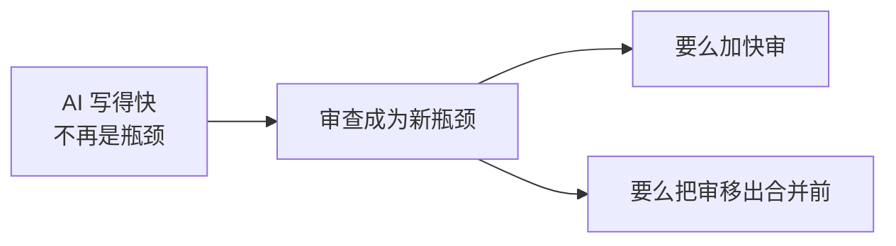
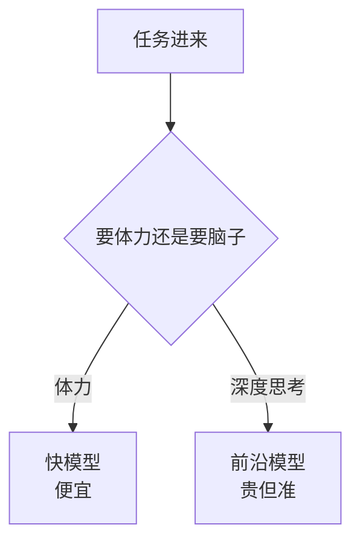
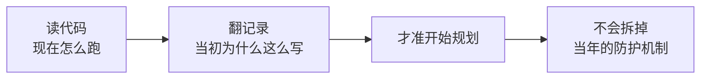
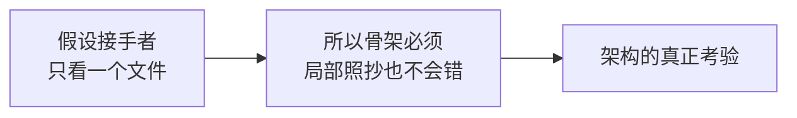
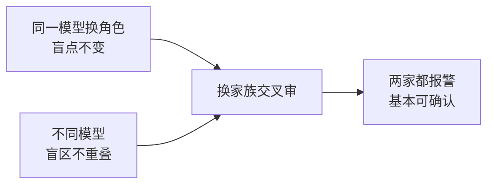
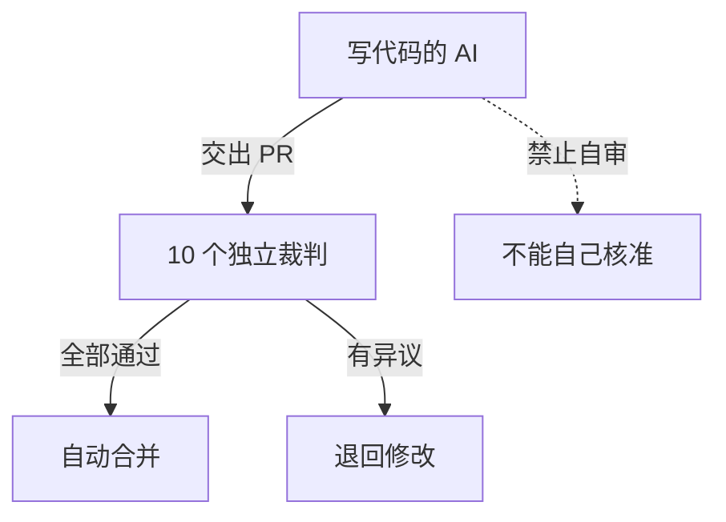
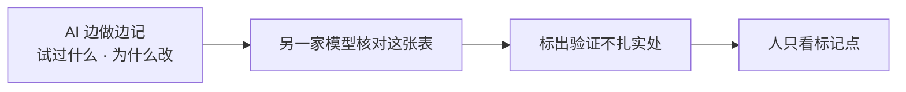
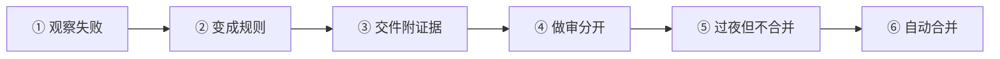
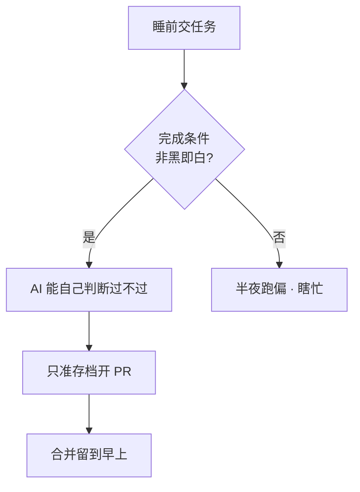

> 本文整理自一支 26 分钟的繁中解说视频，拆解一位工程师开源的自动化开发工作流。文稿由字幕整理而来，属整理稿而非逐字记录。
>
> 文中的人名、数字与工具名沿用原片口述，未做外部核验。

## 开场那组数字

作者一上来就给了三个递进的数量级，我觉得这个对比很有效。

> 「如果你不是技术背景，**可以把一张 PR 想像成你完成工作的一份结案报告**。」
>
> 过去一般人一天能搞定两三个小案子，效率就很惊人了。**现在配合 AI，一天搞个十几二十个也算是非常厉害。**

**而这位工程师呢？**

> **一天平均可以处理八十几个案子。**
>
> 甚至有天早上她醒来打开电脑，**发现有 20 个 PR 是 AI 趁她睡觉时自己做完、检查完，然后提交出去的。**

**作者的疑问也是读者的疑问**：

> 我们自己平常在用 AI，**通常还是得一直盯着它、帮它审核产出**——**怎么敢让它不经过你就直接提交出去？**

**而答案藏在她的背景里**：

> 她待过几家顶尖科技公司，**现在在一个 AI 团队负责产品**。
>
> **她本身就是一位标准很高的资深工程师。**所以那 2500 张 PR **不是随便让 AI 乱生出来的垃圾**，**而是真的能进到大厂产品里的代码。**

## 一个必须回答的算术问题

**作者提了一个我觉得很关键的反问**：

> 就算她再厉害，**一天八十几张 PR**——不要说亲手写，**就算叫她一张一张用肉眼检查，时间也绝对不够用。**

**所以：她到底是怎么做到的？**

上图是这个问题拆开后的两条路。**而整套工作流就是这两条路的分头实现。**

## 先说工具结构

**她开源的工作流里有将近六十个 skill。**

**作者澄清了一个门槛**：

> 这六十个里面有 **24 个是写给 AI 遵守的底层工程原则**——**给 AI 阅读的，不用你自己操作**。
>
> 剩下的三十几个工具型 skill，虽然随时可以单独调用，**但平常工作你只需要记一个总管指令**。

**那个总管指令内置了二十几本不同任务的作业手册**，会根据当前场景自动叫出合适的 skill。

### 一个前置设计：模型分派

**装好第一步要先跑初始化 skill，而它的作用很特别**：

> 它会先侦测当前可用的模型，**然后给工作流里的每一个角色分配适合的模型。**

**而理由是她的核心观念**：

> **不同模型有各自的强项跟成本，不应该从头到尾只用同一个模型。**

**具体怎么分？**

| 活的性质 | 派给谁 |
|---|---|
| **耗体力的**（写代码、跑测试、分头找资料） | **便宜又快的模型** |
| **需深度思考的**（架构设计、写文案、当裁判） | **前沿模型** |

上图是这个分派。**注意「当裁判」被归到了贵的这一档。**

## 三阶段：规划、实作、验收

> 要冲出一个月 2500 张 PR，**前面的规划跟实作追求的是让 AI 一次做对、减少返工**。
>
> 而**后面的验收**，解决的是 AI 编程里很重要的「验证」——**怎么让 AI 检查并验证自己的产出，让人不用自己来。**

### 规划阶段：先搞懂，再动手 ⭐

**作者先讲了常规做法的局限**：

> 通常我们会开规划模式，让 AI 先写一份计划书；**或是先画个原型**。
>
> **但一般的规划模式不会去挖那么深的背景资讯**——**它通常只是把附近的几个文件看一看，就凑出一份计划开始做。**

**而她的升级，是在规划之前做两件事。**

#### 一、先搞清系统怎么跑

> 如果 AI 只看眼前这一个文件就开始规划，**很容易跟原本的架构冲突，或是自己重复造轮子**。
>
> **所以要先强迫 AI 把相关的模组读透、建立全局观，才准开始想怎么改。**

#### 二、再搞清当初为什么这么写 ⭐

**这一段我觉得解释得特别好。**

> 代码本身**只会显示结果，不会显示历史**。
>
> **很多时候系统里有一段看起来绕、奇怪的写法，其实是前人踩过某个大坑、为了防呆才加上去的保护机制。**
>
> **如果 AI 在规划时不知道这段历史，就会自作聪明把它改掉——结果让旧的 bug 重新爆炸。**

**所以第二个 skill 会在动手前自动去翻手边的记录**：

> 比如说 **Git 的修改纪录、工单系统、文档，甚至聊天纪录**，把当初为什么这样设计的前因后果全部挖出来。
>
> **确保之后的改动不会让以前想防范的问题复发。**

上图是这两步的关系。**很多人只做了第一步，所以改得又快又错。**

### 一个小工具：打磨需求

**作者说这是他个人最喜欢的**，因为它解决了一个很常见的失效。

> 我们平常叫 AI 做事，下的指令常常很不精炼——**比如只打一句「帮我让这个网页跑快一点」。**
>
> **这样产出来的结果通常都不太好。**

**那为什么不叫 AI 帮你优化这个指令？**

> 因为一般的 AI 最常犯的毛病是**帮你乱加戏**，**塞一堆你当初没要求的周边功能，把任务范围越搞越大。**

**所以这个工具的设计目标很明确**：

> **它不发散你的需求，而是专注把你原本要做的事往深处做透。**

**它从四个角度重构你的指令。**

| 角度 | 问什么 |
|---|---|
| 一 | 这个领域的顶尖老手接到这任务，**有哪些关键步骤是他通常必做、但你刚刚没提到的**？ |
| 二 | 做判断时必须**从第一性原理出发**，直接看最底层的原始码或一手源头，**而不是看被消化过的二手文件** |
| 三 | 这个领域的专业人士**会用什么具体工具与方法**来完成这件事？ |
| 四 | 要用什么**客观方式证明这件事真的做对了**？ |

**最后产出的东西变了**：

> 它会把原本简单的一句话，**重写成一份含有明确验收条件、而且足够有专业深度的指令**，交还给你确认。
>
> **你看过觉得没问题了，再送出去。**

**「先让 AI 把需求写清楚，再让它执行」。**这个顺序调换的收益，可能比换更强的模型还大。

### 实作阶段：先骨架，再砌砖

> 动工前有一个「建筑师」skill，**核心精神就跟盖房子一样：先画好格局图，才准动工砌砖头。**
>
> **它规定 AI 先不准写里面的细节**，要先从**使用者未来会怎么用这个功能**倒推，先把整个系统的外框跟分工定下来。

**而它的设计标准很有意思，我原样保留**：

> **它预设「下一个来接手的 AI 只会看眼前打开的那一个文件、照抄最近的例子、走最省力的捷径」。**
>
> **所以好的架构必须做到：就算下一个 AI 只看局部、无脑照抄，改出来的结果对整个系统也还是对的。**

上图是这个判据。**它把「代码可维护性」换成了一个可执行的检验：换个笨的接手者，会不会搞砸。**

**而画骨架的时候还有一个「比稿」机制**：

> 它会在背后自动把同一个题目**同时丢给不同家的模型各自设计**，再交叉比对，**把各家的亮点融合在一起**。
>
> **等确认这张集结各家优点的骨架没问题了，才让负责写代码的 AI 顺着这个外框真正实作。**

### 强制测试先行 ⭐

**这一条的理由讲得很硬**：

> 如果让 AI 先写代码再补测试，**万一代码写错了，它为了交差会直接生出一个配合错误逻辑的假测试，来骗你说检查通过。**

> **所以这个 skill 就是用来防作弊的**：在写任何一行代码之前，**AI 必须先把检查对错的测试定死。**
>
> **因为这时候功能还没写，测试一跑绝对会失败、亮红灯。**

> **等到红灯出现了，才准 AI 动手写程序——直到红灯变成过关的绿灯为止。**

**「先让测试失败」这个顺序，本身就是一种防作弊机制。** 因为它证明了这个测试真的有能力发现错误。

## 验收阶段：整套系统最关键的地方

**作者在这里把话说得很明确**：

> 现在用 AI 写代码已经非常快了，**真正的瓶颈其实卡在检查**。**也就是你敢不敢让 AI 写的代码直接上线。**

**而跨过这个瓶颈只有两个方向**（就是开头那两条路）。

### 方向一：把审一张 PR 的速度拉到最快

**他先拆了「为什么审 AI 的 PR 会花时间」**，我觉得这个三分法很准。

| 担心 | 问题 |
|---|---|
| 一 | 你说改好了，**新功能真的会动吗**？ |
| 二 | 你改了这里，**影响范围有多大**、会不会把别的地方弄坏？ |
| 三 | 里面的**代码质量好不好**、有没有低级漏洞？ |

**而她的做法是：用三个 skill 逼 AI 在交件之前，自己把这三件事证明完。**

#### 第一关：证明新功能真的会动 ⭐

**他先问了一个根本问题**：

> 为什么以前 AI 改完程序，非得要人类自己打开 App 点点看？
>
> **因为 AI 只看得懂代码，它根本不知道这个 App 要怎么启动、某个功能的按钮在画面哪里、点完之后看到什么画面才算成功。**

**而这个 skill 的本质是**：

> **让 AI 先去把整个专案读透，自动写出一份「怎么像真人一样操作并检查这个 App」的标准作业流程。**

> 只要建立好这份 SOP，**以后 AI 每次改完代码就能自己打开 App，照着真实使用者的路径点一遍**，
> **并把操作过程录成视频或截图，直接当作「它已经完成、而且你的 App 没被改爆」的证据。**

**注意这一招的巧妙之处**：它把「人类验证」这次性的成本，**转化成了一份可以反复使用的资产**。

#### 第二关：算出爆炸半径

> 当你一天要审几十张 PR，**你不可能每一张都花一样的时间细看。**
>
> **所以这个 skill 的目的就是先帮你标出这张 PR 的风险高低。**

| 爆炸半径 | 怎么办 |
|---|---|
| **小**（只改到独立的小角落） | **扫一眼就结束** |
| **大**（动到多个功能共用的底层逻辑） | **必须特别小心，值得多花时间** |

**「按风险分配注意力」——这是把审查做成流水线的前提。**

#### 第三关：不同家族的模型交叉审问 ⭐

**他先点破了「角色扮演式审查」的无效**：

> 很多人让 AI 帮忙审代码，**喜欢叫同一个 AI「现在请你扮演资深专家来挑毛病」。**
>
> **但同一个模型不管换几个角色，它的盲点还是一模一样——漏掉的地方永远会漏掉。**

**所以做法是**：

> 把改好的代码**同时丢给不同家族的模型去审**。
>
> **这样一来，A 没看出的死角，B 能帮你抓出来。**
>
> **而且如果某个地方连两家不同模型都异口同声警告有问题，那就代表这绝对不是误判。**

上图是这个差别。**而他也诚实提了代价**：

> **这样会消耗掉你比较多的 token**，预算比较紧的朋友可能要慎重考虑。

### 那 PR 送到面前时是什么样

> 里面的代码**已经被不同模型交叉洗过一轮**，而且 PR 里面**直接摆好了修改前后的操作视频跟爆炸半径的实测数据**。
>
> **她根本不用自己把代码拉下来跑**——只要打开 PR 页面看一眼叙述、截图或操作视频，**几十秒钟就能确认这张 PR 有没有做对。**

**「几十秒」这个数字背后是：所有验证成本都被前移到了 AI 那一侧。**

### 方向二：把「合并前按确认」整个拿掉

**这是更激进的一步，而它的关键是那条铁律**：

> **写这张 PR 的 AI，永远没有权力核准自己的 PR。**道理就是**球员不可以兼裁判**。

**具体怎么执行？**

> 每张 PR 准备要合并时，系统会**另外派出十个左右、从头到尾没参与写这段代码的独立验收 AI**。
>
> **同时在云端把 App 打开，各自像这个 App 的使用者一样到处点击测试**，找有没有东西被弄坏。
>
> **只有当这群独立裁判全部盖章通过，系统才会自动把这张 PR 合并进主线。**

上图是这个隔离。**注意「没参与写这段代码」这个限定**。它保证裁判没有「我知道我为什么这么写」的先入之见。

## 这一条最有价值：隔天早上做什么 ⭐

**作者提了一个很好的问题**：

> 如果连合并都全自动了，**那她隔天早上醒来的工作是什么？**

**答案是**：

> **她还是在把关 AI 的产出，并观察 AI 的工作流程哪里有问题，好去修正系统环境。**
>
> **只是到了这个阶段，她不再一张一张全看，而是改成抽样检查。**

### 那怎么知道该抽查哪几张

**这里有一个我觉得是全片最聪明的设计。**

> AI 半夜解问题**不会每次都一次写对**——**可能先试了 A 写法失败，才退掉改用 B 写法**。
>
> **如果只看最后合并的代码，你根本不知道它中间踩过什么坑。**

**所以有个 skill 规定**：

> AI 必须**边做边填一张决策记录表**——把昨晚试过哪个做法失败、最后为什么这样改、以及怎么验证的，全部一行一行记下来。

**而且交给她之前，还有一道**：

> 系统会先**派另一家不同模型的 AI 去核对这张表**，**直接把昨晚验证不够扎实、或改法有风险的地方标记出来**。

> 这样她早上醒来**只要看表格上被标记出来的重点**，就能马上挑出有风险的 PR 来抽样检查。

上图是这个链路。**它把「信任」变成了可审计的产物**——不是相信 AI 没问题，而是**看它有没有留下能被检查的过程**。

## 环境改造：让错误物理上不可能

**这一节我认为是整篇的思想核心。**

**他先描述了多数人的反应**：

> 大部分人遇到 AI 犯错，直觉反应是**在提示词或规则文件里加一条「叫它下次注意」**。
>
> **但她认为这种做法没什么用——因为写在那里的文字属于软规则，AI 就算读了，聊几句之后还是会忘记。**

**而她每次看到 AI 犯错，问自己的问题永远是**：

> **要怎么改系统环境，才能让这个错从物理上就不可能发生？**

**具体怎么做？**

| 手法 | 例子 |
|---|---|
| **统一写法** | AI 天生最爱照抄现有代码 → **确保专案里每件事只有一种标准写法，能抄的全是正确范本** |
| **写成 Lint 规则接上 CI** | 前端那种容易让画面卡死的写法，**直接新增规则禁用**；AI 敢写就亮红灯挡住 |
| **规则文件** | **最后万不得已的手段**——「因为这种软规则就算 AI 没照做，你也不会知道」 |

**而这条路的额外收益，他说得很清楚**：

> **因为整个环境已经被她改造到「想写错都很难」**，现在团队里**连不懂深度开发的产品经理跟设计师，都能自己叫 AI 改功能、送出 PR**，而且她打开看一眼通常就能直接核准。

**「想写错都很难」——这句话把工程能力的价值讲到了组织层面。**

## 产能的真正来源：两套外围机制

**作者提醒：光靠把单一任务做好，还不足以解释 2500 张 PR。**

> 她既不可能自己同时盯八十个对话框，**也不可能每天自己想出八十个任务**。

### 一、平行派工

> 就像**一个经营十几间分店的老闆**，电脑里同时开着十几个专案。
>
> 每个专案里都有一个**不写代码的总管 AI**——**只负责看全局、把大任务拆小，再派给底下的工人 AI 去写**，最后交给验收团自动审核跟合并。

### 二、自动进单 ⭐

**这一套我觉得对做产品的人最有启发。**

> 让工作自己找上门。**对外的做法是派一个机器人 24 小时盯着社群、社交平台和邮件上的使用者回馈。**

**但问题在于**：

> 一般使用者回馈问题通常都很模糊，**可能只丢一张截图加一句「画面卡住了」**。
>
> **这种讯息是没办法直接交给写代码的 AI 去做的。**

**所以中间那个角色是「翻译器」**：

| 步 | 做什么 |
|---|---|
| 一 | 翻代码与工单纪录，**确认是哪个模组的问题、是不是已经有人报过** |
| 二 | **在云端打开 App 照着实操一次**，确认这 bug 真的能重现、且最新主线上还没修掉 |
| 三 | 把**问题在哪段代码、怎么重现、坏掉的截图证据**打包成一张清楚的工单 |
| 四 | **直接发给负责那个专案的总管 AI** 去派工修复 |

**「把模糊的抱怨转成 AI 能执行的工单」。**这一步其实是整条自动化链上最容易断的地方，而她用机器把它补上了。

**对内的做法则更聪明**：

> 派专门巡逻的 AI 每天扫描坏写法，**但规定它不准看到就自己乱修，而是先记进一份清单。**
>
> 过几天她看一次清单，**常常会发现上面记的十个问题背后其实是同一个根本原因**。**这时候再交给总管 AI 一次派工处理掉，比派十个 AI 各自瞎忙有效率得多。**

## 六步进阶路径 ⭐

**这是全篇对普通读者最实用的部分。**她说每一步都有过标准，确认做到了再往下一步。

| 步 | 做什么 | 过关标准 |
|---|---|---|
| **一** | **先用一个 AI，观察它怎么失败** | 能清楚讲出它**最常犯的三种错误** |
| **二** | **把纠正变成规则** | **同一种错误不再出现第二次** |
| **三** | **交件必须附证据** | **不用亲自打开文件，光看证据就能判断对错** |
| **四** | **同时开两三个 AI，把做与审分开** | 同时开三个都还照顾得过来，**且交回来的东西大部分不用重做** |
| **五** | **睡前交代任务，但停在合并之前** | 完成条件必须是**非黑即白、AI 自己能判断**的 |
| **六** | **才开启自动合并** | **连续几个早上醒来的 PR 都不需要收拾，看一眼就能直接合并** |

上图是这六级。**注意分级逻辑：每一级都在减少人类介入的频率，而前提是上一级的验证已经可靠。**

### 几个我很喜欢的细节

**关于第一步，她说得很保守**：

> 一开始**先不要急着装任何大礼包**，包括这套工作流也先不用装。
>
> 你先用一个 AI 处理日常工作，**仔细观察它最常在哪里出包。每次你开口纠正它，就把那句话记下来。**

**关于第二步，有一条硬规则**：

> **如果这条规则能用系统检查或钩子自动拦截，就绝对不要只写在文件里。**

**关于第五步，他给了「可判断」的反例**：

> **「把画面改好看一点」这叫无法判断**；
> **「在手机屏幕上不用左右滑、每个按钮都点得到」这就判断得了。**

**关于止损**：

> 也要设定好止损点，**规定它如果卡住太久就停下来、写出原因。**

上图是第五步的关键约束。**「不准自己合并」这个限制，把不可逆动作留在了人醒着的时候。**

### 他最后那句话

> 前面四步是最花时间、但也最值得投资的基本功。
>
> **如果按部就班走完，你得到的不是某套别人的工作流，而是属于你自己的工作流——而这个东西才是最香、也最有成就感的。**

## 附：与另一套方案的选择

**作者还做了个对比，我觉得判断标准给得挺清楚。**

| | 对齐型方案 | 自动化型方案 |
|---|---|---|
| **重心** | **动工前的人机对齐** + 合并前的人类把关 | **把人类介入压到最低** |
| **手段** | 让 AI 不断向你提问，把模糊想法问清、写成规格书 | 多模型比稿 + 交叉审问 + 实机验收 |
| **人类位置** | **守在一头一尾** | **只在事后抽查** |
| **成本** | **token 用量相对低** | **不惜狂烧 token** |
| **适合** | **从 0 到 1 的新功能**，想法还很模糊 | **已有庞大历史代码**，需要大量修 bug、重构 |

> 如果你正在做从 0 到 1 的新功能，脑中想法还很模糊——**这时候你到底要什么，只有你自己知道，AI 跑再多测试也猜不到**。
>
> **那可能更适合先让 AI 来拷问你，帮规格定下来。**

**而他给新手的建议是先从前者起步**：

> 因为后者那种「敢让 AI 自动合并」的做法，**前提是你已经建好了一整套自动验证跟防呆环境，又有足够的 token 预算。**

**还有一句，我觉得是全篇的道德提醒**：

> **千万不要在信任地基还没打好时，就学别人一次开十几个 AI 平行跑。**
>
> **那样做只会让你以极快的速度产出垃圾，还会白白烧掉一堆 token。**

## 我的三点补充

以下是评注，不是原片内容；取舍由我负责。

**第一，整套体系真正的产出不是 PR，是「可验证性」。** 注意那三个验收 skill 的共同点：**它们都在把「我觉得没问题」换成「这里有证据」**——操作录像、爆炸半径数据、两个家族的模型都报警。**而这一步一旦做成，人类就能抽身**，因为判断从「读代码」变成了「看证据」。**换句话说，自动化省下的不是劳动，是先决条件。**

**第二，「让错误物理上不可能」这个提法，和前面几讲那条「把约束从叮嘱挪到机制」完全同源。** 她明确说了软规则没用——**AI 聊几句就忘了，而且你也不知道它没照做。** 而 Lint 规则、统一写法、CI 闸门这些，**都是「不照做就跑不下去」的东西**。这也是为什么她把这套环境改造放在比 prompt 更前面。

**第三，那条「写 PR 的 AI 无权核准自己的 PR」，是整篇唯一一条被我認为不可妥协的规则。** 因为它针对的不是模型能力，而是**立场**——写的人有动机让审查通过，**而这个动机不因模型变强而消失**。所以它和前面几讲那个「验收者与执行者上下文必须隔离」是同一条原则的两种表述：**审查的有效性，取决于审查者有没有被前一环污染。**

---

一句话总结：**2500 张 PR 不是产能的胜利，是信任的胜利。** 而信任不是感觉，是**一层层铺上去的证据和环境**——**铺到你自己都不敢相信，才敢让它在半夜自己合并。**
