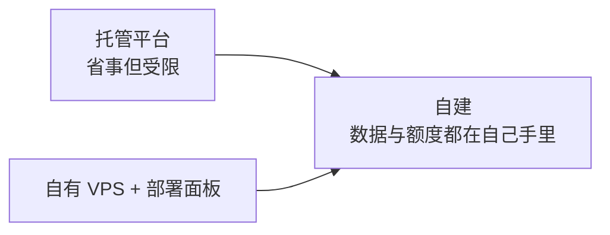
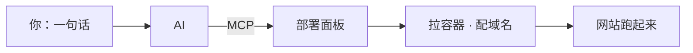
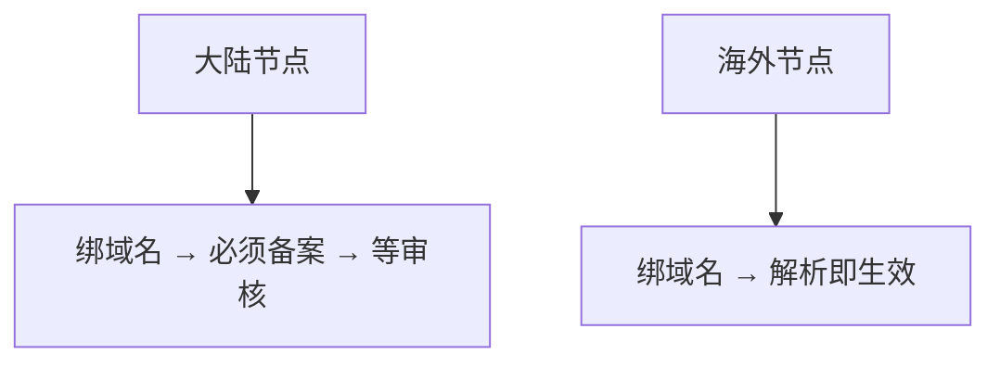
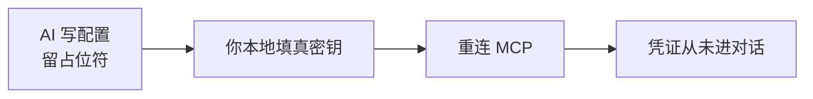
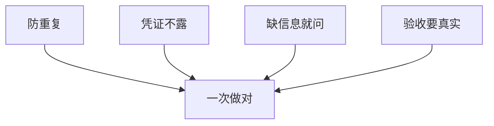

> 本文整理自一篇中文技术博客的实操记录。内容属整理稿而非逐字照搬。
>
> 文中的价格、配置与产品名沿用原文，**未做外部核验，也不构成推荐**；云服务定价与活动随时变动，动手前请自行确认。

## 先说清为什么换

**作者先承认托管平台的好处**：简单，AI 把页面写好，点几下就能上线。

**但他说实际用下来有两个痛点。**

| 痛点 | 具体表现 |
|---|---|
| **访问太慢** | **经常卡顿抽风，甚至直接打不开**；别人想试用还得挂梯子 |
| **限制太多** | **免费额度紧、函数冷启动慢**；**想跑常驻任务或带自建数据库就处处受限** |

**而他的结论是**：

> 拥有一台属于自己的服务器，**然后在上面部署一个开源部署面板**。

**费用他也给了个数量级**：

> 各大云厂商针对新用户基本都有促销，**一年算下来也就一百块左右**。
>
> 我自己常用的某云国际版海外轻量，**两核两 G 一年大概十美元**。

上图是这个取舍。**注意它换到的不是「更便宜」，而是「不受第三方额度和网络限制」。**

## 三个核心东西

**他说别被技术词绕晕，核心就三个。**

| 东西 | 是什么 |
|---|---|
| **VPS** | **一台二十四小时开机联网的云端电脑**，用来跑项目和数据库 |
| **部署面板** | **管理这台电脑的现代部署平台**，可理解为开源自建的托管平台 |
| **MCP** | **AI 操作这个面板的工具接口** |

**而协作流程他画得很直白**：

> 你在 AI 里发一句话，AI 调用面板的 MCP 接口。
>
> **面板在服务器上自动建应用并拉起容器**，服务器把网站跑起来。

上图是这条链路。**注意「你」只出现在第一环。**

**他对这个面板的评价有个对比**：

> 它**比很多人常推荐的宝塔好得多**，功能强大，**全基于容器化隔离，而且对 AI 极度友好。**

## 买服务器：那个免备案的坑 ⭐

**这一节我认为是全篇最实用的一段，因为它是「不知道就会踩」的类型。**

> 有一个非常关键的避坑点：**尽量选香港或者海外节点**（比如新加坡、东京）。

**为什么？**

> **绑定自定义域名免备案。**
>
> 如果你的服务器选在国内大陆节点，**到时候绑定自己的个性化域名解析，就必须走工信部的备案流程**——填资料、等审核。
>
> **对个人折腾小项目来说非常耗时繁琐；而选海外节点，域名解析过去立刻就能生效访问。**

上图是这个分岔。**它不是性能差异，是流程差异**——而流程差异会直接决定你这个小项目能不能上线。

**配置上他的建议很省事**：

> 如果你不知道怎么选配置，**最省事的办法就是直接把预算和需求丢给 AI，让它帮你挑性价比最高的方案。**

**他自己的选择是**：某云轻量，**新加坡、两核、两 G 内存、四十 G 硬盘，预装容器镜像**。

## 装面板

**一条命令，而他提了两个前置检查。**

> 安装前应确认 **80、443、3000 端口没有被其他服务占用**。
>
> **如果服务器已经承载其他网站，先检查现有服务，再安装。**

**然后是防火墙**：

> 到实例的防火墙页面添加规则，**先放行 3000，用来访问管理面板。**

**接着浏览器打开 `http://你的IP:3000`**，出现初始化页面就创建管理员账号。

> **这是你自己这台面板的账号，与云厂商账号无关。**

**而首次引导他给了个很干脆的建议**：

> 如果登录后进入首次使用引导，**点击左下角的 SKIP ALL**，先进入控制台。

**「先跳过引导，别一开始就研究每个菜单」——这个建议我觉得对「先跑通再加功能」的节奏很友好。**

### 域名与 HTTPS

**这一段把他的收益讲清楚了**：

> 面板底层**自带了反向代理**。
>
> 后面你把域名解析过来之后，**在面板里填上域名，它能一键自动申请并配置免费证书**——**体验跟托管平台完全一样无感。**

## 接 AI：生成 API Key

> 打开左侧 Profile，**向下找到 API / CLI Keys**，点击右下角的 Generate New Key。

**他特别强调了一句**：

> **这把密钥就是 AI 访问面板的凭证。**

**而接下来说的话，是整篇里我最欣赏的一个细节**：

> 这一步只需要提供面板地址，**不用把 API Key 发到聊天里**——偷懒的也可以直接发给 AI，**但毕竟有泄露风险，本地替换更安全。**
>
> **密钥先留在本地，等配置生成好后再填写。**

**然后给了具体做法**：

| 步 | 动作 |
|---|---|
| 一 | 让 AI **安装并配置 MCP**，**API Key 先留占位符**，告诉你在哪填 |
| 二 | AI 回复配置路径，**你按路径打开配置文件** |
| 三 | 把占位符替换成真密钥，**保留双引号** |
| 四 | **重连 MCP**，确认开关打开 |

上图是这个设计。**它的巧妙在于顺序——先让 AI 把结构搭好，密钥后填，中间那一步在你自己机器上完成。**

## 先验证连通性，再动手

**他没有直接让 AI 部署，而是先做一次只读验证。**

> 请通过 MCP **列出当前项目**。**只读取信息，不创建或修改任何资源。**
> **如果连接失败，报告具体错误。**

**而他给了一个很关键的判据**：

> 没有项目时返回空列表是正常结果。**关键是 AI 确实调用了工具、并收到面板的返回，而不是只给你解释操作方法。**

**「不是只给你解释操作方法」——这句点出了一个很隐蔽的失败**：AI 可能根本没调工具，而是凭知识给你写了一段「应该这样做」的说明，**而它看起来完全正常。**

**验证通过后，第二步才是创建空项目。**

上图是这两步。**先确认「能读」，再试「能写」——顺序反了会分不清是权限问题还是操作问题。**

## 那一组任务说明 ⭐

**这是全篇我认为最有价值的部分。**他给 AI 的部署指令不是「帮我部署 Supabase」，**而是七条约束**。

**我把它整理成四类。**

### 一、防止重复与误建

> **使用已经检查过的模板，避免重复创建已有服务。**
> **检查模板版本、所需配置和数据持久化挂载。**

### 二、凭证纪律

> **确认密码及密钥已安全生成，不使用默认示例凭据**，
> **不在回复中显示真实密钥。**

**「不在回复中显示」——他连「打印出来」都禁掉了。**

### 三、不知道就问，别猜

> **根据我提供的访问地址配置 API 地址与认证回调**；
> **如果地址或必要配置缺失，先告诉我，不要猜。**

**「不要猜」三个字，比一长串要求都省事。**

### 四、范围与验收

> **不向公网开放数据库端口，不修改其他服务。**
> **执行部署后检查部署记录和关键服务状态**，告诉我如何打开管理入口、如何验证 API。
> **工具无法检查的部分明确说明，不以「已提交部署」代替成功。**

上图是这四类。**而最后那一句我觉得该被抄进所有部署指令里**：**「已提交部署」不是成功，它只是「我发出去了」。**

## 怎么判断真的部署好了

**他给了一个三层的验收标准，而这三层是递进的。**

| 层 | 判据 |
|---|---|
| 一 | **部署记录没有失败或持续重试** |
| 二 | **数据库、认证、API 网关等关键服务运行正常** |
| 三 | **管理入口能登录，API 可以实际请求** |

**而后面那个实战验证更狠**——他做了一个带登录的备忘录，然后给了完成标准：

> **保存后重新登录数据仍在，两个测试用户不能访问对方的笔记。**

> **仅能打开网站首页，还不能证明数据库已经接入成功。**

**「能打开首页」是最容易满足、也最容易骗过自己的验收。** 而他用「重新登录后数据还在」和「两个用户互相隔离」把它堵住了。

## 接上 GitHub：推送即发布

**这一段是把它变成真正的流水线。**

**第一步在面板里连 GitHub**：

> GitHub URL 保持 `https://github.com`——**这里填的是平台地址，不是项目仓库地址。**
>
> 点击创建 GitHub App，按跳转页面完成。
>
> 返回后列表里出现了一个 App，**但右边仍显示 Action Required**——**这时还没有完成仓库授权。**

**而授权范围他给了明确建议**：

> 建议选**仅选定的仓库**，再选目标仓库，最后点击安装与授权。

**他还特意说明了一张截图的问题，这点我很欣赏**：

> 上图是在修改选择前截下来的，**仍显示「所有仓库」，不能把这张图当作已经限制授权范围的证明。**

**「截图不能作为证据」——这种自我校正在一篇教程里很少见。**

### 第二步：让 AI 从仓库部署

**而那条指令里有几个措辞我觉得很有分量**：

> 先读取仓库，**根据实际代码配置构建和运行方式**。
> **复用现有数据库，不重复创建**，保留已有数据和数据卷，**凭证从本地配置读取，不输出**。
> **先确认新服务正常，再切换网站路由，保留回退方式。**
> **开启 main 分支推送后的自动部署。**

**「先确认新的正常，再切路由，保留回退」——这是一个上线的正确顺序。**

### 第三步：验证自动部署

**他的验证设计得很干净**：

> 让 AI 改界面（浅色背景、绿色按钮、卡片式列表、改标题），**保留增删改功能**。
> 完成后提交推送到 main。
> **推送后不要手动触发部署。**观察自动部署记录，确认网页更新，**原有备忘录仍然存在。**

**结果他给了两个证据**：

> 面板**自动出现了这次提交的部署记录**，过程中不需要手动部署。
>
> 刷新后页面已经变成浅色布局，**原来的「测试测试」和创建时间都还在。**

上图是这条链路。**注意它同时验证了两件事：代码更新了、数据没丢。**

## 日常操作清单

**他列了六类日常任务，而每一类都配了「约束句」。**

| 任务 | 约束 |
|---|---|
| **查看状态** | **先只读取，不重启、不重新部署** |
| **排查失败** | **先给出建议，不要连续重试部署** |
| **改环境变量** | **先判断改在构建时还是运行时生效**；不输出其他变量里的密钥 |
| **发布更新** | 报告结果；**能读到提交信息就说明对应提交** |
| **重启应用** | 不改环境变量、不动其他服务；**无法验证访问就明确说明** |
| **看资源占用** | **只读、不停服务**；**说明内存统计口径，区分总量、已用、可用** |

**最后那条我觉得特别有意思**：**「区分总量、已用量和可用量」**。因为这三个数在多数监控里都叫「内存使用」，**而它们的数值可以相差很大。**

**而他给的通用建议是**：

> 刚开始使用时，把任务对 AI 说清楚：**操作哪个项目、修改什么、保留什么、最后怎么验证。**
>
> **例如先让 AI 诊断故障并给出建议，确认没问题后再让它执行修复。**

**「先诊断、后执行」——这个两段式把不可逆操作的决策权留在了人手上。**

## 我的三点补充

以下是评注，不是原片内容；取舍由我负责。

**第一，「选海外节点免备案」这条，是整篇里唯一一条「不知道就会白折腾」的知识。** 它不涉及技术难度，**但会决定你这个项目在两小时内上线，还是两周后上线**。而这类知识通常不在文档里——**因为文档假设你已经知道自己在哪个监管区。**

**第二，那七条部署约束真正的贡献，是把「AI 会自作主张」这个风险写成了可检查的条目。** 「不要猜」「不显示密钥」「不以已提交代替成功」——**每一条都对应一种具体的失败模式**，而不是泛泛地说「小心点」。**而它们能生效的原因很简单：AI 拿到明确禁令时，执行率远高于拿到模糊期待。**

**第三，整套方案真正的价值不在省钱，在于「验收权」回到了自己手里。** 托管平台上，你能看到的只有「构建成功／失败」；而自建之后，**你能查部署记录、能读容器日志、能验证数据库、能回滚**。**这也是为什么那三层验收标准在这套方案里才写得出来**——**换个平台，你连第二层都摸不到。**

---

一句话总结：**托管平台卖的是省事，代价是你看不见里面。** 而自建买到的是**「出了问题我知道该看哪儿」**。这一点在 AI 帮你部署的时代反而更值钱。
