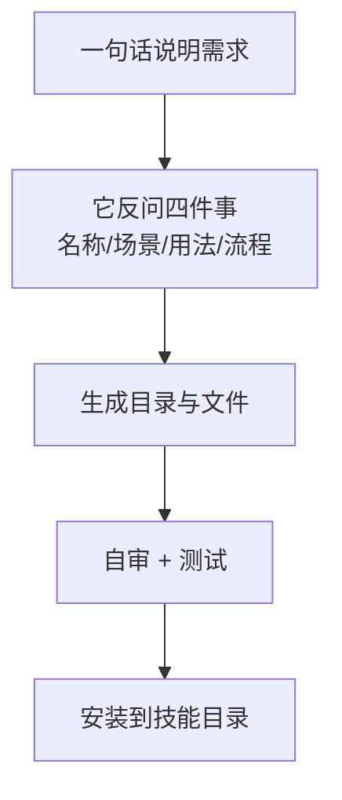
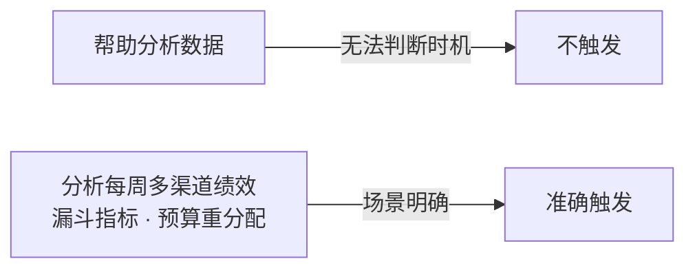
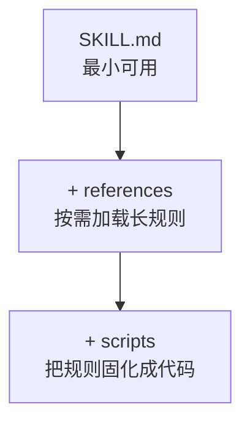

> 本文整理自同一门课程的第二讲。内容属整理稿而非逐字记录。
>
> 文中的工具版本、命令与操作过程沿用原片口述，**未做外部核验**；涉及国产模型服务的选择仅作记录，不构成推荐。

## 先装环境

**他给了四步，并强调跨平台通用**：

| 步 | 做什么 |
|---|---|
| 一 | **装基础环境**：运行时（Node.js）与版本控制（Git） |
| 二 | **装编码助手**：通过包管理器安装 |
| 三 | **配模型**：领 API key，用配置工具写入 |
| 四 | 选一个**可视化入口**（编辑器插件或桌面端） |

**第三步他给了具体做法**：

> 我们在国内，**更方便的是使用国产大模型**。订阅之后拿到 API key，**通过配置管理工具添加密钥。**

**他的演示环境是 Ubuntu 22.04**，而顺序是**先验 Git 与 Node，再装助手，再配 key，最后测一句「你好」**。

上图是这四步。**注意它把「验证」放在最后一行**——**先能聊，再谈写 Skill。**

## Skill 放哪儿：三种位置

**他给了三种，而三种的用途完全不同**：

| 位置 | 范围 | 适合 |
|---|---|---|
| **项目根目录下的技能目录** | 只在这个项目 | **团队共享的、跟项目强绑定的** |
| **用户家目录下的技能目录** | 所有项目 | **个人常用、跨项目复用** |
| 直接作为附加文件上传 | 单次 | **临时测试** |

**第三种他明确说了「一般用于测试」**——**它不是长期方案，只是一个试跑的入口。**

### 先别造轮子

**他给了一个很务实的提醒**：

> 很多时候**我们不需要这样重复去造轮子**，因为现在技能已经有很多应用商店。
>
> **官方有技能仓库**，里面有文档类技能（生成表格、演示文稿）；**也有一些对中文支持较好的第三方站点。**

**而从「用现成的」到「自己做」，他给了一个中间选项**——这一点是整讲最省力的技巧。

## 「用 Skill 创建 Skill」⭐

> 我们还可以**通过 Skill 去创建 Skill**，也就是 Skill Creator。**它是一个专门自动化创建 Skill 的工具。**
>
> **整个过程非常简单，只需要四步：启动工具、回答引导、审查文档、测试。**

**具体怎么用？他给了一句提示词**：

> 「我想创建一个 Skill，**用于在实施任务前澄清模糊的需求**，请使用 Skill Creator 引导我。」

**而交互过程是**：

> 它会问你 **Skill 的名称、功能场景、具体使用场景、核心工作流程**。
>
> 然后确认没问题，**开始生成；生成完它会自己做一些审查，还可以自动进行测试。**

上图是这个流程。**注意第一步的输入也很模糊**——**它靠反问补齐，和你想要的「需求澄清」是同一套机制。**

**而实测里它生成的结构很规整**：

> 主文件 `SKILL.md`；`references`（复杂业务规则放这里）；技术类与验收标准；还有 `assets`（放图片、文档模板）。

### 一个提醒

**他提到一个实际会遇到的小摩擦**：

> 它**有时候会自动给你命名**。如果你想用自己定义的名字，**可以直接告诉它名称**，
> 或者**用中文交互**——**因为它有时候会输出英文。**

## 五步改造法 ⭐

**这是他给的方法论，我觉得是整篇最可复用的部分。**

| 步 | 做什么 |
|---|---|
| **一** | **识别关键流程**：把主要业务逻辑拆开 |
| **二** | **定义输入输出** |
| **三** | **提炼决策**：把原来人脑的判断变成代码逻辑 |
| **四** | **编写 SKILL.md**（核心环节） |
| **五** | **测试验证** |

上图是这五步。**注意第三步才是真正的智力活**——**前两步是把现状描述清楚，第三步是把「人的经验」翻译成机器能执行的判断。**

### 第一步的产出：四段流程

**他把那三轮对话提炼成了四步**：

> 一、**检查数据质量**；二、**漏斗分析**（点击率、转化率）；三、**效率分析**（广告回报率、获客成本）；四、**预算调整**。

**这个提炼本身就有信息量**：**原来散在三轮里的动作，被重排成了一条有依赖的链**——**先查数据能不能用，再算，再决策。**

### 第三步：那些必须写成判断的地方 ⭐

**他举了三个例子，每一个都对应一类「不问就会错」的情况**：

| 情况 | 该写成什么 |
|---|---|
| 某渠道**没有展示次数**，算点击率会出空值 | **转成占位值，避免报错** |
| 广告回报率**高于目标值** | **标注为「达标」状态** |
| 净利润**在某区间内** | **触发对应的削减或增加动作** |

**而他的总结很直接**：

> **这些逻辑写得越详细，Agent 越能输出我们期望的内容。**

**注意第一类的性质**——**它不是业务规则，是「数据的坑」**。而这类知识**通常只存在于老员工的脑子里**，**写出来就是资产。**

## 第四步：SKILL.md 怎么写

### 元数据两字段

**他先说了 YAML 头部，只有两个字段，但都很关键。**

**第一个是名称，而给的要求很具体**：

| 要求 | 说明 |
|---|---|
| **动词开头** | 说明它是个动作 |
| **短横线连接** | 中间用 `-` 而不是空格或下划线 |
| **全小写英文** | — |

**第二个是描述，他说「这是最关键的」**：

> **它是告诉 AI 你在什么情况下该触发这个 Skill 的核心依据。**

### 好描述与差描述 ⭐

**这一段我认为是全篇最实用的部分。**

| 差例 | 为什么差 |
|---|---|
| 「帮助分析数据」 | **AI 不知道分析什么数据，也不知道什么时候该触发** |
| 「使用某个库进行数据处理」 | **太技术化，用户不会这么问** |

**好例**：

> 「**分析每周多渠道营销活动的绩效数据**，用于多渠道数字营销、漏斗指标和预算重新分配。」

**而他给了一个很干净的检验标准**：

> **如果你自己是 AI，看到这样的描述之后，你能不能判断出来该调用哪个 Skill？**
>
> **就是把话说清楚、说明白、说具体。**

**注意好例里的三个触发点**：**「绩效」「漏斗指标」「预算重新分配」**——**它们既是业务语义，也是用户真会说的词。**

上图是这个差别。**它和前面讲「触发词三层覆盖」是同一条原则**：**用用户的词汇写入口。**

### 正文结构

**他展示的结构很朴素**：一级标题是技能主题，下面按步骤分二级标题——

> 输入要求 → 数据质量检查 → 漏斗分析 → 效率分析 → 预算重新分配。

**每一块都给出计算公式。**

### 那条关于长度的技巧 ⭐

**这是全篇我觉得最有工程感的一段**：

> 有时候业务逻辑非常复杂，**如果全部放到 Markdown 文件里，上下文加载的就非常多。**
>
> 对于这样的内容，**我们可以把它拆到一个子目录里，叫 `references`**，**让它按需加载。**
>
> **这也是一个模块化设计的理念，保持主命令的简洁。**

**具体做法**：

> 我们那个预算调配的规则文件**足够长、内容足够多**，**就把它放到 `references` 目录里。**
>
> 里面可以包含**数据门槛、渠道分类、预算变更、决策矩阵**等等。

**而他做了一次核对**：

> 这个文件**和我们原来第一次上传的那个，是一模一样的**。
>
> **我们只是让它挪到了这个目录里面。**

**「一模一样，只是挪了位置」——这个细节很重要**：它说明抽象不是为了改写，**只是为了延迟加载。**

### 进阶：再抽出一层脚本

**他给了一个可选的第 4.5 步**：

> 我们在执行时也会感受到，**它背后会把业务规则转化成 Python 代码。**
>
> **我们也可以把它提炼成脚本。**

**而收益他说得很清楚**：

> 有了前面两部分，**其实已经可以执行了**。
>
> **但如果你进一步把业务逻辑用编码实现，它可能执行起来更高效，一致性会更高。**

上图是这三层。**它们是递进关系，不是替代关系**——**第一层就能跑，后两层是「更稳更快」。**

**而他实际的做法很聪明**：

> 那个脚本**就是它生成好的**，我当时**直接挪过来了**。

**「让 AI 先生成，再把它生成的产物固化成资产」——这是很省力的路子。**

## 放置与验证

**他强调了一个容易踩的坑**：

> 因为我们在项目目录下放置自定义 Skill，**所以一定要在项目根目录启动**——也就是那个技能目录所在的项目根。

**而验证的第一步很具体**：

> **我们首先第一步要观察一下，它有没有去调用我们自定义的这个 Skill。**
>
> 我们看到**它已经调用了，也成功加载了。**

**「先确认调用了，再看它做得对不对」——这个顺序很多人会跳。**

### 那次结果的核对

**他和第一讲的数字做了对照**：

> 小程序最终调整后**新的预算要增加**，**而且正好卡在增幅上限**。
>
> **和我们之前那个方式差不多一样。**

## 实测里那些摩擦

**我觉得这些细节比顺利的部分更有用。**

| 现象 | 说明 |
|---|---|
| **要重启才生效** | 新放的 Skill 需要重启会话才被感知 |
| 需要**「总是允许」**某些命令 | 创建过程要删除旧目录、执行 shell |
| 自动化过程**问题不完全一样** | 每次交互的问题措辞有差异，但**大差不差** |

**而「大差不差」这个说法其实挺重要**——它意味着**这类自动化不保证确定性**，**你仍然得看着它走。**

## 我的三点补充

以下是评注，不是原片内容；取舍由我负责。

**第一，第三步「决策提炼」才是五步里真正的分水岭，而它最容易被跳过。** 前两步是把现状讲清楚，第四步是把它写下来——**只有第三步产生了新东西：把「我知道该这么办」变成「任何人按这个判断都会这么办」**。而这一步难的地方不在技术，**在于很多判断本来就是模糊的**（「利润低的时候要削减」——低到多少？）。**所以写 Skill 的过程，往往先逼你把业务规则想清楚。**

**第二，好描述与差描述的差别，本质是「按业务语义写」还是「按实现写」。** 「使用某个库处理数据」是**从实现视角写的**——但用户不会这么提问。**而「分析每周多渠道绩效」是从场景写的**，所以用户一说「帮我看看上周各渠道怎么样」就能命中。**这条原则在写任何给人看的接口文档时同样成立。**

**第三，「把长规则挪到引用目录」这个动作看着像整理文件，其实是上下文预算管理。** 因为主文件是**每轮都要加载**的，而引用文件是**用到才加载**。**所以拆分的判据不是「这段内容长不长」，而是「它是不是每次都需要」。** 而预算重分配规则恰好符合：**只有问到预算时才需要它。**

---

一句话总结：**写 Skill 的难点不在格式，在于把「老师傅心里那杆秤」写成能执行的判断。** 而写完那一刻，你才真正知道自己懂不懂这门活。
