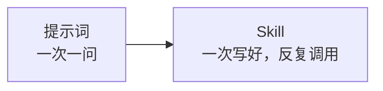
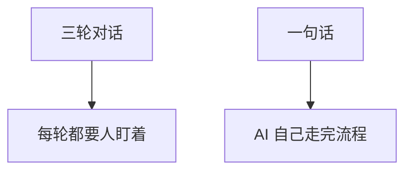
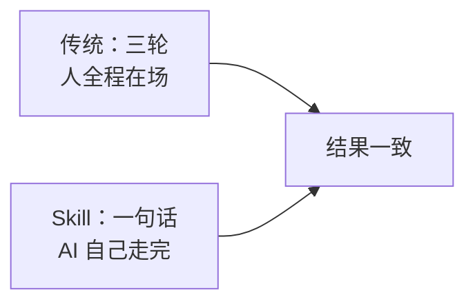
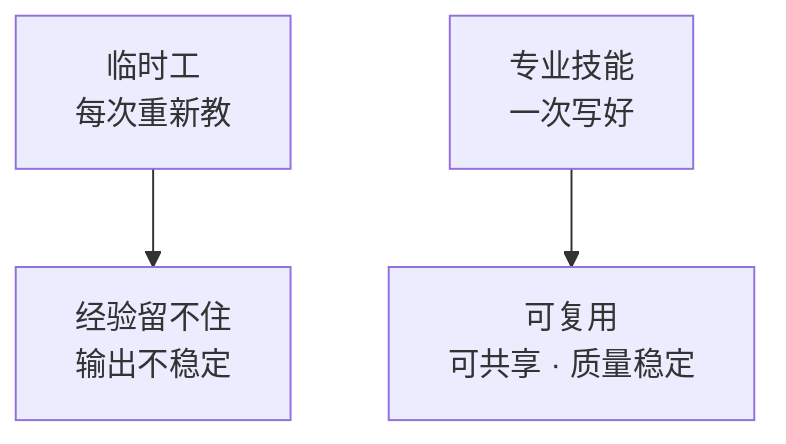

> 本文整理自一门两讲的课程文稿（第一讲），讲者是一位架构师。内容属整理稿而非逐字记录。
>
> 文中的案例数据、工具名与操作过程沿用原片口述，未做外部核验。

## 那个开场判断

**讲者先给了一个他认为正在发生的变化**：

> 很多朋友已经习惯了使用提示词，**但随着编码助手的兴起，我们会发现单纯的提示词已经无法满足复杂的业务需求。**
>
> **如何把传统的作业程序——也就是 SOP——转化成智能体能自主调用的技能，这是从提示词工程转向 Agent 工程的关键一步。**

上图是这个转向。**注意它换掉的不是「怎么说」，而是「说给谁记」。**

## 案例一：营销周报

### 那个被具象化的痛点

**他先描述了一个人**：

> 一个营销经理，**每周一早上非常头疼**。因为他要面对来自小程序、微信、抖音、百度**四个渠道**的营销数据。
>
> **小程序要看留存，微信要看互动和转化，抖音要看曝光量，百度要看搜索流量。**

**而真正的麻烦在下一句**：

> **这些数据是分散的，指标口径也不统一。**

**这句话我觉得是整篇最值钱的一句**——**它指出了真正的成本不在「算」，而在「对齐同一件事怎么算」。**

### 传统做法：三轮对话

| 轮次 | 做什么 |
|---|---|
| 一 | **上传数据文件**，手写公式（点击率、转化率） |
| 二 | 效率分析（广告支出回报率、单次获客成本） |
| 三 | **上传预算调整的最佳实践**，说明额度与增幅上限 |

**而他总结的四个问题很实在**：

> 每次要和 AI 多轮交互，**操作繁琐，还容易遗漏关键指标**。
>
> **最头疼的是大模型记性不好**——**它无法记住之前的分析经验，每次都需要重复引导、重复教学。**

### 有了 Skill 之后

**输入端的变化最直观**：

> 使用 Skill，**我们只有一句话**：直接上传文件，**你给我分析这个文件**——漏斗（转化率、点击率）、效率分析（利润、广告支出回报率）、还有预算调整建议。

**而 AI 接下来的动作是「按流程」**：

> 它首先检查数据，做漏斗分析、效率分析、预算分配建议，**最后给出总结。**

**他的对比维度有四条**：**文字输入量、交互轮次、时间消耗、token 消耗**。

> **特别是人为错误方面，我们几乎降为零了**——因为只有一轮，**分析会更加准确可靠。**

上图是这个对比。**注意「人为错误降为零」的理由不是 AI 更准，是「人只经手一次」。**

## 那个数据长什么样

**为了让案例可复现，他描述了一份测试数据。**

| 列 | 内容 |
|---|---|
| 日期 / 活动名 / **渠道** | 微信、抖音、小程序、百度 |
| **受众** | 新客、**注册未下单**、老客复购 |
| 展示 / 点击 / 转化 | 漏斗分析用 |
| 支出 / 收入 / 订单数 | 效率分析用 |

**「注册过但从未下单」这一类受众值得注意**。**它的口径本身就说明了为什么「指标不统一」是真问题**：同一个「转化率」，对新客和复购客是两件完全不同的事。

### 那份预算规则

**他特意强调这份规则「足够复杂」**：

> 不是哪个渠道都可以调整预算——**有一个数据门槛**。
>
> 然后**将渠道分类**，下面有具体规则：这个是要减少、还是要增加、还是维持不变。
>
> **增加有一个默认幅度**，而我们的提示词会限制**单渠道增幅不能超过这个幅度**。

**这段规则后来被单独抽成一个 Markdown 文件、放进引用目录**。这一点在第二讲里会再出现。

## 实测：两个窗口的对照

**他把两种做法并排跑了一遍，而观察点选得挺准。**

### 传统方式

**第一轮跑漏斗分析，他记了一个细节**：

> 它会把数据文件**转化成一个 Python 脚本**，导入数据分析类库来做分析。
> 先看文件里有哪些列、多少行，然后开始做漏斗分析，**并与基准值比较**。

**而那次运行花了一分多钟，他解释了这个数不可靠**：

> 这个速度还是稍微快一点的，**因为我之前在这个环境里执行过多次，中间一些脚本保存下来了。**
>
> **如果第一次进来，它可能会长达几分钟。**

**「缓存让第二次变快」这个提醒很重要**——它意味着**你在自己机器上测出的耗时，别人复现不出来。**

**他指出了一个真实的数据缺陷**：

> 小程序这里**没有展现量**，所以它做了一个 `NA`，避免异常。

**第二轮效率分析，他强调了输出规范的必要性**：

> 我们要求输出一个汇总表格，**并做标注**：广告支出回报率是否高于目标值、单次获客成本是否低于上限、净利润是否为正。
>
> **所以和大模型交互时，你的输入输出需要有一个明确的规范**，这样才更符合期待。

**第三轮才做预算调整**，而这轮最慢。

### Skill 方式

**他说了加载方式的细节**：

> Skill 可以直接放在项目根目录下的 `.claude/skills` 文件夹里。
>
> **因为我的目录就在这个项目下，所以直接点斜杠就能看到自定义的 Skill。**

**然后他给了同样一句话**，AI 就自己走完了全流程。

**而结尾他做了一个我很欣赏的核对**：

> 小程序新的预算**都是 2112**，调整额度也一样。
>
> **这个地方保留了两位小数，那个地方直接取整了——整体效果是一样的。**

上图是这次对照的结论。**注意他没有说「Skill 算得更对」，只说「效果一样但省了三轮」。** 这个措辞很克制，也更可信。

## 案例二：需求澄清

**第二个案例换了场景**，而它揭示的问题更普遍。

### 那句「他直接就开始干了」

> 你给初级程序员、或给 AI 编码工具表达一个需求——**假如说「在设置页面加一个夜间模式的开关」，他直接就开始干了。**
>
> 那就导致一个循环：**他猜测你的需求，直接实施，导致返工率非常高。**

**「猜测你的需求」——这个词抓住了要害。**

### 该问却没问的三件事

**他给了三个具体问题，而每一个都是「不问你就会猜错」的**：

| 问题 | 不问会怎样 |
|---|---|
| **开关放在哪里** | 位置猜错 → 全部重做 |
| **是否要持久化** | 刷新就丢 / 或者莫名记住 |
| **生效范围是全局还是当前页** | 体验完全不同的两种产品 |

**而他的解法是**：

> 我们需要一个 Skill，**能够在每次用户提问后、在真正编码实现之前，先去澄清几个问题。**
>
> **我可以给你提供一些默认值**，你也可以自己补充，或者提供一些选项。

**「提供默认值」这个设计我觉得很关键**——**它让澄清不变成审问**：你可以直接选，也可以自己填。

### 实测的交互

**他实际跑了一遍，而 AI 给的分组很规整**：

> 它给了几组确认：**技术栈、存储方式、应用范围。**

> 我选原生实现、选好存储方式，然后它问：**你要整个页面，还是整个应用？**

**他接着补了一句对比，我认为是这一节的落点**：

> 如果给它一句话就直接干，**它背后完全是个黑盒子，会给我们产生很多不确定性。**
>
> **但有了需求澄清，就能把一个模糊的需求细化。**

**而团队层面的收益他也点了**：

> 整个团队里**能够遵守相同的流程，减少沟通成本。**

## 那个本质区别

**他在第一部分收尾时给了这个总结，我觉得说得很准**：

> 原来写提示词，**它很多是一个临时工的角色**——每次都需要重新指导，**经验、知识都无法沉淀，输出的内容也不稳定。**
>
> **而有了 Skill，其实是我们打造了一个专业技能**——一次创建，**可以稳定地输出，质量也得到了标准，也可以在团队里共享。**

上图是这个对照。**它解释了一件事：为什么「写得更长的提示词」解决不了这个问题**——**提示词是消耗品，Skill 是资产。**

## 我的三点补充

以下是评注，不是原片内容；取舍由我负责。

**第一，「指标口径不统一」这句抱怨，其实是整篇最该被认真对待的技术判断。** 因为大多数人把多轮对话的痛苦归因于「交互麻烦」，**但真正的成本在「每次都要重新对齐同一件事怎么算」**。而口径一旦写进 Skill，**它就从「每次口头约定」变成了「文件里的定义」**。这也解释了为什么后面那一步「把规则抽成单独文件」那么重要。

**第二，「人为错误降为零」这个说法，成立的理由值得说清。** 不是 AI 比人准，**而是人只经手一次**。三轮对话里，人要贴三次文件、写两次公式、传一次参考文档——**每一次都是一个可能贴错、写错、漏传的接口**。而一句话只留一个接口。**减少错误的方式，很多时候不是「更小心」，而是「减少必须小心的地方」。**

**第三，需求澄清那个案例，真正的价值不在「AI 会问问题」，而在「问题被固定下来了」。** 因为一个资深工程师本来也会问那三件事，**差别在于他不是每次都会问**——赶时间就跳过了。而 Skill 把「该问的」变成了流程里绕不过去的一步。**所以它防的不是 AI 不懂，是人图省事。**

---

一句话总结：**提示词是每次重新交代一遍，Skill 是把交代过的事存下来。** 而它省下的不只是时间，**更是那些「这次忘了说」导致的返工。**
