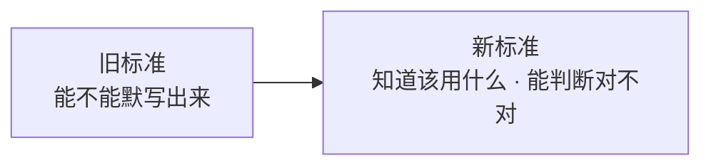
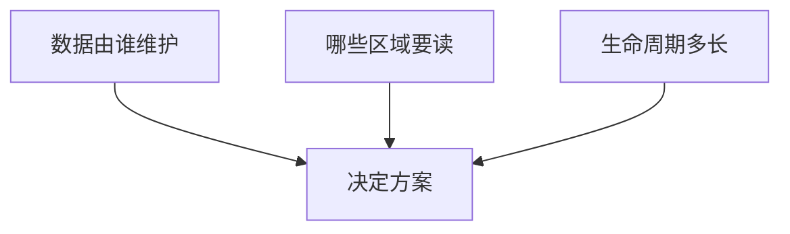
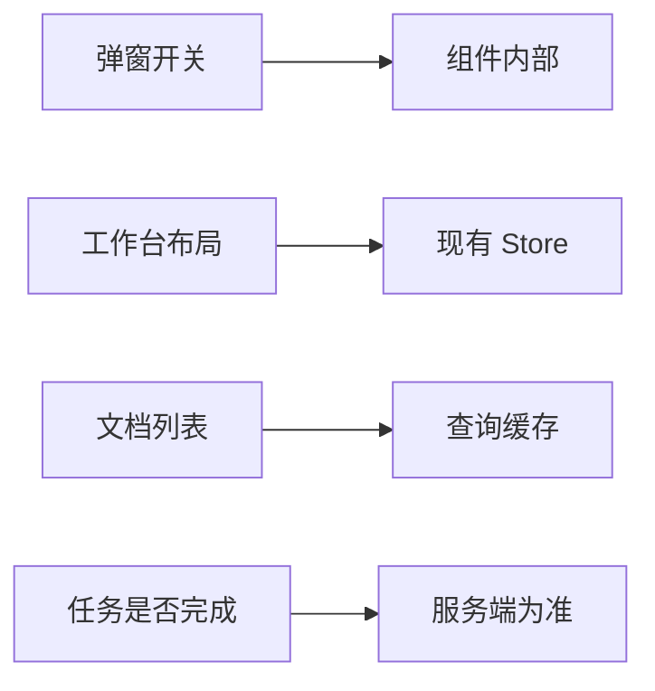
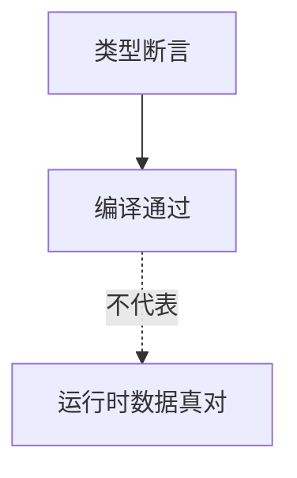
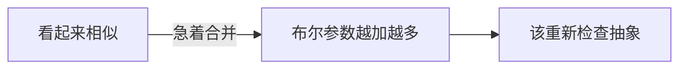
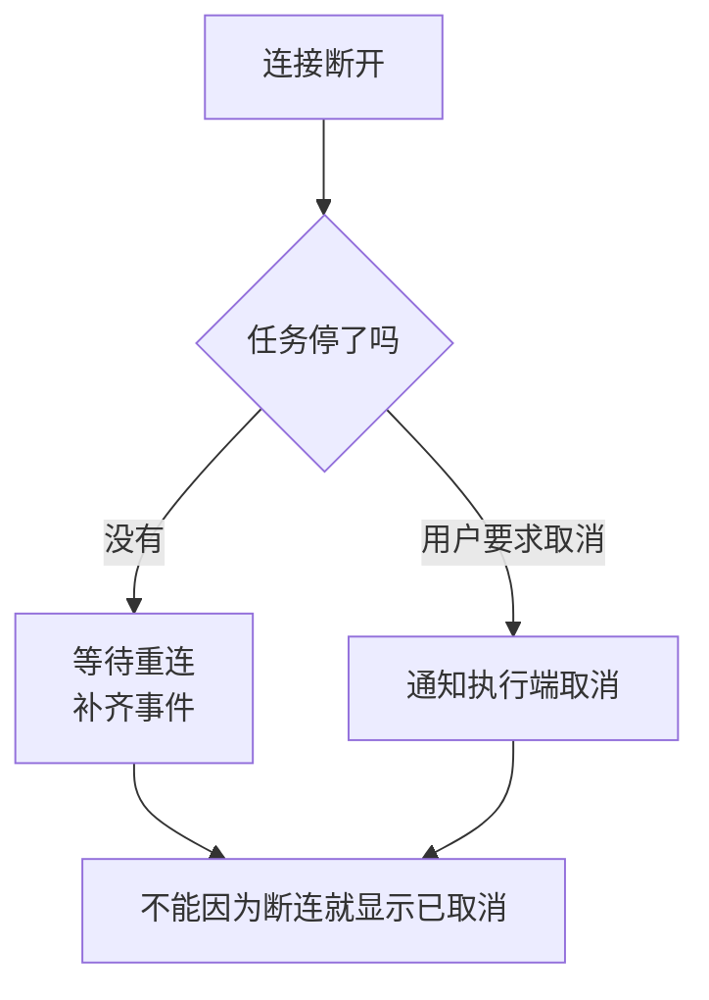
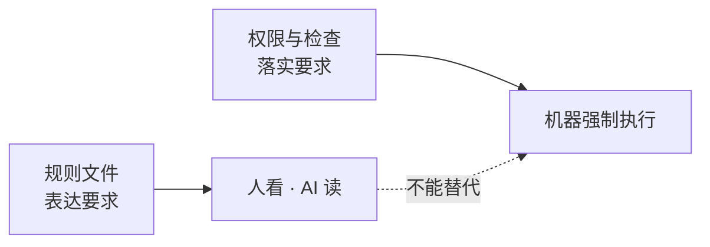
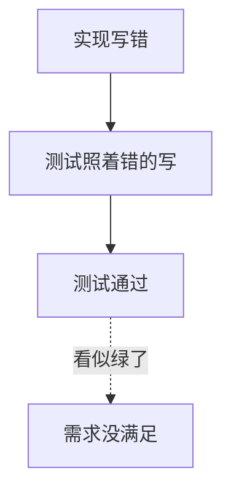
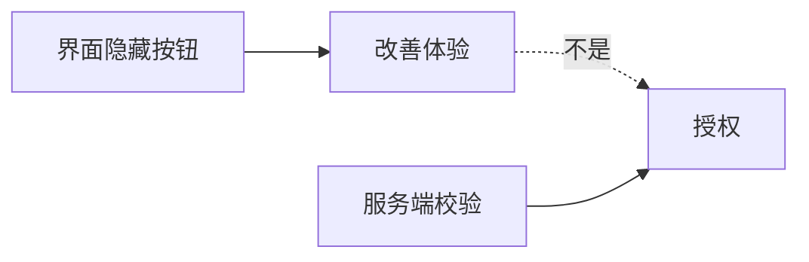

> 本文整理自一篇中文技术博客的长文，原作者在做一个融合 Agent、RAG 与知识图谱的全栈项目。内容属整理稿而非逐字照搬。
>
> 文中的招聘观察、库名与规范引用沿用原文，**未做外部核验**。

## 先看清那个焦虑

**作者从行业讨论切入**：

> 有人说，**部门已经没有纯前端了**，页面、接口、部署都得一起做。
>
> 有人感叹，**明明投的是前端岗位，招聘要求里却写着全栈、AI 应用和 Agent 开发。**

**再加上一个事实**：Agent 生成页面、修改组件、对接接口的表现——**确实很容易焦虑。**

**他的态度是一句话**：

> **我不觉得前端已经死了，但我们的学习方式确实可以调整。**

**而调整的方向他说得非常具体**：

> 我们不必把每个包的调用方式、每个 API 的参数、每段代码的实现都记在脑子里。
>
> **更值得掌握的，是这些技术能解决什么问题、适合什么场景，以及怎样判断 Agent 有没有用对。**

上图是这个转向。**注意它没有降低要求，只是换了衡量方式。**

**而他把这条落成了两个更具体的能力**：

> 我们不需要闭眼写出 Zustand 的初始化代码，**但应该知道它适合管理哪些状态**。
>
> 也不必背下 Redux 的每个 API，**却需要理解项目为什么采用它，新增功能是否该沿用现有方案。**

**「具体代码可以让 Agent 查文档、参考项目实现。」**

> **我们理解技术，才能给它更合适的需求和约束，也能在它提出方案时看懂其中的取舍。**

## 先分清两条方向 ⭐

**这一节我觉得是全篇最重要的区分。**

> **使用 Agent 开发产品**，主要解决**开发效率**和**交付质量**的问题。
>
> **开发 Agent 产品**，则需要进一步处理**任务执行、工具调用、人工确认和结果展示**。

**而他的建议很克制**：

> 我们可以同时发展这两类能力，**但不必因为开始使用编码 Agent，就立即把模型训练、底层推理和所有 Agent 框架都加入学习计划。**

> **先让已有知识能够支持技术选择，再沿着项目需要扩展**，比不断重学一整套技术栈更有价值。

**「沿着项目需要扩展」——这句把学习顺序从「体系驱动」换成了「问题驱动」。**

**他也给了招聘侧的证据，但很谨慎**：

> 从整理过的公开招聘要求来看，**前端基础并没有被 AI 技能整体替换**。
>
> 组件开发岗仍然关注 TypeScript、React、组件库、持续集成和页面响应速度。**有的 AI 原生产品岗，则把 React 渲染性能与模型交互放在同一组要求中。**

> **这些样本不能代表整个市场**，更不能把所有要求合并成每位前端都必须掌握的清单。

**「不能合并成一张清单」——这个提醒很必要**，因为把几十份招聘要求求并集，会得到一份没人能学会的目录。

## 换一种学习顺序

**他先描述了旧习惯**：

> 过去学一个库，**很容易从安装、初始化、API 列表一路看下去**，最后用**能不能独立默写示例**判断自己是否掌握。

**新的顺序是**：

> 我会先看**它解决哪类问题、项目里有没有等价方案、引入以后可以省掉哪些工作、以及需要接受什么限制。**
>
> **遇到具体需求时，再让 Agent 根据文档和项目版本完成实现。**

**他给了两个例子，都挺具体**：

| 场景 | 该知道什么 | 不必知道 |
|---|---|---|
| 越来越卡的长列表 | **列表虚拟化是可考虑的方案**，且动态高度、滚动定位、内容搜索**要一起验证** | 某个虚拟列表组件的全部参数 |
| 频繁重复请求 | **项目可能已有请求缓存工具**，先让 Agent 检查现有能力 | 马上手写一套缓存 |

**而他的总结我觉得可以直接当原则用**：

> **技术知识的作用，是让我们在遇到问题时知道有哪些办法可选，而不是要求所有办法都能脱离文档手写出来。**

## 状态管理：先分清数据，再选工具 ⭐

**这一段是全文最具体的示范，我觉得它把「怎么判断」讲透了。**

**他先描述 Agent 的默认行为**：

> 我们让 Agent 开发一个工作台，**它可能很快就创建出全局 Store，把当前会话、弹窗开关、接口结果、任务进度和表单输入全部放进去。**
>
> **代码能够运行，却不代表这些数据就应该由同一个地方维护。**

**而他的判断顺序是**：

> **先判断数据由谁维护、哪些区域需要读取、生命周期有多长**，再决定使用什么方案。

上图是这三问。**注意它是先问数据，再问工具。**

**然后他给了一张表，我认为是全篇最实用的一张**：

| 状态类型 | 例子 | 优先考虑 |
|---|---|---|
| **组件内部状态** | 弹窗开关、输入内容、展开项 | **留在组件内**，`useState` / `useReducer` |
| **跨组件的客户端状态** | 布局、多个区域共享的选择 | 按架构考虑状态库 |
| **需要分享和恢复的页面状态** | 搜索条件、分页、当前资源 ID | **能以 URL 表达的部分，以 URL 为准** |
| **服务端数据的本地缓存** | 用户资料、文档列表、查询结果 | 查询缓存类库 |
| **持久化的任务事实** | 工具执行结果、审批是否有效、任务是否结束 | **由服务端维护，前端只同步和展示** |

**最后一行我认为是最关键的一条**。**它把「任务是否完成」这类事实的权威位置定在了服务端**，而不是前端状态里。

### 那句反套路的话

**他特意反驳了一个常见公式**：

> **这不是「小项目用轻量方案、大项目用重型方案」的固定公式。**
>
> **现有代码、团队约定、状态关系和维护成本，都应该进入选择过程。**

**而他对某个老牌方案的补充也很实在**：

> 讨论它现在的实践，**也应该以官方推荐的现代写法为基础**，而不是只记得早期大量手写样板代码的印象。

### 一条容易踩的重复

> 使用查询缓存以后，**就没必要不加区分地把同一份结果再复制到另一个 Store。**
>
> 本地编辑草稿可以单独保存，**但要明确什么时候初始化、什么时候提交、什么时候丢弃**，避免**两份数据都被当作最新结果。**

**「两份数据都当最新」——这是双写问题的标准症状。**

**而他给出的验收话术，我认为是这一节的落点**：

> 我们不需要记住这些库的每一种写法，**但应该能告诉 Agent**：弹窗状态留在组件内部，工作台布局沿用现有 Store，文档列表交给查询缓存，**任务是否完成以服务端为准。**

上图是这四句话。**它的价值在于：这是一份可以直接说给 Agent 听的需求。**

## JavaScript 与 TypeScript：理解行为与约束

### 那个异步覆盖的例子

**他给了一个很典型的缺陷**：

> 用户先搜 A，随后搜 B。**B 的请求先返回，页面展示了正确结果；之后 A 的请求才结束，又把页面覆盖成旧内容。**

**而关键是「识别」而不是「默写」**：

> 我们不一定要现场默写解决代码，**但应该识别出这是异步结果与当前操作不匹配的问题。**
>
> 接下来就可以要求 Agent **检查请求取消、过期响应过滤和结果写入条件**，**而不是继续调整防抖时间。**

**「而不是继续调防抖」——这句点出了一个常见误诊**：防抖解决的是**发得太频繁**，而这个缺陷是**回来的顺序不对**。

**而他对取消能力的定位很准确**：

> 它可以用于取消请求及读取操作，**但它不能替代应用对结果归属的判断。**
>
> 我们至少需要知道，**减少请求、取消读取、阻止旧结果覆盖，是几个不同的问题。**

### TypeScript：能表达什么，不能保证什么 ⭐

**他先说了它擅长的一面**：

> 等待审批的任务应该携带审批信息，成功任务才允许读取最终结果，失败任务需要提供可处理的错误。
>
> 我们知道**可辨识联合、类型收窄和穷尽检查**能表达这些差异，**就可以让 Agent 按这些约束建模。**

**然后给了那条我认为最该记住的边界**：

> **写下一个类型断言，不会自动验证接口响应或模型输出**，因为**类型断言不提供运行时检查**。

> 因此，**看到 Agent 用类型断言消除报错时，我们应该继续确认**：这里是真的已经验证过数据，**还是只是让编译器不再提示？**

上图是这条边界。**它是「编译期」和「运行期」的分界，而 Agent 很容易用前者冒充后者。**

## React：状态、渲染、副作用的用途

### 那个「加了 key 就好了」

**这个例子我觉得很有代表性**：

> 切换页面后表单内容为什么还保留着？**修改 `key` 后，输入内容为什么突然消失？**
>
> 这些行为**与组件在树中的位置和身份有关**。

**而 Agent 的默认操作是**：

> 遇到问题后，**让 Agent 随意加一个 `key`，有时能让现象消失，却也可能把需要保留的状态一起清掉。**

**「有时能让现象消失」——注意这个措辞**：它不是修复，**是把症状转移到了别处。**

### Effect 被当通用补丁

> 一个值能够从现有数据直接计算出来，**就未必需要额外保存、再通过 Effect 同步。**

**而订阅类的副作用，检查方向不同**：

> 页面离开后仍然收到旧事件，**或者反复进入后出现重复消息**，就应该检查**副作用与清理逻辑**。

**而他说了一句我觉得很有分寸的话**：

> 我们可以让 Agent 完成依赖分析和代码修改，**但应该知道，删除依赖项或关闭检查规则，并不自动等于解决问题。**

**「关掉检查不等于解决」——这是一条该写进任何评审清单的话。**

### 服务端与客户端组件的那个追问

**他给的追问句式很实用**：

> 不必背下框架所有限制，**但要知道这些区别存在**。
>
> 这样，**Agent 提出把整个页面改成客户端组件时，我们才会追问**：究竟哪些区域需要交互，**有没有必要扩大到整个页面？**

## HTML、CSS 与交互：决定界面是否真的好用

**他的判断很直接**：

> **截图只能说明某个时刻的视觉效果，不能证明连续操作时的行为正确。**

**而他给的那几个问题，我觉得可以直接当验收清单**：

| 场景 | 该问什么 |
|---|---|
| 聊天工作台 | 用户正在向上阅读历史，**新消息到来时该不该自动滚到底部？** |
| 侧栏缩窄 | **代码块会不会撑破布局？** |
| 移动端 | **弹出键盘后，输入框和发送按钮还能不能用？** |

**这几个问题的共同点是**：**它们都发生在「操作序列」里，而不是「某一帧」里。**

### 弹窗不只是遮罩加居中

> 模态对话框的交互要求**还涉及焦点进入、键盘操作和关闭后的焦点恢复**。

> 知道这些要求，**我们就会优先让 Agent 复用项目中已经处理过相关行为的组件**，而不是每次重新拼出一个只有视觉效果的弹窗。

### 组件抽象也要判断

**这一条我觉得很多人会踩**：

> 两处界面看起来相似，**不一定意味着应该立即合成一个参数很多的公共组件**。
>
> 我们需要看**它们的行为是否相同，未来变化是否会一起发生。**

**而它给了一个可操作的信号**：

> 每新增一个场景**都要添加多个布尔参数**时，就值得重新检查抽象方式，**而不是继续往公共组件里叠条件。**

上图是这条退化路径。**「参数越加越多」是抽象错了的报警灯。**

## 断点续传：一个能检验理解深度的问题

**他没有要求默写实现，而是要求说清「什么才算成功」**。

> 采用分片上传方案时，可以先创建上传会话，**再为分片确定标识、预期长度和必要的校验信息。**
>
> **服务端验证并保存后，才将它记录为已接收。**

**而断线之后的关键判断是**：

> 连接中断以后，**客户端查询服务端确认的进度，再上传缺失部分。**
>
> **不能只相信本地进度条，因为请求已经发出，不等于服务端已经完整保存。**

**两个容易漏的边界**：

| 边界 | 规则 |
|---|---|
| 最后一个分片 | **可以小于标准大小**，是否完整**依据自身预期长度和校验判断** |
| 重复上传同一分片 | **需要明确的处理规则**，避免重试产生重复结果 |

**而他的落点是**：

> 具体用什么接口切片、怎样调度并发、请求函数怎么封装，**都可以让 Agent 实现。**
>
> **我们需要明确的是：什么才算上传成功，失败后根据什么恢复。**

### 这条区别同样适用于流式交互 ⭐

**这一段是全篇我觉得最有洞察的地方之一。**

> 连接断开时，**任务可能还在执行。**
>
> **页面重新连接，也不应该默认重新创建任务。**

> 原生的事件流机制支持断线重连，**但这些机制并不等于应用已经具备完整的任务恢复能力。**

**而恢复能力需要什么，他列得很清楚**：

> 对于需要恢复的界面，我会要求**任务具有稳定标识、能够查询当前状态、并补齐指定位置之后的事件。**
>
> **重复事件需要去重，无法补齐历史时重新获取完整状态。**

**还有一条最容易被忽略的**：

> 用户点击停止，**也要说明是停止接收内容，还是请求取消实际任务。**
>
> **界面不能仅仅因为连接关闭，就把任务显示为已经取消。**

上图是这个区分。**「连接状态」和「任务状态」是两件事，而界面经常把它们混成一个。**

## 性能优化：先知道哪里慢

**他的顺序是先定位再选方案**：

> 遇到页面卡顿，**先获取记录，再判断时间主要花在计算、更新还是布局上**，比直接让 Agent 加缓存更有针对性。

**而他给的对照很具体**：

| 主要开销在哪 | 该查什么 |
|---|---|
| **文本处理** | **解析和更新范围** |
| **列表渲染** | 减少不必要更新，或使用虚拟化 |

> **不能因为记得某个性能优化手段，就把它放到所有组件里。**

**而验证的部分我认为最有价值**：

| 改了什么 | 要验证什么 |
|---|---|
| 缓冲与合并 | **最后一段内容有没有丢失** |
| 列表虚拟化 | **滚动定位、搜索和键盘操作** |
| 减少计算 | **结果没有过期** |

**「性能能力在于能把问题定位到合适方向，并用相同条件比较修改结果」——这句把性能从「技巧」还原成了「方法」。**

## 多个 Agent 同时返回内容，怎么展示 ⭐

**这一节的出发点是信息组织，而不是组件属性。**

> 假设一个任务**同时在检索资料、分析文件和生成修改建议**。
>
> **所有输出按到达顺序混进同一个文本区域**，虽然容易实现，**但用户很难判断每段内容属于哪个步骤，也不知道局部失败会不会影响整体结果。**

**所以第一件事是归属关系**：

> **任务、步骤、消息和工具调用需要有明确的归属关系。**

**而界面的分层他给了建议**：

| 层 | 放什么 |
|---|---|
| **默认可见** | 整体进度、关键动作、待处理事项、最终结果 |
| **可展开** | 具体参数、执行日志、错误详情 |

> **优先让用户理解当前正在发生什么。**

### 几条容易被忽略的规则

**并行任务的完成规则**：

> **一个步骤完成，不等于整个任务完成。**
>
> **某个步骤等待审批，也不一定要求其他无关步骤全部暂停。**

**人工确认要落到具体操作**：

> 用户应该知道**系统准备修改哪些文件、覆盖哪些内容，以及确认后会发生什么。**
>
> **批准记录要绑定对应操作**，避免**用户看到的是旧建议，实际执行的却是另一份内容。**

**取消要区分请求与结果**：

> 用户点击取消后，**可以先展示正在取消，等执行端确认，再更新最终状态。**

**而动态结果的处理，他给了一条安全底线**：

> 我会优先让模型返回**受约束的组件类型和数据**，再由前端使用**已注册组件**渲染，
> **而不是让模型生成的任意代码直接进入执行环境。**

**「受约束的类型 + 已注册组件」——这是把模型输出关进沙盒的标准做法。**

## 怎么约束 AI 生成代码的规范

**他的定位很准确**：

> 我们不必提前替 Agent 决定每一处实现，**但应该提供足够的项目背景和交付要求。**

**而规则文件该写什么**：

> 项目规则适合记录**目录结构、模块职责、编码约定、测试命令和特殊注意事项。**

**而写多深，他给了一个判据**：

> **规则不需要写成一份要求 Agent 背诵的百科。**
>
> **当前项目真正有效的约定，比大量泛泛的最佳实践更有用。**

### 一个「要求它论证」的句式

**这个我觉得很实用**：

> 例如，项目已经采用了某个状态方案，**新功能就应该先检查现有状态组织方式。**
>
> **Agent 准备引入另一个方案时，可以要求它说明**：现有方案为什么不够、增加依赖有什么收益、以及后续怎样维护。

> **我们不必因为熟悉旧方案就拒绝所有变化，但也不能只因为新方案代码更短，就接受额外的维护成本。**

**「说明为什么现有方案不够」——这是一条能立刻用上的审查提问。**

### 任务说明也要具体

> 修复「切换后旧结果覆盖」的问题，可以明确**允许修改的模块、必须保留的接口、是否允许新增依赖、以及需要通过的验收场景。**

### 那条我认为最重要的原则 ⭐

> **规则表达要求，工具和检查负责落实要求。**

> 不得修改某个目录，**可以写在说明里。**
>
> **必须强制执行的限制，还应该通过工具权限、工作区隔离或变更检查落实。**
>
> **不能把一句提醒当作系统已经具备的控制能力。**

上图是这个分工。**这句话和前面几讲那条「把约束从叮嘱挪到机制」是同一条原则**，只是这次说在前端语境里。

## 测试与工程化：能确认交付结果

**他先承认测试也可以由 Agent 生成，但立刻给了限定**：

> **测试同样可以由 Agent 生成，但测试目标不能只由当前实现反向决定。**

**而不同层测什么，他给了对应**：

| 层 | 测什么 |
|---|---|
| 单元 | 状态转换与数据处理 |
| 契约 | 接口与事件结构 |
| 端到端 | 用户操作过程 |

**而他给的验收例子很具体**：

| 功能 | 该验证什么 |
|---|---|
| 人工审批 | **拒绝后执行端没有继续调用对应工具**，而不是只检查按钮变灰 |
| 任务恢复 | 模拟中断与重新进入，**确认结果没丢、也没重复创建任务** |

### 那条最该警惕的情况 ⭐

> **Agent 编写的测试也可能只是在重复当前代码的行为。**
>
> **错误实现与错误断言互相配合，测试照样可以通过。**

> 因此，我们要检查**断言是否来自需求**，是否覆盖了真正不能出错的条件。

**而修复失败时也要留意**：

> **它有没有通过删除断言、放宽类型或绕过错误处理，让检查表面通过。**

上图是这个闭环。**它的危险在于「绿」被当成了正确性证据。**

**而工程化那条他说得也很实在**：

> 依赖能否复现安装、类型检查和关键测试是否通过、生产构建是否成功、错误能否对应到具体版本，**都应该有确定的检查方式。**

**还有一条关于长任务**：

> 已经发生的**文件覆盖、消息发送等外部操作**，也要单独考虑后续处理，**不能认为回滚代码就能恢复一切。**

## 全栈：沿着功能延伸

> 已经熟悉 JavaScript 和 TypeScript，**可以先沿着 Node.js 理解接口、身份认证、数据库、文件处理和异步任务怎样协作。**
>
> **具体框架 API 可以需要时查，先把一个功能涉及的职责弄清楚。**

**而以文档 Agent 为例，他列出的问题都是「职责归属」问题**：

> 前端提交修改请求后，系统需要知道**请求属于谁、操作哪份文档、用户是否有权限、任务当前处于什么状态。**
>
> **生成结果怎样保存，用户确认后怎样应用，发生冲突后怎样处理。**

### 权限那条硬边界 ⭐

> **权限尤其不能只停留在界面上。**
>
> **隐藏按钮可以改善体验，却不能作为最终授权依据。**

**而这条对 Agent 工具调用同样成立**：

> 用户在界面上点击批准，**执行端仍然需要校验身份、操作对象、授权范围和批准是否有效。**
>
> **模型认为可以执行，不能替代系统授权。**

上图是这条边界。**它是「体验」与「安全」的分界，混了就是漏洞。**

## 选一个复杂领域，把知识用起来

> 只知道越来越多工具的名字，**也很难形成具体能力。**
>
> **更好的练习方式，是选择一个熟悉的领域，让这些知识真正参与设计和验证。**

**他给了两个方向，而每个都指向一个具体的取舍。**

### 文档编辑

> 编辑器用 **Schema 定义文档允许存在的节点、标记和结构**。
>
> 知道这一点，**我们就不会把所有文档修改都当作普通字符串替换**，也会要求 Agent **优先使用编辑器提供的文档操作能力。**

**而那个场景他设计得很刁**：

> 用户选中内容让 Agent 修改，**生成期间另一位协作者改变了目标段落。**
>
> 系统需要**识别变化，让用户审阅建议，再决定应用、重新生成或放弃。**

**它把「协同+AI 生成+冲突」三件事压在了一个场景里。**

### 桌面应用

> 涉及**进程职责、工具权限和应用生命周期。**
>
> 安全指南强调**上下文隔离、沙箱、消息来源校验，以及限制向渲染进程暴露的能力。**

> 知道这些机制的用途，**才会在 Agent 实现桌面功能时提出合适的要求**，**而不是为了调用方便，就把系统能力直接开放给整个页面。**

### 那句总结

> **项目里的技术深度，可以体现在我们知道怎样组合现有能力解决问题，而不必用从零手写了多少底层功能来证明。**

## 学习投入怎么重新分配

**他给了一张很干净的两栏表。**

| 不必作为主要目标 | 更值得投入 |
|---|---|
| 背熟每个 API 的参数与调用格式 | **知道它提供什么能力，需要时找到准确用法** |
| 默写状态库的初始化代码 | **分清状态归属，判断要不要引入或复用** |
| 记忆大量样式属性和布局模板 | **理解布局、滚动、响应式和焦点行为** |
| 重复编写请求、缓存、表单样板 | **了解成熟工具能处理什么，明确项目需要什么行为** |
| 收集大量框架与工具名称 | **在具体需求里理解适用场景、限制与组合方式** |
| 只检查代码能否运行 | **用测试、日志和实际操作确认结果符合需求** |

**而他也留了一个平衡**：

> 这些调整**并不要求我们放弃代码阅读**。看不懂某段实现时，**可以让 Agent 解释、拆解或补充测试，再回到需求判断结果。**

**而最后那句我觉得是整篇的落点**：

> 比起再做一个只展示成功路径的新 Demo，**我更愿意把已有功能的取消、恢复、冲突和异常处理补完整。**

> **我们会在这个过程中真正知道，各种包和 API 分别能帮到哪里，又有哪些事情需要额外设计。**

## 我的三点补充

以下是评注，不是原片内容；取舍由我负责。

**第一，这篇文章真正在做的，是把「懂技术」的定义从「能产出」换成「能判断」。** 旧标准下，会不会写就等于懂不懂；**而当实现可以由 Agent 产出时，「会不会写」不再是有效的检验**——因为写出来的东西对不对，你还是得自己看。所以他把知识重新定义为三样：**知道有哪些选项、知道各自的限制、知道怎么验证结果。** 这三样恰好构成「审阅」所需的全部。

**第二，「规则表达要求，工具负责落实」这句话，是全文唯一一条跨越技术栈的通用原则。** 它和前几讲那些「把约束从叮嘱挪到机制」「收走写工具」「密钥不走模型」是同一条。**因为只要是「必须成立」的东西，就不能依赖被执行者的配合**——而模型恰恰是最容易不配合的那种执行者：**它不是不听，它是会忘、会误解、会在压力下走捷径。**

**第三，「测试可能只是在重复当前实现」这个提醒，指出了 Agent 协作里最隐蔽的一种失败。** 因为前几讲那些失败都能看见（跑不通、报错、界面坏了），**而这一种是「所有检查都绿，但功能是错的」**。而它的成因很自然：**让 Agent 照着实现写测试，它当然会写出一组与实现自洽的断言。** 所以测试的源头必须是需求，**而这条只有人能守住**——因为只有人手里有需求。

---

一句话总结：**Agent 能替你写代码，但不能替你决定「什么算做对了」。** 而学技术，现在学的主要就是后者。
