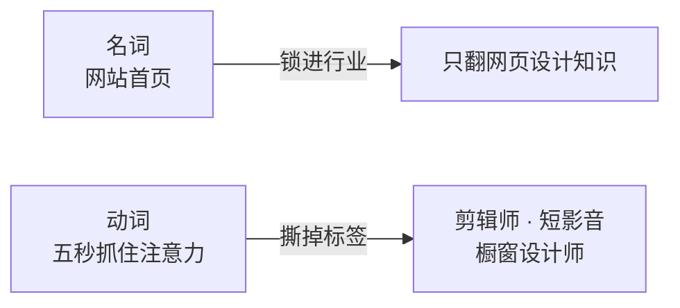

> 本文整理自一支 13 分钟的繁中解说视频，原片转述一位工程主管关于「如何更有野心地使用 AI」的文章。文稿由字幕整理而来，属整理稿而非逐字记录。
>
> 文中的案例、人名与数字沿用原片口述，未做外部核验。

## 开场那句话

作者用一句话立住了全篇。

> 我一直很认同：**创业的人，他的上限就是自己野心还有认知的上限。**
>
> **但我们生在这个 AI 的时代，我认为这句话适用于所有人。**

**然后他给了对照**：

> **同样的 AI、同样的模型、同样的月费**，你能用 AI 做出什么东西，**完全取决于你的野心和认知有多大。**

**这个对照很扎人，因为他举了另一半**：

> AI 一直在医学、数学或其他领域协助专家取得突破性进展。**但我们每天还在跟 Claude 说：「请你帮我写一封专业的邮件。」**

**而他特意留了一个平衡**：

> 当然了，**请 AI 把日常运营的琐事处理掉，这件事本身绝对没有错**。
>
> **你也不用去解开超级爆炸难的问题**——因为我相信，**在你上班的地方或者你自己的公司内部，就有很多问题困扰着你，但你从没想过要用 AI 去解决。**

## 两极分化

**原文章的作者每天看大家怎么用 Claude，发现一个很两极的现象。**

> **有一小群人已经用它做各种惊人的事，但大多数人还是把它当一般的搜索引擎或打字机来用。**

**而他的核心判断，我觉得是全篇最重的一句**：

> **早在一年前甚至更久以前，限制大家的就已经不是模型的智商了，而是旧的做事习惯**——**导致我们根本没想过可以把更大的问题丢给 AI。**

## 四个问题，四个维度

**当你决定把一件工作交给 AI，或者决定亲手做、不用 AI 的时候，可以先问自己四句。**

| 问题 | 维度 |
|---|---|
| 这件事能不能用 AI 做得**更快**？ | **速度** |
| 我能不能不只让它做流程中的一小部分，**而是直接负责最后的结果**？ | **高度** |
| 我能不能要求它做到**顶尖专家水准**的品质？ | **深度** |
| 这件事能不能**结合其他领域**的做法？ | **广度** |

上图是这四个维度。**他的判断是：第一个只拉开入门差距，后三个才是分水岭。**

> 追求变快是**一般人用 AI 最直觉的做法**，所以不多赘述。**而真正拉开你和别人使用 AI 差距的，得看后面三个。**

## 高度：退后一步问「我真正要什么」

### 大部分人视角放得太低

> 习惯自己先想好每一个步骤，再叫 AI 照着做。**像「帮我改这段文字」「帮我写这封信」，或者「帮我修好这一行程序」。**

**而他先给了理解**：

> 大家会这样做**完全没有错**，因为**过去的 AI 能力确实不够，没办法做到通盘考量**，你必须一步一步带着它走。

**但现在的关键变化是**：

> 现在的模型能力已经不可同日而语。**如果还一直帮它拆小步骤，不只低估了它的能力，有时候甚至我们自己拆步骤的方向都是错的。**

> 结果 AI 也只能顺着你的小步骤做，**没办法帮你解决真正的大问题。**

### 一个很具体的对照

> 去年年初他的视角还停在过去的习惯：**每次 App 崩溃，他就叫 Claude「帮我修好这一个 bug」**——**这就是盯着小步骤。**

> 但后来他把视角拉高，**直接跟它说：「我要的结果是让我们的 App 可以不崩溃。」**
>
> **AI 为了扛起这个大目标，就自己去抓崩溃报告、自己修、自己测试。**

**「从『帮我修这个 bug』变成『让 App 不崩溃』——这就是把视角拉高。」**

上图是这个转变。**注意差别不在措辞，在于「谁负责拆解」。**

### 但高度不是无限拉

**他补了一个很实在的边界，还带了个玩笑**：

> **视角也不是无限往上拉就有效。**如果你直接跟 AI 说「帮我搞个一百万来花花」，**那可能得等到下辈子。**

### 可操作的技法：一层一层问「然后呢」⭐

**这是全篇我認為最实用的一套动作。**

> 最实用的做法，是**一层一层往上试**。所谓一层一层，**就是一直问自己同一个问题：做完这件事了，然后呢？**

**他举的例子是每季度的复盘简报，四层递进。**

| 层 | 你给的 | 你得到的 |
|---|---|---|
| 一 | 数字，让它填进上季的模板 | **一份简报** |
| 二 | 所有资料，问「这季变了什么、为什么、接下来怎么做」 | **一份分析** |
| 三 | 请它挑出**现在最急的三个决策**，各写好支持与反对理由 | **一份决策清单** |
| 四 | 请它想「季报真正的目的是什么」，有没有更好的做法 | **一套新流程** |

**每一层的差别，他讲得很细。**

**第一层的问题出在哪？**

> 简报是做好了，**但开会的时候老板翻到第三页就会问：这个数字为什么掉了？**

**第二层好一点，但还不够**：

> 分析完了，大家坐在会议室里，**最后总要做出决定**——**不然开会就跟开派对没两样了。**

**第三层的变化很关键**：

> 这样一来，当你走进会议室的时候，**大家讨论的就是「我们的下一步是什么」，而不是一些空泛的数字。**

**而第四层他发现了一件更大的事**：

> 如果你再问一次「然后呢」，**你会发现季报这个东西有没有可能是旧时代的产物？**
>
> 以前分析资料要靠人一笔一笔翻、一笔一笔算，很花时间，**所以只能一季检讨一次。**
>
> **可是现在 AI 看资料的速度快太多了——那为什么还要等三个月，才发现业绩出问题？**

**于是他给出最高一层的做法**：

> 请 AI 去想：**季报真正的目的是让老板早点发现问题、把钱跟人放到对的地方。**
>
> **那有没有比季报更好的做法？**
>
> 比如设计一个**自动监测的流程**：每天盯着公司的数字，平常不来吵你，**一发现重要变化才主动通知老板**。
>
> 然后**请它用公司过去的资料，证明新方法能更早抓到问题**，再**跟现在的季报一起跑一季，看哪个比较好用。**

**这一段的收尾我很喜欢**：

> **从帮忙做简报，到重新设计整个检讨流程，用的都是同一个 AI——差别只在你多问了几次「然后呢」。**

### 什么时候停

> 就这样一层一层往上加，**加到你发现 AI 开始做不好了，再退回一层**——**那就是你现在能交给它的最大目标。**

**「退一层就是上限」——这个判据比任何理论都可用。**

## 深度：别做角色扮演，要方法论

### 直觉 vs 严谨

> 一般人解决问题是**凭直觉猜答案**——就像头痛直接去买止痛药吃。
>
> 但**顶尖专家解决问题是有一套严谨的方法跟工具**——就像专科医生会先帮你抽血、照 X 光、看最原始的检查报告，**找出病因才开药。**

**而 AI 两种都做得到**：

> **但如果你没有特别要求，它就会给你平庸的答案。**

### 这一关为什么难 ⭐

**他点出了一个我觉得很关键的认知障碍**：

> 这一关之所以难，**是因为它卡在我们自己的认知上限。**
>
> **很多时候我们并不是那个领域的专家，你不知道顶尖的人到底怎么做事**——**所以你根本提不出够深入的要求。**

### 角色扮演为什么没用 ⭐

**这一段是全篇最有洞察的部分。**

> 一般人最常做的，就是跟 AI 玩角色扮演——**直接跟它说「你现在是一个十年的资深行销专家，帮我改写首页的文案」。**

**但会发生什么？**

> **模型听到这句话，通常只是把语气跟用词换得比较华丽**，**而它背后做事的方法完全没变**——**只是用专家的口气讲外行话而已。**

上图是这个失效。**注意它不是完全无效，而是「看起来专业，但没解决问题」。**

### 四问法：先问方法，再让它动手 ⭐

**他给的替代方案很干脆**：

> 在他叫 AI 动手之前，**先问它几个问题。**

| 问 | 目的 |
|---|---|
| 一 | 这个领域**最顶尖的专家**处理这件事时，**会做哪些我没想到的事**？ |
| 二 | 他们会看**哪些第一手资料**，而不是只看别人整理好的报告？ |
| 三 | 他们具体会**用哪些专业的方法跟工具**？ |
| 四 | 做完之后**怎么证明结果真的有用**，而不是只有你自己感觉不错？ |

### 实战：改首页文案

**他真的把四个问题丢给模型跑了一遍，而第一个回答就翻转了前提。**

> 顶尖的专家**第一步根本不会碰文案**，而是**先确认问题到底是不是出在文案**。
>
> 转换率掉下来，**有可能是广告换了受众、网页变慢，甚至是追踪码坏掉**。
>
> **如果是这些原因，你把文案改得再漂亮也没用。**

**第二个问题的答案也很具体**：

> 专家不会从整理好的报表开始看，**而是去翻最原始的东西**——像**客服对话、客人留下的评论、网页的录影跟热点图**。
>
> 看**客人到底停在哪里、在哪一步离开**。

**而它还给了一句我觉得非常实用的**：

> **最好的首页标题，常常就是直接从客人的原话里抄出来的。**

**第三个问题，它给了一套可执行的工具**：

> 像是用某个模型从**价值主张、相关性、清晰度、焦虑感、分心、急迫感**这六个面向，一块一块检查你的首页。
>
> 或是做**五秒测试**：让陌生人看你的首页五秒钟，再请他说出**「这是什么、给谁用、为什么选它」**——**说不出来，就代表首页没有在做它该做的事。**

**第四个问题，它的答案最关键**：

> 要证明新文案真的有用，**不能靠你觉得，也不能靠 AI 觉得**——**要靠真实的客人**。
>
> 你要拿新旧两版文案去跑对照测试：**一半的人看旧版，一半看新版，看哪一版真的卖得比较好。**

### 这一段的结论

> **简单的一句「请帮我润色这个文案」，大概率拿不到这样有深度的答案。**
>
> 透过先问 AI 这四个问题，**你让 AI 先把顶尖专家的方法论搬出来**——**不但可以偷学几招，瞬间把自己的认知拉高一层**，最后的产出可能也会大有不同。

### 小诀窍：故意给一个不合理的目标

> 比如你的网站要十秒才打得开，你想改到五秒——**那就不要跟它说五秒，直接说「我要 0.2 秒就能打开」。**
>
> 如果 AI 跟你说这不可能，**你就回它「这绝对做得到，继续想办法」。**

**他说这招有研究支撑**：

> 有两位心理学家整理了三十五年的目标设定研究，**发现被要求达成具体又困难目标的人，表现会比只被叫「尽力就好」的人更好。**

**而机制解释很直白**：

> 如果你的目标只是五秒，**找到的就是小修小补**。**目标要是两百毫秒，小修小补根本不够，只能去想完全不同的做法。**

## 广度：把名词换成动词 ⭐

### 为什么 AI 不主动跨领域

**这个归因我觉得很准。**

> AI 明明懂全世界所有行业的知识，**但为什么它平常不会主动帮你跨领域？**
>
> **原因是我们开口给任务的时候，习惯讲「我要做什么东西」**——比如「我要做一个网站首页」「我要做一份业务简报」。
>
> **而「网站首页」「业务简报」这些名词本身，就已经贴着特定行业的标签了。**

> 当你跟 AI 说要做网站首页，**等于是把它的思考范围锁进「网页设计」这个小框框里**。**它的行为通常就是去翻网页设计师的知识库、避开其他领域——因为这样通常更有效率。**

### 技法：把名词换成动词

**他引用了一个方法，我认为这一节的价值最高。**

> **忘掉那个成品的名称，只看它实际要发挥什么作用。**
>
> 因为**成品的名称是单行业专属的，但它要发挥的作用是跨行业共通的。**

**例子**：

> 你不要说「我要做一个网站首页」，而是先想：**首页真正要发挥的作用是什么？**
>
> 你的答案可能就会变成——**「我想要在五秒内让一个陌生人停下来，而且产生好奇心。」**

> 当你把「网站首页」这个标签拿掉，改用这个作用去问：**全世界有哪些不同行业的人，最擅长在五秒内抓住陌生人的注意力？**

**这时候搜出来的东西就变了**：

> 不再是网页设计师，**而是电影预告片剪辑师、短影音创作者，甚至百货公司橱窗设计师的手法**——**全部借过来，教你怎么设计第一眼的画面。**

上图是这个切换。**注意它不是换个说法，是换了一整个知识域的检索范围。**

## 最后一关：动手之前的自我设限

**他说这是原文章最后的提醒，也是我觉得最有分量的一段。**

> 很多人就算知道了这些方法**还是不会去试**，**因为真正卡住我们的，往往在开口之前。**
>
> **很多事我们根本连问都没问，直觉就认定「这件事 AI 不可能做得到」。**

### 两个故事

**第一个是关于「不知道它不可能」。**

> 1939 年，柏克莱有个学生上统计课迟到。他看到黑板上有两道题，**以为是作业，就抄回去当作业写。**
>
> 回家后他把这两道题解开了。**交出去才知道，那是统计学界一直没人解开的两道难题。**
>
> **但正因为没有人告诉他这两题解不开，他就真的解开了。**

**第二个是关于「看见别人做到了」。**

> 几十年来，人类一直没办法打破一千六百米的跑步纪录——**始终卡在四分钟以上**。
>
> 结果 1954 年有人打破了四分钟的纪录。**后来只过了四十六天，就有第二个人也打破了。**

上图是这条心理门槛的崩塌。**限制不在身体，在「没人做到过」这个信念。**

**他还给了一个当代的例子**：

> 前阵子西班牙有一个二十八岁的产品经理，**完全没受过天文学训练、连望远镜都没有**，**却靠着写代码扫描了十二万多颗恒星的公开资料，然后发现了一颗潜在的新行星。**

### 第二个方法：别太害怕

> 大多数人都**高估了风险，又低估了回报**。
>
> **用 AI 更是这样**：在现实中做错决定可能会赔钱，**但问 AI 一个它做不到的问题，代价就是几分钟跟一点点 token 而已。**

**「既然失败的成本几乎是零，你就不需要先相信它做得到——只要愿意试一次就够了。」**

## 收尾

> 一直给自己设限，**会让你错过太多太多的机会**。
>
> **AI 让人类的能力突飞猛进，但我们大多数人挑战未知的勇气却还停留在原地。**

**最后回到开头**：

> 在 AI 时代决定你能走多远的，**还是你的野心跟认知**。
>
> **野心决定你敢把多大的问题交给 AI，而认知决定你能让 AI 发挥出多深多广的实力。**

## 我的三点补充

以下是评注，不是原片内容；取舍由我负责。

**第一，「一层一层问然后呢」这套动作，真正的产出不是更好的答案，而是重新定义了问题。** 前两层（简报、分析）都还在原问题的框架内改进；到第四层，**它质疑的是「季报」这个形式本身**。而这个跳跃之所以可能，是因为**AI 没有「这件事本来就该这么做」的包袱**——它不知道季报是行业惯例，所以它敢问「为什么是季」。**这是人和 AI 协作里比较少见的一种互补：你的领域知识负责判断可行性，它的无知负责打开可能性。**

**第二，「角色扮演给的是口音，四问法给的是方法」这句区分，值得单独记。** 因为角色扮演的门槛太低，容易让人误以为已经做了深度要求。**但它的作用域只在措辞层**——模型会调整语气、选更专业的词，**却不会自动切换到那个领域的作业流程**。而四问法之所以有效，是因为它**逼模型先把方法论显式说出来**，然后你才有机会审视：这套方法我认不认、适不适合我的场景。

**第三，「名词换动词」这个技法，本质是在给检索换索引。** 因为 AI 的知识是按行业组织的，**你说出行业名词，就等于指定了检索分区**。而作用描述是跨分区的，**所以它能命中那些「解决同一类问题但属于别的行业」的方法**。这也解释了为什么这个技巧在创意类问题上特别有效——**创意的本质往往就是跨域嫁接**，而它刚好打开了跨域的通道。

---

一句话总结：**同一个模型，能做出什么取决于你敢问多大的问题。** 而「敢」这件事，卡在两层——**一层是你不知道怎么问得更深，一层是你压根没问就认定它做不到。**
