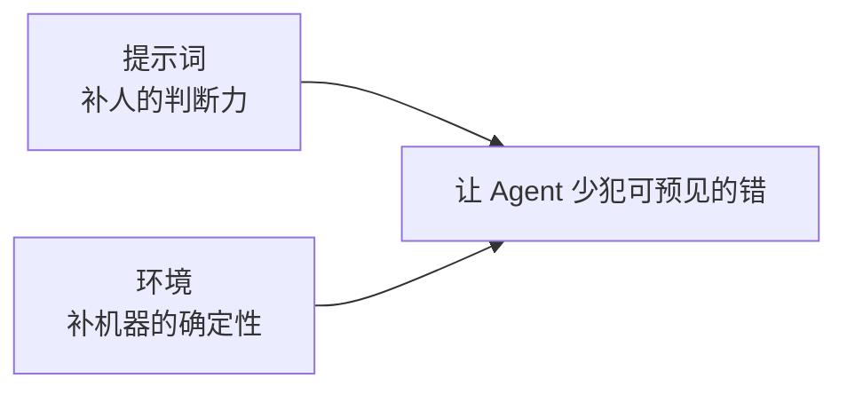
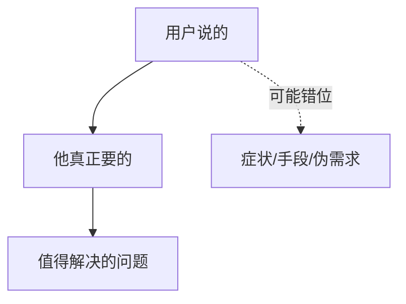
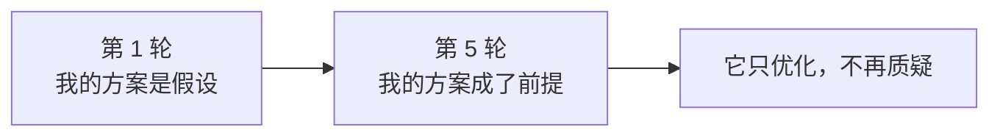
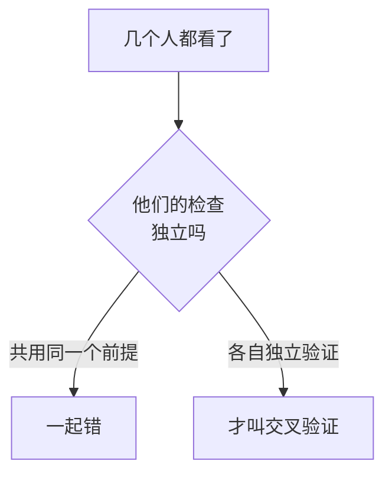
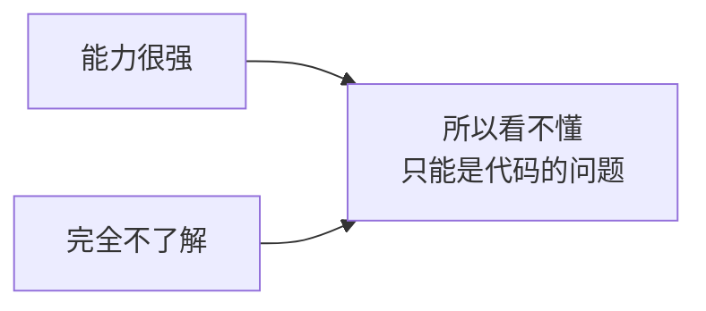
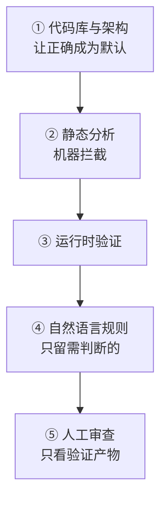
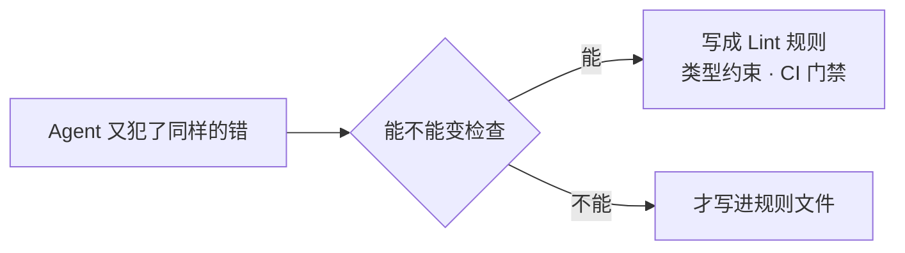
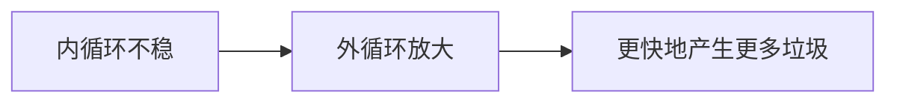

> 本文整理自一份流传的提示词合集（原作者署名为「数字生命卡兹克」），以及一位工程师关于「信任倒金字塔」的公开表述。内容属整理稿而非逐字照搬。
>
> 文中提到的一位工程师的团队数据（月合入 PR 数与回滚率）沿用原述，**未做外部核验**。

## 先说这批素材的形状

**它不是一篇文章，是一堆可以直接抄走的话。**

**而把它们摊开看，会发现它们其实在补同一件事**：**模型默认会往「讨好、含糊、表面完成」的方向滑**，而每一条提示词都是在那个方向上顶一根柱子。

**而后面那部分（信任倒金字塔）反过来问**：**为什么有些事根本不该靠提示词？**

上图是这两半的关系。**它们不冲突，而是分工。**

## 第一类：逼它想清楚

### 找根因

> **从第一性原理出发，找到最本质原因，修复一下。**

**这条最短，但它约束的是「别打补丁」**——「修复一下」很容易变成改表象，**而前半句把落点定在了原因上。**

### 先对齐再动手

> **先问一些不清晰的问题，对齐我的喜好，然后再出三版方案。**

**两件事被捆在了一起**：**先问清楚**（而不是猜），**再给三个选项**（而不是给一个让你无从比较的方案）。

**「三版」这个数字我觉得有讲究**——一版是没有选择，两版容易二元对立，**三版刚好能逼出「还有第三种做法」这一层。**

### 别把我的问题当成正确的问题 ⭐

**这一条我认为是整批里最有分量的一句**：

> **不要默认我提出的问题定义就是正确的。**
>
> **你先分析我真正想解决的底层需求，判断我有没有把症状误认为原因、把手段误认为目标。**
>
> **如果存在更值得解决的问题，直接指出来。**

**它拆的其实是三类错位**：

| 错位 | 表现 |
|---|---|
| **症状当成原因** | 界面卡 → 去优化渲染，其实是数据量炸了 |
| **手段当成目标** | 「加个缓存」→ 目标可能是「让它别那么慢」 |
| **问题本身选错了** | 这个需求其实不值得做 |

上图是这个拆解。**而它的价值在于：它给了模型「反驳你」的授权。**

### 推演二阶三阶影响

> **不要只考虑这个改动产生的直接效果。继续推演它的二阶、三阶影响**，
> **尤其关注对其他模块、用户行为、系统复杂度和长期维护成本的潜在影响。**

**这四个观察面我认为选得很准**：**其他模块**（耦合）、**用户行为**（人会怎么用它绕过去）、**系统复杂度**（引入了几条新路径）、**长期维护成本**（谁将来要改它）。

**「用户行为」这一条最容易被漏**——因为技术评审通常只看代码，**而新功能的真实成本往往在「人会怎么滥用它」上。**

### 跨领域找方案

> **其他领域里有没有类似的方案，用跨领域的方式全面思考，找到最优解。**

**还有一条更具体的**：

> **我的想法或目前存在的问题，是否是其他领域经典问题的变体，有无成熟的解决方案，请进行跨领域的广度搜索核实这一点。**

**注意第二条的措辞**：它要的不是「随便联想一下」，**而是「核实」**——**先假设它是某个经典问题的变体，然后去验证。** 这两者的差别很大：**前者产出类比，后者产出结论。**

## 第二类：逼它别迎合

### 假设自己错了 ⭐

> **先假设你当前认为最合理的方案是错误的。**
>
> **站在最强反对者的角度，寻找能够推翻它的证据、反例和边界情况。**
>
> **然后重新评估方案，看看有没有更好的解法。**

**这条的结构很干净**：**先立一个「最强反对者」的位置**，**再要求它去找能推翻的证据**——而不是「顺便想想有什么风险」。

**「最强反对者」这个限定是关键**：因为日常的「有什么风险」会得到一堆无痛的小风险，**而「最强反对者」要求它站在真正想打败你的立场上。**

### 定场：不许迎合 ⭐

**这一条是给整场对话定基调的**：

> 请在与我的讨论和回答中遵循以下原则：
>
> **以事实、证据和合理推理为依据，不因我的立场或偏好而迎合我，也不为反对而反对。**
>
> **如果我的观点、前提或推理存在问题，请直接指出并说明理由；依据不足或存在不确定性时，请明确说明，区分事实、推断与意见。**

**它同时压住了两个方向**：**「不因偏好迎合」**，和**「不为反对而反对」**。第二条常被忽略，**但确实存在「为了显得独立而故意挑刺」这种失效。**

**而「区分事实、推断与意见」这一句，我认为是它最实用的部分**——**因为它要求模型给自己的每句话标注证据等级。**

### 越聊越不对劲时，归拢一下

**这一段我觉得场景选得很真实**：

> **每次跟 AI 聊，越聊越不对劲的时候**，都需要这个提示词来归拢一下想法：
>
> 请重新回顾此前围绕 X 的设计讨论，**独立重新评估该设计的取舍**，并判断什么才是最佳方案；
>
> **不要因为那些建议由我提出就倾向于接受，也不要为了迎合我而让步。**
>
> **给出你独立得出的推荐设计，说明理由、关键取舍和仍存在的不确定点或需要补充验证的信息。**

**「不要因为建议由我提出就倾向于接受」——这句话直接点出了那个隐形的偏移**：**在多轮对话里，你的方案会慢慢变成「既定前提」**，而模型会开始围着它优化，**而不是质疑它。**

上图是这个漂移。**而这条提示词的作用是把它重置回第一轮。**

### 允许它说得难听

**这一条是上一类的加强版**：

> 继续向我提问以确保你完全理解我的意思，**且你的回答必须完全无隐瞒，禁止讨好我而隐藏「你做不到」的事实**，
>
> **你的回答可以犀利甚至有些「不安全」「偏执、疯狂的」。**

**「禁止隐藏你做不到的事实」——这一句我觉得比「要诚实」有力得多**，因为它针对的是一个具体行为：**遇到做不了的事，它倾向于换个说法绕过去，而不是直说。**

## 第三类：逼它做验证

### 深层推演

> 请执行深层推演。**在生成最终结论前，先列出至少 3 种边界异常与假设推翻场景**，
> **逐一进行逆向压力测试，确认逻辑无误后再输出解决方案。**

**「先列，再测，最后才输出」——它把顺序写死了。** 这一点很重要，因为**模型默认是先给结论，再补理由。**

### 那项自我检查 ⭐

**这一条只有一句，但我觉得是整批里最锋利的一条**：

> **如果其他几方都错了，你这次做的哪项独立核验，有机会发现那个错误。**

**它问的不是「你确认了吗」，而是「你的确认里哪一步是独立的」。**

上图是它要区分的东西。**因为「三个人都检查过了」和「三个独立的检查都过了」是两件事**——**而后者才叫验证，前者只是复核同一个视角。**

### 复盘要落到机制

> 全面复盘最近某段时间的 Bug、返工、回滚和重复修改。
>
> **不要只统计发生了什么，要分析这些问题背后有没有共同的根因。**
>
> **把能够预防的共性问题沉淀成项目规则、自动化或者 skill，避免我们反复支付同样的成本。**

**「沉淀成规则、自动化或 skill」——这句话把复盘从「总结经验」拽到了「改环境」**，而这正是后面那半篇的主题。

### 性能排查

> 全面分析最近某段时间里的所有 PR，**找出最慢的那几个**，看看有没有导致卡顿、可以优化的地方。

**这条朴素，但它示范了一件事**：**先缩小范围（最慢的几个），再分析**——而不是「全面分析所有 PR」。

## 第四类：让它做清理

### 读历史，找遗产 ⭐

> 深入分析整个代码库的 Git 历史、关键 PR 和架构演变过程。
>
> **找出哪些设计是有意为之，哪些是历史遗留，哪些是为了解决已经不存在的问题而引入的。**
>
> **识别可以安全移除的历史包袱。**

**这三分类我觉得非常实用**：

| 类型 | 怎么处理 |
|---|---|
| **有意为之** | 保留，**且要理解为什么** |
| **历史遗留** | 可评估移除 |
| **为了解决已不存在的问题** | **最值得清理**——它的存在理由消失了 |

**第三类是最隐蔽的**：代码本身没错，**但它防的那个风险已经不存在了**——于是它变成纯负担。

### 换人接手测试 ⭐

> **假设明天有一个完全不了解项目、但是能力很强的工程师来接手。**
>
> 请评估他理解整个项目需要付出的**认知成本**，
>
> **找出那些命名混乱、抽象过度、职责不清晰、需要大量上下文才能理解的代码**，并提出简化方案。

**「能力很强但不了解项目」这个设定很妙**——**它排除了「看不懂是因为水平不够」这个借口**，把问题唯一地归到代码上。

上图是这个设定的逻辑。**它把「可读性」变成了一个可测量的东西：新人要花多久。**

### 清掉过程记录

> 请全面检查当前项目的所有文件（包括脚本、文档等）：
>
> **逐项审查并确认代码结构干净、命名与结构统一归一、遵循单一职责原则**；
>
> **删除冗余内容、废弃的历史记录及历史思考过程，仅保留最终敲定的版本**；
>
> 最后对所有修改进行审核，并汇总说明发现的问题、已做的清理与调整，以及是否还存在潜在冗余或待确认的取舍。

**作者的理由很实在**：**「因为发现 AI 总记录一大堆过程」**。

**这条和前面几讲那条「做加法谁都会，做减法很难」是同一个问题**——**AI 尤其擅长留痕，因为写下来对它没有成本，而清理对它有。**

### 低熵运行

> **尽量保证低熵运行，确保任务中不留存非必要的上下文噪声、历史返工噪声，仅保留正向流程。**

**「历史返工噪声」这个词我觉得很准**——它指的是那些**「试过但失败了」的痕迹**。它们看起来是信息，**但在后续轮次里只会稀释注意力**。

## 第五类：UI 与方法

### 先收束功能，再谈界面

> 从产品经理的角度去对整体功能需求进行收束，**梳理一份核心功能架构，出一个 mermaid 的功能流程图**。

**注意顺序**：**先收束需求，再画图**——而不是「画个图看看」。

### 洗掉 AI 味

> 【洗掉 AI 味】从用户体验的视角，去对整体产品 UI、UX 设计做优化，
>
> **去掉无用说明、改掉用户不懂的晦涩文字、最大程度简化用户操作**，优化后使产品达到可交付的标准状态。

**这三件事其实是一条线的三个层次**：**删掉不需要的** → **改写看不懂的** → **减少要操作的**。

## 下半部分：信任倒金字塔 ⭐

**前面那十九条，本质都是「用提示词让 Agent 表现更好」。**

**而这位工程师的框架反过来问**：**哪些事根本不该靠提示词？**

### 那句话

> **她的核心不是「更聪明的提示词」，而是「更可信的环境」。**

**而这个判断是拿数据支撑的**：

> 她团队**一个月合入约一万一千个 PR，回滚率约零点五个百分点**。
>
> **前提就是内循环先不掉链子。**

### 五层，按确定性从高到低 ⭐

**她说把精力从上到下投在「确定性更强」的地方。而她的排序是这样的。**

| 层 | 手段 | 确定性 |
|---|---|---|
| **一** | **代码库与架构**：接口设计、目录边界、重构，**让正确写法成为默认路径** | **最高** |
| **二** | **静态分析**：Lint、类型系统、编译器、测试，**机器自动拦截** | 高 |
| **三** | **验证**：运行时验证加形式化验证，**确认真的跑通** | 中高 |
| **四** | **自然语言规则**：规则文件、Skill，**只留需要判断的部分** | 低 |
| **五** | **人工审查**：成本最高，**尽量收缩到只看验证产物** | **最低** |

上图是这个倒金字塔。**注意它「倒」在哪**：**人们习惯把精力花在顶部（人工审查）和中部（写规则），而她把重心压到了底部。**

**而「让正确写法成为默认路径」这句是关键**——**它不是说「告诉它怎么写对」，而是「让它不写对就很别扭」。**

### 那个关键动作 ⭐

**这一句我认为是整篇最该被记住的**：

> **每次纠正 Agent，先问「能不能变成一条确定性检查」，而不是往文档里再加一行规则。**

上图是这个决策。**它把「加规则」从第一反应降级成了兜底选项。**

**我能想到它为什么有效**：**规则是「希望它照做」，检查是「它做不到就过不去」。** 而模型的执行是不稳定的——**它会忘、会误解、会在长对话后漂移**，所以**凡是能变成机械检查的，都不该留在「希望」这一层。**

### 内外双循环

**他用两个循环解释规模化的前提**：

| 循环 | 内容 |
|---|---|
| **内循环** | **单个 Agent 自己跑、自己验证、自己举证**，**先别急着并行** |
| **外循环** | 内循环足够稳之后，**用编排层调度大量 Agent 并行干活**，自动开 PR、跑验证、合入 |

**而那句总结我觉得该裱起来**：

> **先修好 Agent 干活的环境，再谈规模化。**
>
> **内循环产出是垃圾，外循环只会更快地产出更多垃圾。**

上图是这个放大效应。**它和前面几讲那条「没有终止条件会烧掉预算」是同一类结构：并行不创造正确性，它只放大现有水平。**

## 我的三点补充

以下是评注，不是原片内容；取舍由我负责。

**第一，那十九条提示词里，真正有效的那些都在做同一件事：给模型一个「可以说不会」的位置。** 「不要默认我的问题定义正确」「假设你的方案是错的」。

「禁止隐藏你做不到」「你的回答可以偏执」。**它们都在解除「必须让你满意」这个默认约束。**而这个约束不是模型故意加的，**它是训练出来的**。所以想让它说真话，**得先明确授权它顶撞你**。

**第二，「如果其他几方都错了，你哪项独立核验能发现」这一条，问的是检查的独立性而不是覆盖率。** 因为多个检查如果共享同一个前提，**它们会一起错**——数量再多也不构成验证。**这也是为什么「三个人都看过了」不能替代「三个独立的检查」。**

**第三，信任倒金字塔真正的贡献，是把「写规则」从答案降成了兜底。** 大多数人遇到 Agent 犯错的第一反应是**补一条规则**，而它问的是**能不能变成一条确定性检查**。这个转向的深层理由是：**规则的执行依赖被约束者的配合，而检查不依赖。** 所以两者不是「程度不同」，**是性质不同**——一个是在请求，一个是在强制。

---

一句话总结：**提示词能让 Agent 少犯错，但只有环境能让它「犯不了那个错」。** 而判断标准很简单：**你这条纠正，是希望它记住，还是让它做不到？**
