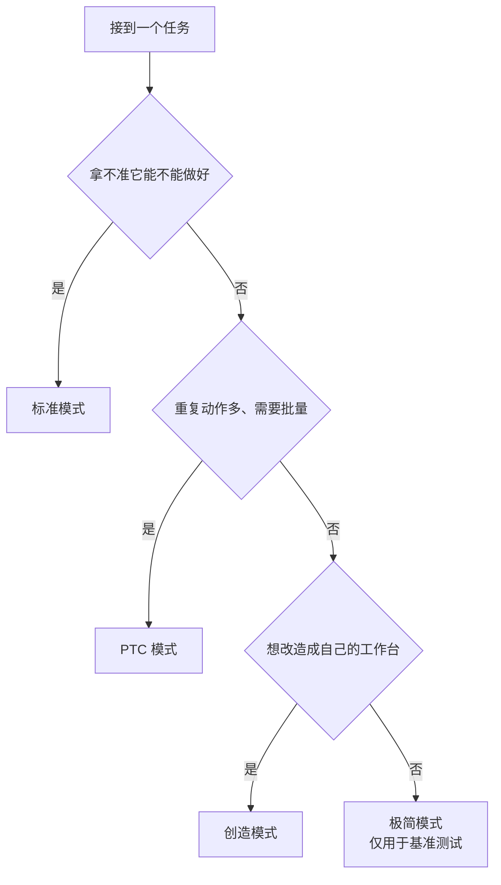
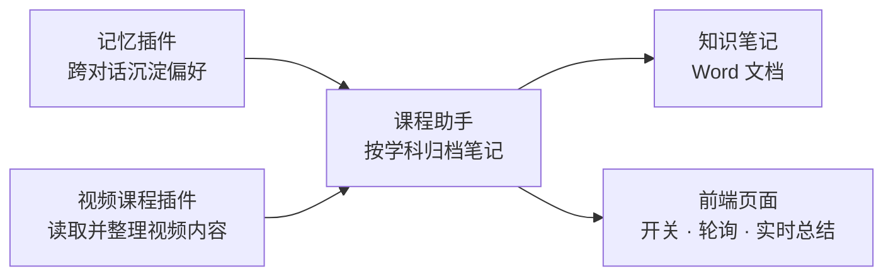
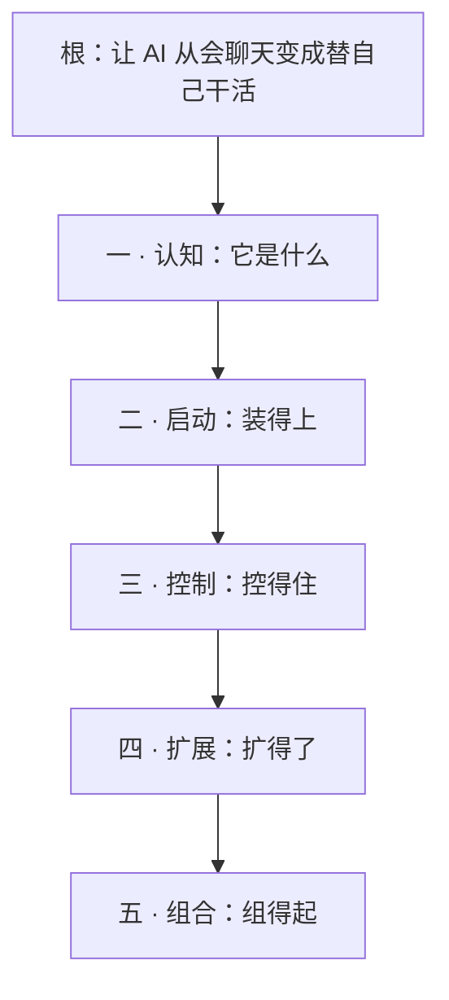

> 本文整理自 B 站视频《【全网最全】DeepSeek Harness 超详细教程：50 分钟吃透 DSH，让 SuperAgent 给你干活》，作者元宝，片长约 50 分钟。原片是一条完整的上手路径，从下载安装一路讲到插件组合，不是 API 文档式的功能清单。
>
> 字幕由语音转写生成，专有名词错听较多，例如把 Harness 转成“哈尼斯”、把 PTC 转成“PDC”。本文按官方写法统一订正；几处转写完全无法还原的插件名，只按功能描述，不猜英文名。

多数人第一次打开 AI 编程工具，会遇到同一种落差：看别人用得很顺，自己上手却不知道点哪里。原因往往不是模型不够强，而是没搞清这套东西的**部件关系**——哪个是模型、哪个是环境、哪个决定它能干什么。

原片用了一套很稳的比喻：**马、马具、车马间**。下面沿用这套比喻，把五十分钟压成一条可以按图索骥的路径。

## 先把名字拆开

DeepSeek 是模型的名字，也是做模型的公司。Harness 这个词直译是**马具**，就是套在马身上那一整套东西：缰绳、嚼子、套包。

这个比喻的关键在于：马具既不是马本身，也不是马后面拉的车。它只做一件事——**把马和车连起来，让马听得懂人往哪指挥**。

对应到软件上，两者的分工是这样的。

| 部件 | 比喻 | 负责什么 |
|---|---|---|
| 模型 | 马 | 理解要求、分析问题、决定下一步 |
| Harness | 马具与车马间 | 读哪个文件、能调哪些工具、做完一步之后怎么继续 |

所以一句话定义：**DeepSeek Harness 是一套把大模型套上工具的装置。**它让模型不只会回答问题，还能在你自己这台电脑上读文件、写文件、跑命令、装插件、定时干活。

### 和网页版到底差在哪

“都有 DeepSeek，为什么还要装一个桌面端”——这个问题用一句话就能回答：**网页版是一个聊天窗口，Harness 是一个干活的现场。**

窗口和现场的区别，落在三个具体动作上。

**改文件。**网页版里，你要么把文件传上去，要么把要改的内容复制过去，改完再粘回来。在 Harness 里，它直接打开那个文件改。

**查资料。**网页版要你把资料一段一段粘给它。Harness 可以自己翻本地文件夹，也可以自己上网搜。

**批量。**一百个文件要改同一个地方，网页版只能一个个粘。Harness 会自己写一个小脚本，一次改完。

### 一个很多人踩过的坑

有人以为模型越强，Harness 的能力就越强。这句话只对了一半。

马具再好，马具**配错了**一样拉不动车。**选对模式、给对权限、下对指令**，往往比换一个更贵的模型更管用。这也是整期教程里最值钱的一句判断。

## 启动：从下载到第一句回复

这一步比想象中简单。整个过程没有命令行，不配环境变量，也不提前装依赖，和装一个微信没区别。

（1）去官网下载对应系统的安装包。桌面端目前支持 macOS 和 Windows。

（2）Windows 双击一路下一步，**安装路径建议选 D 盘**。macOS 双击打开，把图标拖进“应用程序”。

（3）打开后用手机号加验证码登录。**这一步不能跳过**，因为配置、会话、已安装的插件全都跟着账号走；换一台机器登录，它们也还在。

（4）首次进入会让你准备调用额度。注意两点：充值金额是**用来调用 API 的**；如果已经买过 DeepSeek 官方或其他模型的 API，直接点继续，不用再充。

（5）配 API。路径是左下角账号 → 设置 → 第三栏“模型”。这里有两栏容易混。

| 栏目 | 填什么 | 什么时候用 |
|---|---|---|
| DeepSeek 账号 | 平台账户里的余额 | 已经在桌面端充过值 |
| DeepSeek | 你买到的 API Key | 有自己的 Key，粘贴后旁边出现绿点即成功 |

想接第三方模型，就点“添加模型供应商”，选好提供商，把 Key 粘进对应一栏保存。

（6）验证。随便给一个提示词，收到回复就说明配通了。

### 界面只有三块

| 区域 | 内容 |
|---|---|
| 左导航栏 | 新建对话、插件入口、按工作区分组的会话列表、账号与设置 |
| 中间对话区 | 标题栏（显示当前会话与模式）、对话与轨迹两个视角、输入框 |
| 右侧停靠面板 | 文件浏览、终端（可多实例）、内置浏览器，支持多标签与左右分栏 |

右侧面板默认隐藏，点标题栏角落的按钮才滑出来。它可以同时开两个页面，也可以一键全屏。这个设计的意义在于：**模型在中间干活，你可以在旁边同时看文件、看网页、看运行结果。**

还有一个开关值得先打开。设置 → 通用设置 → 打开“显示代码工作图”，回到会话就能在标题栏下面看到“对话”和“轨迹”两个按钮。

它们是同一段过程的两种看法。**对话**是熟悉的问答流，适合看结论。**轨迹**是按时序排的事件记录表，点开任意一条能看到这一步的 token 用量和耗时，适合复盘它到底怎么一步步做出来的。

## 控得住之一：四种模式怎么选

模式决定的是“这匹马怎么干活”。原片反复强调一句：**模式之间没有强弱之分，只有适配之别。**

| 模式 | 工具配置 | 适合什么 |
|---|---|---|
| 标准 | 功能完整：文件编辑、shell、文件检索、网页检索、skills、计划、目标、子代理、工作流 | 拿不准时先用它；日常任务与资料整理 |
| PTC | 同样是完整编码 agent，但默认不提供工作流工具 | 重复动作多、要批量的任务 |
| 极简 | 只保留两个工具：持久化 shell 与文件编辑器，配固定提示词 | 跑模型基准测试 |
| 创造 | 标准模式全部工具，另加运行时检查、插件管理、开发指引 | 想改造 Harness 本身、写插件、做自己的模式 |

有一条操作限制要先知道：**一个对话里可以换模型，但不能中途换模式。**新建对话时就得想好用哪个。

### PTC 到底不同在哪

PTC 的全称是 programmatic tool calling，也就是通过程序调用工具。

标准模式的工作方式是**让 agent 直接调工具**：做一步、调一次、等结果、再往下走。PTC 反过来，让 agent 先用 run code 写一段 TypeScript 程序，再用生成的工具 SDK 发起调用。程序里可以写循环、条件判断、错误处理，也可以把适合并发的调用放在一起。

一句话：**标准是先干一步看一步，PTC 是先写脚本再批量干。**

同一个任务，两种模式交出来的结果往往很像，差别藏在过程里。把两个会话的轨迹页并排看，能看出三处不同。

| 对比项 | 标准模式 | PTC 模式 |
|---|---|---|
| 轨迹形态 | 一条长链，每做一步就调一次工具 | 一整段程序加一个干净的结果 |
| 记录表 | 几十条工具调用记录 | 几条 run code 记录 |
| token 花费 | 高 | 明显更低 |

差异最大的是 token 那一栏：**干差不多的活，花的钱差出一大截。**

### 选模式的四句话

觉得拿不准，先用标准模式。重复动作多、需要批量处理，再考虑 PTC。想把 Harness 改造成自己的工作台，选创造模式。要跑几种测试、只关心模型本身的表现，选极简。

原片末尾留了一个小测试：二十份格式相同的笔记，要做同一套提取，选哪个模式。按上面四句话推，答案是 PTC。

上图把那四句话排成了判断顺序：先排除不确定，再看动作是否重复，最后才考虑改造。

## 控得住之二：工作区与四档权限

如果模式决定马在哪干活，权限就决定它在这块地方能干多大的事。讲权限之前，得先有工作区。

新建对话时，模式按钮旁边有一个写着“默认工作区”的按钮，点它可以选一个本地目录，也可以新建一个位置。添加成功后，左侧导航栏的会话列表会自动按工作区分组。

权限一共四档，前三档原生自带，第四档要在插件界面里开启。

| 档位 | 能做到什么 | 边界在哪 |
|---|---|---|
| 仅可查看 | 读取允许读的内容 | 不能改文件；请求写入会被限制并提醒 |
| 工作区内修改 | 工作区内随便改 | 碰工作区外的文件会被沙箱拦下，报文件访问被拒 |
| 完全权限 | 选择时弹风险确认，确认后放行 | **越界操作仍会弹审批卡片**，每次都要单独放行 |
| 自动授权审查 | 每次调用前先给模型做前置审查，通过后按完全权限执行 | 可能误放不安全操作，也可能误拒有用操作，且每次审查额外消耗 token |

三个容易误解的点。

**完全权限不等于不再问你。**原生状态下，即使切到完全权限，越界的操作仍会弹审批卡片。想真正不再逐个确认，得额外装一个社区插件，这一档本身不带这个效果。

**自动授权审查是实验性的。**选择器上带 EXP 标记，要先在左侧插件页里开启它，才能在会话里选到。选了之后同样会弹一次当前对话的风险提示。

**日常工作用“工作区内修改”就够。**既能干活，又有边界，不会把电脑弄乱。

上图是四档按放权程度排成的阶梯。注意两点：拦人的位置在第二档之后；最右边那档虽然建立在完全权限之上，仍可能放错或拒错。

## 控得住之三：八条指令与三个 Office 技能

每次用鼠标点权限太麻烦，于是有了斜杠指令。总共八条，分成三组。

| 组 | 口诀 | 菜单条目 | 作用 |
|---|---|---|---|
| 常用四条 | 先计划 | `plan` | 先出计划，你同意再动手 |
| | 给权限 | `permission` | 直接切到某一档，改完看界面状态是否真切过去 |
| | 清桌面 | `compact` | 把聊过的内容压成摘要，给后续任务腾空间 |
| | 传文件 | `file` | 把本地文件直接交给它 |
| 进阶两条 | 选模型 | `model` | 切换当前对话使用的模型 |
| | 管目标 | `goal` | 设定一个跨多轮持续推进的长期目标 |
| 收发两条 | 提意见 | `feedback` | 把意见正式反馈给官方 |
| | 存档案 | `export` | 以 zip 格式导出当前对话日志 |

口诀按菜单顺序念：**先计划、给权限、清桌面、传文件、选模型、管目标、提意见、存档案。**

上表的英文名按字幕还原，个别可能是单数形式。界面里以你看到的条目为准，作用是准的。

有两件事必须记牢。

**第一，指令是给界面下的，不是给模型下的。**光敲一个指令，它不会跟模型说话。所以**指令本身不消耗 token，只有指令后面跟了内容才消耗。**这是全篇最实用的一条省钱知识。

**第二，管目标不是普通提问。**普通提问只执行一轮；设了目标之后，agent 会围绕它持续工作，每轮结束自动进入下一轮，直到目标完成、被拦住，或达到轮次上限。单轮任务不用开，跨多轮的长任务才值得。

“压缩上下文”值得单独说，因为它有明确的触发信号。出现以下任一情况就用它：它开始忘记前面提过的要求、开始重复已经说过的事、界面提示上下文快到上限。

### 菜单里还坐着三个邻居

输入斜杠时，菜单里除了八条指令，还并列着三个 Office 技能：Office Docs、Office PPT、Office Excel。

它们看着像指令，性质完全不同。**指令是控制当前会话的，技能是告诉模型“做这类任务要走什么专业流程”。**所以指令空敲不花钱，技能一叫就花钱。

| 技能 | 能做什么 |
|---|---|
| Office Docs | 新建、读取、修改 Word 文档 |
| Office PPT | 新建、修改演示文稿，产出的是**可编辑的原生图表**，不是贴上去的截图 |
| Office Excel | 新建、修改表格，处理数据、公式、格式，也支持用 pandas 做数据分析和清洗 |

三者共用一条“生产加质检”的流水线，都是三步。

第一步**生成**，直接用打包在 Harness 里的 Python 环境写文档，不用另外装软件或装库。第二步**体检**，检查文件有没有损坏、内容有没有真的写进去、页数对不对、表格数量对不对。第三步**预览**，渲染成图片或 PDF 看效果，确认没有跑版。

这套流程是桌面端和网页版生成 Office 文件时最大的不同之一：**它不只负责写，还负责看一眼写出来是什么样。**

## 扩得了：一切皆插件

官方自带的插件分两类。

**内置配置类**默认开启，比如子智能体、网页搜索。**实验性插件**需要手动开，比如智能体团队、语音输入、自动授权审查。设置里第四行“内置插件”还有一份完整的只读清单，对话插件默认展开，全局插件那组折叠在下面。

社区插件的安装有三种方式，对应三种情况。

| 方式 | 怎么操作 | 适合 |
|---|---|---|
| 插件页安装 | 左侧插件 → 添加插件，粘贴 GitHub 仓库地址、插件名或本地目录路径 | 已经知道要装什么 |
| 对话里让 agent 装 | 新建对话 → 输入斜杠选计划 → 粘插件链接并说明要求 | 陌生插件，不想读长 README |
| 插件市场 | 设置最下方的插件市场入口，浏览、搜索、点安装 | 想先逛再决定 |

第二种值得展开，因为它顺带演示了“计划”指令的正确用法。原片的提示词是：先读说明，检查是否和当前版本兼容，再告诉我这个插件的作用、装在哪里、怎么使用。Harness 会先交一份 Markdown 计划书，在右侧边栏就能预览。看完点确认执行，它才动手；不满意就点再次修改，提新要求。

**这个习惯值得养成。**不只是拆解多步骤任务，凡是涉及修改文件的任务，都先让它计划一遍。理由很简单：**在它动手之前，你就能看出它有没有理解偏。**

## 组得起：用两个插件拼一个课程助手

前面三件装备单独看都是一个一个的功能，合起来才有意思。原片用它们做了一个真实的组合案例。

### 先理清需求

痛点很具体：在视频网站看教程，学完就忘。不是没有内容，而是知识点散在不同窗口里——这个讲安装，那个讲插件，真要动手时不知道从哪条开始。

所以目标是一个会自动盯着课程视频、自动生成知识笔记的应用，两个功能。

**功能一，实时总结。**定时观察浏览器当前窗口，如果是新视频，就在工作区生成一份知识笔记；如果不是新视频，保持静默。

**功能二，学科分类。**根据视频关键词判断属于哪个学科。已有学科就更新到对应笔记，全新学科就新建一份。

最终产出还要结合视频内容、弹幕和评论做总结，保存为 Word 文档。

### 为什么用 PTC

这是典型的批量判断任务，正好是 PTC 的主场。所以在“课程助手”这个新工作区里新建对话，模式选 PTC，然后走计划指令，把整段需求跟在后面发出去。

过程中会弹两类窗口：选项对话框点推荐项，权限申请点允许一次。如果它自动开了别的窗口，不用慌，那是它在测试。

它先交一份 Markdown 计划书，逐个功能说明实现思路。确认执行后，它按计划把应用搭出来。

这里有一句判断值得记下来：**做这个应用不需要写技术方案，只要把“要什么”说清楚。**怎么判断新旧、怎么提取内容、怎么生成笔记，它自己去解决。

### 再补一个前端

第一版能用，但不方便——每次都得打开 Harness。所以追加一条需求：做一个简单前端，可以调轮询时间、带启动开关、有实时总结界面，并且在桌面生成一个快捷方式。

界面要求写得很克制：**不要花哨，简洁实用为主**，其余功能适当自由发挥。

同样走计划指令，同样先出计划书再执行。做完后实测：打开 B 站选一个视频，回到课程助手界面，它已经开始实时同步内容并显示正在播放的标题；换一个学科的视频，它把新视频归到了新的学科分类下。

### 最后一步：存档案

优化的时候有个很实用的技巧：**在同一个工作区下新建一个对话，用自己的大白话把想法说清楚。**它既能讲清改动点，也会直接把应用改好。

收尾是口诀的最后三个字。输入斜杠选“存档案”，整个对话会以 zip 格式导出。以后想复盘、想复用、想发给同事，把这个压缩包发过去就行。

上图是两个插件的分工：一个管跨对话的记忆，一个管视频内容的理解，应用把两者的输出汇成笔记，再套一层不依赖 Harness 的前端。

## 几个容易踩坑的地方

原片在演示中间散落了几句提醒，集中起来看，它们都不属于“不会用”，而属于“用错了还不知道”。

| 坑 | 表现 | 正确的做法 |
|---|---|---|
| 以为模型强就够 | 换了更贵的模型，任务反倒更糟 | 先查模式、权限、指令三处配置 |
| 想中途换模式 | 找不到切换入口 | 新建对话时先定模式，模式在会话内固定 |
| 把完全权限当免审批 | 越界仍被反复打断 | 日常用工作区内修改；要免审批得另装插件 |
| 以为指令也花钱 | 不敢敲斜杠 | 指令空敲不耗 token，后跟内容才耗 |
| 一上手就搬空插件市场 | 装了一堆，一个也没配明白 | 先有需求，再补能力 |

最后一条是原片的原话：插件多不等于任务完成得好。课程助手那个案例的顺序值得照抄——**先明确两个功能，再去找能实现这两个功能的两个插件。**

## 五层与四颗果实

把整期内容长成一棵树，一共五层。

| 层 | 对应问题 | 交付的能力 |
|---|---|---|
| 认知 | 它是什么 | 知道它是给模型套工具的装置 |
| 启动 | 怎么装起来 | 装好桌面端、选好工作区、配上模型、收到第一条回复 |
| 控制 | 怎么指挥它 | 模式、工作区与权限、指令、Office 技能 |
| 扩展 | 缺什么怎么办 | 一切皆插件，三种安装方式对应三种情况 |
| 组合 | 怎么变成自己的东西 | 多个插件拼成一个专属助手 |

四颗果实是四个动词：**装得上、控得住、扩得了、组得起。**

上图是这棵树的主干。它真正的用法不是记住五层，而是**卡住的时候用来定位**：先看自己卡在哪一层，再回到对应章节复习。

### 两道自检题

**第一题。**用一句话说清 Harness 和平时用的聊天网页差别在哪。重点不在“一个装在电脑上、一个在网页里”，而在它当前接入的工具和执行环境。

**第二题。**给你一个任务，你知不知道该选哪个模式、给多大的权限、敲哪条指令。

两题都能说清，说明不是跟着按钮点了一遍，而是真的把配置关系学到了手。

## 我的三点补充

原片讲得很完整，但有几处值得补一句自己的判断。以下是我的评注，不是原片内容。

**第一，这套五层框架的价值不在记忆，在排错。**它把“我不会用”这种模糊感受，拆成了五个可以逐层检查的问题：不知道它是什么、装不上、指挥不动、缺功能、拼不起来。这比记住四个动词有用得多。

**第二，权限那一档是唯一有真实风险的地方。**模式选错只是效率问题，权限给错是数据问题。稳妥的做法是：日常固定用工作区内修改，只在明确知道要动哪里时临时提权，用完降回来。完全权限和自动授权审查都属于“知道自己在做什么”才用的档位。

**第三，插件多不等于任务完成得好。**原片那句“先有需求，再补能力”说得克制。刚上手就把市场搬空，结果是每个插件都装了、每个都没配明白。

---

一句话总结：**DeepSeek Harness 把“模型能不能干”的问题，换成了“你有没有把模式、权限、指令、插件配到位”的问题。**前者你改不了，后者你可以。
