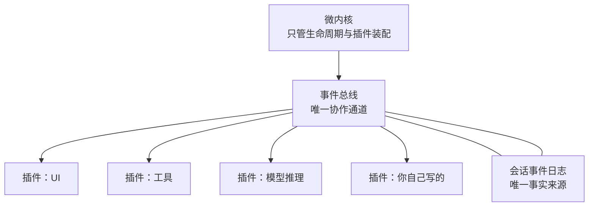

> 本文整理自南京大学《生成式软件工程》第九讲，B 站编号 09-Raw 26。原片长约 89 分钟，字幕 1,229 条、约 2.8 万字。
>
> 字幕由语音转写，产品名错听较多。本文按上下文订正；确实无法还原的只描述行为，不猜名字。

这一讲和外面那些 DSH 教程不一样。

那些讲的是**怎么用**：装哪个版本、模式怎么选、插件怎么装。这一讲讲的是**它为什么长成这样**——以及同样的问题换成你来设计，你会怎么答。

开头他先给了个前提：你一旦有了 agent，就立刻拥有了一家现代公司的架构。你是 CTO，下面有架构、产品、UI、前端、后端，每个 agent 还带子 agent，子 agent 还能再往下分。

**所以你需要一套组织架构，也需要一套版本管理。**而这套东西现在正在被重新发明。

## 从一个一百五十行的 agent 说起

上一节课的学生作业是一个 mini agent——大约一百五十行，遵循所有 agent harness 都有的那个循环：模型推理，返回工具调用，执行，结果回灌，再推理。

它能用。他拿它做了一个真任务：在高铁上让 agent 生成一个南大仙林校区的三维地图。

结果比预期好。它自己去 OpenStreetMap 抓了真实的地理数据，然后建模。图书馆建得相对准，从上往下看几何形状是对的。计算机楼明显不对——十层楼的高度做成了别的比例。

你观察它的 trace 就知道它怎么做到的：网上有大量现成数据源，那个网站连篮球场都会画出边线。它先爬数据，再自己补：地图上没有东西的地方，它标成绿地；大门那个位置它当成了一栋楼，门口铺满了树。

给它一句更好的提示词——把每一块区域单独划出来，先想清这块区域的功能再建模——再把 token 消耗抬上去，能修到不错的程度。

**但这东西做不成产品。**

因为上一版有一个不切实际的假设：**网络服务不会中断。**

他在高铁上跑得正顺，网断了，进程直接终止。一百五十行的 agent 没有会话保存，没有恢复，没有断线重连。中间结果全丢，只能从头再来。

### 复杂性从这里开始爆炸

顺着这一个假设，往下推会撞出一连串问题，而每一个都不是能靠加几行代码解决的。

**重连要多久。**你在美国的数据中心访问服务，和在别处挂了很多层代理访问，网络环境完全不同，超时设置也该不同。

**重试间隔怎么定。**等间隔重试没有意义——一秒失败，下一秒大概率还是失败。所以要指数退避，两秒、四秒、八秒。而如果是物理故障级别的断网，可能要两三分钟才恢复。

**服务端和客户端不一致怎么办。**这是最狠的一个。

你的客户端发起支付，服务端收到后就下单了。因为这笔钱要转给银行或航空公司，那个事务在服务端已经结束，不可能等你确认再提交。

而你手机断网了。

于是界面上转着圈，应用不能崩，还得告诉用户：**你的订单处于一个我不知道的状态。**可能成功，可能失败，但因为和服务端失去同步，客户端自己也不知道。

**这就是本质复杂性。它没法避免。**

## 产品和 MVP 的区别

他顺着这个结论给了一个判断。

如果直接把一份详尽的需求丢给 agent 实现，大概率会陷入 slop。因为 agent 有一个很强的倾向：**赶紧把任务完成，不去想未来还会发生什么。**

而 MVP 的价值在这里——它逼你先验证假设。像那个 mini agent，一跑就暴露了「网络稳定」这个假设不成立。

**于是需求膨胀了，而这次膨胀是有依据的。**

### 一个残酷的假设：上线五十万行之后老板改主意

他做了一个完整的推演。

假设你给 AI 生成了一份面向办公场景的产品需求书：左边栏是项目，右边栏是几种视图，Agent 能整理周报、列出延期事项、生成 Word 文件。清单里还包括历史检索与任务复用、模板与偏好、执行预算与用量、账号与数据管理、外部内容隔离、用户反馈与问题诊断，以及一堆非功能需求。

然后你带着 agent 写了五十万行，上线了。

**这时老板说：下一个版本照那个新的群聊式产品做。**

你的需求全部崩塌——交互模式的根基变了。

他在这里引了一句玩笑：怎么杀死一个程序员，改三次需求就行。

上图是需求的寿命：越是把当期需求做到极致，遇到摧毁性变更时越难转身。

## 架构是受限与自由的取舍

这一段是全讲的理论核心，也是它区别于所有工具教程的地方。

他先从一个具体场景切入：如果你对着需求文档让 agent 设计架构，agent 会顺着需求走。需求里提到「工作区」，它就会给工作区做一个类，然后设计工作区和 agent 层、和会话怎么交互，再决定会话状态放数据库。

**这个设计非常自然，大厂也常这么做。**

但架构意味着没有免费的午餐。

**做了设计，就有了边界。**好处是每个模块可以独立开发，于是马上能启动大量子 agent 并行堆出来。代价是自由度被限制了——**将来需求变化时，如果架构适应不了，抽象就开始泄漏，项目越来越难维护。**

反过来，你也可以做一个极致自由的架构：每个模块都是一个进程，进程之间发消息。

**这个架构非常干净，也非常自由。但它没有用。**

因为他没有约束：什么时候发什么消息、消息怎么管理，全都没有规定。它退化成了教科书上的 actor model——说得对，确实能这么实现，但它没有告诉你任何该做的事。

**换句话说，越自由的东西越不好开发。**

### 两个历史证据

他用两段历史说明这不是 DSH 独有的问题。

**MapReduce。**2004 年那篇论文做的事很聪明：你只要把计算写成 map 和 reduce 两个函数，剩下的并行、容错、调度全归它管。

这是一个很硬的取舍——**它限制你的编程模型，先 map 再 reduce，别的写法不行。**

代价很明显：只适合离线批处理，处理不了实时到达的数据，比如银行订单。所以后来有了 Spark，有了 Flink 这种流式引擎。

但在它适用的场景里，收益巨大。因为 Google 当年的根本问题是：**机器一多，系统就不那么可靠了。**跑全互联网的索引，几乎总会碰到某台机器出故障。

而你在自己电脑上做大作业时的基本假设是「我的机器不会突然消失」。Google 不能这么假设，它必须用系统抽象来解决。

**LAMP。**另一段历史。

这套架构引领了互联网十几年，WordPress 就是典型产物。但你从单机服务几百人，到服务一亿人、十亿人，架构每一个点都成了瓶颈——先分库分表，再拆服务器，然后各种抽象泄漏。

**不是 LAMP 错了，是它的假设过期了。**

### 事件溯源也有代价

他甚至把上一讲讲的事件溯源也拉回来做了一次自我批评。

那个架构概念很干净：一切皆事实，只追加，所有人看到的都是事实的推导。

**但代价有两条。**

第一，性能难做。当前状态完全由历史推导，这个成本要付。

第二，**有些事你偏偏就是想 hack 当前状态。**

他举了个特别真实的例子：教务员想让你强行毕业，没有理由，就是让你过。在一个没人知道的时刻，悄悄搞定。

在事件溯源里这件事很难办——你得加一个特殊事件，叫「强行毕业」，配一条特殊处理规则。而因为它在不可篡改的历史里，**它会被审计到**。谁提交的这条事件，一查就知道。

所以你没法用「我也不知道当时怎么回事」搪塞过去。

> 他的总结很简单：**架构和需求匹配的时候，它就是最合适的。**LAMP 在单机能扛住时就最好，PHP 在当时就是最好的语言。假设一变，它就成了阻力。

## 从零看 DSH：一个近乎空白的内核

铺垫到这里，才进入正题。

他给了时间线：2026 年 6 月 10 日晚上十一点，一个空项目启动。第一个提交里写着要做微内核、做需求分析、做操作系统。

**「他想造一个航母。」**

而航母的第一块钢板，定的是第一原则：**一切皆插件。**

它像操作系统：内核不需要知道每个进程在干什么，只要能把进程组合起来、让它们互相调用。

上图是这套架构的骨架：内核薄到几乎没有，插件之间不直接调用，只通过总线交换事件，而状态的事实来源是一份事件日志。

### 内核负责的事：进程管理

他拿操作系统做类比，讲得很清楚。

一个进程退出时，它持有的资源要全部回收。这是大家默认了很久的事——**你们写 OJ 从来不管内存，因为知道操作系统会回收。**

DSH 的内核（那篇论文里管这叫服务解析）做的就是这件事：插件声明它需要什么资源、会产生什么副作用，依赖会被自动加载；插件卸载时，依赖也应该被自动卸载。

**理想情况下如此。**

### 真正的难点是协同

但他立刻指出：光有插件还不够。

**如果让插件随便发消息、随便协同，那就全乱了，等于没有架构。**

所以真正有意思的设计是：**给这个 agent harness 建一个世界模型。**

这里面几层东西值得拆开看。

| 层 | 是什么 | 类比 |
|---|---|---|
| 会话事件日志 | 只追加，是唯一的事实来源 | 事件溯源的账本 |
| 事件总线 | 插件之间唯一的协作通道 | 消息总线 |
| 投影 | 从事实里算出来的视图 | 数据库的 view |
| 类型约束 | 事件格式不匹配就编译不过 | 类型系统 |

**关键在于第四层。**他说得很直白：类型不匹配，TypeScript 就不会编译这份代码。这相当于禁止你随便往别人那里发消息。

**而视图这一层特别值得说。**模型的历史不是存起来的，是从事件日志派生出来的。所以他做了一件事：把同一份历史投影成两种形态。

一种是给人看的对话界面，另一种是给开发者看的轨迹——工具调用、参数、结果、额外信息，全都能查。

**同一份事实，两种投影。**这是他能做出 TUI、能做出别的界面形态的根本原因。

### 那个「未提交的条目」

有一个设计细节他很欣赏。

模型的推理输出不是一次提交完的——它在不停吐 token。所以事件日志里可以有一个**未提交的条目**，代表这轮还没结束。

这个状态不持久化，但可以被看到。

于是你就能看到思维链动态地变化。

他点评：这是一个小的实现技巧，但它让「实时观察」变成了事件架构的自然产物，而不是额外加的功能。

## 插件到底能做什么

讲完骨架，他开始列举。这一段是整讲最有想象力的部分。

因为所有插件都挂在总线上、都能看到主会话，所以能做的事远超常规想象。

**做一个命令行界面。**原生设计是 Web，因为 Web 能装配出人类友好的界面。但你如果偏要剑走偏锋，就把所有用于装配 UI 的槽位全扔掉，只要会话和 agent，把总线上的事件投射到终端。

**甚至可以做两个终端同步。**他在一个终端里发消息，另一个终端能看到一模一样的内容，因为两边都只是在读同一份事件流。

**做一个 VS Code 那样的东西。**工作区就是目录，左边栏可以动态配置出编辑器、浏览器、终端，再加 git、side chat。他现场拼了一个，说这就是一个用许愿方式做出来的编辑器。

**最关键的一层：创造模式。**

普通会话里，agent 只有工作区目录的读写权限，外面还套着沙箱。而在创造模式里，它能看见整个世界：可以拆插件、加插件，**甚至在 agent 一边运行的时候，一边往总线上挂东西。**

这就是动态插件生命周期的意义——像操作系统里随时起一个进程、随时杀掉一个进程。

## 六个愿望：插件能做到什么程度

接下来他进入创造模式，现场许了六个愿。这一段我觉得比任何功能列表都有说服力。

| 愿望 | 做法 | 它证明了什么 |
|---|---|---|
| 在 token 消耗旁边放一个大号仪表 | 订阅推理事件，自己维护状态 | 非侵入式增强，完全不用碰系统其他部分 |
| 给办公软件加 AI | 锁住对象，把对象送到模型上下文，改完再送回来 | 一个没有任何 AI 能力的应用，能以最小改造接入整个生态 |
| 动态 UI 卡片 | 约定一个标记，模型输出带 JS 的卡片，塞进界面槽位 | 模型可以生成界面，界面里的点击又能注回上下文 |
| 成语接龙 | 点击按钮，JS 把一句话拼进上下文，模型接龙 | 交互状态可以借用会话历史承载 |
| 五子棋 | 界面里存棋盘，落子交给模型思考 | 状态在 UI、决策在模型，两者靠事件同步 |
| 把整个聊天框去掉 | 面对任务直接生成一个好的界面 | 界面是投影，不是本体 |

### 第二个愿望值得单独说

这是全讲我认为最有分量的一段。

他说自己第一个想接入的是办公套件。需要的抽象非常小，只要三个操作：

1. 把某些对象锁住，别人先别编辑。
2. 把对象从总线送到模型上下文。
3. 把改完的对象拿回来，替换回文档。

**只需要对一个成熟的办公软件做这样最小的改造，就给一个超级应用赋予了 AI 原生能力。**

而且它顺带享受了整个插件生态的所有好处。

他的评语很尖锐：市面上很多产品是自己做一个编辑器，让模型生成内容，再让你拖框、加注释、让它改。

**你为什么不反过来做——直接把它按进去。**

### 第六个愿望：把聊天框去掉

这个愿望的哲学意味最强。

他说，你可以不要聊天框。面对一个任务，直接生成一个真正好的界面。

这句话背后的东西是：**界面只是会话历史的一种投影。**既然如此，聊天框就不是必要的，它只是一种实现。

这也解释了他为什么对架构这么兴奋——**当界面是投影，你就能为不同任务生成不同界面。**

## 但这套东西不是万能

讲到这里他没有顺势吹完，而是转成了自我批评。这一段是整讲最诚实的地方。

### 代价一：语义冲突没有解决

所有插件都用同一套事件，类型不匹配就编译不过。**但这只统一了格式，没有统一语义。**

他给了一个很具体的例子。

假设你装了十个上下文压缩插件，每个都把上下文压到二分之一。

**十次方就是一千零二十四分之一。**任何输出都被压到看不懂，信息全丢。

再比如，两个钩子都监听输入：一个负责检查，一个负责改写。**检查在前还是改写在前？**

这个问题架构没有规定，因为它属于应用的语义。

更极端的例子：一个钩子要求停止，另一个要求继续。它们直接冲突。而钩子跑到「停止」那一步时，系统就停下来了。

**这种语义冲突，架构层面永远解决不了。**

他的答案很直接：你可能需要另一个机制，比如一块共享白板，让插件在需要的时候互相协调。而一旦需要这个，**抽象就有限，就泄漏了。**

> 所以插件不是万能的，架构也不是万能的。

### 代价二：它把难题推给了生态

另一个代价更宏观。

传统路线是：需求确定，做产品，发布，挣钱。

**DSH 走的是另一条路：发布的时候发布了一个几乎空白的东西。**只有基础抽象和一些第一方功能，剩下的全交给开源生态。

他给了一个观察：社区做出来的东西，很多是高达驾驶舱那种，好看、好玩，但复杂度低。

他的态度很坦率：如果是我在第一方，我可能不会用这么好的东西去搭一个驾驶舱，我会做一些更了不起的。

**但这也是代价的一部分：门槛足够低，就很容易长出很多低复杂度的东西。**而生态的价值恰恰来自门槛低。

## 最后那个闭环

收尾他讲了一个场景，把整讲的论证收上了。

他要填一张表，需要列出从 2021 年到现在发表的所有论文。

用常规办法：打开办公软件，或者用 computer use 去点，要花不少时间，还要烧 token、疯狂截图。

而在这套架构里：接一个自己写的数据库插件，这个数据库能向模型提供必要信息——个人信息、论文列表、带的学生。办公软件要填论文列表时，把这个任务往总线上一丢，剩下的由生态里的工具、电脑、记忆一起协作把数据凑齐，一把头填好。

**中间不需要 computer use，不需要多余的 token，不需要疯狂截图。**

他说：这就是一个操作系统。你可以在这里闭环完成非常多的事情。

## 我的三点补充

以下是评注，不是原片内容；取舍由我负责。

**第一，这一讲真正的价值不在介绍 DSH，在给出了一个判断架构的通用问句。**问了什么、放弃了什么、这个放弃在什么假设下成立。用这套问句看 MapReduce（放弃通用性换容错）、看 LAMP（放弃分布式换开发速度）、看事件溯源（放弃可 hack 换可审计），都能对上。DSH 也一样：**放弃语义一致性，换取插件组合的自由。**它没有解决冲突，只是把冲突挪到了应用层。

**第二，那个「高铁断网」的开场是整讲最好的教学设计。**它把架构讨论从抽象拉回到一个具体到不能再具体的场景：网断了，进程死了，一百五十行代码什么也没留下。从这里开始推复杂性，读者不会觉得是在听术语，而是在看他自己的项目会怎么死。

**第三，第六个愿望值得单独记下来。**「把聊天框去掉」听起来像炫技，但它背后的命题很硬：**如果界面是会话历史的一种投影，那聊天框就只是一种实现，而不是它应有的样子。**多数 AI 产品把聊天框当成唯一的界面范式，这个假设或许和「网络不会断」属于同一类。

---

一句话总结：**好的架构不是功能多，是约束下得准。**它替你决定哪些事不能做，然后让剩下的事变得容易——而 DSH 准的地方，是把「怎么组合」交给插件，把「什么算事实」留给自己。
