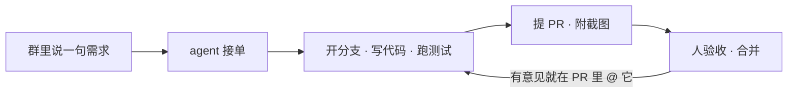
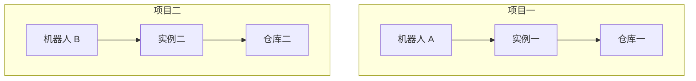

> 本文整理自 B 站视频《DeepSeek Super Agent 保姆级教程：从安装到多项目并行执行全流程》，编号 BV1584q6aEp3，片长约 14 分钟，字幕 238 条、约 5,700 字。
>
> 这是一期实操录屏，原片节奏很快、以点击演示为主。本文把操作步骤收成清单，把其中真正卡住人的地方单独拎出来讲。

前两篇写 DSH，讲的都是你坐在电脑前怎么用它：装模式、给权限、敲指令、装插件。

这一篇不一样。它讲的是**你不在电脑前的时候，它还在干活**。

## 一句需求，落到一个 PR 上

先看这条工作流长什么样。

群里有个人说：正文、代码、终端的字体能不能分开配置。

一个叫 Super Agent 的机器人在群里静默听着，看到这条就接了下来。后来另一个人补充：字号也要分开。它回了一句：加入同一个 PR。

再往后，它自己开分支、写代码、跑测试、截图、提 PR。维护者看一眼，合并。



上图是这整条链路。**注意它没有「打开对话框」这一步**，这是它和普通用法的根本区别。

## 它和你熟悉的 agent 差在哪

原片列了四条特征，我觉得这四条值得原样留下，因为它解释了为什么这东西值得单独配一套。

| 特征 | 意思 | 具体表现 |
|---|---|---|
| 连续 | 理解上下文会变 | 你在 IM 里提方案 A，PR 里改成方案 B，它跟着改 |
| 高效 | 并行推进 | 同时跑多个复杂任务 |
| 主动 | 不用等指令 | 持续观察环境事件，主动推送 |
| 持久 | 一直在线 | 直接接入真实工作环境长期运行，异常自动修复 |

两条对比起来看更清楚：**普通会话是「你问一句它答一句」，Super Agent 是「你丢一个需求，它交一个 PR」。**

原片有一句判断说得很准：它相当于团队里的一个研发。而它工作的地方，恰好就是你团队本来就在用的那几个地方——群聊和 PR。

## 第一段：装

前置条件只有一条：**本机已经装了 DSH**。因为 Super Agent 是运行在 DSH 上的扩展。

安装本身不用记命令。核心就三段提示词：给它仓库地址、让它按官方说明装、缺依赖时让它自己补。

**第三点是关键。**这套东西依赖不少：Node、Git、tmux、Python。让人一个个装会卡住，让 agent 自己装反而顺。

原片的实测数据：**整个安装用了 4 分钟。**

### 一个容易误会的点

装完之后你打开 DSH 桌面端，看不到它在跑。

因为 Super Agent **跑在单独的一套配置和进程里**，有独立的 profile。它有自己的管理面板地址，从那里才能看到执行过程。

它默认沿用 DSH 里已配好的模型。想换的话，改它自己那份配置文件就行；懒得改路径，直接让 agent 帮你改。

## 第二段：配飞书和仓库

这一段是整件事的地基。要配两样东西：**一个 IM 群**，**一个 GitHub 仓库**。

原片选了飞书，给了一句很简单的提示词：我已经装好了 Super Agent，帮我配置飞书 CLI，参考官方这个链接。

接下来它带着你走流程：

1. 打开它给的链接，建一个应用，起个名字。
2. 把 App ID 和密钥发回给它。
3. 在终端粘贴一条命令，回车。

到这一步你以为通了。**其实没有。**

## 四个真实卡点

原片最值钱的地方在这儿——它把踩坑过程全录了。这四个坑按顺序排列，恰好构成一份排错指南。

### 卡点一：机器人没进群

配置完成，群里发消息，没反应。

原因很简单：应用建好了，但**机器人还没被拉进群**。步骤是：进群设置 → 群机器人 → 添加机器人 → 选中刚建的那个。

### 卡点二：权限配了但没发布

拉进群之后还不行。它提示要先配一个仓库，你发了仓库地址，然后卡住了。

根因是：**飞书里的权限授权是有「版本」这一步的。**它给了你一个一键授权链接，你点完授权，还得去开放平台做两件事：

- 版本管理与发布 → 创建新版本
- 保存 → 确认发布

**不发布，权限就不生效。**发布完再回它一句「已授权并发布」，它自己会做一次检查，确认群成员能读到了。

### 卡点三：旧 API Key 返回 401

权限通了，仓库也给了，再发指令，还是没反应。

它自己查出了原因：**调用模型时用的 API Key 失效了，返回 401。**

这个坑很典型，值得多说一句。它有一套独立配置，里面存的是模型和 API Key。而你本机可能也有一套全局配置。两套并存时，容易一个过期一个有效。

它自己修好了——直接改用你 DSH 里当前那份 Key。

### 卡点四：克隆失败，自己恢复了

配第二个实例时，消息能收到，但克隆仓库失败了。

它说「待会再试一次」，然后自行重试、修复、建 PR。

作者的处理方式是：让它自己排查。这在整条链路里是很重要的一条经验——**这套东西的容错是靠 agent 自己兜的，你要做的只是把现象告诉它。**

### 一个必要的本地前置

Git 本身要装好（本机已有的话它会跳过），并且要配好邮箱和用户名：

```
git config --global user.email "you@example.com"
git config --global user.name "Your Name"
```

## 第三段：跑通第一个需求

配完之后，用真实需求验证一遍。

原片给的产品文档比较规范，P0 是这个版本要做的：任务的增删改查。

操作很简单：打开群聊，@ 它，把需求发过去。

然后等着。**原片特别提醒：一个简单的项目也可能跑几十分钟。**这次实测是 **26 分钟**。

产出是什么？主分支上没有代码，仓库里多了一个 PR。点开看：

- 改动内容
- 测试截图
- 手机适配和电脑适配的效果图

### 验收这一步不能省

作者拉下来本地跑了一遍：新建任务、换日期、选优先级，功能没问题。

但他同时注意到一件事：**适配性不太好。**

这一点很值得记：PR 里的截图看起来很完整，但真正用起来还是有手感上的差别。**截图是它给的证据，不是它给的保证。**

### 改需求：两条路

验收之后你会有意见。原片演示了两条路，都很自然。

**路一：回群里说。**比如「按钮颜色改成绿色」。它收到，开新任务，提一个新 PR。

**路二：直接在 PR 里 @ 它。**原片特意换了个账号来演示——用另一个账号在 PR 下面评论「把按钮颜色改成红色」，它一样接单，并把更新推到了同一个 PR 里。

第二条路更像真实团队：**评审意见本来就长在 PR 上，不用切到别的地方去。**

## 第四段：多项目并行

单项目跑通之后，问题自然变成：我有好几个项目怎么办。

官方文档给了一条硬规则：**一个仓库、一个实例、一个机器人，绑定在一起。**

所以并行不是「一个 agent 管所有」，而是**给每个项目配一套独立的实例和机器人**。

原片现场配了第二套：新的机器人（项目二组）、新的仓库、新的 profile 和端口号。全部交给 agent 自己配，**用了 12 分钟**。



上图是这套隔离的形态。看起来笨重，但好处很实在：**一个项目的混乱不会污染另一个项目的上下文。**

### 并行的验证

配好之后同时开工：

- 项目二：给它一份个人博客的需求文档。
- 项目一：在群里说「给这个项目加四种主题模式」。

两边各自收到任务，各自提 PR。项目一的 PR 还附了测试和效果图。

**到这一步才算真的跑通了并行**——不是两个窗口开着，是两套独立的执行链路同时在推进。

## 这套模式真正的价值在哪

原片最后那句总结，我认为是全片最该记住的。

> **最有价值的地方是：后续有需求、有问题，可以继续在群或者 PR 下面反馈，让它接着做。不用每次都重新开一个会话、把项目背景介绍一遍。**

这句话点出了一件很多人忽略的成本：**重复交代背景**。

开一个新会话，你要重新解释项目结构、技术栈、当前进度、哪些坑不能踩。而常驻在群里的 agent，这些背景是一次性建立的。

他自己也给了适用判断：一个人做多个项目，就给每个项目配独立的实例，分别推进。

## 但也别高兴太早

原片没有回避这一点，我把它放在最后：

> **提交了代码不代表任务完成了。功能有没有做好、问题有没有修好，最后还得自己测试验收。**

而且他给了一个很务实的起步建议：**先拿一个小项目跑通完整链路**——需求提交、代码合并、测试、反馈一轮，再逐步接入更多项目。

因为这套东西的成本不在安装，在于**你要重新建立一套协作习惯**：需求丢群里、意见写在 PR 上、验收自己做。

## 我的三点补充

以下是评注，不是原片内容；取舍由我负责。

**第一，这篇真正的主题不是工具，是「工作在哪里发生」。**普通 agent 的界面是对话框，它的界面是你的群聊和 PR。这看起来只是换了个壳，但它改变了一件事：**任务的上下文天然留在了团队已经在看的地方。**不需要你复制粘贴给谁，也不需要谁去翻聊天记录——需求、讨论、代码、评审，全在同一条线上。

**第二，那个「一个仓库一个实例」的规则，是限制也是节俭。**它意味着你没法用一个 bot 统管所有项目，配置成本随项目数线性增长。但代价换来的是上下文隔离——这在 agent 场景里比省事更重要，因为上下文串味比配置麻烦更难排查。

**第三，四个卡点里有两个是「权限」，一个都不在代码上。**机器人没进群、权限没发布、Key 过期、克隆失败——**没有一个是因为 agent 不会写代码。**这大概是这类工具最真实的门槛所在：它不再考你会不会编程，而考你会不会配一条完整的闭环链路。而最后那个「克隆失败自己重试」反而说明，链路里真正需要人做的，是把现象描述清楚。

---

一句话总结：**它的价值不在更聪明，而在更持久。**你少花的不是打字时间，是每次重新解释「这个项目是什么」的那些分钟。
