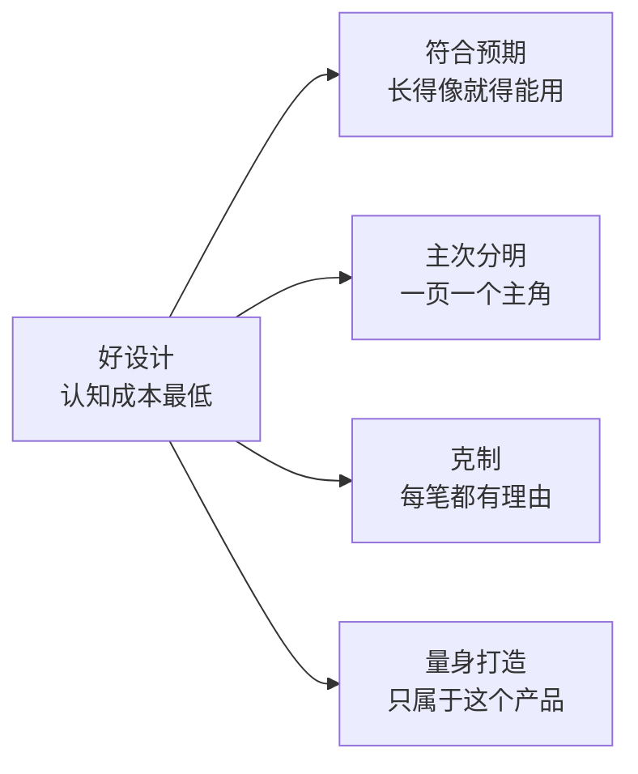
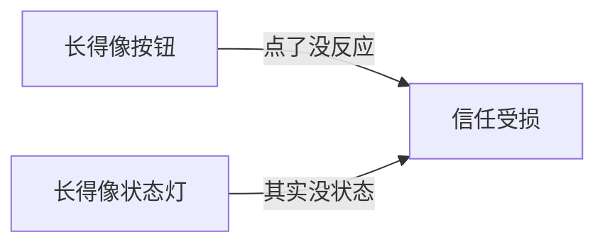
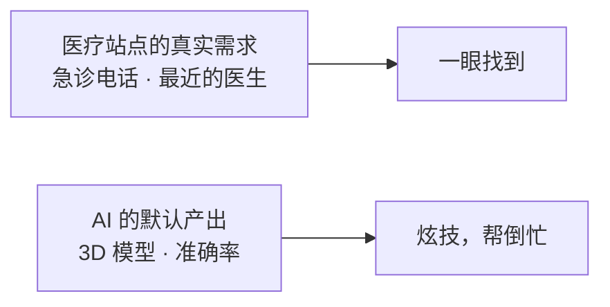
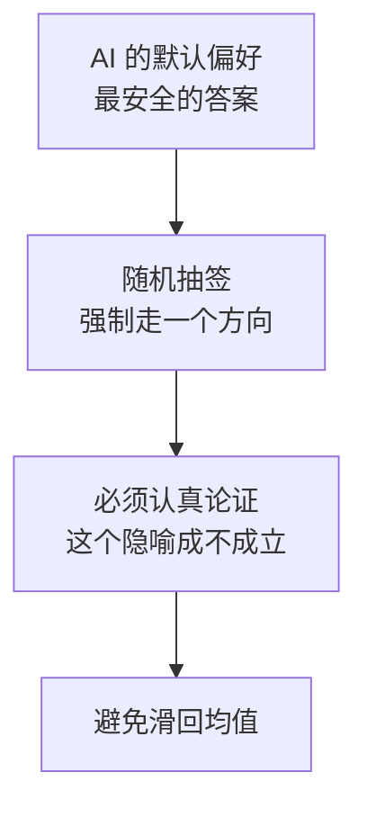
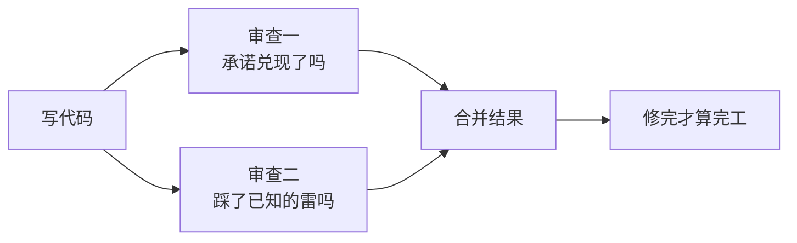
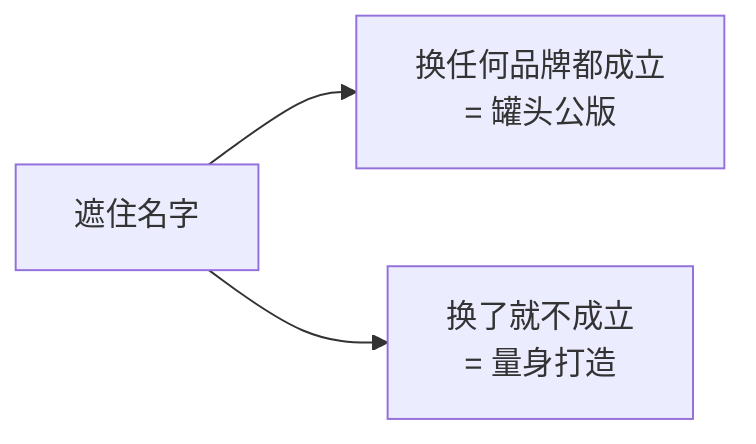

> 本文整理自一支 16 分钟的繁中解说视频，拆解一个前端设计技能的工作方法。文稿由字幕整理而来，属整理稿而非逐字记录。
>
> 文中的清单条数、案例与工具名沿用原片口述，未做外部核验。

## 开场：三代 AI 设计

作者用三张图开场，我觉得这个设计很好。

> 某设计技能官网上展示了 AI 设计的演化史，**三张图分别是 2022、2025、2026 年 AI 做出来的网页长相**。

| 年代 | 长相 |
|---|---|
| 2022 | **科技感满满的紫色渐变配霓虹光晕** |
| 2025 | **像文艺杂志那种米白底配斜体字** |
| 2026 | **粗黑边框、立体黑阴影，还到处贴满小贴纸** |

> 三年下来虽然换了三种长相，**但不管哪一页，我相信你还是能看得出来：这就是 AI 做出来的。**

**而反转在这里**：

> 但如果看下面这几个呢？**是不是 AI 味就比较淡了一点？或者客观来说，比较有设计感了？**
>
> **其实这些也通通都是 AI 产生的。**

**所以问题就清楚了**：

> 现在用 AI 做网站太快太方便，随便丢一段指令，等个两三分钟就能生出一个「看起来人模人样」的网页。
>
> **但也正因为门槛消失了、大家都用 AI 做，做出来的网站就变得高度同质化。**

> 而我们为了与众不同、为了凸显品味，**都在拼命寻找差异**，想办法**撕掉那个「AI 味」标签**。

## 先不列症状，先定义好设计 ⭐

**这是我认为这篇最聪明的地方。**

> 某份官方清单整理了 **67 条 AI 最常犯的设计毛病**。**但问题是，这份清单每年都在变。**
>
> 比如 2022 年 AI 做的网站到处都是紫色渐变配亮青色、深色背景中间一定塞一团发光彩晕——**这种风格现在已经很少见了**。
>
> **因为模型一直迭代，AI 又换上了一批新的套路。**

**所以他不去追症状，而是换了个问法**：

> 我们不妨换一个角度来问：**为什么 AI 做出来的设计会被诟病？它究竟违反了哪些设计原则？**
>
> 要回答这个，**我们得先回过头来看：到底什么才叫好的设计？**

**而他先做了一个很重要的免责声明**：

> 设计这东西**非常主观**。有些人喜欢海纳百川，有些人喜欢极简主义，**更何况还要考虑你自己的受众群体**。
>
> **所以我分享的是我自己认为的好设计**，绝对不是一竿子打翻其他理念。

### 那句话

> **所谓好的设计，说穿了就是一句话：把使用者的认知成本降到最低**——
> **让你一眼抓到重点，而且每一次操作都完全符合预期。**

**拆开就是四个维度。**

上图是这四个维度。**而后面 AI 的每一个毛病，都能挂到其中一条上。**

## 维度一：符合预期

**核心是「长得像什么，就该能做什么」。**

### Affordance

**他分享了一个他喜欢的词，我觉得这个补充很好**：

> 有一个我很喜欢的英文单字叫做 **Affordance**。它的定义是：**一个物品所具备的物理特征，能够让人看外观就知道怎么用。**
>
> **一个东西的长相本身，就在告诉你它能拿来干嘛。**

**例子很日常**：

> 杯子有个耳朵，**你不用想就知道要握那里**；椅子有个平面，**你看一眼就知道可以坐上去**。

**而设计界的老话他归给了现代用户体验之父**：

> 东西的外观本身就该告诉使用者怎么用，**根本不需要附说明书**。
>
> 最经典的例子就是门把——**如果你给一扇门装了一个拉的手把，那这扇门就绝对不能是用推的**。

### AI 踩的两个雷

**这一节我觉得抓得很准，因为它挑的都是很具体的细节。**

**雷一：假按钮。**

> 最常见的就是**在大标题正上方放一颗小巧精致的胶囊标签**。**它外观长得跟可点击的按钮一模一样，结果鼠标点上去根本没用。**

**雷二：假状态灯。**

> 或者在画面角落放一颗**一直在呼吸闪烁的绿色小圆点**。
>
> **在人类的使用习惯里，这代表系统正在连线运作。**可**它背后什么都没有，只是一段没有意义的纯装饰动画。**

上图是这两个雷的共同点。**它们不是在骗眼睛，是在骗预期。**

## 维度二：主次分明

> 这个画面上**到底有没有主角**？你有没有办法**在三秒内看出这一页最想传达什么**？

**他引了一本经典设计入门书的第一个大原则**：

> 经典设计入门书开篇第一个大原则就叫**对比**。
>
> **如果两个东西的重要程度不一样，它们在视觉上的差距就要大到一眼就能看出来。**
>
> **最重要的必须最大、最显眼，次要的就自动往后退。**

**而他的比喻很直观**：

> 就像报纸头版——**头条标题永远最大，其他新闻字级自动小一号**。
>
> **你站在报摊前随便瞄一眼，就能立刻知道今天发生了什么大事。**

**而 AI 的翻车点，他定位得很准**：

> AI 在设计上常翻车的地方就是**产品功能介绍区**。
>
> **你只要叫它做功能展示，AI 几乎百分之百会排出跟别人一模一样的流程：三张卡片，里面塞一颗精致的小图示，三张卡片长得一样大、一样显眼。**
>
> **看起来重要性都差不多，结果使用者看完还是完全不知道你家产品到底哪里最厉害。**

**「三张等大卡片」这个诊断之所以有效，是因为它指出了病症**：**没有主次，就等于没有主张。**

## 维度三：克制

> **画面上每一样元素，都必须有它存在的充分理由。**

**他引了那位影响苹果设计理念的传奇设计师**：

> 有一句名言叫 **Less, but better**。
>
> **就是好的设计的极致，从来不是看你还能多塞多少装饰进去，而是看你还能拿掉多少多余的东西，却依然不影响它的核心功能。**

**而给了一条很硬的自检标准**：

> 你在画面上每多加一样无效的装饰，**就是在稀释使用者的专注力。**
>
> **所以如果你看到画面上某个设计，你自己都说不出来它是干嘛用的，那唯一正确的做法就是把它果断删掉。**

### AI 的视觉噪音清单

**他列的这一串我觉得可以直接拿来当检查表用**：

| 噪音 | 问题 |
|---|---|
| **没有功能意义的配色** | 说不上为什么是这个颜色 |
| **莫名其妙的背景渐变** | 只是为了让画面不空 |
| **随处乱套的卡片** | 内容不需要卡片包裹 |
| **点不进去的胶囊** | 长成按钮但不可点 |
| **装饰用的小灰字** | 纯占位，无信息 |

**而他的总结很有力**：

> 整页看起来**到处都在发光、到处都在套卡片**。
>
> **但只要你把这些多余的视觉噪音通通拔掉，你会发现页面其实根本没有少掉任何实质的资讯。**

**「拔掉之后什么都没少」——这是一个可执行的检验。**

## 维度四：量身打造

> 这个设计**到底是不是专门替你的产品、以及特定的这群使用者量身定做的**？

**他引了另一位设计师——画纽约地铁图的那位**：

> 设计师在动手之前，**必须先弄懂三件事：这个东西是什么、给谁用、以及在什么情境下用。**

### 那个药袋与洋芋片的对照 ⭐

**这是全篇我觉得最好的一个例子。**

> 药袋和洋芋片包装，**它们明明同样都是袋子，长相却截然相反**。

| | 药袋 | 洋芋片包装 |
|---|---|---|
| **字体** | **很大** | 花俏 |
| **排版** | **非常朴素** | 高彩度鲜艳配色 |
| **为什么** | 生病拿药的人**最迫切需要看清的是一天吃几次、饭前还是饭后** | 唯一的任务是**在超市整排货架上瞬间抓住你的眼球** |

> **两者长相之所以完全不同，背后全是因为目标使用者和使用场合天差地别。**

### AI 最致命的弱点

**他举的例子很扎人**：

> 请 AI 做一个医疗咨询网站，**它马上给你科技蓝配浅灰，中间放一个炫技的 3D 人体模型在那里转，还塞满「AI 准确率百分之九十九」的科技宣传**。
>
> **但一个焦虑生病的病患点进来，他哪有心情看你的 3D 模型旋转？**
>
> **他最迫切需要的是一眼看到急诊电话、或找最近的医生。**
>
> **AI 的炫技反而是在帮倒忙。**

上图是这个错位。**注意它错的原因在于搞错了「谁在使用、在什么状态下使用」。**

## 为什么 AI 会一遍遍踩雷

**他给的答案很短，但我认为点到了根上。**

> **因为你根本没告诉它。**
>
> **AI 手上只有你丢给它的两三行指令。在没有足够上下文的情况下，它唯一能做的，就是把全世界网页的统计平均值吐给你**——**再用浮夸的渐变和假按钮把画面硬塞满。**

**「统计平均值」这个说法很准**：它不是在创作，**它是在回归均值。**

## 那个技能怎么反向实现这四条

**讲完原则之后，他才开始拆工具。**而这个工具的做法，是**把设计流程化**。

### 第一步：产品访谈，而不是问你要什么颜色 ⭐

> 一般 AI 拿到需求**下一秒就急着敲代码**。
>
> **而这个技能完全遵照专业设计师的规矩：先确认产品事实，再决定视觉方向，最后才动手做设计。**

**访谈问的是什么？**

> 目前有哪些功能？**没有哪些功能**？用户来到你的网站**需要完成什么任务**？以及**有哪些设计是绝对不能做的**？

**而这里有一个我觉得很关键的观察**：

> 在**整个访谈过程里，它完全没有问我「你喜欢什么颜色」「想要什么字体」这种表面上的视觉喜好**。
>
> **这是因为好的设计从来不是凭个人感觉去选字体或涂颜色。**
>
> **如果连这个产品到底在解决什么问题都没搞清楚，那挑配色和字体就没有依据。**

### 第二步：把事实写成文件

> 问完之后，**它把这些讨论出来的事实白纸黑字整理成一份产品说明文件**。
>
> **从这一刻开始，后面所有的视觉设计和代码，全部都会根据这份文件来做。**

**而作者补了一个很实用的习惯**：

> 但为了避免 agent 忘记，**我个人习惯还是会在规则文件里提到这份文件**，**告知你的 agent 在做前端改动时都需要参考它和这个技能。**

### 第三步：先找「感受」，再找隐喻

**这一步是全篇最有意思的设计。**

> 理解完产品事实后，**下一步不是立刻画画面，而是先抓住这个产品真正要带给使用者的感受。**

**他的例子是一个「守夜」服务**：

> 这是一个给独立工程师使用的监控服务，**它的核心体验其实只有两个字：守夜**。
>
> **平时你几乎不该感觉到它存在，但只要半夜网站挂掉，它必须像警铃一样在第一时间把你叫醒。**

**然后它去找现实世界的原型**：

> 它会先去找**现实世界中有哪些系统，真正承载了「长时间安静监看、但异常必须立即升高讯号」这种工作方式**。
>
> 它列出了好几个日常场景：**大楼的火警总机、医院夜班的观察纪录表，还有在狂风暴雨中警戒的灯塔**。

### 第四步：掷骰子 ⭐

**这是我认为整个技能里最巧的一个设计。**

> 最巧妙的地方是：**它会像掷骰子一样，随机抽选指定其中一个方向，成为 AI 必须认真发展的主提案。**

**为什么这么做？他解释得特别准**：

> **因为 AI 很容易滑向统计上的平均值。如果让它自己挑，它通常只会选最安全的答案**——科技蓝、几张功能卡片，或是一个通用的仪表板。

> **抽到灯塔，不代表最后一定要做成灯塔网站。**
>
> **它代表 AI 不能一句「这个太大胆」就随便略过，而是必须认真证明**：灯塔的信号、黑夜、远距警戒与警报机制，**能不能真的让工程师更快理解产品的价值。**

上图是这个机制的作用。**它不是随机化风格，是用随机化对抗惰性。**

**而它给选择的方式也很诚实**：

> 它会把主方向和其他真正有竞争力的提案一起放进选择页。
>
> 每个提案都写清三件事：**第一眼长什么样、背后的设计理由、以及它可能带来的风险。**

### 第五步：读避坑清单才准动手

> 方向定好之后，**它会让你先去读一份参考文件，可以把它想成一份防呆避坑手册**。
>
> **还记得前面聊过一般 AI 最常犯的通病吗？它其实就是把这些坏习惯收敛成具体规则，白纸黑字禁止它踩雷**——**像是不准随便套用卡片、不准用浮夸的渐变字、不准用装模作样的小标签等等。**

**「把通病收敛成规则」——这又回到了那条老原则：把约束写进机制。**

### 第六步：两层独立审查 ⭐

**代码写完之后，它会立刻启动两层审查，而这两层的分工很清晰。**

| 层 | 问什么 |
|---|---|
| **第一层：做对了吗** | **这个界面有没有完成对使用者的承诺？** |
| **第二层：犯不该犯的错了吗** | **拿着避坑清单逐行抓漏** |

**第一层具体怎么问？**

> 既然这是一个替工程师守夜的监控服务，**那画面平时符不符合「守夜」这个理念？**
>
> **真的出事时，工程师能不能在几秒内看懂：哪个服务挂了、严重度多高、下一步该做什么？**

**第二层具体怎么查？**

> 它会跟着清单去侦测：**刚刚的没计有没有偷偷塞了嵌套卡片？是不是又套了千篇一律的小标签模板？或是加了没有任何资讯意义的渐变与装饰？**

**而收尾是**：

> 最后它把这两层审查的结果合在一起，**逼 AI 把所有抓到的毛病逐一修掉，才算完工。**

上图是这个闭环。**注意两层的对象不同：一层看目标，一层看禁令。**

## 两个成品摆在一起

> 第一眼看过去，**两边其实都是深色底，连大标题都长得差不多，功能也都正常。**
>
> **但只要你稍微看一眼细节，就会发现差距。**

**他的判据还是那个「遮住名字」的测试**：

> **如果把产品名字遮住，一般 AI 做出的那一页，换成随便哪家公司的名字都完全成立**——**因为它就只是一具没有灵魂的罐头公版。**
>
> **而这一页就算把名字遮掉，它依然只属于这个产品**——**因为画面上留下来的每一个元件与动态，都是专门替这群「自己顾网站的独立工程师」量身打造的。**

**具体好在哪？他给了一个例子**：

> 画面上**亮起红灯、跳出拨打电话的警报**——**它直接把产品机制动态跑给你看，让你更能感觉到产品具体的运作方式。**

上图就是那个测试。**它简单到可以当成一个验收动作。**

## 反面的诚实 ⭐

**这一段我很欣赏，因为他没有吹。**

> 但仔细看，**就算用它做出来的网站，依然还是有蛮多缺点的**。
>
> 比如**第一屏资讯量非常大，而且到处都是极小的英文字，阅读起来确实比较费力。**

**他的结论**：

> **它绝对不是阿拉丁神灯，不可能每次都一次到位。**
>
> **但至少它在一开始就帮你定义了专案的「设计上下文」文件**，让你后续开发时可以回去引用，**让 agent 不要做出风格落差太大的缝合怪**。

### 成本的实话

**他给的时间对比很具体**：

| | 耗时 |
|---|---|
| 没装技能的版本 | **两分钟生完** |
| 装了技能的版本 | **整整跑了一个多小时** |

> 消耗的 token 想当然也会增加许多。

**而他的建议给了明确分界**：

> 如果是**要拿出去见人的重要门面**——产品首页或核心的落地页，**它绝对值得你花时间跑完整套**。
>
> 但**如果只是做个自己用的内部界面或网页 UI，现在一般 AI 的设计其实就足够了。**

## 收尾：它没有黑科技

**他最后把这件事的本质说破了。**

> **这套技能也没有发明什么新的黑科技，它就只是把过去几十年一流设计师在做的事给流程化了而已。**

**具体对应关系他列了三条**：

| 技能里的步骤 | 对应什么 |
|---|---|
| 产品访谈 | **逼你先搞清楚事实**：这是什么东西、为谁服务 |
| 找灯塔、找火警总机的隐喻 | **从真实生活借灵感**：伟大的设计师从来不是凭空捏造 |
| 避坑守则 + 双层审查 | **一套对抗 AI 平庸的防御机制** |

**而"为什么需要防御"他讲得很直接**：

> **因为大语言模型只要没人管，天性就是端出最安全的公版**，塞满无意义的卡片跟发光特效。

**最后那句我觉得是全篇的落点**：

> 而我觉得这也是最值得借镜的地方：**就是用自己独有的领域知识，写成一份真正有约束力的 skill。**

## 我的三点补充

以下是评注，不是原片内容；取舍由我负责。

**第一，四个维度的排序本身就是一条诊断路径，而不是并列的四条标准。** 符合预期管的是**信任**（长得像就得能用），主次分管的是**注意力分配**，克制管的是**信噪比**，量身打造管的是**归属感**。前三条是「不出错」，第四条才是「有辨识度」。而大多数「AI 味」的抱怨，其实落在**前三条的低级失手上**——假按钮、等大卡片、无意义装饰。**所以想立刻改善，先修前三条，成本低见效快。**

**第二，掷骰子这个设计，是整篇里最值得迁移到别处的思路。** 它解决的其实是一个通用问题：**模型会向统计均值回归，而均值就是平庸。** 而它用的手法不是「要求它更有创意」（这种要求通常无效），**而是先随机指定一个方向，再要求它为这个方向辩护**。这就把「要不要大胆」这个判断题，变成了「这个方向成不成立」的论证题。**换到写作、命名、方案设计上，同样的手法都能用。**

**第三，「遮住名字」这个测试的威力，在于它可以把「有没有设计感」变成可操作的验收。** 因为设计感这个词无法测量，**但「换个品牌还成不成立」可以一眼判断**。这也间接解释了为什么通用组件库产出的页面往往缺乏辨识度：**它们的设计目标本来就是「适配任何品牌」。**

---

一句话总结：**AI 味不是某种特定的配色或布局，是不做选择就交付的结果。** 而所有解法最后都指向同一件事：**在动手之前，先把「这是什么、给谁用、什么时候用」答清楚。**
