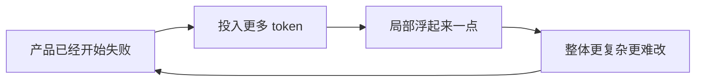
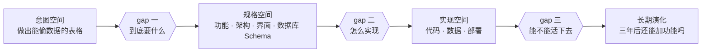

> 本文整理自 B 站《欢迎来到未来｜01-Raw 26 生成式软件工程 NJU》，南京大学《生成式软件工程》第一讲，片长约 99 分钟。原片是一堂带大量现场演示的课，不是工具教程，也不按知识点编号推进。
>
> 字幕是语音转写，模型名与产品名错听严重。本文按上下文订正；确实无法还原的，只描述它做了什么，不猜英文名。

一个计算机老师站在讲台上，先花了十分钟讲自己怎么焦虑，然后才讲技术。这个顺序不是意外。

这一讲真正想回答的问题只有一个：**当写代码这件事被 AI 接管之后，软件工程还剩什么。**剩下的部分，恰好是最难被接管的那部分。

## 四次变革，一条主线

计算机史上经历过几次结构相同的变革。它们的共同点不是算力变强，而是**把昂贵的能力变成了日用品**。

| 时间 | 变革 | 被变成日用品的能力 |
|---|---|---|
| 1975 | 第一台个人计算机 | 计算 |
| 1990 年代 | 互联网 | 连接 |
| 2010 年代 | 移动互联网 | 交易 |
| 2022 | ChatGPT | 生成 |

讲者用三段私人记忆把这条线串起来。小学快毕业时他装了 ICQ，随机加一个地球另一端的人，对方母语英语，打得飞快，他只会 hello。腾讯的仿制品叫 OICQ，后来改名 QQ。然后是移动互联网：一夜之间，所有菜市场卖菜的人摊前都摆上了支付宝和微信两个二维码。再到 2022 年，ChatGPT 成了人类历史上增长最快的产品。

这条线上每一格都没有让专业人士失业，但每一格都让原本只有专业人士才能做的事，变成了谁都能做。

## 为什么开这门课：两份焦虑和一份零分简历

学生有两种焦虑，讲者把它们分开说。

**第一种是「AI 替我上大学」。**老师用豆包出题，学生用豆包答题，整个闭环里只有学生本人没有受到训练。作业链接丢进 codex，连复制粘贴都省了。

**第二种是听话的学生发现自己被骗了。**每堂课认真听，每次作业认真做，四年毕业时确实学会了点什么，而学会的东西 AI 都会做。

比这两种焦虑更具体的，是保研。讲者说自己也收到过很多简历，然后放了一份在课上。那份简历全是 AI 做的，个人信息用 Unicode 方块字符盖住，有 CCF 期刊列表上的 accepted 论文。

他给这份简历的评分是零分。理由不是造假，而是**没有额外信息**：没有 GitHub 链接，没有个人主页，没有一篇 preprint。「你和你的竞争者已经无法区分了。」他收到过无数份长这样的简历。

那么大学还能给什么。他列了两样。

**一是信息差。**你有别人不知道的信息，才能做别人做不到的事。这不算可悲，社会要进步必须有它。

**二是成为一个更好的人。**具体一点说，是拥有驾驭别人驾驭不了的东西的能力。这门课想教的正是第二种：**驾驭人工智能的能力。**

## 这门课的三条 policy

三条 policy 都带着挑衅的意味，但每一条背后都有具体判断。

**第一条：禁止古法编程。**他承认在座的人都是古法编程的好手，因为马上要保研机试。但他想撕开一个小口子。

**第二条：token 自费。**理由很直接——他本来想拉赞助，看到选课人数就算了。他的观点是：手上没有付费 token 的人，先别谈学 AI。课上所有演示，除了生成 slides 用了更聪明的模型，其余全部跑在 DeepSeek V4 Flash 上。也就是**用一个足够便宜、但智能有一些的模型带完整套流程**。他还顺带调侃了时段差价：白天贵，晚上便宜，而计算机学生本来就夜里干活。

**第三条：通过或不通过。**他申请的就是这个考核方式。教务的反馈是专业选修课一般不这么做，但他说分数在这个时代已经不那么重要了。

真正重要的是简历上写什么。他给的项目建议很具体：**做一个自己的邮件管理系统**，能回他的邮件，用指定邮箱通信，跑在宿舍一台常开的小电脑上。

> 顺便说一句他自己都承认的矛盾：想走到投简历那一步，你还是得有 GPA，还是得 reward hacking、overfit 考题。他只是希望最终检验你的，是那份交出去的简历。

## 这门课怎么上：讲义是源码，幻灯片是编译产物

在进入技术内容前，讲者先展示了自己的上课系统。这一段是整堂课最好的自我示范。

桌面上是一份 Markdown 讲义，那是 **source of truth**。按 F5，它变成幻灯片，其中紫色的部分是模型添油加醋写上去的。所有图片都是生成的，包括那张 1975 年个人计算机的配图——他还会顺口点评：一眼看得出 AI 味，而且用的不是强模型。

生成流程是三层结构。一个改写讲稿的 skill 负责扩写；三个子 agent 各带不同 personality，在隔离的上下文里各写一版；主 agent 汇总收敛。他的说法是**用算力换智力**：付出更多算力，就有更多智力。最后他换过几版提示词，每版都重新生成一次，再让另一个模型盲评哪一版质量最高。

他还给了两个更远的设想。一是把上课当表演：课前写好剧本，课上即兴，课后回看录像复盘，把不完美的即兴部分切回源码里重新整理，实现课程的「数字化永生」。二是把这套切片流程用到操作系统课上——B 站有一整套录像，整理成切片后，理论上可以由全世界的人维护和定制。

> 他的原话是想探索一条「真正杀死大学」的路径。这句话是修辞，不是计划书。

## 先看清工具：从概率分布到 agent

他在讲大模型时，刻意不讲原理。「大模型就是一个概率分布」，和概率课上的抛硬币没有区别：给一段文本，预测下一个 token 的概率，一次次输出。

他也不要求学生懂原理。**打开网页版 API，你此刻就在体验大模型。**

真正让人震动的是两个具体时刻。

**第一个是 2023 年，GPT-4 给他五岁的孩子解释扫描电子显微镜。**他讲不下去，模型给了一个比喻：你闭着眼睛看不见山的形状，那就朝山扔石头，有的方向穿过去了，有的方向弹回来还带着声音，靠这些差别就能推测出山的形状。他后来专门查了资料，**这个比喻是对的**。到了有 reasoning 的模型，同一个问题给的是更严谨的版本。

**第二个是 agent 的出现。**语言模型输出一个特殊 token，意思是「调用这个程序」；程序跑完，结果重新送回模型，在循环里继续。这就是 ReAct 式 agent 的骨架。他补了一句：去年上操作系统课时 agent 还各种出错、任务做不完就停下；今年同一批任务已经非常能用。

至于更远的路，他提了两个方向：扩散式语言模型（从随机噪声一点点清晰起来，他说像做梦），以及把上下文随时裁短的预测方式。他不预测哪条路线胜出，只预测一件事——**模型只会更强，不会更弱。**

## 普通人怎么用：两个原则，五个现场

这一段是整堂课最可复制的部分。两个原则先立住。

**原则一：现在就开始用。**不要等到准备好。

**原则二：随时问它。**他现场演示：问它「你是谁」，它答「生成式软件工程的教学辅助助手」；再问「你不就是个模型吗，怎么知道这门课」，它答因为仓库里有配置文件。这条演示的意思是——**它的知识边界由你给的环境决定。**

然后是五个现场案例。

### 一句话装一台电脑

他上课带一个 U 盘，里面装着一套 Linux，插到教室电脑上直接启动。这是操作系统课的传统，其中最惊险的一次是把这个硬盘抹掉了。

过去装机很痛苦，他自己是「装机仙人」，各种定制都手动做。现在是一句话：去镜像站找一个 Debian 13 镜像，装到 U 盘上，确保可以启动，然后用模拟器验证。点睛之笔是最后那句验证——装完之后，它真的在 QEMU 里启动，看到登录界面，创建用户，设好密码，再回来报告完成。

接着换成平铺式窗口管理器，依然是一句话。他当场按快捷键演示，窗口从右边长出来。至于怎么用，他让模型看一遍系统设置，生成一份操作文档：哪个组合键开终端，哪个组合键开启动器。

他说自己没看过任何一眼配置文件。**他只要交付，剩下的由 agent 负责。**

### 让 AI 管住邮箱和打印机

他自己的邮箱有一套 skill。数据库里有历史上回过的所有邮件，所以收到新邮件时，它会自动标记已读，按他的口吻写好回复草稿。他诚实地说：目前还做得不够好，简单的例行回复能直接用，大部分还得自己改。

更有意思的是后半段。收到发票，附件自动归到指定位置。然后他在手机上往提醒事项里加一条「把今天那张发票打印出来」，点勾提交，后台就开始处理。打完，一条通知推到手表上，他去打印机取。

**这是一个完整闭环：手机下指令，家里的机器执行，结果回到手腕。**他说这比在聊天框里跟 bot 说话好用。

### 把一篇论文剥到只剩新的部分

他读论文的方式变了一个方向：先假设人类已有的知识全都是已知的、固定的、trivial 的，然后只把这篇论文里**真正新的那一点**剥出来。

一篇 12 页的论文，剥完剩下没多少。他还会拿着原文、摘要、深层摘要跟模型对谈。用他的话说，现在读一篇论文的效率比以前高得多，但他仍然在读论文。

### 读一个两小时的视频

给一个 BVID，先让模型把内容整理成带图的时间轴。他特别提了一点：整理后的文本质量比原始字幕高，但图片密度还不够，所以他自己补了一道工序——**两帧之间间隔大到一定程度就截图**，这才拿到视频的 ground truth。

有了图文素材，再让模型按他的记忆过滤：哪些是他已经非常清楚的、可以跳过的，剩下哪些是真正新的。结果是一个两小时的视频，几分钟看完。

> 原片在这里下了一个判断：会用 agent 学习和不会用的人，效率差距是数量级的。他没有给出数据，这句当修辞听；但从上面那套工序看，差距的方向是真的。

### 浏览器是新的手

他先夸了一句浏览器：人类软件工程史上的奇迹之一，代码量甚至超过操作系统内核，因为它要和用户打交道、做图形、做性能优化。而它给开发者留了一个接口，叫 Chrome DevTools。

**第一个现场故障。**直播时 USB 采集卡断了，画面卡住。他在讲台上够不到机器后面那个接口，于是给 agent 一个 prompt：看系统里的 USB 设备，找出问题，重连。agent 用了一串他见过概念但说不清细节的 Linux 命令，**在软件层面把那个采集卡拔了又插**，画面回来了。

**第二个现场翻车。**教务系统的教学周历是空的，他让 agent 随便填点什么，并且明确要求「不要看任何东西」。结果它先去读了讲义目录。他当场吐槽这是便宜模型的毛病：不听指令。换成更贵的模型会守规矩，但他选便宜的是因为课上要快。

真正有价值的是后半段。它先试了直接注入事件，不行；再试点鼠标，成了。然后他补了一句判断：**当它走通一次，这次 session 里留下的东西可以沉淀成确定性的脚本、记忆，或者把走过的网页变成脚本。**那就得到了一个自动抢课的系统。

## 会组合，才会放大

单个案例都只是「厉害」。让它们变成生态的，是一条老规则。

Unix 的哲学能成立，靠的是管道：程序之间自由组合、无限复用，一加一可以大于二。今天这条规则搬到了 agent 上——从一个上下文里提取记忆和脚本的能力，和操作浏览器的能力，可以叠在一起互相调用。

于是个人的信息流可以这样搭：早报、B 站推送、archive、Hacker News，每一条都沉淀成 skill 或脚本，全部进入一个处理系统，最后产出对自己有用的知识。他管这叫飞轮。整个系统由自然语言构成，一行代码不用写，但会被不断调整。

**一个人有飞轮，一个人没有，这是两种生物。**这也解释了他为什么认为个人 agent 产品是现象级的。

他也顺手泼了冷水。他说自己不太喜欢让 agent 自动总结 memory：提示词决定了它会记住不想记的、忘掉想记的。他的做法是自己写流程，把要留的东西写进数据库，让 AI 只负责执行。

## 换到计算机科学的视角

普通人用 agent，做到上面那些就够了。但计算机专业的人如果只用 agent 写作业，是低估了它。

差别在一个能力上：**知道边界在哪里，以及知道什么该以代码复用、什么该以 skill 复用。**普通人能提需求，但需求超出能力边界时，他不知道该怎么把它拆成 agent 能确定完成的形状。专业的人知道。

他给的例子是改卷统分——一件本来要交给助教、配一个计算器、再核对一遍的活。

他的流水线是这样的：

| 阶段 | 做法 | 为什么这样设计 |
|---|---|---|
| 采集 | 桌上装一个顶向下摄像头，对准固定位置，按回车拍一张 | 双手都空出来，摆歪了可以立刻重拍 |
| 识别 | 离线用千问识别姓名、学号、每道小题分数，写进文本文件 | 识别和统分拆开，出错可单独重跑 |
| 核对 | 倒序再过一遍，语音播报每一小题分数，他逐项听 | 不信任 OCR，要对每个学生负责 |
| 计分 | 脚本算总分，抄写到卷面 | **不让大模型做加法**，避免幻觉算错 |
| 汇总 | 自动填进教务处的 Excel 模板，抽样检查后提交 | 最后一道人工闸门 |

这套流程里没有一句「让 AI 帮我统分」。有的是：本地跑一个 27B 模型，知道它的能力边界，再设计一条同步代价最低的人机分工。

他的判断是：**现在还需要人和 AI 共建，但边界正在移动。**

## 一个真实的软件工程任务：用 Excel 把数据偷出去

讲到这里，他换了个题目：我们来做一个小软件。

场景是假设的，但很具体。你在一家金融公司，机器被管控：数据可以带进去，带不出来；不能执行不信任的程序；不能显示不信任的网页。唯一的出口是——远处有人能悄悄射频。

**怎么把一个很大的文件送出去。**

他做的程序是这样的：把任意文件内容编码成一串字节，再用 **Excel 2019 兼容的公式**把它画成二维码；内容变，二维码就变；内容很长，就变成一段二维码动画，按 F9 循环刷新。外面的人拍下每一帧，数据就出去了。

全部用合法公式实现，没有宏，没有外部程序。他甚至演示了把 hello world 换成长文本，二维码跟着变。

反方向也可以。如果能在机器里装程序，就抖鼠标：上下是 0，左右是 1。或者用远程桌面连进去，把远程桌面当虚拟网卡。他说这些组件一个计算机专业的人都学过——操作系统、计算机网络——**知道有哪些零件，就能把它 web coding 出来。**

这个例子放在软件工程段落之前，是有意的。它说明 spec 可以一句话说完，而实现的选择空间巨大。

## 三次暴毙：AI 为什么写出不可维护的代码

同一个二维码需求，他做了受控实验：**把 spec 原样交给 AI，不插手。**

| 尝试 | 发生了什么 | 结果 |
|---|---|---|
| 直接做（第一版） | 第一秒就被带歪，去做「对任意输入都正确」的通用版本 | 理解错了重点：软件工程第一步是别扩大范围 |
| 直接做（更强模型） | 思考 25 分钟，写出 32K 以上 token，撞到输出上限被截断；无人监管跑了六小时才完成 | 完成了，但产物不可维护 |
| 直接做（另一家模型） | 用 Python 先算 base64 贴进公式框；输入改了结果不会变 | 完成了，但违反了需求 |
| 换一个位置 | 两份产物只是把工作区挪个地方，都要修两小时 | 满篇硬编码，改一点就崩 |

最后一行是判据。**能跑不等于能用。**他把这种代码的死法，和教务系统归为同一类：需求来了就实现，实现完就进维护泥潭，每加一个功能都要付巨额代价。

那门课上的一个细节被他拿来当证据：系统里原本没有「校区」这个字段，苏州校区建成后要加，数据库里没有，只能硬塞。写过软件的人都知道接下来会发生什么。

这里他引了《人月神话》的焦油坑：大型动物陷进去就出不来，濒死的动物还会引来掠食者，掠食者也陷进去。书里那个经典论断是——**一个已经开始失败的团队，加人只会让它更失败。**

换成 AI 时代的版本：

上图是他描述的循环：每次加码都能让失败的东西往前浮一点，直到你再也付不起那个 token。这个循环的出口不在模型侧，在架构侧。

## 正解是先造一座桥

那么正确做法是什么。他用一个 quiz 抛出来：如果让你来实现这个二维码程序，你会怎么 prompt。

答案是：**先设计一层中间语言。**

他让模型设计一组 Python 类，构成一个符号系统，处理位运算等底层操作。这个中间语言有两个后端：一边能翻译成 Python 直接执行，一边能翻译成 Excel 公式。于是他只需要分别验证两件事——每个翻译到 Python 的结果对不对，每个翻译到 Excel 的公式对不对。

分开验证，然后一把生成，第一次就正确。代码干净，不算短，但可维护性远高于前面那两份。

**这就是编译器式的思路：与其让模型一次猜对终点，不如先给它一座桥，让每一段都能单独验证。**

上图是整堂课的理论骨架：软件工程真正要处理的不是某个空间内部的事，而是三个空间之间的三道缝。

### 三种做法，各自付什么代价

同一个二维码需求，原片实际上演示了三条路线。它们的差别不在模型强弱，在**把成本放在哪一段**。

| 做法 | 前期投入 | 后期代价 | 适合什么 |
|---|---|---|---|
| 直接 prompt 到底 | 几乎为零 | 满篇硬编码，挪个位置要修两小时 | 一次性脚本、用完即弃 |
| 先设计中间语言 | 要先想清楚有哪几个后端 | 每个翻译单元可单独验证，改动影响可控 | 需求明确、要长期维护的小工具 |
| 人机共建流水线 | 要自己设计分工与闸门 | 每步都有人工确认，速度受限于人 | 出错代价高、结果要对人负责 |

三者的取舍很清楚：**越往后，前期越慢，后期越省。**原片里改卷那条流水线属于第三种，二维码最终版属于第二种，而三次暴毙全部属于第一种。

选哪条不看技术含量，看这个程序要活多久。用完就扔的脚本，硬编码是理性选择；要活三年的东西，先搭结构才是省钱的。原片最狠的一句判断正好落在这里：**当一个已经开始失败的项目继续加码，加进去的人也好、token 也好，都只会让它更失败。**

## 三个空间，以及那道缝

他把问题拆成三层，每一层都可能有无数种选择。

**意图空间**是脑子里想要的东西。老板说「做一个国民级应用」，校长说「要一个教务系统」，甲方说「给我挣一个亿」。

**规格空间**是这份意图的一种具体化：要满足什么要求，有几个界面，每个界面什么功能，数据库用关系型还是键值型，表怎么分、列怎么定。**同一个意图可以对应大量不同的规格。**

**实现空间**是代码。同一个规格，也能有大量不同的实现。

三道缝就在这里。提需求的人往往没有计算机经验，一句话丢过来；规格层的每个决定都会改变结果；实现层的每个选择都会改变能不能活下去。

他放了一张很老的梗图：客户描述的、项目经理理解的、分析师设计的、宣传说的、客户真正要的、最后造出来的，六张图各不相同。**造成这个现象的根本原因，就是这些空间之间的缝。**

而今天，模型是靠**猜**来补这些缝的。

## 焦油坑：加人和加 token 都救不了

模型为什么总是急着上手？他的解释是后训练：任务做完、测试通过就有奖励，于是形成一种倾向，**尽快把任务完成**。做简单任务时这是好事，做复杂设计时就成了灾难。

人的路径恰好相反。大一第一门课是 C 语言程序设计，先把实现空间里的东西练熟；再上软件工程课，一点点把对整件事的理解补全。**先从下往上，再从中间往两边。**

所以他给出的操作建议是反直觉的：**先让 AI 把东西搞出来，再回头复盘理解。**效率比从零搭积木高得多。代价是理解深度可能有差距，他承认这一点，但认为这个交换值得。

这也牵出一个他反复提的问题：AI 到底缺不缺品位。既然它见过所有好的设计，为什么不能从记忆里取出那个设计来解决眼前的问题。「既然能做做题家，为什么不能有好的品位。」他说自己因此有危机感，因为这门课讲的东西，三个月后可能就作废了。

## 软件工程仍然是一门有技术的学科

他花了一点时间纠正一个误解：软件工程不是文科。

学科范围很宽：AI for SE、SE for AI、架构设计、可靠性、演化、需求，以及 human and social aspects。他举了同行的例子——做程序分析、测试生成、代码审查，在代码不满足规格时给出警告。这些都在大图景里。

他也承认它确实带文科成分：人类学、社会学、管理学。而在生成式软件工程里，这些部分正好被换成了 AI——你管的是一群不会抬杠、只会说「你说得对」的 agent。人不管了，但风险还在：人会离职、会跳槽去对手公司，agent 会忘、会瞎猜。

还有一个他觉得教育体系该负责的问题。**所有考题都是五分钟能解出来的**，否则就不出。于是学生长期训练的，就是五分钟解题。而 agent 的数据更多、反馈信号更明确，在这条赛道上做得更好。

真正的杠杆在需求阶段：越早改动，后面的放大越大。**大型软件系统基本都在这个点上出错**，然后整体崩盘。

## 那么，还学什么

他的结束语很短。

**古法编程已经死了。**在单个任务上，AI 已经无人能敌。**但软件工程暂时还没死。**

他给了一个检验问题，也是这一讲真正的考试题：保研面试时，导师问你，我为什么要招你，而不是花两百美元买一个 Claude Max。

他把这个问题抛给了模型，得到的答案他认为还不错：**能找到值得解决的问题，把未知拆成便宜的实验，用证据让坏方向及时停下，并对长期结果负责。**

然后他补了一句：这个回答很好，但模型自己现在还做不到。

## 我的三点补充

原片讲得很密，有几处值得单独拎出来。以下是评注，不是原片内容。

**第一，二维码那次实验的价值，不在「AI 写不好代码」。**而在它把失败的原因定到了具体位置：模型不是不会写，是**没人告诉它范围**。它一上手就扩大需求，做成通用版；而软件工程的第一条纪律是先做最简单、不会失败的那一版。这条纪律人也要学很多年，模型只是把它暴露得更快。

**第二，「走通一次就沉淀成脚本」是全文最可操作的一句。**它把 agent 的产出分成两层：探索层允许失败、允许翻车、允许试错；沉淀层必须是确定性的脚本或记忆。多数人只做了第一层，于是每次都要重新摸索。抢课系统那个例子之所以成立，就是因为第二层被补上了。

**第三，三个空间的说法解释了长 prompt 的边际递减。**提示词越写越长，本质是用人的时间手工补第一道缝。真正省力的方向有两个：要么把 spec 写成可验证的中间层（像那套中间语言），要么把验证拆到每一步（像改卷流水线里不让模型做加法）。**两者都不是把话说得更清楚，而是把结构搭出来。**

---

一句话总结：**AI 把「怎么写」变成了日用品，于是「要什么」和「怎么验证」变成了唯一还值钱的部分。**软件工程没有消失，它只是从代码里退到了那三道缝上。
