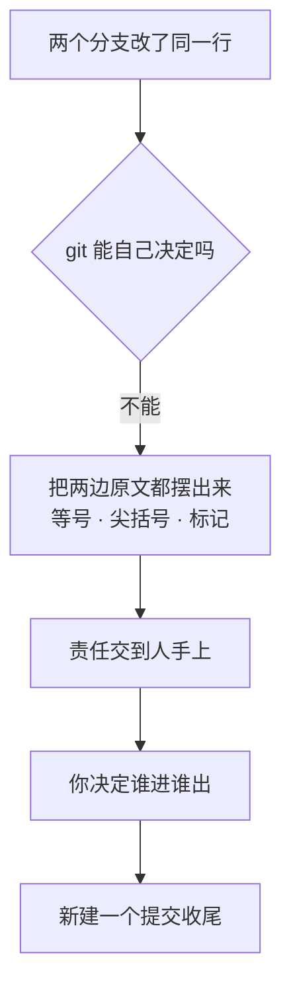
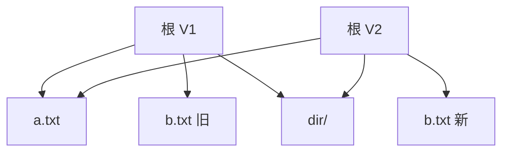
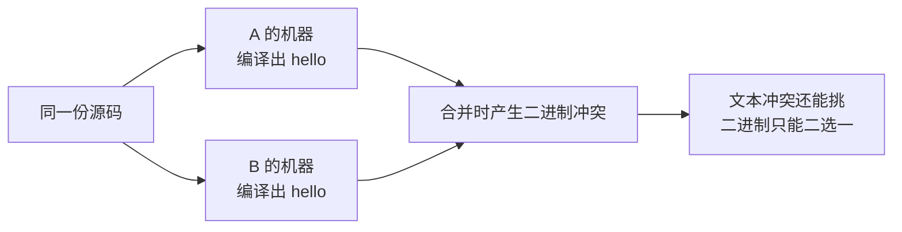
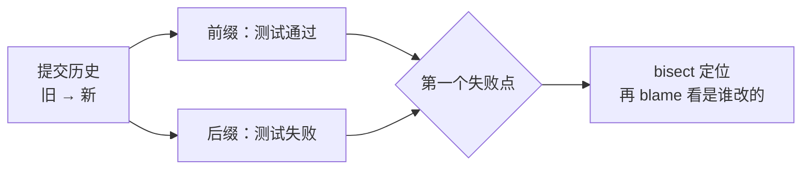

> 本文整理自 B 站《软件仓库管理｜03-Raw 26 生成式软件工程 NJU》，南京大学《生成式软件工程》第三讲，片长约 100 分钟，字幕 1,334 条、约 3 万字。
>
> 字幕由语音转写，专有名词错听较多。本文按上下文订正；确实无法还原的只描述行为，不猜名字。

这一讲标题叫「软件仓库管理」，开场讲的是怎么建目录、git 从哪来、底层存的是什么。

但讲到九十分钟时他说了一句总结：**今天我好像在讲 git，其实讲的是 best practice。**

这句话是真的。git 那部分只是骨头，肉是下面那一串「为什么」。

## 用一个需求推出 git

他先不给定义，而是从一个学生一定经历过的场景开始。

你的项目是一个目录，里面有代码、文档、测试用例，全部搅在一起。你要交作业。于是目录变成了「作业一」「作业二」「作业三」「作业最终版」。

这个做法能work，因为它满足了一个真实需求：**手滑改错了，想回去看看上一版怎么写的。**

那么从这条需求出发，你能自己推出一个版本控制系统。

先做一个命令行工具：列出这个项目有哪些版本，把当前状态切换到任意一个版本。到这一步你已经有 `git checkout` 的雏形了，虽然还没有分支、没有合并、没有冲突。

接着你会碰到第二个需求：跟室友一起改同一个文件。你就得发明合并。再往后碰到冲突，你就得发明冲突解决。

**一个人的需求，加上一点点时间，就能长出整套工具。**他把这个过程叫 first principle 的推演，而且强调每一句话都和前面有逻辑关联。

### SVN 错在哪

在 git 之前，主流是 SVN。两者的差别只在一句话：

| 系统 | 存什么 | 回到旧版本要做什么 |
|---|---|---|
| SVN | 每次改动存一个补丁 | 从当前版本一个个往回退 |
| git | 每次改动存一张完整快照 | 直接切过去 |

SVN 的选择其实很高效——补丁很小，存储省。但这个高效会随着项目增长把人拖进泥潭：你想回到三个月前的某个版本，得沿着补丁链往回走。

**而人真正要的是「一秒钟回到过去」。**他把这个判断压成一句：SVN 有点像走错了路。

### Linux 自己的故事

git 的作者是 Linux 的作者，这个背景解释了它的设计取向。

1991 到 2002 年，Linux 内核靠什么维护？**和交作业一样：版本一、版本二，以及在邮件列表里发补丁。**有人改了一个文件，就往邮件列表里发一份新的，然后由维护者收进核心仓库再发版。

后来他们用过几个别的工具，都不满意。直到 2005 年，Linux 受不了了，决定自己做一个「绝对简单、但概念正确」的版本控制工具。

所以 git 比想象中年轻。**2005 年，二十来年。**

## 责任回到人手上

这是全讲最好的一段现场演示，也是一次当场的测验。

他先讲自己面试推免生时问的问题：什么是 git，什么是 merge 冲突。前两个大家多多少少能说两句。真正让他意外的是——**问「git merge 发生冲突以后你会观察到什么」，几乎没人答得上来。**

然后他自己回答了这个问题，用的是学生最熟悉的场景。

老师发布了一个作业更新。你本地那份已经被改得面目全非。你让 agent 来合并，它啪啪啪修好，说测试都通过了。你看一眼，看起来没问题。

**现在，如果你愿意在冲突发生的那一刻停下来看一眼**，你会看到一些很朴素的东西：等号、尖括号、两个标记。

那不是乱码，那是一个设计的痕迹。

站在 git 设计者的角度想：有个文件原来是 1111，一个人把第二行改成 2，另一个人把第二行改成 3。**那这一行到底留 2 还是留 3？git 不知道，它也不该替你决定。**

所以它做的事是：把两边的代码**同时**摆在你面前，把决定权交出去。

上图是这次现场演示的全部内容：冲突文件本身就是 git 把决定权交出来的证据。

他只要求一件事：**注意一次就够了。**你只要看过一两次，就能说出「两边冲突的代码会显示在一起」这句话。而这个细节，恰恰是判断一个人有没有真正动过手的分水岭。

> 顺带说一句他的观察：用 IDE 的话，冲突块上方还会有按钮，可以直接选接受哪一边。但原理是同一个。

## 打开 .git 看里面

讲完「怎么用」，他往下一层走。

git 的本质是**一个持久化的数据结构**。它持久化的对象是目录树。

问题很具体：V1 是一棵大树，现在要创建 V2，只改了一个 `b.txt`。**要把整棵树都复制一份吗？**

不需要。你自己也能推出这个解法：

1. 被改的那个文件，生成一个新版本。
2. **从它到根的那条路径，每一级目录都要复制一份**，因为它们的子项变了。
3. 路径上没碰到的兄弟节点，**用指针指过去**就行。

上图是关键：V2 只新建了一个 `b.txt` 节点和一条到根的路径，`a.txt` 和 `dir/` 直接复用旧的。所以哪怕项目里有一百万个文件，一次提交的增量也非常小。

他补了一句为什么目录不会很深：每级索引都是指数级增长，很快就能把文件分完。就算真有人搭了很深的目录，路径复制的代价也有上界。

### 三类对象

`.git` 里全是普通文件，用哈希索引。它们分成三类。

| 对象 | 存什么 | 现场看到的细节 |
|---|---|---|
| blob | 字节序列，文件的内容 | 很小的文件压缩反而变大：31 字节压成 23 字节 |
| tree | 目录结构：权限、文件名、指向 | `644 hello.c` 这样一条条列出来 |
| commit | 一次快照，指向一棵 tree，带 parent | 合并提交有两个 parent |

他做了一个可视化工具，直接从真实的 `.git` 目录读文件、实时监听变化、用动画展示仓库怎么长。

现场演示里有一个细节值得记下来：他删掉一个文件，右边树里那个节点就消失了；创建一个分支，磁盘上就多出一个文件——**所谓分支，就是一个指向某个 commit 的指针，`refs/heads/` 下面一个文件而已。**而 HEAD 是指向指针的指针。

他还展示了合并冲突时 git 悄悄留下的东西：工作区旁边有三个版本，`base`、`ours`、`theirs`。你平时看不到它们。

> 这个工具是他用一句话 web code 出来的车。他的原话是：视觉效果不完美，因为我没调，一次直出，只补了一个 prompt 去掉多余的东西。但它能把真实的仓库刨开给你看，这跟看一个模拟动画是两码事。

## 真正的主题：best practice

从四十分钟开始，讲的东西变了。他一条一条拆那些约定俗成的规矩，每条的落点都是同一个问题：**为什么会有这条规矩。**

### commit message 不是备注

他先做了一个反例提交，信息写的是「我加了些很酷的东西」。

然后让 AI 评审。结论很直接：主要问题在提交信息，完全看不出做了什么。

道理不难：**git 存的是快照，但项目本质上是「从 V1 改到 V2」的一次次修改。**所以 message 要描述这次改了什么，相当于给这条演化轨迹做标注。

他用一个反问把这件事钉住：如果你有一万个提交，每个都写「我加了些很酷的东西」，那这个特性就不该存在——**从 V1 到 V2 就够了，何必要个 message。**

反过来，好的 message 让你翻历史就知道项目怎么走到今天：修了多少 bug、加了什么需求、经历过什么重构。

### 提交之前，让 AI 先审一遍

他演示了一个可以立刻照抄的动作：**做任何 git 操作之前，把所有改动逐个过一遍。**

第一次，他故意写了个编译不过的文件去提交。AI 拒绝，并把文件修好了。

给出的理由很干净：**提交应该是一个完整自洽的快照，提交编译不过的代码等于让仓库处于坏状态。**

第二次，他用 `git add .` 把所有文件一把提交。AI 按严重程度排了序，然后一条条批评：

- 提交信息看不出做了什么
- 提交力度和内容混杂
- `hello` 是编译产物，根本不该进版本库，应该写进 `.gitignore`

他补了一句自己都没预料到的：AI 还顺手发现这个仓库没有 remote，所以这次重写历史不会影响别人——**如果别人也持有这个仓库，重写历史就是另一回事了。**

### 编译产物为什么不能进版本库

这是他解释得最细的一条，因为几乎每个新同学都会踩。

`hello` 这个二进制是可以编译出来的。你觉得放进去也无所谓，反正都是我的代码。

问题在于**别人的环境不一样**。同一个源文件，在不同机器上编译出来的二进制可能不一样——带上日期、带上哈希、带上本机的指纹。

于是两个人都提交 `hello`，一合并就是二进制冲突。而**二进制冲突几乎无法合并**：文本冲突还能一行一行挑，二进制只能二选一。

上图是他说这条规矩时画的因果链。落点在于：**能重建的东西不该被存下来。**

### 例外：不是所有生成文件都该忽略

他特意留了一个反例，说明这条规矩不是死规则。

`package-lock.json` 是生成的，但它该进版本库。某些自动生成的 C 头文件也是——放进仓库，别人就不必装全套工具链也能编译。

**判断标准不是「是不是生成的」，而是「别人能不能用更低成本重建它」。**

### 那个藏在 Finder 里的文件

他讲了一个很多 Mac 用户不知道的坑。

你在 Finder 里打开一个目录，系统会自动留下索引：哪些子目录展开过，滚到哪个位置。这些写在一个以点开头的文件里，叫 `.DS_Store`。

因为以点开头，`ls` 默认不显示，你也看不见。于是你随手 `git add .`，它就进去了。

他的评语很克制：**git 把这个文件加进来其实是合理的**，因为点开头的也有很多该跟踪的东西，比如 `.github/workflows`。规则复杂，所以才有 `.gitignore`。

### 空提交什么时候合法

他做了一个实验：让 agent 提交，但要求「不做任何改动也要提交」。

git 会拒绝空提交。但 agent 知道怎么做，因为它有这方面的知识。

那空提交什么时候有用？他给了一个具体场景：你修完了最后一个 bug，这是一个 bug fix 提交；现在你要冻结版本、发 V0.1，这是一个 finalize 提交。

**把这两种意图分成两个提交，而不是混在一起或只打一个 tag。**偶尔这么做是可以的，但不能大量创建。

### 他调研过的那些东西，被大模型杀死了

这一段是全讲最诚实的地方，也是我认为最值得记的。

他说自己做软件工程研究，有一个非常标准的研究题目：**研究 git 项目是否满足这些 best practice，不满足就给你一个警告。**比如 `.DS_Store` 该不该被跟踪，需要一条规则；各种生成物要不要入库，需要另一套规则；最后做一个小工具，在提交之前告诉你行不行。

他说：**所有这些东西都被大模型杀死了。**因为模型可以如此耐心地逐项检查，还给你一个表情符号缓和情绪。

他补了一个更真实的动机。作为导师，看到学生提交不合规范的项目，他会先高血压，然后还得装作友善，说「这个项目不太符合软件工程的实践」。而不管他情绪多正常，学生听到的都是「老板在批评我」。

**AI 在这一点上真的解放了学生。**

## 惊人的注意力

他反复用一个说法：惊人的注意力。

具体指什么，他给了操作定义。

**看到任何东西之前，先在脑子里做一遍。**我会怎么解决这个问题？然后立刻比较：我看到的东西，和我脑子里想的，谁更好。

- 如果一致，说明你已经完全掌握了。
- 如果它更好，就去想它为什么能想到，于是它变成你知识的一部分。
- 如果**你**更好——一万次里可能只有一次——那种正反馈足够让你兴奋到想去干点别的。

他把这个方法叫 virtually implement，说它适用于任何课，包括高等数学和计算机系统基础。

### 地铁站的路牌

他用一个和编程无关的例子说明这件事的价值。

在香港找路时他发现：**每当他不确定，正前方一定有一块牌子告诉他三个出口分别去哪。**那是一个很复杂的地下系统，但从来不需要他回头看。

回到南京，在地铁站里他经常要环顾四周、走一段距离才能找到一块地图。

他从这个对比里学到的是 UI 设计的一条原则：**站在人所在的位置，把他此刻需要的信息全部放在这里。**

而这条原则，git 也在用。冲突文件把两边代码同时摆在你面前，就是同一个原则的另一个表现。

### 关于 readme 的观察

他说现在 GitHub 上的项目，readme 都是巨长无比，还带各种 Unicode 字符拼出来的目录结构框图——**一股 AI 味。**

但偶尔点进一个维护了十几年的老项目，文档清新舒服：readme 很短，看完之后就三个链接，点过去就是了。

**你不需要看那么长的东西。**看完几个好的，你自然就知道 readme 该怎么写。

他也顺手解释了一句为什么很多学生觉得上课耽误学习：**课外的信息密度已经远远超过任何一个课堂能做的事。**你打开一个成熟的 GitHub 项目，那是别人十几年的心血，中间还崩过一次、做过一次大版本重构。而你从没被教过怎么消化这种密度的信息。

## 从 git 到 GitHub

最后一段讲了一件容易被混淆的事：**git 和 GitHub 不是一回事。**

git 管理的是快照。GitHub 上还有 issue、有对代码的评论，这些东西**不随 git 持久化**。

所以有了 `gh` 这类命令行工具：取一个 issue、找分配给我的、把它关掉。对 agent 来说这个工具特别顺手，因为它是纯文本接口。

他给了一个很有用的组合：装好 `gh` 之后，给 agent 设定一个长任务，要求它**做小步提交、做可审计的提交、遵守分支规则或保持线性历史**。然后就不用管了。

> 他补了一句现状：agent 常常会先试着调 `gh`，失败后退回古法，手写那些 git 命令。原因是 GitHub 太普及，工具链成熟到值得专门做一个。

## 全讲的结论只有一句

九十分钟后，他把整讲压成一句话。

> **把项目组织成用原子改动推进的快照。**

所有东西都从这句话推出来。

因为项目是人类没法处理的混沌——需求多、代码多，一次做一大波就会乱。所以要切成能理解、能审计的小任务。

小任务的好处是一串连锁反应：

| 因为小 | 于是 |
|---|---|
| 出了问题能定位 | 可以 bisect、可以 blame |
| 冲突范围有限 | 两个小任务冲突，剩下的部分仍能合并 |
| 尝试成本低 | 可以开分支试验，失败就安全扔掉 |
| 可以并行 | 多条主线同时推进，靠合并收敛 |

关于 blame 他还补了一条操作层面的用法：**对提交历史做二分查找。**

把历史看成一个数组。当前版本有 bug，但触发它的是很久以前的某个提交。于是你有一个「前面都通过、从某一刻起全都失败」的数组——这不就是在找第一个 1 的二分查找。

上图是这套做法：历史本身变成了一份可检索的档案。

### 线性历史：现在流行，是因为 AI 擅长

他说现在更流行强制线性历史：`main` 上永远是一条直线，合并靠 rebase 而不是 merge 提交。

理由很实际：**反正都是 AI 在 resolve，rebase 对它来说很容易。**

但他也承认这不全是好处。只是对现在的项目维护来说，线性历史更易追溯，对 cherry-pick 和 blame 更友好，AI 维护起来也更省 token。

## 一个可以直接照抄的工作流程

讲完理论，他给了自己的做法。

| 阶段 | 怎么做 | 为什么 |
|---|---|---|
| 架构设计 | 单线程，用一个智力较高的模型多轮讨论 | 设计不好，后面就是无穷迭代 |
| 定接口 | 把组件接口定得非常明确：纯函数、数据进数据出 | 接口稳了，实现就可以当黑盒 |
| 收敛共享状态 | 全局互相影响的状态注册到一处 | 他的 playground 核心共享状态只有十几行 |
| 并行实现 | 开三四个 agent，各干一块 | 有规则在手，不怕它们乱来 |
| 收尾 | 要求禁止调用视觉模型自检、禁止开浏览器任务 | 省 token；他在旁边另一块屏上肉眼看刷新 |

他特别强调「禁止看库函数实现，只看接口」——这条让 agent 的 token 消耗降下来，几万个 token 就能做出一个 playground。

## 我的三点补充

以下是评注，不是原片内容；我的判断只代表我读这份字幕后的取舍。

**第一，把冲突当成一次责任交接，是理解 git 的钥匙。**很多人把 merge 冲突当成工具不好用。但从设计角度看，git 唯一没做的事就是替你做决定——因为它没有资格。把这一条想通，冲突文件里那些等号和尖括号就不再是噪音，而是一次明确的责任交接。这也是他面试学生时唯一真正在意的那个细节。

**第二，他对「什么该进版本库」的重述比常见说法准确。**通行说法是「不要提交生成的文件」。他的版本是：**能低成本重建的东西不该存，重建成本高的东西该存。**这一条同时解释了为什么编译产物不能进（任何人的机器都能重建）、为什么 lock 文件和生成的头文件可以进（不装依赖或工具链就重建不了，代价高）。判据是成本，不是来源。

**第三，那个「先自己写一遍再对比」的习惯，是这讲最可迁移的部分。**它把「看别人的代码」这件被动的事，变成了一次主动的对比实验。而且它有明确的三档结果，每一档都有下一步动作：一致就是学会了，别人更好就学到了新知识，你更好就是一次罕见的正反馈。这比「多读源码」这种建议具体得多。

---

一句话总结：**git 只做一件事——把项目打成一个个可以回退、可以审计的快照。**其余所有规矩，都是为了让你在需要回退和审计时还找得到路。
