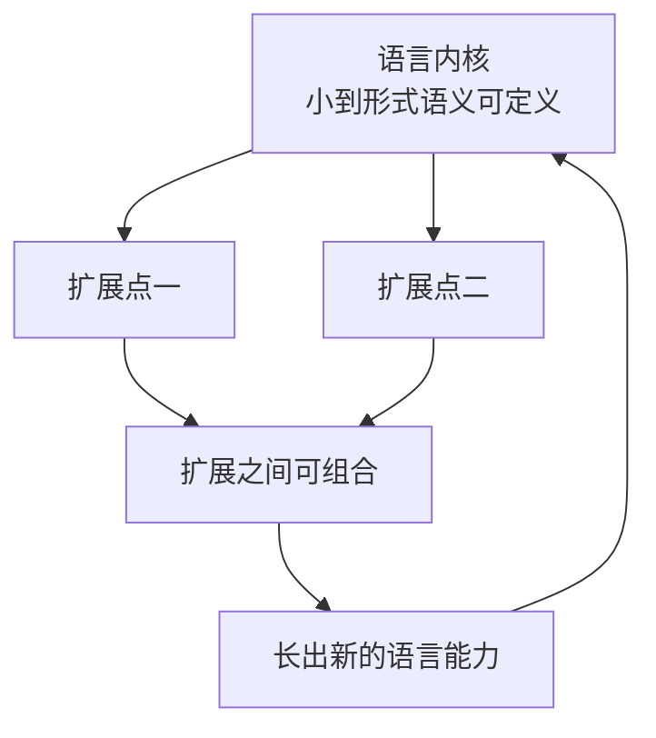
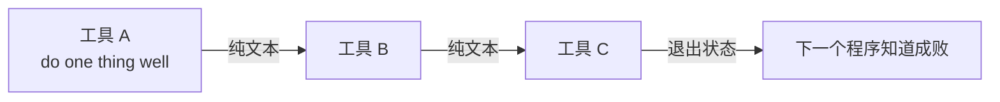
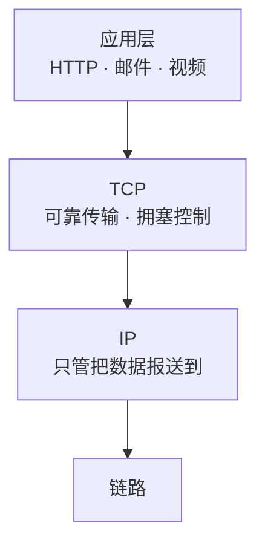
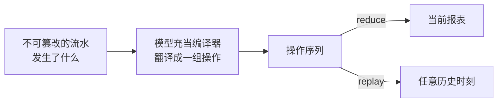
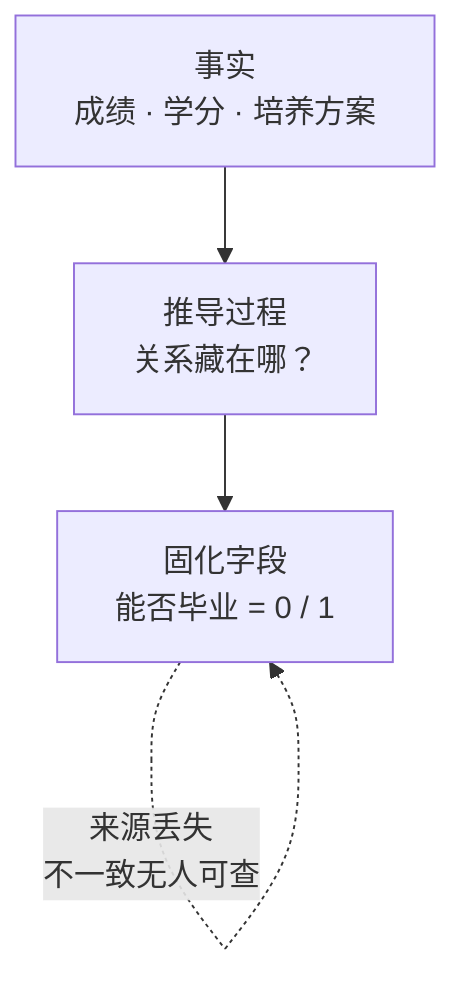

> 本文整理自南京大学《生成式软件工程》第七讲「需求和架构（下）」，B 站编号 07-Raw 26。原片长约 99 分钟，字幕 1,307 条、约 3 万字。
>
> 字幕由语音转写，人名与术语错听较多。本文按上下文订正；确实无法还原的只描述行为，不猜名字。

上一讲说需求定方向、架构定船能扛多大浪。这一讲接着往下走，但走了另一条路——**不讲怎么设计架构，讲怎么判断一个架构好不好。**

判断标准压成两个字：**可生长。**

## 先承认复杂性消不掉

Brooks 那句话被引了一遍：软件工程的本质是驾驭复杂性。

但这里有个关键区分，他用了两个词。

**essential complexity**，本质复杂性。选课系统为什么复杂？因为它要考虑课程容量、先修要求、时间冲突、教室排布，还有教师和学生都能借教室这件事。这是物理世界本身的复杂，投影到信息世界里一分不少。

**accidental complexity**，偶然复杂性。这是你自己选的技术带来的。文件系统好改好 hack，但没有事务原子性；数据库有事务，但你每次调试都要穿过一层中间件。

**前者消不掉，后者可以选。**架构的第一职责就是把前者隔离开。

### 一个登录框能长出多少细节

他用一个例子说明需求为什么必须直面本质复杂性。

你说要做一个购物车，那登录怎么做。如果直接把「我要 login」丢给模型，它会猜一个：用户名加密码。

往下推就收不住了。

第一次登录需要确认密码，那要不要忘记密码功能？不做的话，用户忘了密码，数据留在里面取不出来，体验很糟。做的话，发短信还是发邮件？发邮件用什么服务？

那换成微信登录呢？很多网站都这么做了，更方便。但个人开发者注册不了，你大概需要一个公司实体。

**「这仅仅是登录这一件事儿。」**

所以需求工程没有捷径，只能看得多、做得多。他的建议是深度优先和广度优先同时用：用一个 MVP 快速验证最重要的功能点是不是满足了，同时对那些分叉的决策保持广度的敏感。

## 需求和架构各管一段

他给了一个很干净的划分。

| 物件 | 作用 | 收缩哪个空间 |
|---|---|---|
| 需求 | 把「我到底要什么」问清楚 | intent 的不确定性 |
| 架构 | 把「怎么实现」定下来 | specification 到 implementation 的可能性 |

一旦你做了决定，就背上了一定程度的技术债。区别只是：**这个债你后面还得起，还是还不起。**

## 两篇老文献，两个判断标准

讲到这里他插了一段读书的话，然后是这讲最有分量的部分。

他先讲自己让 AI 做的事：让一个 agent 去收集 1980 到 2010 年间值得读的系统论文，每个领域两三百篇，共一千篇左右。他说这些大部分他自己读过，仔细核对了列表，**发现列得相当好**。

然后他挑了两篇讲。

### 1972：人脑很小

第一篇是 Dijkstra 那本谈结构化程序设计的书。

他特意说了一句：翻开这本书你会发现它不是现代意义上的软件工程书，讲的都是比较小的程序，还在争论「要不要 GOTO」。

但那本书开头几段，他觉得每一句都值得抄下来。

> 我们没有能力做太多事，我有一个很小的脑袋，最好学着与这个限制共处，并尊重它、给它充分的认可，而不是试图忽略它。

**整讲的第一个判断标准就在这里：承认人脑很小。**

由此推出的方法只有两条：抽象，加层次分解。把一个人无法一次理解的东西，变成人可以逐层理解的东西。

他用书里的一个比喻：写程序就像做一条项链，把一颗颗珍珠串起来。

### 学生程序为什么写不好

书里还有一个观察，他拿学生的经验对照。

**学生写的程序为什么烂？因为一次要在脑子里装的东西太多。**

他举了动态规划。OJ 上最难调的题往往不是模拟题，而是需要一点数学性质的那些。模拟题你还能把几个大块拆开、封装成类、单独测试，中间状态也能映射到有物理含义的东西上。

但一个两百行的 DP，中间是纯数学表示。你在哪里错了，看不出来。而且它常常不崩溃，只是算出一个错的值。

**所以问题不在数学，在你没法观察它。**

他的解法很有意思：DP 的状态转移本身是一张有向无环图，这是一个抽象。但你写 `dp[i][j][k]` 的时候把这个抽象扔掉了。那可以把它放回来——实现一个状态查询，把可能的迁移打印出来，或者干脆换一层抽象，用 state 替代数组。调通之后再改写成等价的、更高效的数组形式。

先让它可观察，再让它快。

### 1998：扩展必须是一等公民

第二篇是 Guy Steele 的一次主题演讲，题目是「让语言生长」。

他先讲了这篇演讲的形式：**全篇只用单音节英文词，遇到所有双音节以上的词必须当场定义。**

他点评了一句：这是炫技，而 AI slop 写不出这种东西——至少今天还需要人类的创造力才想得到。

这个形式本身就是论证。当你只能用单音节词，你要讲清楚一个复杂概念，就必须不断定义新词。定义得越多，越显出语言的困境。

**所有编程语言相对于人类需求都是小的**，因为它必须有形式语义。没有形式语义的东西不能在计算机上执行，而形式语义一旦膨胀就定义不出来。

所以语言小，但需求大。出路在哪？

出路不是二选一，而是**生长**。

上图是这篇演讲的架构主张：内核保持小，扩展作为一等公民，且扩展之间能组合。而不是「先列一张需求清单，再逐条实现」。

他补了一句很扎的反省：**你们从进大学就在疯狂做 OJ，OJ 把你们训练成了解题机器。**因为做题不需要扩展，交完就扔，用后即弃，于是思考扩展性的那部分能力就没长出来。

### 他给 Java 开的三味药

演讲里还提了给 Java 的建议：只加三样东西——泛型、运算符重载、轻量用户自定义类。

他点评泛型为什么重要：没有泛型，你构造抽象时就会到处强制类型转换，写得像早期的 Java。

## 三个可生长的系统

有了标准，就可以看案例。他给了三个系统级的例子。

### Unix：只做一件事，用文本连起来

三条原则里，他认为第三条最精髓：**用文本做接口。**

因为文本同时统一了人与程序的接口，以及程序和程序之间的接口。如果是二进制字节流，人读不了。

他给了一个很生动的对比：数据库很好用，但你总觉得隔了一层纱，因为每次查询都要写一条 SQL。人不太适应做任何事都加一层间接。

而 Unix 的答案是统一的命令行约定、统一的输出格式、退出状态，加上管道。

上图是这套机制的骨架：每一步的输入输出都是纯文本，成败用退出状态传递。

他举了一个很具体的例子说明组合性。

你想给编辑器配一个「打开文件」菜单。要么用编辑器自己实现的，要么用操作系统的，两个你都不满意，还有别的选择吗？

在图形界面里没有。但在 Unix 里可以自己配一个，因为菜单、文件列表、打开动作都是可以组合的工具。

他的评语是：**从你用 Unix 的那一刻起，你每个人都是程序员**，因为你敲的每条命令都是一个小程序，你在把一堆 do one thing well 的工具组合起来。

### 关系数据库：把存储的复杂性隔离掉

第二个例子是 Codd 的关系模型。

它解决的问题写在论文标题里：把用户从「数据表示会随规模增长和访问模式变化而改变」这件事里保护出来。

用文件系统管数据，好处是 UNIX 工具都能复用，坏处是太自由，没有统一管理。

而关系模型做了一件了不起的事：**给世界建了一个模型**——数据可以用二维表表示，表和表之间有运算。至于怎么存、存得可靠不可靠，全交给底层的实现。

于是它隔离了复杂性，又有近乎无限的扩展能力：schema 是什么，由你的应用决定。

他补了一句评价：数据库带起了整个人类世界数据信息化的一波浪潮。图书馆的书、学籍、财务、订单，全都可以用关系模型表示，因为**它表示的是实体之间的逻辑关系**。

### Internet：只做连通性

第三个例子更极端。

它只做一件事：connectivity。上面跑什么应用，不管。

要做到这一点，它必须把几件难事做好——数据传输的可靠性、拥塞控制、连接的中断管理。做完这些，剩下的全部交给别人。

原则写在 1996 年那份架构原则文档里，他念了一句：**唯一应该永存的原则就是变化本身。**

上图是这种分工：它只保证「从一个点到另一个点稳定送达」，至于跑什么，不预设。

他还讲了一段网络史来说明「变」：他读书时全网还没普遍上 HTTPS，大家在 HTTP 上裸奔，用 telnet 连 BBS 灌水；传文件用 FTP，因为协议里自带断点续传，校内下电影很爽。

今天这些都被 HTTPS 上的接口取代了。**因为做软件变容易了，所以可以把原来靠协议提供的功能，全部实现在应用层。**

## 业务系统怎么长：从 CRUD 到 React

系统层打好地基之后，舞台就留给业务系统了。

他给的演进线索很清楚。

| 阶段 | 核心想法 | 谁在管状态 |
|---|---|---|
| CRUD | 每个页面就是一次数据库事务 | 数据库 |
| MVC | model 存知识，view 是它的投影，controller 改它 | model |
| MVVM | view 自己也有状态（hover、搜索框） | model 加 view state |
| React / Vue | 界面等于状态的纯函数 | 状态树加虚拟 DOM |

### MVC 那张两页纸

MVC 的原始定义他很喜欢，因为干净：

- **model** 表示知识，是当前世界知识的单一来源。谁选了什么课、有哪些订单。
- **view** 是 model 的可视化表示，它是一个纯函数，不该有改变世界的能力。
- **controller** 是用户和系统之间的连接。它把用户的输入翻译成对 model 的修改。

于是需求的每一个可修改点被翻译成一次事务，你看到的东西是状态的一个投射。

**问题是：这套假设只在一个 HTML 页面、每次点击都整页刷新的时候成立。**

### MVVM 补上的那块

今天的界面里有大量元素的状态不在 model 里。

你展开一个菜单；你在搜索框里打字，但列表已经拿到了，你只是想做本地过滤，不需要再查一次数据库；你把鼠标移到一个元素上，它应该亮起来。

这些都需要一个 model，但这个 model 不该存在数据库里。

所以有了 MVVM：**把 view 的状态也当成 model。**

### React 那一刀

再往前一步，能不能直接写：DOM 等于状态的纯函数？

可以，但性能会爆炸。网页上可能几万个元素，你在搜索框里每敲一个字符，整棵树都要重算。

所以 React 做了大量虚拟 DOM 的工作把这个复杂性藏起来。你只要声明状态是什么、怎么变，剩下的它帮你更新。

他的判断是：React 和 Vue 思路很接近，都要求你隔离复杂性——**把变的东西和不变的东西分开，把逻辑和数据源头分开。**

因为你脑袋小，关注状态的时候就别同时关注状态怎么变成 DOM。

## 长流程把问题暴露出来

讲到这里，前面那套架构看起来都挺好。然后他转向了问题。

**MVC 和 MVVM 没有解决真正的本质复杂性，尤其是长流程任务。**

他拿淘宝下单举例。下单之后要锁库存、算优惠、支付、风控、发货、退款、售后、对账。

按前面的思路，最直接的表示办法是在订单表里放一列 status，1 是下单，2 是锁库存，3 是支付……

**这一列 status 就是一个状态机，而且会越来越复杂。**

更麻烦的是异常分支。某个节点触发风控后要回退，这个回退逻辑写在业务里，随流程变长越来越难维护。

### 一个既能毕业又不能毕业的学生

他给了一个真实存在的怪状态。

有时候你会发现某个学生处在一个矛盾的位置：既可以毕业，又不能毕业。

因为流程里有 bug，或者某个环节被特批 override 了。本该触发风控的地方，被另一个人放行了。于是这个数据处在一个风控失败、但已经进入下一环节的状态。

**这个数据到底是什么，你怎么解读？**

他说学校教务系统里这类不一致的数据有很多，因为经常手操。反正最后没影响这名学生毕业，也就只能不管。

### 根因：快照丢了推导

他把根因讲得很清楚。

**当前状态是一个快照，它是从过去推演过来的。但「怎么过来的」丢了。**

而业务流程往往要同时编码过去、现在和未来。丢了这个过程，不一致就会复杂化。

## 复式记账法：人类早就解过

在给软件方案之前，他先讲了一个非软件的解法。

你用过支付宝的记账，但那只是流水。真正严肃的记账有会计规范，叫**复式记账法**：每一笔交易同时记入两个或以上账户，金额相等、方向相反。

为什么要这么麻烦？**为了防错。**一条记录简单，但无法反映业务的完整结构，也不具备自平衡的校验能力。有了双录，你可以试算平衡，把不一致找出来。

而人类发明它的根本原因，他说得很直接：**一个当前状态很有可能是损坏的。**

### 他自己做的那套记账系统

他说自己对会计没有任何知识，但有一个需求：生成一张符合规范的资产负债表。

正常做法是设计数据库、设计表结构。他没有。他的做法是**记流水**：今天收了 1000，明天付了营业成本，每一笔都写下来。

然后关键的一步：**让模型充当编译器。**

每一笔流水账的条目，会被编译成对报表的一系列小操作：货币资金怎么变、所有者权益怎么变、应付账款怎么变、现金流量表怎么变。当前报表则由所有这些操作依次应用得到。

上图是这套架构：事实只追加，编译可能出错但可修正，状态永远是事实的一次归约。

他还讲了一个实现细节。模型第一版写的代码很长很乱，他加了一个小技巧：给函数加一个参数，让参数把状态确定下来，于是剩下的就是一个柯里化形式。这是函数式编程里很常见的做法，好处是记账从此不再是问题。

## 事件溯源：把事实和预期分开

于是回到软件工程，这套东西的名字叫 event sourcing。

它做的事很简单：**不维护当前状态，只记录所有原始事实之间的依赖。**

他立刻补了一句诚实的话：编译这一步也可能错。但错了以后可以改，改了不用付出代价。而如果你维护的是当前状态，改一个字段，你不知道影响了多少地方。

### 成绩更正那个例子

这是全讲最有说服力的一段。

假设有个学生要查卷子。老师说别要了，学生非要查。查完发现老师当时救了他一手：最后那道空着的题给了 20 分。现在只能扣掉，于是挂了。

**这对数据库是一次摧毁性的修改。**

因为这门课挂了，学分要减一；学分变了，又影响能不能毕业、能不能准出、能不能选下一门课。

更矛盾的是：他当时是先修通过了计算机系统基础，才选上操作系统的。现在这门课挂了，他还能选操作系统吗？

**系统内部天生就不一致了。**

如果只改那个 0 和 1，数据库剩下的部分你到底动了什么，很难评估，很容易漏。

而在事件溯源里，你追加一条事实：成绩从通过改成不通过。然后所有相关结论重新算一遍。因为计算逻辑都还在，数据流是显式的，你能知道这条事实影响哪些结论。

### 还能推演未来

还有一个额外的好处：**因为是 replay based，当前状态完全由过去决定，所以可以用来推演未来。**

他举了两个场景。

流程走到支付这一步，他可以在这个位置直接推演：风控成功会到什么样，风控失败会到什么样。

记账系统里，只要知道应收账款有多少回不来，就能评估自己破产的概率。

**这些都是「只存当前状态」做不到的。**

### 那句总结

他把这整套东西压成一句话：

> **现在是过去的结果。**

所以好的架构把事实和预期分开了。世界没按预期发展，你不用让工程师去手改数据库、把数据库改得越来越糟，你只要追加一条新事实。

领导认为这个学生就是可以毕业，那就追加一条：允许毕业。所有推导重新跑一遍，一切都自洽。

## 最后一击：关系代数漏掉的东西

讲到九十八分钟，他抛出了最狠的一段。

关系代数是一个非常好的、可扩展的架构。但它有一个问题：**它没有把图灵可计算的计算关系作为一等公民管起来。**

他的类比借了 Tony Hoare 那句自嘲——发明空指针是「十亿美元的错误」。他觉得关系代数也犯了一个同类的错误。

具体到代码：如果数据库里有两个字段，一个是「能不能毕业」，另一个是各种成绩。那这个 0 和 1 就是不一致的潜在源头。

因为数据库几乎都会这么设计——**你必须能快速把它查出来**，而用关系代数去建模一个复杂的计算，性能上做不到。

于是这个 derived state 就被固化成了一个字段，而它和它的来源之间的依赖关系，**没有地方记录。**

上图是这个漏洞的形状：推导过程无处安放，结果被冻结成一个字段，而字段和事实之间那条线断掉了。

### 所以那些框架都在做同一件事

他最后把线索收拢：

**MVVM、React、data flow、event sourcing，都在试图把 derived state 和它的依赖关系显式化。**

于是整讲的标题就成立了——从 Unix 管道的文本接口，到关系模型的逻辑关系，到 React 的状态到 DOM，到事件溯源的事实到状态，**每一次进步都是把一层原本藏在黑箱里的推导搬到明面上。**

## 我的三点补充

以下是评注，不是原片内容；取舍由我负责。

**第一，这一讲真正的轴线是「显式化」，不是「事件溯源」。** 事件溯源只是这条轴上走得最远的那一站。前面 Unix 把进程间协议显式化成文本，关系模型把实体关系显式化成表，React 把界面显式化成状态的函数——它们干的是同一件事。**判断一个架构好不好，可以问：它把哪些原本隐含的推导，变成了看得见的东西。**

**第二，成绩更正那个例子值得当成通用判据。** 它把抽象的技术债变成了一个具体可感的场景：改一个字段，你不知道动了多少东西。所以遇到任何「改一处要担心波及」的系统，根因都是同一句——**推导过程没被记下来。** 这个判据比任何架构模式的名字都好用。

**第三，他在四十七分钟处说的那句话，可能是这套课最实在的一条建议。** 大意是：很多宝藏被埋在快速发展的时代里；大家进组后听到的都是「师兄又发了篇 SOTA」，品味就被海量的人类 slop 和 AI slop 污染了。而今天每个人都可以用很低的成本回到一手文献。**这不是怀旧，是成本结构变了之后应该重排的优先级。**

---

一句话总结：**好的架构要能生长，而能生长的前提，是把每一步推导都留在明面上。** 现在之所以能解释，是因为过去被完整记下来了。
