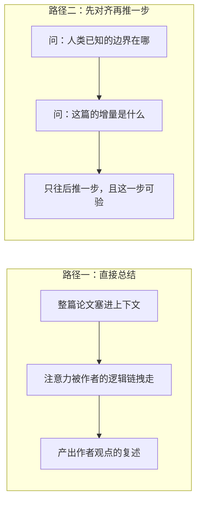

> 本文整理自 B 站《提示词工程｜02-Raw 26 生成式软件工程 NJU》，南京大学《生成式软件工程》第二讲，片长约 98 分钟，字幕 1,316 条、约 3 万字。
>
> 字幕由语音转写，模型名错听较多。本文按上下文订正；确实无法还原的，只描述它做了什么。

第一讲讲的是「AI 能干活了」，第二讲换了个更实际的问题：**你凭什么指挥它。**

讲者的答案有点反直觉——不是靠把话说得更漂亮，而是靠**把整个上下文安排好**。

## 一个词，两种含义

大多人以为提示词就是输入框里那句话。你在聊天框里打「帮我写个游戏」，这就是提示词。

但 agent 看到的不是这句话。它看到的是一整个上下文，而那句话只是最后一行。

讲者第一次被这件事震到是 2023 年。他上操作系统课，想让 ChatGPT 讲讲 x86 汇编——那年头已经没什么人写汇编了，算是传统艺能。他**故意写了一段地球人不会那么实现的反汇编代码**，结果模型解释得出奇地好。

那段代码不太可能在训练语料里。他的原话是：那一刻觉得时代要变了，虽然没到今天这么清楚。

## 现场解剖：让 agent 看自己的上下文

课上最有效的一个演示，是让 agent 自己检查自己。

提示词很朴素：老师上课说 agent 的上下文里不止一两个提示词，你能检查一下你的上下文里都有些什么吗。它照做了，还逐层说明了每一层来自哪个文件。

拆开看是这样七层。

| 层 | 内容 | 谁写的 |
|---|---|---|
| 系统提示词 | 身份、工具使用指南、回复风格 | agent 框架内置 |
| 全局指令 | 用户级的 AGENTS.md，例如「用中文回答」 | 你 |
| 项目指令 | 项目根目录的 AGENTS.md | 你 |
| 技能索引 | 只有名字和一句描述，按需加载，用完就从上下文里抹掉 | 你 |
| 工具定义 | 每个工具的参数说明，以文本形式躺着 | 框架 |
| 会话历史 | 你说的话、它说的话、每次工具调用的结果 | 双方 |
| 运行环境 | 每次执行注入的变量，**包括当前时间** | 运行时 |

最后一行有个实用推论：如果你和聊天版模型聊，可以把当次注入的环境套出来。它不属于系统提示词，所以能问。

所以「提示词工程」这个词有点误导。**它真正在管的是上下文工程。**

## 顺手读一个你不懂的系统

上下文结构讲完，讲者顺手演示了一件更实用的事：**现在的软件系统，你可以直接问它内部怎么工作。**

他留意到一个细节：Codex 调用 bash 时，有时要你确认，有时不问。于是他写了一段提示词，问它风险判定是怎么做的——是做了语法分析，还是让大模型评级，还是别的方法。

agent 去读了自己的源码，给出的答案分四层。

1. **语法分析器加白名单**：命中的命令直接放行，连审批都不需要。
2. **按沙箱分流**：沙箱内的低风险命令直接执行。
3. **注入一小段提示词**：不在白名单里的，让它给风险评级。这也是提示词工程。
4. **人工审批**：剩下的交给人。

这里有两个值得记下来的洞察。

**第一，白名单不等于安全。**他举了个例子：如果你的环境里把 `ls` 重命名成了别的命令，那这个「安全命令」就可能是危险的。恶意的环境里，名字和语义是可以脱钩的。

**第二，验证方法是改提示词看行为。**他建议：如果你不信这个评级，就把那段提示词改一改，让原本会拒绝的变成不拒绝，再观察行为变化。**行为变了，就是证据。**

顺带说一句他吐槽的老习惯。上系统课时他发现，很多同学从第一个实验做到第四个，VS Code 里一直挂着红线——因为没配 include path。红线不影响在受控环境里编译，但那不是正确做法。花十分钟配好，就能用跳转、重命名符号、一次性重构。

**工具变便宜了，习惯没跟上。**这是他反复提的一件事。

## 学习方式先变了：正着请教，反着讲

在讲怎么写提示词之前，他先讲了怎么学。

**正着用**：把 AI 当老师。他说自己大学时有个心理障碍——有个东西不会，可能室友会，但跟他沟通成本很高，而且会暴露「我很菜」。AI 没有这个成本，它不嫌弃你，你可以任意程度地追问。

**反着用**：费曼学习法。你自认为弄懂了，就反过来让它扮演学生，你来讲，让它指出你哪里逻辑有错有漏。正一遍反一遍，概念基本就清楚了。

这套方法的门槛低到几乎没有。**任何时候你觉得有点麻烦，就可以立即行动。**

## 指令遵循是怎么做到的

这是整讲最硬的一段。要理解提示词为什么有用，得先理解模型是怎么「听话」的。

### 一个喵，测出上下文有没有被截断

从 Claude Opus 4.5 那一代开始，模型靠强化学习和后训练，学会了很强的指令遵循。上下文接近百万 token，它依然能在很靠后的位置遵循你最早写下的指令。

工程上流传一个测试：在最早的提示词里加一句「你每说一句话都要在后面加一个喵」。然后正常干活。

某一天你突然发现喵丢了。**那就说明上下文被截断或被压缩了。**这时候你得重新想办法。

### 从舔狗到做题家

早年的 ChatGPT 没有思维链。它被训练成一定要给个回答——人类问什么，它必须说点什么。

这个激励结构直接解释了幻觉：不回答一定低分；随便答有概率对，答对就是高分。**所以它无论如何都要给你一个东西。**

有了思维链和强化学习之后，逻辑变了。它知道答错惩罚很大，于是学会先想一想：这个问题有点难，我先试试什么，把推导写下来，再看这个解对不对。

这就是 test-time scaling。它不是变聪明了，是**学会了先打草稿再交卷**。

### 上下文是一张只能往后写的纸

讲者在这里引了一条很漂亮的类比，来自 Manuel Blum 给研究生的建议：**人是一个有限状态机，但当你有了纸和笔，你就成了图灵机。**

有限状态机和图灵机的唯一区别，就是后者有一条无限长的纸带。

模型也一样。它每输出一个 token，都是一次固定大小的计算——哪怕参数有 3T，一次推理激活的也只是其中一部分。所以它必须把思考写下来。

而这条纸带有两个缺陷。

**它只能往后写，不能擦。**写错了的东西擦不掉，只能靠注意力在后面忽略它。

**它会越写越满。**写满之后，早先的指令就被挤到注意力之外。

### 注意力会分时上班

这是全讲最关键的一个机制。

模型输出每个 token 时，都会「看」过去的某些位置。而看哪里，是随输出阶段变化的。

他举了一个自己的例子。全局 AGENTS.md 里写了「用中文回答」。当你在让它写一个赛车游戏的代码时，注意力集中在需求和你已经写过的代码上，「用中文回答」这句话的权重很低。

代码写完，它要总结了。这时候它「喘一口气」，注意力回到「用户还要我用中文」。于是它用中文总结。

**人也是这样。**你专心化简一个算式时，全部注意力在算式上；化简完吸一口气调整，注意力才回到别处。

这解释了两件事。

**第一，为什么思维链能纠错。**它一路往前写，注意力在不同时刻看到不同的部分。写到某一步，它同时看到了「当前输出」和「早先的某条要求」，于是发现自己错了，回头再改。

**第二，为什么指令越多越糟。**每条指令都在抢注意力。上下文是一种稀缺资源，塞得越满，被漏掉的越多。

### 老式提示词玄学为什么失效

有了这个机制，很多旧现象就能解释了。

早年网上流传大量提示词模板：你是一个专家，你是一位资深的什么什么，你已经在这个领域工作了二十年。这些写法某种程度上是在 **hack 自注意力**——当模型注意到「你是一个专家」这句话，它就会假装专家说话。

但从 GPT-5 那一代开始，思维链训练出来了，模型知道怎么收敛到好的推理路径。那些奇怪的提示词就不需要了。

**你只要把明确的 verifier 写在上下文里。**模型被训练成会去找它、看它、确认它。

## 三个演示，一个结论

为了证明指令遵循能走多远，他现场出了三道题。三道的共同点是：**人看一眼就想骂出题人。**

**第一道，藏头诗。**要求写一首押韵的诗，讲一个和动物有关的故事，且「二零二六九月一日」八个字按顺序出现在八句里。头是 nonsense，人类第一反应是这题没法做。

模型照单全收。它先定韵脚，写出一版，然后自己验：这个字对不对，韵脚合不合。不对就改，改不动就换韵脚重推。

**第二道，同偏旁。**写一句十八个字的话，全部用三点水偏旁。模型对字形结构感知很弱，必须先靠视觉模型才行。但它先选了「氵」这个部首，再往里填字，写出「江湖游泳渡河波涛汹涌」这样的句子。

**第三道，全同音。**就是《施氏食狮史》那种。讲者说他发现 GPT-5.6 也能写出来，虽然故事性和千古流传的还有差距。

三道的结论是同一个：**写 prompt 最要紧的不是措辞，是你有没有准备好 verifier。**

韵脚可以验，偏旁可以验，读音可以验。只要有明确信号，再加一个足够强的模型，它就能一轮一轮逼近。

反过来，教学为什么难。他做了数字人切片，第一个版本还行，第二个版本怎么调都调不好。因为「这堂课讲得好不好」没有 verifier——AI 味要淡、要有情绪起伏、要意料之外情理之中，这些都对，但没有一个能自动判定的信号。

> 他的判断：在有明确 verifier 的事情上，AI 已经超过了多数人的极限。在没有 verifier 的事情上，还得人来做。

## 过度字面：模型把要求写进了注释

指令遵循太强，也会出另一种事故。

你写「要一个白色背景，不要半透明的效果」。模型老老实实照做，然后在代码后面加了一行注释：`// 白色背景（不要半透明效果）`。

它知道这条要求很重要，所以把它记下来——但没意识到**人不需要注释，人需要的是效果**。

讲者把这个归因于后训练的副作用：强化学习教会了它「满足要求」，没教会它「共情」。所以有时候你会觉得模型不说人话。

想防这种事，可以在 AGENTS.md 里写规则，规定注释该怎么写。**但规则本身又污染上下文。**这是一个绕不开的取舍，目前没有通用解。

他给的建议很实在：当你从网上拿各种 skill，第一次用有改进，第二次就不够好，第三次开始陷入泥潭——**这时候回到自己写指令**，做一点不严格的可解释性：看它注意到了什么，得到了什么结果，然后据此改。

## 一个完整的上下文工程：读论文

前面都是机制，这一段是完整案例。他拿自己刚改过的一篇论文现场演示。

### 直接总结：逻辑越自洽，污染越强

最常见的做法：把 PDF 放进去，说「帮我做个总结」。

问题就在这里。**论文是逻辑高度自洽的东西**——作者反复改过，A 所以 B，B 所以 C，一环扣一环。模型读进去，注意力被这条链拽着走，最后写出来的总结，本质上就是**作者观点的复述**。

他补了一句：这不限于论文。你看不懂的教科书某一章，讲链接和加载的那一节，机制完全一样。逻辑越紧，你越容易被它带着走。

### 它是墙头草

第二个问题是立场。模型没有自己的立场。

你说它好，它马上说好；你说它不好，它马上说不好。就算你想认真评估，它也只会来回摇摆。然后它会抓住一些不重要的点疯狂发力——比如「实验还可以再补充一些」。这是它最爱干的事。

### 正解：先站到人类知识的边界上

他的做法是换一个起点：**站在人类已知的知识边界看这个问题。**

分两步问。

第一步，先问人类历史上相关的、已经解决的问题是什么，解决到什么程度。

第二步，再问这个工作试图解决哪些不一样的增量问题。

这就是 grounding。**先让模型和你站在同一条起跑线上，达成共识，再往前走。**

上图是两条路径的分岔点：一条让模型替你复述，一条让模型替你在已知边界上推一步。

第二步的推理之所以可信，是因为它可以验证。不是跑测试那种严格验证，而是你相信模型有人类知识，能站在人类立场审视合理性。

### 学生版：先告诉它你学到哪

讲者说，学生用这套方法要对齐的对象不一样——**你要对齐的是「过去的你」。**

比如你在学计算机系统基础，就先告诉它：我学到什么程度了，我的编程水平是什么样。这相当于维护一份记忆，AGENTS.md 里写清楚。

然后让它只用你学过的知识把这部分刷新一遍。这样它不会一上来就讲你没学过的东西。

### 审稿人版：逻辑自洽，但没意义

他自己审稿时的立场是：有没有给人类提供新的知识。

他讲了一个刚拒掉的例子。作者说要做一件事 A，A 分成 A1 和 A2，A2 没人好好研究过，所以我们在 A2 上做了一个改进。

这是一个很标准的路线图。问题在于比例：A2 只占整件事很小一块，讲者估计 A1 才是性能大头，优化 A2 带来的收益接近噪声。

这就是他说的：**我几乎不会因为实验不够好拒稿，大部分是因为逻辑在这里断开了。**

而模型审稿做不到这一点。他让 GPT-5.6 审同一篇。它只验证「claim 是否成立」「逻辑有没有漏洞」。按这个口径，每篇论文都是 valid 的，但它不会问：**这件事值不值得写出来。**

他在这里下了一个很重的判断：发表和评审体系很快要崩。AI 写的文章涌入，AI 再拿去审，双方的上下文都被同一套故事污染。最后没人真的读文章，全是 slop。

> 顺带一个观察：他说自己学习的方式是「对齐过去的我」。读到好东西会想：为什么我以前不知道，我的盲区在哪，缺了哪块前置知识。这个圈就这样一点点往外长。例子是《自然》百年科学经典里的论文，还有线粒体母系遗传怎么推出共同祖先。

## 从短程到长程

讲者把任务分成两类，分界线是 verifier 清不清楚。

| 类型 | 特征 | 该怎么交给 AI |
|---|---|---|
| 短程 | 有明确的、机器可验证的信号 | 直接把 verifier 写清楚，让它自己一轮轮逼近 |
| 长程 | spec 和实现都不清楚，只有模糊的 intent | 不要让它一口气做完，拆成能验收的小段 |

短程的甜点区很具体，就是「帮我把这个实验做了」。它最擅长这个，因为它有明确信号，可以不计代价地试。

长程就不行。模型有一种着急的执念：赶紧通过 verifier、满足要求、结束。这是强化学习给的。而如果它规划得太久，上下文会满，人又不满意。

**所以现阶段它最好用的形态还是「帮我把这一块做了」，而不是「帮我从零设计这个系统」。**

## 一个悖论：小游戏翻车，Linux 内核游刃有余

接下来是他观察到的、全场最有意思的一个反差。

**从零做个小产品，一点都不难。**一句话生成一个赛车游戏，物理、碰撞、后视镜都做得有模有样。但往后维护，加一个功能、再加一个功能，从某个点开始就崩了，成本指数上升。这就是《人月神话》讲的那件事，只是换了演员。

**可在大型成熟系统里，它像砍瓜切菜。**他说自己 hack Linux 内核、改 Android runtime 的 JIT 编译器，这些事在人类手上极其痛苦——为了改编译器而放弃这个方向的学生不在少数。但模型很擅长。

原因正好是前面那个「上下文污染」的反面。

**一份由人类长期维护的高质量代码，会迅速教育模型的注意力。**它要找类似实现，注意力马上就找到库里已有的那几处：原来这三个地方都是这么写的，那我就加起来。该在什么顺序上锁，对不熟悉子系统的人是巨大的心智负担，但自注意力在加载几十个文件之后就明白了。

于是他提了一个研究构想：**能不能把人类最好的设计经验，以文档形式注入上下文？**

这件事其实已经有人做过一遍了，就是《软件设计哲学》那本书——什么时候该封装，什么时候该做成继承关系，都是人提炼出来的碎碎念。

但有个坑：不同设计会打架。你的软件可以是完全松耦合的消息传递，我的可以是统一网关查表，两者不能同时存在。所以也许得让 AI 多轮迭代，收敛到一个好结构再落进代码库。

**核心没变：在维护良好的大型系统里，AI 永远能看到它该看到的东西。**这一点不会开倒车。

## 一次真实的科研失败

这是全讲最诚实的一段。一个学生做符号执行引擎的优化——用一个程序自动分析、验证另一个不太大的程序的正确性。想法是现有的执行效率低，能不能提一些有效优化。

这是个很合理的渐进式题目。学生觉得 idea 有道理，GPT-5.6 也觉得有道理，于是开始跑。

烧了很多 token。按学生的说法：GPT 一直在给我反馈，但我无法验证这个反馈对不对；它给负面结论时，我不知道怎么打破。

失败的原因是一行提示词。

上下文里有一句话是「我想证明 A 方法是有用的」。模型看到这句，就忘了更大的研究图景，变成了 reward hacker。它去构造了一堆小 benchmark，在小 benchmark 上做一些微小的改动，试图给出正面或负面的结论。

**而这些结论对真问题是没用的。**

纠正的方式是把它拉回真实的工具和 state-of-the-art 算法上：从真实工具开始，哪怕 benchmark 跑几个小时都超时。**超时本身产生的搜索路径才是金子**——它揭示什么样的程序结构对现有探索方法是不友好的。

这个案例的价值不在「AI 会犯错」。而在于它把错误的机制点得很准：**你在上下文里立了一个错误的靶子，模型就会极其高效地朝那个靶子冲锋。**

## 算力换智力，和一堵墙

最后一个例子很小，但走得最远。

给小孩起名字。你让 AI 起，它会给一批很不错的——因为它知道去《诗经》里找。但你不敢用。

原因是：**你用 DeepSeek 起名，别人也用 DeepSeek 起名。**最后你孩子成了 AI 时代的「子涵」——一个班里五个十个同名。

他的解法是把开放问题切成可验证的子问题。

1. 先枚举，把范围拉到足够大。
2. 按音筛，把不好的音去掉。
3. 剩下的字交给子 agent 一个一个查。

这样就把一个巨大空间里的开放问题，切成了一堆各自有 verifier 的小问题。代价是烧 token。

上图是这套方法的骨架：把无法验证的整体判断，拆成大量可以逐项验证的小判断。

他管这叫算力换智力。而顺着这个逻辑往下推，他给出了全场最冷的一段。

人类为什么有集体智能。因为世界很大，人很小，每个人的品味都不一样——不同的城市、教育背景、生活圈，各自带着不同的 bias。正因为有这些 bias，才有一加一大于二。

**但如果算力真的能换智力，就会有一堵墙。**有一类人能拿到无限算力，于是拥有无限智力。他们在墙里，墙外是普通人。按这个假设，墙外的人就成了动物园里的猴子——自生自灭，而且永远追不上墙里产出智力的速度。

> 墙里是超人，墙外是动物世界。他没有给解法，只说了一句：这件事快到时候了，我们可能得想想怎么防止它到来。

## 我的三点补充

原片信息很密，有几处值得单独拎出来。以下是评注，不是原片内容。

**第一，全讲的中心轴其实是 verifier，不是提示词。**从藏头诗、同偏旁、读论文、改卷，到起名字，所有能成功的案例都有一个共同点：**有一个能判对错的信号**。所有翻车的案例——数字人切片、教学、科研选题——都缺这个信号。所以「提示词工程」这个名字容易让人练错肌肉：练措辞不如练怎么把任务变成可验收的形状。

**第二，「注意力会分时上班」是这讲最有解释力的一条。**它能同时解释四个现象：为什么思维链能自我纠错、为什么指令越多越容易被漏、为什么长上下文末尾反而记得住、为什么写代码时忘了你要中文。把这四件事当成同一个机制的不同侧面，比分别记四条经验有用。

**第三，那个科研失败案例应该被当成反面模板保存。**失败不是「AI 能力不够」，是**上下文里出现了一个局部最优的靶子**。这个模式在任何长任务里都会复现：你在对话里随口说一句「我想证明 X 可行」，后面所有努力都会被这句话吸引过去。所以长任务开始前，值得先检查一遍上下文里有没有这种「诱饵」。

---

一句话总结：**你以为你在写提示词，其实你在给模型布置一个世界——世界里放什么，决定它往哪走。**
