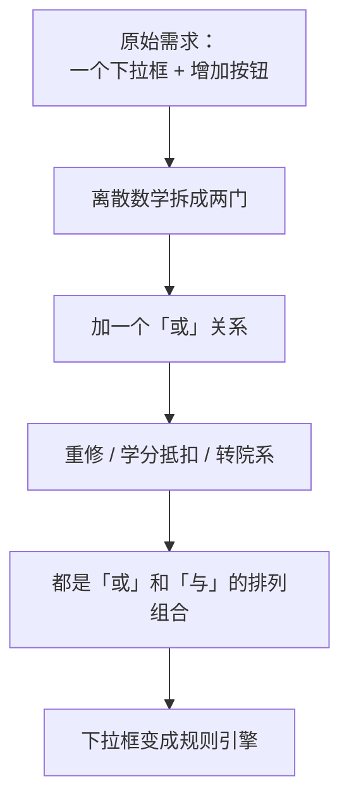
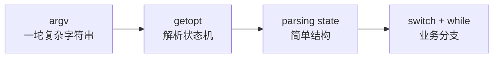
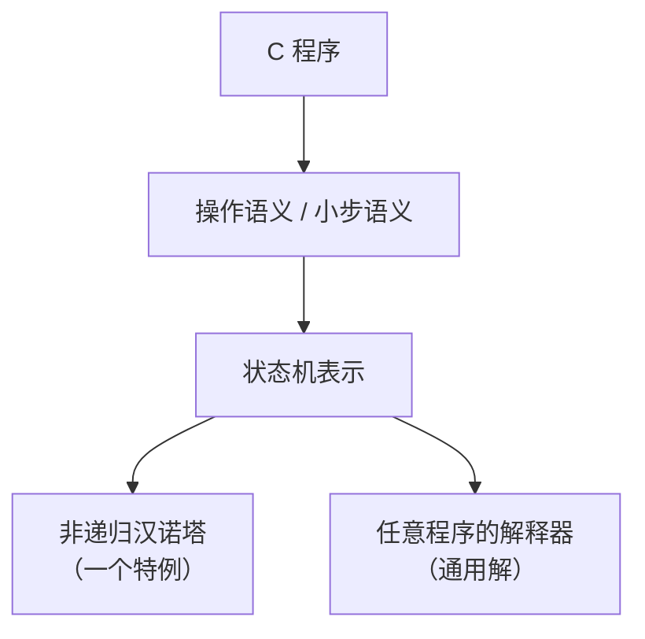
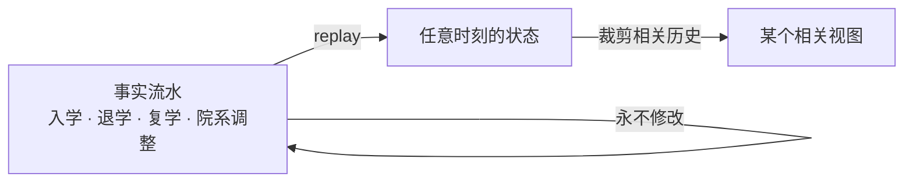

> 本文整理自南京大学《生成式软件工程》第六讲「需求和架构」，B 站编号 06-Raw 26。原片长约 96 分钟，字幕 1,240 条、约 2.9 万字。
>
> 字幕由语音转写，术语错听较多。本文按上下文订正；确实无法还原的只描述行为，不猜名字。

上一讲说的是软件工程从哪来。这一讲说它具体怎么干——**需求定方向，架构决定这个方向能走多远。**

讲者给了一个很朴素的分工：需求是你想去哪，架构是你的船能扛多大的浪。而这一讲真正想说的是，这两件事其实是同一件事。

## 软件一点都不软

开场他先纠正一个直觉。

椅子靠背是软的：你按下去它瘪，你起来它弹回来，下次坐还是好的。**软件不是这样。**软件是纯逻辑制品，容不下任何细微差错。

他举了一个极端例子。程序从输入读一个整数 N，N 等于 1 时进循环读一个数组元素。这个程序要是在卫星上跑，一颗宇宙射线打中内存，让无符号整数的最高位翻成 1——那个 1 突然变成四十多亿，程序就崩了：它会无休止地往下读，读一千个、一万个，直到内存错误。

他又补了数据中心里更常见的版本：制程越先进、晶体管越密，热噪声下某些指令会产生静默错误。同一条指令在这台机器和那台机器上跑，结果可能不一样，甚至要服务器跑一段时间才暴露。

**所以「软件」这个词本身就是误导。**它是人类智慧的集成物，同时要承载客户拍脑袋想出来的需求。

## 一个反面样本：教务系统

这一讲用了大半场讲南大教务系统。他的定位很直接：**史诗级的需求爆炸。**

他现场登录演示，一件一件看。

搜索框能用了——这是「史诗级更新」，以前没有。他搜「仙林教学楼的灯一直没解决」，系统回了句正在理解您的问题。他说灯的问题在系统里提过，被基建处打回来了，说不归他们管。

然后是教学任务页面。学生名单里能看到电话号码。他点评：这显然是个糟糕的 feature。

再往下，是无穷多的功能点：编辑联系方式、当前教学学期、最新排课学期、历史授课信息、期末考试签到表、编辑教材、查看大纲。

他随手点了几个，翻出一个 bug：编辑教材的弹窗打不开。大纲页面等了很久才刷出来，他点评这不满足功能性需求。

还有一个更典型的：疫情之前系统里没有「慕课」这个概念。疫情期间领导说需要，就加了慕课；加完之后需要慕课助教；慕课助教又不能当普通教学班助教，于是单独开一条路径。

**这就是需求叠加的现场证据**——每一条单独看都合理，合起来就是一团乱麻。

### 为什么学生做不了这个项目

他说以前很难讲需求工程，因为学生见不到真正的客户，也不敢接真项目。

「你不敢拍胸脯说这个给我二十万，我找几个同学把南大教务系统包了。」逾期交付怎么办，达不到功能要求怎么办。

但**你不敢，agent 敢。**

## AI 替你写需求文档

于是他做了一件事：让 agent 去爬教务系统里和教师相关的功能，产出一份需求说明书。

结果他很满意，直接展示：调研方法与证据边界、业务目标与成功标准、详细用例规约、功能需求目录、术语表、配套文件。

他点评了两句，一句是「GPT 是懂软件工程的」，另一句更实在：**这已经是一个做好的系统，所以是 slop。**

但 slop 里有真东西。

**第一是术语表。**面对客户时，术语很重要——他看不懂的时候可以查，这样至少能对齐。虽然不是 UML，但已经比自然语言强。

**第二是可追踪性。**每个需求都有编号和语义，比如角色、参与者、业务目标。有了编号，你才能建起 traceability，而不是靠一句「教学班和学生管理有关」这种自然语言。

他挑了一条需求念：「当服务支持多种已分配身份时，提供身份选择并显示当前身份。」

**这条很能说明 AI 观察到了什么。**他自己登录时确实见过身份选择——教师、本科生——但从来没想过这会变成一条需求。而这条需求背后是一个真问题：领导要的是「我打开这个页面，什么样的界面对我最舒适」。

### 这个文档的价值

他给了两个用途。

**一是分派。**前二十条分给一个团队，后二十条分给另一个，然后就能追踪谁落后。

**二是——更重要的——它能直接生成一个替身系统。**

他让 agent 开一个子 agent，不看任何其他教务系统，只根据这份需求说明书实现一个假的教务系统。结果出来的东西和他刚看的那个挺像：返回全部教学任务、我的教学任务、本科教材管理、编辑记录。

他试了一下编辑，保存成功；试了一下记录缺课次数，输入 1，保存成功——但**它没阻止他填一个超过整学期上课次数的数字**。

他的总结是这一讲第一个关键论断：

> **当需求清楚到那个程度，编码、可追踪性、测试这些事，AI 都能帮你搞定。你只需要一份需求。**

### 但也别高兴太早

紧接着他泼了冷水。

如果真要做教务系统，你被迫从零开始，而你没有行业知识。一个五十三岁、本科学历、两年后退休的教务员想要什么，你猜不到。反过来，在这个行业摸爬滚打二十年的公司，知道学位授予的流程怎么变成需求列表——**这就是行业壁垒。**

## 技术债从写下第一条需求开始

这里是本讲的重点段落。

他说了一条定律：**需求没法一次说清，而且它本身也在变。**

他给了一个真实案例，就发生在南大。

离散数学原来是一门课，后来拆成上下两学期两门。拆完之后，准出结果变了，保研要求也变了，新旧衔接不上。

系统里原来的规则是「必须选修离散数学」。现在要变成「选修了离散数学，或者选修了离散数学一」。

而最早做需求时，checklist 上写的是：界面上有一个「毕业要求」，旁边一个下拉框，一个增加按钮，点一下能选一门课。

**在定下这条需求的那个时间点，它完全合理。**但课一拆，它就不能适应了。

于是重构：在下拉框里加一个「或」。**每叠加一次，屎山就长高一层。**

上图是这条需求怎么从「一个按钮」长成「一个规则引擎」的。每一格都是真实发生过的追加。

他继续往上叠：重修；学分抵扣（软院也有一门类似的数学课，能不能抵计算机学院的）；转院系进来的学生怎么算；能不能只抵「离散数学一」还要求补「离散数学二」。

「你一旦面对这个开放的物理世界，你就没办法了。」

### 最后的兜底：打电话给工程师

最狠的是这一段。

有个学生因为离散数学卡住，拿不到学位。课已经拆了，春季学期不开那门课，他来不及再修。

领导拍板：这两门课之间可以存在替代关系。

但系统里没有这个概念。最后怎么办——**打电话给工程师，让他进数据库把这名学生的毕业条件改成满足。**

他补了一句：这个在档案里是可查的，层层审批流程都在。在人类世界的意义上，这个解释是合理的。

**这就是软件系统真正的复杂之处。**

### 他自己踩过的那个坑

他讲了自己第一年上课的经历。2018 年，第一次从学生端换到老师端，发现可以给学生设置缺课次数。他想不通为什么要有这个功能——缺课留个签到表当证据就行了，学生手册里写了无故缺课多少可以开除。

于是他绕过了前端校验，把一名学生的缺课次数从 0 改成 1。

不是什么有害操作。但**所有能选出这名学生选课记录的页面，全部崩溃，直接 500。**

只好打电话给教务处。第二天工程师登录数据库，把那个条目修好了。

> 他在这里下了一个判断：当你驾驭 AI 的时候会产生一种错觉——AI 确实能往后修，迭代三个版本都没问题。但一旦这个系统在真实世界里跑久了，原来的设计不起作用了，麻烦就来了。软件工程里管这叫「没有银弹」。

## 架构是什么：把耦合解开

讲完需求，进入架构。

他先破除一个印象：架构听着玄，其实不玄。**架构就是控制复杂性，而控制复杂性的手段就是分解。**

最小的例子是十行代码。你写一个命令行程序，`main` 会收到 `argc` 和 `argv`。你怎么处理参数？

一个 string compare 一个 string compare 地比？

然后你会想起这世上有 `getopt`。你会在课上、在实验里、在别人的项目里看到那段代码。

**这本身就是一种架构**——`argv` 是一坨复杂的字符串，`getopt` 把它变成一个简单的 parsing state。他管这叫「抵抗需求变化的方式」：`argv` 怎么变都行，但这个模式不变。

上图是这个模式的形状：把复杂性挡在中间，两头都变简单。

他顺手批评了一种教法：老教师讲 C++ 的 lambda，就说「lambda 是 a 加 b 返回 a 加 b」，讲完就没了。这跟没讲一样。**因为你不说它为什么存在，学生就学不到任何东西。**

## 尺度一：十行的非递归汉诺塔

他给研究生出过一道题：写一个非递归的汉诺塔。研究生摇头。

他就用这道题比较了四个"实现者"。

| 实现者 | 做法 | 评价 |
|---|---|---|
| 某个推理型模型 | 直接推出「盘号等于 1 加上步号二进制末尾零的个数」，从数学性质入手 | 正确、极度最优，但看不懂 |
| DeepSeek V4 Flash | 用显式栈保存剩余任务，永远执行栈顶 | 非常优雅，就是标准答案 |
| 豆包 | 选了同样的方案，但代码有瑕疵 | 有 bug |
| CSDN 上搜到的第一篇 | 用了一个 `move`，而标准库里是有 `move` 的 | 比 AI 的 slop 还糟 |

他自己怎么写？他先讲一个前提：**C 语言程序本身是一个状态机。**

他操作系统课上花一整节课讲：单个步骤对应操作语义，递归调用一层对应一个良定义的小步语义。所以你可以写一个 C 语言解释器，把任何程序翻译成状态机表示。

然后非递归汉诺塔就没什么难度了——**把形式语义翻译成状态机就行。**

上图是他这个视角的层次：汉诺塔只是那个通用解的一个简化特例。

所以同一道题有四种表达，差别不在写代码的能力，**在你站在哪一层看它。**

- 站在数学层：一切是规律。
- 站在语言层：一切是栈。
- 站在语义层：一切是状态机。

他说：这就是为什么架构关乎你**跳出问题看问题**的能力。

## 尺度二：两千行的 Excel 二维码

第二个例子他现场打开了一个东西：用 Excel 公式生成二维码。

需求看起来极其明确——一个单元格输入字符串，一堆单元格输出 0/1 序列，拼成二维码。

但这里有大量坑。

**第一，Excel 有版本。**查找学号对应的成绩，以前用 `VLOOKUP`，后来微软出了 `XLOOKUP`。所以马上出现一个模糊问题：你是要兼容旧版本（发给那位教务员也能打开），还是只自己用、可以用最新语法写最短的公式？

需求一变，维护就是摧毁性的。原来用 2023 语法写的，要求退回 2019，等于全部重做。两千行可以重做，两千万行嵌入到教务系统里的呢？那就要加人加钱。

**第二，位置也是需求。**如果所有单元格都是硬编码的相对位置，整体往右移一格，立即全部崩溃。

### 真正的问题在哪里

他说：跳出问题看问题，这其实是一个**编译**问题。

二维码本身很简单。规范里就那几步：选版本、纠错等级、掩码，然后数据编码（0100 模式 + 字节）、算纠错码、填进矩阵。用 Python 写，二十行。

那为什么在 Excel 里这么难？

因为**不存在一个把 Python 编译成 Excel 公式的编译器**。Excel 本质上是为财务报表设计的，不是图灵完备计算环境。

而如果用大模型直接「编译」自然语言到公式，就回到了上一讲那个问题：需求一漂移，它就崩。

### 正解：造一门中间语言

他的做法是：在 Python 和 Excel 之间造一门中间语言。

这门语言是一个表达式树——异或、加法、取某个字符串里的某一位。它有两个后端。

| 后端 | 用途 | 怎么验证 |
|---|---|---|
| 翻译成 Python | 快速验证逻辑对不对 | 直接跑 |
| 翻译成 Excel 公式 | 真正交付 | 每个节点一条公式规则，拼进单元格 |

于是流程变成：**先让模型生成这门语言的二维码计算逻辑，翻译成 Python 验证，对了再翻译成 Excel。**

上图是两个后端的同源验证：一份逻辑，两种执行方式，先验后交。

这个架构还带来一个额外好处：**可以优化。**因为它是门语言，你可以写改写规则——循环里每次算都一样的不变量，就提到循环外；性能瓶颈在哪，先用 profile 看，再决定怎么改。

**这些全是计算机系统课上学过的概念，在这里又用上了。**

## 尺度三：五十万行的教务系统

最后一个尺度最大。

先看 AI 生成的那个替身系统的架构。他让模型自己评价，答案很自信：经典三层单体、前后端分离，还有几个生产级横切设计——乐观锁、幂等、事务、审计、统一错误处理。

他点评：这确实是有软件工程直觉的。至少是摸爬滚打几年才理解的设计。

**但他不认为这是个好架构。**

因为本质上它是一个 **CRUD 架构**：增删改查。

## CRUD 为什么不适合教务系统

这一段是全讲的收尾，也是最漂亮的一段推理。

CRUD 的来源很朴素：物理世界是有状态的，一切都是状态机，人也一样。所以信息系统很自然会建模成状态迁移系统——当前状态存在数据库里，一次操作就迁移到下一个状态。

而数据库课教你要消除冗余、做范式分解：引用学生不要用姓名，用学号，因为学号是链接。一个地方改了不用改另一个地方。

**这个架构没有任何错误。**前后端分离，界面就是当前状态的投影。

问题出在「当前」这两个字。

### 当前状态里，历史全丢了

「当我看当前状态的时候，我看到的是一片祥和的景象。但这个当前状态里，所有的历史它都丢掉了。」

他给了两个具体例子。

**例子一：允许毕业这个字段。**

学生表里有一列叫「是否允许毕业」。但这个值不是独立事实，它是**算出来的**：学分够不够、毕业设计状态如何、有没有违纪。每当修了一个学分，这个逻辑都要重算。

教务员需要能导出「现在还毕不了业的学生名单」，好一个一个谈话。这是个典型需求。

但结果是：**你知道这个学生可以毕业，你不知道他为什么可以毕业。**

计算过程丢掉了。

**例子二：院系改名。**

计算机系改成计算机学院，在那个表里要把 name 改掉。

不改，所有外键还是指向旧名字；改了，你 2011 年的毕业证明上就印着「南京大学计算机学院」——**和事实不符。**

### 不一致会堆积成黑洞

再往下，是更麻烦的事：物理世界发生的事，系统里没有建模。

培养计划通过了、学期开始了、教室还在修不能用了——系统里没有这个概念。只能靠人手工改，改完再把教室重新安排进去。

于是系统里慢慢积累大量不一致的数据，最后变成无法解释的黑洞：明明这个学生没交学费，为什么能毕业？

他补了一句自嘲式的话：南大改成计算机学院的时候，教务系统是瑟瑟发抖的，因为 CRUD 是一个 **point of truth**，所有事实都在那，改一个字就动全身。

### 所以他给的正解：event sourcing

他先问一个更基本的问题：既然三种视图是等价的，为什么不存第三种？

| 存什么 | 等价形式 | 现成例子 |
|---|---|---|
| 当前状态 | 数据库表 | CRUD |
| 操作对状态的增量 | delta | git、SVN |
| 操作本身的日志 | write-ahead journal | 数据库、操作系统 |

**三种视图等价，而存日志能回放出状态。**

于是他给出那个经典设计：**event sourcing，从历史事件生成状态，而不是直接维护当前状态。**

上图是它的骨架：事实只追加、不改写；状态是事实的一个投影，随时可以重新算。

这个设计解决了他前面提的所有问题。

**退学又复学。**以前系统里没有「复学」这个操作，只能把记录抹掉，抹掉之后所有关联记录都没了。现在事实不可篡改，replay 就能拿到复学前的状态。

**院系改名。**不用改表。加一条事件叫「2014 年院系调整」，查历史的人查到他毕业时的版本，查现在的人看到新名称。同一个人可以有两个正确答案。

**数据库迁移。**他说这一条最实在——用 CRUD 做迁移的时候手会抖，因为不知道会坏什么。用 event sourcing，做错了随时退回快照。

他也诚实地说代价：replay 有性能问题，要用快照和缓存优化；而且如果已经在屎山上，改成 event sourcing 会非常困难。

**最后一句总结**：回到最初的 first principle，看清问题的根源在哪，就能做出正确的架构设计。**哪怕你从没听说过 event sourcing 这个名字。**

## 这一讲里的四次翻车

原片最有说服力的地方，是它不回避失败。把散落在各处的失败收在一起看，它们指向同一件事。

| 失败 | 表现 | 根因 |
|---|---|---|
| 他自己改缺课次数 | 把 0 改成 1，所有相关页面 500 | 绕过了前端校验，但没人想到这条数据会被别处依赖 |
| 豆包写非递归汉诺塔 | 选对方案，代码有瑕疵 | 方案对不等于实现对 |
| CSDN 那篇教程 | 调用了标准库里已有的 `move` | 抄来的代码没有经过验证 |
| AI 生成的替身教务系统 | 允许他填一个超过整学期上课次数的缺课数 | 需求文档能定功能，定不了没人想到的约束 |

最后一行尤其值得注意。那份需求说明书已经写得相当完整，替身系统的架构也得到了模型自己的好评，但**它依然放过了一个显然不合理的输入**。

所以「需求写清楚之后 AI 就能搞定」这句话成立的边界在这里：它能搞定被写下来的部分。没被写下来的约束，不管是因为没想到还是觉得显然，都不会自己出现。

## 我的三点补充

以下是评注，不是原片内容；取舍由我负责。

**第一，这一讲其实把「架构」重新定义成了一种读题能力。**汉诺塔、二维码、教务系统，三个尺度的例子看起来毫不相干，但解法是同一个动作：把眼前这个具体问题，翻译成一个你已经有工具的问题。汉诺塔翻译成状态机，二维码翻译成编译器，教务系统翻译成事件日志。**架构能力不是知道更多模式，是更早认出这是哪一类问题。**

**第二，那个「AI 替身系统」的实验价值不在炫技。**它证明的是需求文档的**可执行性**：一份写到位的 spec，能让另一个 agent 在不看原系统的情况下造出结构相似的替身。这比「需求文档写得好」这种空话有说服力得多。但它同时也暴露了边界——那个替身没有阻止他填一个超过整学期次数的缺课数，说明需求文档能定功能，定不了那些没人想到的约束。

**第三，event sourcing 那段值得抄下来当判据。**判断一个系统该不该改成事件溯源，不用问技术细节，只问一句：**你是否需要回答「为什么会变成这样」。**只需要知道「现在是什么」，CRUD 就够；一旦要回答「为什么可以毕业」「为什么这个数据对不上」，当前状态里就没有答案，因为它把过程丢掉了。这个判据比任何架构模式的名字都好用。

---

一句话总结：**需求决定你想去哪，架构决定你能不能在半路改主意。**而这两件事的解法是同一个——跳出问题看问题。
